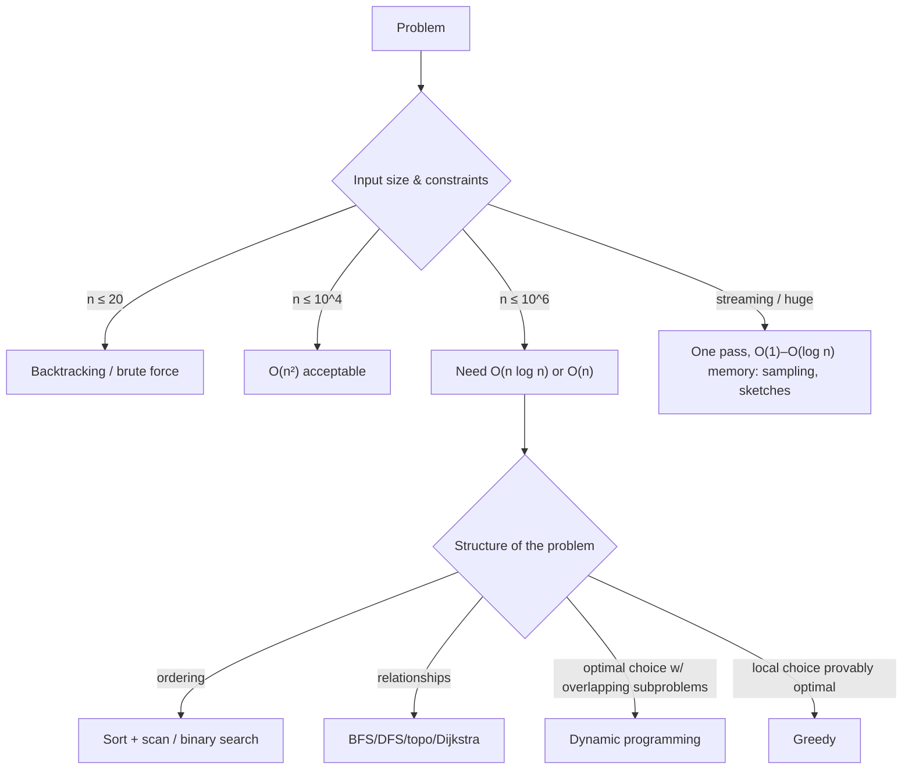

# Algorithms

> [!abstract] TL;DR
> Algorithms are step-by-step procedures with known cost ([[Big O Notation]]). Most practical problems reduce to a handful of families:
> - Sorting/searching, two pointers/sliding window, hashing.
> - BFS/DFS and shortest paths, topological sort, union-find.
> - Greedy, divide-and-conquer, dynamic programming.
> - Backoff/rate-limiting/sampling patterns in production systems.
>
> **The senior-dev skill**: recognize the pattern, pick the right [[Data Structures]], and know where the "algorithm" already lives (database planners, standard library sorts, Redis commands) so you don't reimplement it badly. Watch for **algorithmic complexity attacks** (ReDoS, hash flooding).

## Introduction
- **What**: a finite, well-defined procedure transforming input to output. It's analyzed for correctness (invariants, proofs) and cost (time, space, I/O, network round trips).
- **History**: Euclid's GCD (~300 BC), al-Khwarizmi (the name), Knuth's *The Art of Computer Programming* (1968–), and CLRS as the standard text.
- **Where it sits**: inside every library and system you use: DB query planners (join algorithms: nested loop, hash join, merge join), Git diff (Myers), routing (Dijkstra/A*), compression (LZ77/Huffman/zstd), consistent hashing in caches, HNSW in [[Vector Databases]], scheduling in queues.

## Core Concepts

### Pattern catalog
| Pattern | Typical problem | Complexity | Structure |
|---|---|---|---|
| Hashing | Dedup, two-sum, group-by, joins | O(n) | Hash map/set |
| Sorting + scan | Merge intervals, find duplicates, ranking | O(n log n) | Array |
| **Binary search** | Sorted lookup, "minimum X that satisfies…" | O(log n) | Sorted array / monotonic predicate |
| Two pointers / sliding window | Subarrays with constraints, rate windows | O(n) | Array, deque |
| BFS | Shortest path (unweighted), levels, spread | O(V + E) | Queue |
| DFS / backtracking | Cycles, components, permutations, search | O(V + E) / exponential | Stack/recursion |
| **Topological sort** | Dependency order (builds, migrations, DAG workflows) | O(V + E) | Graph + in-degree queue |
| Dijkstra / A* | Weighted shortest path, routing | O((V + E) log V) | Heap |
| Union-find | Connectivity, grouping, Kruskal MST | ~O(α(n)) per op | Disjoint sets |
| Greedy | Interval scheduling, change-making (some coin sets), Huffman | Usually O(n log n) | Sort/heap |
| Divide & conquer | Merge sort, quickselect, closest pair | O(n log n) | Recursion |
| **Dynamic programming** | Optimal substructure + overlapping subproblems: knapsack, edit distance, LCS | Polynomial in state space | Table/memo |
| Randomized / streaming | Reservoir sampling, HyperLogLog, quickselect | O(n), O(1) memory | — |

### Sorting in practice
| Runtime | Algorithm | Stable? |
|---|---|---|
| JavaScript (V8 7.0+, all modern engines) | **TimSort** | Yes (required since ES2019) |
| Python | TimSort → Powersort merge policy (3.11) | Yes |
| Java | Dual-pivot quicksort (primitives), TimSort (objects) | Objects yes |
| Go | **pdqsort** (1.19+), `slices.Sort` | `sort.Stable`/`slices.SortStableFunc` for stable |
| Rust | driftsort (stable) / ipnsort (unstable) since 1.81 | `sort` yes, `sort_unstable` no |
| PostgreSQL | Quicksort in memory, external merge sort on disk (`work_mem`) | — |

Never hand-write a sort in production. Choose the comparator and stability instead.

### Classic snippets
```ts
// Binary search on a monotonic predicate: smallest page size that fits the budget
function lowerBound(lo: number, hi: number, ok: (x: number) => boolean) {
  while (lo < hi) { const mid = (lo + hi) >>> 1; ok(mid) ? (hi = mid) : (lo = mid + 1); }
  return lo;
}

// Topological sort (Kahn): run workflow steps in dependency order, detect cycles
function topo(deps: Map<string, string[]>): string[] {
  const indeg = new Map<string, number>(), out = new Map<string, string[]>();
  for (const [n, ds] of deps) { indeg.set(n, indeg.get(n) ?? 0); for (const d of ds) {
    indeg.set(n, (indeg.get(n) ?? 0) + 1); out.set(d, [...(out.get(d) ?? []), n]); indeg.set(d, indeg.get(d) ?? 0); } }
  const q = [...indeg].filter(([, v]) => v === 0).map(([k]) => k), order: string[] = [];
  for (let i = 0; i < q.length; i++) { const n = q[i]; order.push(n);
    for (const m of out.get(n) ?? []) { indeg.set(m, indeg.get(m)! - 1); if (indeg.get(m) === 0) q.push(m); } }
  if (order.length !== indeg.size) throw new Error('cycle detected');
  return order;
}
```
```python
# DP: edit distance (fuzzy matching customer names, e.g. "Mohd" vs "Mohamad")
def edit_distance(a: str, b: str) -> int:
    prev = list(range(len(b) + 1))
    for i, ca in enumerate(a, 1):
        cur = [i]
        for j, cb in enumerate(b, 1):
            cur.append(min(prev[j] + 1, cur[j - 1] + 1, prev[j - 1] + (ca != cb)))
        prev = cur
    return prev[-1]
```

## Architecture / How It Works

- **Correctness tools**: loop invariants, induction for recursion, and property-based tests (fast-check, Hypothesis) that compare a clever implementation against a slow obvious one.
- **Constant factors and I/O** often dominate: an O(n log n) in-memory sort beats an O(n) algorithm that makes n DB round trips. In web systems, count **queries and network calls** first (N+1 is an algorithm bug).
- **Production algorithms** you'll implement more than textbook ones:
  - **Exponential backoff with jitter**: `sleep = random(0, min(cap, base·2^attempt))`.
  - **Token bucket / sliding-window rate limiting** (Redis + Lua).
  - **Keyset (cursor) pagination**: `WHERE (created_at, id) < ($1, $2) ORDER BY created_at DESC, id DESC LIMIT 50`. O(log n) per page vs OFFSET's O(n).
  - **Consistent hashing** for sharding caches ([[System Design]]).
  - **Idempotent retries** with dedup keys.

## Project Structure
N/A — a concept. When algorithmic code lives in a project, isolate it as pure functions with property-based tests:
```text
src/lib/algo/
├── scheduling.ts       # topo sort for workflow steps
├── matching.ts         # fuzzy name matching (edit distance, trigram)
├── backoff.ts          # retry with jitter
└── __tests__/*.prop.test.ts   # fast-check properties vs brute-force oracle
```

## Use Cases
| Use case | Algorithm |
|---|---|
| Run migrations/workflow steps in order | Topological sort |
| Delivery routing / nearest outlet | Dijkstra/A*, or geospatial index (PostGIS KNN) |
| Fuzzy search for Malay/Chinese names and addresses | Edit distance, trigram similarity (`pg_trgm`), phonetic keys |
| Fair scheduling / priority jobs | Heap-based priority queues |
| Dedup of leads/contacts | Hashing + normalization, union-find for merge groups |
| Recommendations / similar items | kNN / ANN ([[Vector Databases]]) |
| Rate limiting and retries | Token bucket, exponential backoff with jitter |

## Pros & Cons
| Approach | Pros | Cons |
|---|---|---|
| Use library/DB implementations | Correct, optimized, maintained | Must understand their complexity and limits |
| Hand-rolled algorithms | Tailored to the problem | Bugs, edge cases, maintenance |
| Exact algorithms | Correct answers | May be too slow at scale (NP-hard problems) |
| Approximations/heuristics | Fast, scalable | Bounded error, harder to explain to clients |

## Alternatives & Peers
| Instead of writing it… | Use | When |
|---|---|---|
| Sorting/joining/aggregating large data in app code | SQL in [[PostgreSQL]] (planner picks hash/merge joins) | Data already in the DB |
| Custom search ranking | Postgres full-text / `pg_trgm`, Meilisearch, vector search | Search features |
| Route optimization (VRP) | OR-Tools, OSRM, Google Routes API | Delivery/logistics clients |
| Graph traversals over big data | Recursive CTEs, graph DBs | Hierarchies, org charts, referrals |
| Scheduling/constraints | Constraint solvers (OR-Tools CP-SAT) | Rostering, timetables |

## Tips & Reminders
> [!tip]
> - Estimate first: n × operations per item vs ~10⁸ simple ops/second in compiled code (~10⁷ in JS/Python loops).
> - Push heavy set operations to the database. Avoid loading 100k rows into Node/n8n to filter them.
> - Make retries safe: idempotency keys + backoff with jitter + max attempts + dead-letter queue.
> - Test algorithms with randomized properties against a brute-force oracle on small inputs.
> - Interview prep (if hiring or being hired): practice patterns, not problems. Hash map, two pointers, BFS/DFS, binary search on answer, DP on prefixes, heap for top-k.
> - **In ZP's stack**: n8n Code nodes are often where accidental O(n²) loops (nested `find` across items) slow workflows. Index with a `Map`. Put dedup/joins in SQL, rate limiting in [[Redis]], and order dependent jobs with a topological sort or the queue's dependency features.

## Versions & Breaking Changes
N/A for algorithms. Runtime implementation changes worth knowing:

| Runtime | Version | Change | Impact |
|---|---|---|---|
| V8 / Node.js | 7.0 (2018) | `Array.prototype.sort` → TimSort, stable | Stable sort guaranteed (ES2019) |
| Python | 3.11 (2022) | `list.sort` uses Powersort merge policy | Fewer comparisons on structured data |
| Go | 1.19 (2022) | `sort` → pdqsort | Faster, still unstable |
| Rust | 1.81 (2024) | New sort implementations (driftsort/ipnsort) | Panics if `Ord` is inconsistent (detects bad comparators) |
| V8 | 8.8+ | Experimental linear-time regex engine (`--enable-experimental-regexp-engine`, `/l` flag) | ReDoS mitigation option |

## Critical Issues & Gotchas
> [!danger] ReDoS: catastrophic regex backtracking
> Backtracking regex engines (JS, Python, Java, PCRE) take exponential time on patterns like `(a+)+$` or `.*.*=.*` with crafted input. **Cloudflare's 2019-07-02 global outage** came from a WAF rule regex that pinned CPUs worldwide. Many npm/PyPI packages have ReDoS CVEs. Avoid nested quantifiers, limit input length, use linear-time engines (RE2, Rust `regex`, Go `regexp`) for untrusted input, and lint with tools like `safe-regex`/`recheck`.

> [!danger] Algorithmic complexity attacks
> Attackers choose worst-case inputs: hash-flooding (O(n²) inserts), deeply nested JSON (stack overflow), huge sort/pagination parameters, expensive [[GraphQL]] queries, zip bombs. Bound input size, depth and work per request, and use randomized hashing.

> [!warning] Gotchas
> - Inconsistent comparators (e.g. `(a, b) => a > b` returning booleans in JS, or non-transitive comparisons) produce wrong or engine-dependent orders.
> - Floating-point for money breaks sums and comparisons. Use integer sen/cents or decimal types.
> - Recursion depth: JS ~10k frames, Python 1000 by default. Use iterative versions for user-controlled depth.
> - OFFSET pagination gets slower with page number and skips/duplicates rows under concurrent inserts. Use keyset pagination.
> - Unicode: sorting/compare strings with `Intl.Collator`/ICU collations (e.g. Malay/Chinese names), not code-unit order. Normalize (NFC) before comparing.

## Deep Dives
- [[Algorithms - Graph Algorithms in Practice]]

Candidates: dynamic programming patterns.

## Related
- [[Data Structures]] — the structures algorithms operate on
- [[Big O Notation]] — cost analysis
- [[System Design]] — consistent hashing, rate limiting, scheduling at scale
- [[Design Patterns]] — strategy pattern for swappable algorithms
- [[PostgreSQL]] — join algorithms, sorting, keyset pagination
- [[Redis]] — rate limiting and sorted-set algorithms

## References
- CLRS, *Introduction to Algorithms* (4th ed., 2022)
- Skiena, *The Algorithm Design Manual*
- Competitive Programmer's Handbook (free): https://cses.fi/book/book.pdf
- Cloudflare 2019 outage postmortem: https://blog.cloudflare.com/details-of-the-cloudflare-outage-on-july-2-2019/
- OWASP ReDoS: https://owasp.org/www-community/attacks/Regular_expression_Denial_of_Service_-_ReDoS
- AWS: exponential backoff and jitter: https://aws.amazon.com/blogs/architecture/exponential-backoff-and-jitter/
