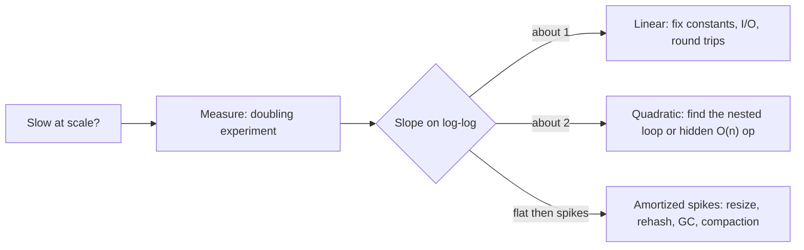

# Big O Notation - Amortized Analysis & Practical Complexity

> [!info] Deep dive of [[Big O Notation]]

> [!abstract] TL;DR
> **Amortized O(1)** means cheap *on average over a sequence*, not cheap every time. Resizes, rehashes and compactions still cause O(n) spikes, and those spikes show up as p99 latency.
> In production, the "n" that matters is usually **round trips** (N+1 queries, per-item API calls) and **memory hierarchy** (cache misses, disk, network), not CPU operations. Measure growth with a doubling experiment before arguing about notation.

## Concept
- **Worst-case per operation**: a bound on every single call. **Amortized**: a bound on the *total* cost of m operations ÷ m, guaranteed for any sequence. No probability is involved. **Average-case/expected**: depends on an input distribution or randomness, as with hashing or quicksort pivots.
- Three proof methods, all giving the same answer:

| Method | Idea | Dynamic array `push` with doubling |
|---|---|---|
| Aggregate | Sum the total cost of n ops, then divide | n pushes copy at most 1 + 2 + 4 + … + n < 2n elements. Total < 3n, so O(1) each |
| Accounting (banker's) | Overcharge cheap ops and store "credits" for expensive ones | Charge 3 per push: 1 for the write, 2 saved to pay for copying itself and one older element at the next resize |
| Potential | Φ(state) ≥ 0; amortized cost = actual + ΔΦ | Φ = 2·size − capacity; a resize's cost is cancelled by the potential drop |

- **Growth factor matters**: doubling (×2) or ×1.5 gives O(1) amortized. **Growing by a constant** (+10 slots) gives O(n) amortized, so n pushes take O(n²).
- **Shrinking**: halving the array when it is half empty causes thrashing on a push/pop/push/pop sequence at the boundary. Shrink at ¼ full to keep O(1) amortized.
- Classic amortized structures: dynamic arrays, hash tables (rehash), union–find with path compression (O(α(n)), effectively constant), splay trees, two-stack queues and LSM-tree compaction.

## How It Works

**Doubling experiment**: run with n, 2n, 4n, 8n and look at the time ratio T(2n)/T(n). A ratio of ~2 means O(n), ~2.1–2.3 means O(n log n), ~4 means O(n²) and ~8 means O(n³). It works on any black box: an API endpoint, an SQL query or an n8n workflow.

**Latency ladder** (order of magnitude, 2020s hardware):

| Operation | Time | Relative to an L1 hit |
|---|---|---|
| L1 cache hit | ~1 ns | 1× |
| Main memory (RAM) access | ~100 ns | 100× |
| NVMe SSD random read | ~20–100 µs | 10⁴–10⁵× |
| Same-datacenter round trip (app → Postgres/Redis) | ~0.2–1 ms | 10⁶× |
| KL/Kuching ↔ Singapore round trip | ~15–40 ms | 10⁷× |
| Singapore ↔ US East round trip | ~200–250 ms | 10⁸× |

One cross-region round trip costs as much as about 10⁸ in-cache operations. **O(n) network calls beat O(n²) CPU work only in textbooks.**

## Practical Usage
**Doubling harness** (TypeScript / Node):
```ts
import { performance } from 'node:perf_hooks';

function measure(fn: (n: number) => void, start = 1_000, steps = 6) {
  let prev = 0;
  for (let n = start, i = 0; i < steps; i++, n *= 2) {
    fn(n);                                    // warm-up for JIT
    const t0 = performance.now(); fn(n); const t = performance.now() - t0;
    console.log(n, t.toFixed(2), prev ? (t / prev).toFixed(2) : '-');
    prev = t;
  }
}
measure((n) => { const a: number[] = []; for (let i = 0; i < n; i++) a.unshift(i); });  // ratio ≈ 4: unshift is O(n)
measure((n) => { const a: number[] = []; for (let i = 0; i < n; i++) a.push(i); });     // ratio ≈ 2
```
**Hidden quadratics in everyday code**:
```ts
// ❌ O(n·m): includes() is a linear scan inside a loop
const missing = orders.filter((o) => !paidIds.includes(o.id));
// ✅ O(n + m)
const paid = new Set(paidIds);
const missing2 = orders.filter((o) => !paid.has(o.id));

// ❌ O(n²): spread copies the accumulator on every iteration
const byId = rows.reduce((acc, r) => ({ ...acc, [r.id]: r }), {});
// ✅ O(n)
const byId2 = Object.fromEntries(rows.map((r) => [r.id, r]));

// ❌ O(n²) for a queue: shift() reindexes the whole array
while (queue.length) handle(queue.shift()!);
```
```dart
// Dart: List.removeAt(0) is O(n); use a ListQueue for FIFO work (amortized O(1))
final q = ListQueue<Job>()..addAll(jobs);
while (q.isNotEmpty) await run(q.removeFirst());
```
**N+1 queries are O(n) round trips**:
```ts
// ❌ 1 + n round trips: 500 orders × 1 ms = 500 ms, before any SQL work
for (const o of orders) o.items = await db.from('order_items').select().eq('order_id', o.id);
// ✅ 1 round trip; Postgres does the join in-process
const { data } = await db.from('orders').select('*, order_items(*)').in('id', ids);
```
**Redis**: O(n) commands block the single main thread ([[Redis - Data Structures & Patterns]]):
```bash
redis-cli --bigkeys          # find large keys
redis-cli SCAN 0 MATCH "sess:*" COUNT 1000   # ✅ incremental, instead of KEYS sess:* (O(N), blocks)
redis-cli UNLINK big:set     # ✅ frees memory in a background thread; DEL of a 1M-member set blocks
```

## Patterns & Anti-patterns
| Pattern | When | Anti-pattern to avoid |
|---|---|---|
| Pre-size (`new Array(n)`, `List.filled`, `make([]T, 0, n)`) | Size known up front | Repeated resizes in hot loops |
| Index with `Map`/`Set` before joining in memory | Matching two lists | `find`/`includes` inside `map`/`filter` |
| Batch I/O (`IN (...)`, `MGET`, pipelines, bulk APIs) | Any per-item remote call | Awaiting a query or HTTP call inside a loop |
| Incremental / de-amortized work | Latency-sensitive paths | One giant rehash, rebuild or compaction during peak hours |
| Pagination by keyset (`WHERE id > $last`) | Deep pages | `OFFSET 100000`: O(offset) rows read and discarded |
| Doubling experiment in CI for critical paths | Regression guard | Asserting on absolute ms on noisy CI runners |

## Performance & Trade-offs
- **Amortized vs tail latency**: a hash map that doubles at 1M entries copies 1M entries during *one* request. Systems that care about this de-amortize:
  - Redis rehashes incrementally across subsequent operations.
  - Go's runtime spreads map growth over later writes.
  - Postgres autovacuum spreads cleanup over time.
- **Constants dominate at small n**: insertion sort beats merge sort below ~16–32 elements, which is why TimSort and pdqsort switch to it. A linear scan over 50 contiguous items beats a hash lookup that misses cache.
- **Space–time trade-offs**: indexes turn O(n) scans into O(log n) lookups but make writes O(k log n) for k indexes and use disk. Caches turn O(query) into O(1) at the cost of invalidation complexity.
- **Big O of the database**: the planner's `cost` is an estimate, but the shapes are real. `Seq Scan` is O(n); `Index Scan` is O(log n + k); `Nested Loop` without an inner index is O(n·m); `Hash Join` is O(n + m) plus memory (`work_mem`). See [[PostgreSQL - Query Planning & EXPLAIN]].
- **Garbage collection** is amortized memory management. Allocation-heavy O(n) code can trigger GC pauses whose cost scales with heap size, not with n.

## Tips & Reminders
> [!tip] In ZP's stack
> - n8n "Loop Over Items" with an HTTP node inside is an N+1 by design. 1,000 items × 300 ms is 5 minutes and a rate-limit ban. Use batch endpoints, `Split in Batches` with a size of about 50–100, or move the loop into one Code node calling a bulk API.
> - In Supabase, prefer embedded selects (`select('*, items(*)')`) or an RPC over per-row fetches from Flutter. Each mobile round trip from Malaysia to a Singapore region costs tens of milliseconds.

- State **which n**: rows, users, tenants, bytes or round trips. "O(n)" with an unnamed n hides the real bottleneck.
- Profile before optimising: [[Node.js - Performance & Diagnostics|Node profilers]] (`--cpu-prof`, clinic), Flutter DevTools, `EXPLAIN (ANALYZE, BUFFERS)`.
- Prefer algorithms with a good **worst case** on user-controlled input (see complexity attacks in [[Big O Notation]]).
- Write the complexity of non-obvious functions in a doc comment, especially for helpers that look O(1) but aren't (`getAllPermissions()` hitting the DB).

## Version Notes
N/A — mathematical concept. Runtime-specific costs do change. Check the language docs when relying on complexity guarantees: for example, V8's array representation switching (packed vs dictionary mode), or Python 3.11+ dict and list internals.

## Critical Issues & Gotchas
> [!danger] Amortized O(1) is not real-time safe
> A single `push` that triggers a resize, a hash-table rehash, or a GC cycle can stall for milliseconds to seconds on large structures. For WebSocket fan-out, audio or trading engines, pre-allocate or use structures with worst-case bounds.

> [!danger] Accidental O(n) in "constant" APIs
> Common traps:
> - JS `Array.prototype.shift`/`unshift`/`splice`, `Object.keys(obj).length` in loops, and string `+=` in some engines;
> - Python `list.pop(0)` and `x in list`;
> - Dart `List.removeAt(0)`;
> - Redis `KEYS`, `SMEMBERS`, `HGETALL` and `LRANGE 0 -1` on large keys;
> - SQL `COUNT(*)` on big Postgres tables (MVCC means no stored row count).
>
> Each looks innocent and becomes the incident at 100k rows.

- **Constant growth step**: custom buffers that grow by a fixed chunk (e.g. +4 KB) are O(n²) in total copying. Grow geometrically.
- **Benchmark artifacts**: JIT warm-up, GC timing and CPU frequency scaling distort small-n timings. Warm up, repeat, and look at ratios, not absolute values.
- **Big O ignores memory limits**: an O(n) algorithm that needs O(n) extra memory can OOM a 512 MB Coolify container long before it is "slow". Prefer streaming ([[Node.js]] streams, Postgres cursors) for unbounded n.

## Related
- [[Big O Notation]]
- [[Data Structures]] — operation costs, cache behaviour
- [[Algorithms]] — sorting and graph complexity in practice
- [[PostgreSQL - Query Planning & EXPLAIN]] — complexity of plan nodes
- [[Redis - Data Structures & Patterns]] — O(n) commands and big keys
- [[Node.js - Performance & Diagnostics]] — profiling hot paths

## References
- Cormen et al., *Introduction to Algorithms* (4th ed., 2022), ch. 16 "Amortized Analysis"
- https://gist.github.com/jboner/2841832 (latency numbers every programmer should know)
- https://redis.io/docs/latest/commands/ (per-command time complexity)
- https://www.postgresql.org/docs/current/using-explain.html
