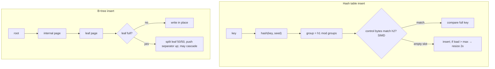

# Data Structures - Hash Tables & B-Tree Internals

> [!info] Deep dive of [[Data Structures]]

> [!abstract] TL;DR
> **Hash tables**:
> - O(1) average lookup; resizes are amortized and cause latency spikes;
> - worst case O(n) under collisions, which is why runtimes use seeded hashes (SipHash) against hash-flooding;
> - modern designs are cache-friendly open addressing (Swiss tables, compact dicts).
>
> **B+trees**:
> - wide nodes (one disk page, hundreds of keys), so height is 3–4 for millions of rows and lookups are O(log n) with ~3–4 page reads;
> - range scans are cheap thanks to linked leaves;
> - **random keys (UUIDv4)** scatter inserts and cause page splits, bloat and cache misses. Prefer time-ordered keys (UUIDv7, bigint identity).

## Concept
**Hash table design space**:

| Design | How collisions are handled | Used by |
|---|---|---|
| Separate chaining | Bucket → linked list/array of entries | Java `HashMap` (bins become trees after 8 collisions), older designs |
| Open addressing, linear probing | Next free slot. Great locality, clustering risk | Many C/C++ maps, Rust `hashbrown` variants |
| Robin Hood hashing | Probing that evens out probe lengths | Some Rust/C++ maps |
| **Swiss table** | Open addressing + SIMD scan of 16 control bytes per group | Abseil `flat_hash_map`, Rust `hashbrown` (std `HashMap`), **Go maps since 1.24** |
| Compact ordered dict | Dense entries array + sparse index table | **Python `dict`** (insertion-ordered since 3.7) |
| Deterministic hash table | Ordered entries, insertion order preserved | **JS `Map`/`Set`** (V8) |

- **Load factor** α = n / capacity. Open addressing keeps α ≲ 0.875 (Swiss tables); chaining tolerates ~0.75–1.0. Exceeding it triggers a **resize** (rehash every key), which is O(n) once but amortized O(1).
- **Hash function quality**: seeded, keyed hashes (SipHash in Python/Rust; per-process seeds in Go) stop attackers from crafting colliding keys that turn every operation into O(n) (**hash flooding** DoS).

**B+tree anatomy** (database index):

| Part | Holds | Notes |
|---|---|---|
| Root / internal pages | Separator keys + child pointers | Fanout = keys per page (8 KB Postgres page → hundreds) |
| Leaf pages | Keys + row pointers (Postgres TIDs) or full rows (InnoDB clustered index) | Doubly linked for range scans |
| Height | ⌈log_fanout(n)⌉ | Fanout 300 → 3 levels ≈ 27M keys, 4 levels ≈ 8B |

- **Postgres** B-trees are Lehman–Yao (high keys + right links for concurrency), with **deduplication** of duplicate keys (PG13+), bottom-up deletion (PG14+), and skip scan (PG18). Default leaf `fillfactor` is 90.
- **InnoDB** tables *are* B+trees clustered on the primary key. Secondary indexes store the PK, so wide or random PKs cost on every index ([[MySQL - InnoDB Internals & Tuning]]).
- **LSM trees** (RocksDB, Cassandra, ClickHouse MergeTree-like designs) trade read amplification for sequential writes via memtables + compaction. They're better for write-heavy ingestion, worse for point reads without bloom filters ([[Data Structures - Probabilistic Data Structures]]).

## How It Works

- **Sequential keys** always land in the rightmost leaf. Postgres optimizes this ("fastpath" rightmost insert), and pages fill densely.
- **Random keys** land on random leaves. Each insert touches a cold page, splits happen everywhere and pages end ~50–70% full. The index gets larger, cache hit rate drops and WAL volume rises (full-page writes after checkpoints).

## Practical Usage
**Time-ordered primary keys** (PostgreSQL 18 has a native `uuidv7()`):
```sql
create table orders (
  id uuid primary key default uuidv7(),       -- time-ordered: inserts append near the right edge
  tenant_id uuid not null,
  created_at timestamptz not null default now()
);
-- pre-18: generate UUIDv7 in the app (e.g. `uuid` npm v10+ `v7()`), or use bigint identity
```
**Inspect B-tree shape and bloat** (`pageinspect`, `pgstattuple`):
```sql
create extension if not exists pageinspect;
create extension if not exists pgstattuple;
select * from bt_metap('orders_pkey');                       -- level = tree height - 1
select avg_leaf_density, leaf_fragmentation from pgstatindex('orders_pkey');
reindex index concurrently orders_pkey;                      -- rebuild a bloated index without blocking writes
```
**Pick the right in-memory structure** (TypeScript):
```ts
const byId = new Map<string, Order>();          // ✅ insertion-ordered, any key type, O(1) avg, size property
const counts: Record<string, number> = {};      // ⚠ prototype keys ("__proto__", "constructor") and string-only keys
const seen = new Set(ids);                      // ✅ membership in O(1) instead of array.includes O(n)
```
**Hash flooding defence when you key maps by attacker input** (e.g. JSON object keys, header names): use runtime maps (seeded) and **cap input sizes**:
```ts
if (Object.keys(body).length > 1000) return problem(413, 'too_many_fields', 'Too many fields');
```
**Wrong way**:
```sql
create table events (id uuid primary key default gen_random_uuid(), …);   -- ❌ v4 random PK on a hot insert table
create index on events (lower(email));                                     -- fine; but ❌ hash index for range queries:
create index on events using hash (created_at);                            -- hash indexes only support equality
```

## Patterns & Anti-patterns
| Pattern | When | Anti-pattern to avoid |
|---|---|---|
| Time-ordered PKs (UUIDv7 / identity) | High-insert tables | UUIDv4 PKs on large, write-heavy tables |
| Pre-size maps/sets when n is known | Bulk loads | Repeated resizes in hot paths |
| `Map`/`Set` for dynamic keys in JS | Caches, indexes, dedupe | Plain objects as hash maps for user-controlled keys |
| B-tree (default) for equality + ranges + sorting | Most SQL indexes | Hash indexes "because lookups are O(1)" (rarely faster than B-tree in Postgres) |
| `fillfactor < 100` on tables with frequent updates | Enable HOT updates | Default 100 on update-heavy tables, so every update touches indexes |
| Periodic `REINDEX CONCURRENTLY` for bloated indexes | After mass deletes / random inserts | Letting index size grow 3–5× the data |

## Performance & Trade-offs
- **Cache locality dominates**: open-addressing tables (contiguous memory) beat pointer-chasing chains by large factors on modern CPUs. Swiss tables add SIMD probing of 16 slots at once.
- **Memory overhead**: hash tables need empty slots (load-factor headroom) plus metadata. A Python `dict` is roughly 50–100 bytes per entry for small entries. For millions of small items, consider arrays, sorted structures or compact encodings (Redis listpacks for small hashes).
- **Resize spikes**: a map doubling from 8M to 16M slots copies everything once. Latency-sensitive systems rehash incrementally (Redis) or pre-allocate ([[Big O Notation - Amortized Analysis & Practical Complexity]]).
- **B-tree vs LSM**: B-trees give predictable reads and updates in place, with write amplification from page writes. LSMs give fast ingestion with compaction debt and read amplification. Postgres and InnoDB are B-tree; for append-only analytics use columnar/LSM stores (ClickHouse).
- **Index width**: every extra or wide column in an index lowers fanout and grows height. Use `INCLUDE` columns for covering only where queries need them ([[PostgreSQL - Indexing]]).

## Tips & Reminders
> [!tip] In ZP's stack
> - **New Supabase/Postgres tables**: `id uuid default uuidv7()` on PG18 (or app-generated v7 for earlier versions); bigint identity for internal high-volume tables (events, logs).
> - **Redis**: small hashes/zsets stay in compact encodings (listpack) under the `*-max-listpack-entries` thresholds, so keep per-key collections small for memory efficiency ([[Redis - Data Structures & Patterns]]).

- Check index health quarterly on big tables: `pgstatindex` density < ~60% means a rebuild is worth it.
- In Go 1.24+, map iteration order is still randomized and there's no stable order. Sort keys when output must be deterministic.
- Never rely on JS object key order for numeric-like keys: integer-like keys are ordered numerically before string keys.
- For counting/top-k over huge streams, approximate structures (Count-Min, HyperLogLog) beat exact hash maps in memory ([[Data Structures - Probabilistic Data Structures]]).

## Version Notes
| Runtime / DB | Change relevant here |
|---|---|
| Python 3.6 / 3.7 | Compact dict (CPython detail in 3.6), insertion order guaranteed by the language in 3.7 |
| Java 8 | `HashMap` treeifies long bins (red-black trees), so worst case becomes O(log n) |
| Go 1.24 (2025-02) | Built-in maps reimplemented as **Swiss tables**: faster lookups, lower memory |
| PostgreSQL 10 | Hash indexes WAL-logged (crash-safe) |
| PostgreSQL 13–14 | B-tree deduplication, bottom-up index deletion |
| PostgreSQL 18 (2025-09) | B-tree skip scan. Native `uuidv7()` |

## Critical Issues & Gotchas
> [!danger] Hash-flooding DoS
> Unseeded or weak hashes let attackers send thousands of colliding keys (JSON fields, query params, headers), making each insert O(n) and pinning CPU (the 2011 multi-language disclosure). Modern runtimes seed by default. Don't replace them with a custom fast non-keyed hash on untrusted input, and cap key counts and payload sizes.

> [!danger] Random UUID primary keys at scale
> UUIDv4 PKs on tens of millions of rows inflate index size, shrink buffer-cache hit rates and multiply WAL (full-page images after each checkpoint touch more pages). The symptom is "inserts got slow as the table grew". Migrate hot tables to time-ordered keys, or add a sequential surrogate for clustering.

- **Hash iteration order** is an implementation detail in most languages (Go randomizes it on purpose). Tests that depend on it are flaky.
- **Mutable keys** in hash structures (objects whose hash/equality changes after insert) become unfindable.
- **B-tree page splits under concurrency** cause write contention on hot ranges (e.g. all tenants inserting into the same rightmost page with a global sequence). It's rarely a problem below thousands of inserts per second; partition or shard keys above that.
- **Index-only scans need the visibility map**: without regular vacuum, "covering" B-tree indexes still hit the heap.

## Related
- [[Data Structures]]
- [[Big O Notation - Amortized Analysis & Practical Complexity]] — amortized resizes, cache effects
- [[PostgreSQL - Indexing]] — B-tree, GIN, BRIN, HNSW in Postgres
- [[MySQL - InnoDB Internals & Tuning]] — clustered B+tree tables
- [[Redis - Data Structures & Patterns]] — incremental rehash, listpack encodings
- [[Data Structures - Probabilistic Data Structures]] — bloom filters for LSM reads, sketches

## References
- Cormen et al., *Introduction to Algorithms* (4th ed.), ch. 11 (hash tables) and ch. 18 (B-trees)
- https://abseil.io/about/design/swisstables
- https://go.dev/blog/swisstable
- https://www.postgresql.org/docs/current/btree.html
- https://www.postgresql.org/docs/18/functions-uuid.html
