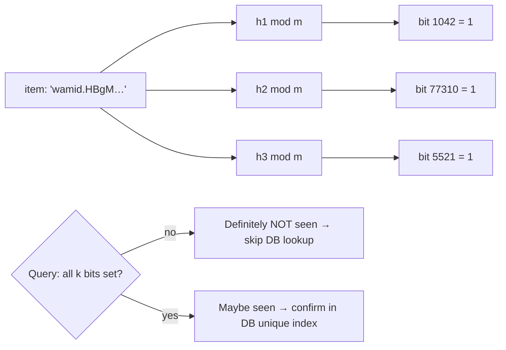

# Data Structures - Probabilistic Data Structures

> [!info] Deep dive of [[Data Structures]]

> [!abstract] TL;DR
> Probabilistic structures (**sketches**) answer questions approximately, in **fixed, tiny memory** and O(1)-ish time:
> - **Bloom/Cuckoo filters**: "is X in the set?" (false positives, never false negatives)
> - **HyperLogLog**: "how many distinct?" (~0.81% error in 12 KB)
> - **Count-Min Sketch / Top-K**: "how often / who's heaviest?"
> - **t-digest**: percentiles
> - **MinHash**: "how similar?"
>
> Use them when exact answers are too expensive and a bounded error is acceptable. They're **mergeable**, which makes them ideal for distributed counting.

## Concept

### Which sketch for which question
| Question | Structure | Error type | Memory | Deletes | Mergeable |
|---|---|---|---|---|---|
| Membership: "seen this ID?" | **Bloom filter** | False positives (tunable p) | ~9.6 bits/item at 1% | ❌ (Counting Bloom: ✅) | ✅ (OR, same params) |
| Membership with deletes | **Cuckoo filter** | False positives | ~similar to Bloom at low p | ✅ | ⚠️ limited |
| Distinct count (cardinality) | **HyperLogLog** | ±1.04/√m relative (Redis: 0.81%) | 12 KB (Redis dense) | ❌ | ✅ (max of registers) |
| Frequency of item | **Count-Min Sketch** | Overestimates by ≤ εN with prob 1−δ | width × depth counters | ⚠️ (only if counts stay ≥ 0) | ✅ (sum) |
| Heaviest hitters | **Top-K** (HeavyKeeper / Space-Saving) | Approximate ranks | k entries + sketch | ❌ | ⚠️ |
| Quantiles (p50/p95/p99) | **t-digest** / KLL | Small rank error, best at tails | KBs | ❌ | ✅ |
| Set similarity (Jaccard) | **MinHash** (+ LSH for search) | ±1/√k | k hashes per set | — | ✅ |

### Bloom filter math
- **Bits needed**: `m = −n · ln(p) / (ln 2)²`, with optimal hash count `k = (m/n) · ln 2`.
- **Worked numbers**: 10M items at 1% FP need ≈ 95.9 Mbit ≈ **12 MB** with k ≈ 7. At 0.1% that's ≈ 18 MB with k ≈ 10.
- **Overfilling**: once more than n items are inserted, the FP rate rises fast. Scalable Bloom filters add layers as they fill.

### HyperLogLog intuition
- **Mechanism**: hash each item, use the first bits to pick one of m registers, and record the max run of leading zeros. Rare long runs imply many distinct items.
- **Estimate**: a harmonic mean across registers with bias correction. Redis uses m = 16,384 registers, 6 bits each (12 KB dense), with a sparse encoding for small sets.

## How It Works

- Filters are a **fast negative check in front of the source of truth**: most lookups for new items are answered with "not seen" without touching the database. Positives still go to the DB, because false positives must never cause data loss.
- Sketches **merge**: per-shard or per-day HLLs/CMSs can be combined (`PFMERGE`, summing CMS counters) without the raw data, which is useful for analytics across tenants/time windows.

## Practical Usage

### Redis / Valkey commands
```bash
# HyperLogLog: unique WhatsApp senders per tenant per day (core Redis/Valkey)
PFADD uniq:t42:2026-10-20 "+60123456789" "+60198765432"
PFCOUNT uniq:t42:2026-10-20
PFMERGE uniq:t42:2026-10 uniq:t42:2026-10-01 uniq:t42:2026-10-02   # month = merge of days

# Bloom filter: dedupe front for webhook event IDs (Redis 8 built-in; Valkey via valkey-bloom module)
BF.RESERVE seen:wa 0.001 10000000          # p = 0.1%, capacity 10M
BF.ADD seen:wa "wamid.HBgM..."
BF.EXISTS seen:wa "wamid.HBgM..."          # 0 = definitely new, 1 = maybe seen

# Count-Min + Top-K (Redis 8): heavy-hitter API keys / abusive senders
CMS.INITBYPROB rate:cms 0.001 0.01         # ε = 0.1% of total, δ = 1%
CMS.INCRBY rate:cms key_abc 1
TOPK.RESERVE abusers 20
TOPK.ADD abusers "+60111111111"
TOPK.LIST abusers WITHCOUNT
```

### Minimal Bloom filter (TypeScript, for in-process use)
```ts
import { createHash } from "node:crypto";

export class Bloom {
  private bits: Uint8Array; readonly m: number; readonly k: number;
  constructor(n: number, p: number) {
    this.m = Math.ceil((-n * Math.log(p)) / Math.LN2 ** 2);
    this.k = Math.max(1, Math.round((this.m / n) * Math.LN2));
    this.bits = new Uint8Array(Math.ceil(this.m / 8));
  }
  private idx(item: string): number[] {                      // double hashing: h1 + i*h2
    const d = createHash("sha256").update(item).digest();
    const h1 = d.readUInt32BE(0), h2 = d.readUInt32BE(4) | 1;
    return Array.from({ length: this.k }, (_, i) => (h1 + i * h2) % this.m);
  }
  add(item: string) { for (const i of this.idx(item)) this.bits[i >> 3] |= 1 << (i & 7); }
  mightContain(item: string) { return this.idx(item).every((i) => (this.bits[i >> 3] & (1 << (i & 7))) !== 0); }
}
// 1M items at 1% ≈ 1.2 MB vs ~60+ MB for a Set<string> of 32-char IDs
```

### Postgres options
```sql
-- Approximate distinct counts with the postgresql-hll extension (Citus): rollups per day/tenant
create extension if not exists hll;
create table daily_uniques (tenant_id uuid, day date, users hll, primary key (tenant_id, day));
insert into daily_uniques select tenant_id, date(created_at), hll_add_agg(hll_hash_text(phone))
from messages group by 1, 2;
select hll_cardinality(hll_union_agg(users)) from daily_uniques where tenant_id = $1 and day >= now() - interval '30 days';
-- contrib "bloom" index: multi-column equality filters on wide tables (different use case: index type)
```

### Near-duplicate detection for RAG ingestion (MinHash)
- Shingle each chunk (5-word windows), compute 128 MinHash values, and bucket with LSH (e.g. 32 bands × 4 rows). Chunks sharing a bucket are candidates, so verify Jaccard > 0.8 and drop duplicates.
- Duplicate chunks waste embedding cost and crowd retrieval results ([[RAG]]).

## Patterns & Anti-patterns
| Pattern | When | Anti-pattern to avoid |
|---|---|---|
| Bloom as a negative cache in front of DB/disk | Dedupe checks, "username taken?" pre-checks, LSM-tree reads | Treating a Bloom positive as truth (drops legit items on false positives) |
| HLL per time bucket + merge | Unique users/devices/senders | `SADD` every ID into giant Redis sets for counting |
| CMS/Top-K for heavy hitters | Abuse detection, hot keys | Exact per-key counters for millions of keys in Redis |
| t-digest/HDR histograms for latency percentiles | Monitoring | Averaging averages (mean of per-node p95s is wrong) |
| Size sketches from expected n and target error | Always | Default params, then silent error growth when n is 10× larger |
| Keep the exact source of truth for money/legal data | Billing, compliance | Billing customers from HLL counts |

## Performance & Trade-offs
- **Memory vs error**: Bloom error halves roughly with each extra ~1.44 bits per item. HLL error falls with √registers (4× memory → 2× accuracy).
- **Hash quality matters**: use well-distributed non-cryptographic hashes (xxHash, Murmur3) for speed. SHA-256 in the example is simple but slower.
- **Mergeability requires identical parameters**: the same m, k and hash seeds for Bloom, and the same precision for HLL. Plan parameters upfront, because resizing means rebuilding.
- **Redis 8 vs Valkey**: Redis 8 ships Bloom/Cuckoo/CMS/Top-K/t-digest built in. Valkey core has HLL, and Bloom comes via the `valkey-bloom` module (other sketches may need app-side libraries) ([[Valkey]]).

## Tips & Reminders
> [!tip]
> - **Document the error budget** next to every sketch ("uniques ±1%"), and show it in dashboards so clients don't treat estimates as exact.
> - **Expire time-bucketed sketches** (`EXPIRE` daily HLL keys after 90 days) to bound memory.
> - **For privacy**, HLL stores no raw IDs (only register values), which makes it useful for PDPA-friendly analytics. Bloom filters can still leak membership to someone who can query them.
> - **In ZP's stack**:
>   - **Counting**: HLL per tenant/day for unique WhatsApp contacts in dashboards.
>   - **Dedupe**: a Bloom front for message-ID dedupe, before the Postgres unique constraint, at very high volume.
>   - **Abuse**: Top-K for abusive senders in rate limiting ([[Redis - Data Structures & Patterns]]).

## Version Notes
N/A: algorithms are stable. Tooling notes:
- **Redis 8 (2025)**: probabilistic types merged into core (previously RedisBloom module).
- **Valkey**: `valkey-bloom` module (2025), shipped in `valkey-bundle`.
- **Postgres**: `postgresql-hll` (Citus) is widely available on managed providers. Check whether your Supabase plan or extension list includes it.

## Critical Issues & Gotchas
> [!danger] False positives treated as facts
> - **The failure**: a Bloom "maybe seen" used to **skip processing** silently drops a fraction p of genuinely new events (orders, payments, messages). At 0.1% and 1M events/day, that's 1,000 lost events.
> - **Fix**: always confirm positives against the source of truth (DB unique index), and use the filter only to short-circuit negatives.

> [!danger] Wrong sizing makes error explode
> A Bloom filter sized for 1M items but holding 10M has a FP rate approaching 100%. HLL is robust, but a CMS sized for small totals overestimates wildly as N grows. Monitor fill ratio (`BF.INFO`) and plan capacity with headroom, or use scalable variants.

> [!warning] Gotchas
> - Counting Bloom filters overflow small counters. Deleting items never inserted corrupts them.
> - HLL counts are approximate even for small sets in some implementations. Redis uses sparse encoding for small cardinalities, but don't expect exact counts.
> - Cross-language sketches need identical hashing (seed, byte encoding of strings) to merge or query consistently.
> - Adversaries can craft inputs to pollute Bloom filters (pre-image flooding) if hashes are predictable. Use keyed/seeded hashes for public-facing filters.

## Related
- [[Data Structures]]
- [[Redis]] — built-in HLL, Redis 8 probabilistic types
- [[Redis - Data Structures & Patterns]] — rate limiting, counting patterns
- [[Valkey]] — `valkey-bloom` module
- [[Algorithms]] — hashing, LSH, streaming algorithms
- [[RAG]] — near-duplicate chunk detection

## References
- Bloom, "Space/Time Trade-offs in Hash Coding" (1970): https://dl.acm.org/doi/10.1145/362686.362692
- Flajolet et al., "HyperLogLog" (2007): https://algo.inria.fr/flajolet/Publications/FlFuGaMe07.pdf
- Cormode & Muthukrishnan, Count-Min Sketch (2005): http://dimacs.rutgers.edu/~graham/pubs/papers/cm-full.pdf
- Redis probabilistic data types: https://redis.io/docs/latest/develop/data-types/probabilistic/
- Bloom filter calculator: https://hur.st/bloomfilter/
