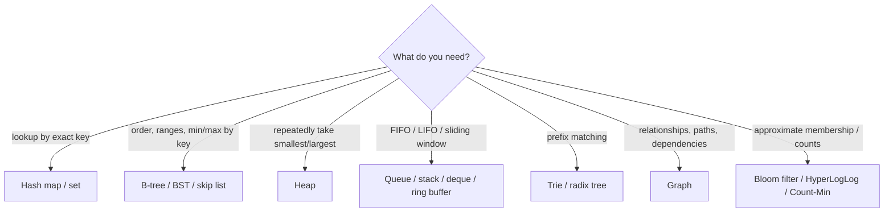

# Data Structures

> [!abstract] TL;DR
> A data structure is a way to organize data so the operations you need are cheap. Picking one is always a trade-off between **access pattern, memory layout and cost of updates** (see [[Big O Notation]]).
> - **Everyday 95%**: dynamic arrays, hash maps/sets, sorted structures (B-trees, balanced BSTs, skip lists), heaps/priority queues, queues/deques, graphs and tries.
> - **Systems you use already embody these**: [[PostgreSQL - Indexing|Postgres B-trees]], [[Redis - Data Structures & Patterns|Redis sorted sets]] (skip lists), Kafka logs (append-only arrays), and LSM trees in NoSQL stores.
> - **Choose by the operation**: lookup by key → hash map; ordered/range queries → B-tree/sorted set; "next best" → heap; relationships → graph.

## Introduction
- **What**: abstract data types (ADT: the interface, e.g. "map", "queue") vs concrete implementations (hash table, red-black tree, ring buffer).
- **Why it matters for a senior dev**: most performance bugs are the wrong structure (an `Array.includes` inside a loop = O(n²), an unindexed DB column = sequential scans), and most database/caching choices are data-structure choices in disguise.
- **Where it sits**: language collections (JS `Map`/`Set`, Python `dict`/`deque`/`heapq`, Go maps/slices, Java Collections), databases (B-trees, LSM trees, inverted indexes, HNSW graphs in [[Vector Databases]]), caches and queues ([[Redis]], [[Kafka]]).

## Core Concepts

### Cheat sheet
| Structure | Access | Search | Insert | Delete | Notes |
|---|---|---|---|---|---|
| Dynamic array (JS Array, Python list, Go slice, `ArrayList`) | O(1) | O(n) | O(1) amortized at end, O(n) middle | O(n) | Cache-friendly. Default choice |
| Linked list | O(n) | O(n) | O(1) at known node | O(1) at known node | Poor cache locality. Rarely the right answer outside LRU internals |
| **Hash map / set** | — | O(1) avg, O(n) worst | O(1) avg | O(1) avg | No order (or insertion order in JS/Python). Hash-flooding attacks |
| Balanced BST (red-black, AVL) | — | O(log n) | O(log n) | O(log n) | Ordered iteration, range queries (`TreeMap`, C++ `std::map`) |
| **B-tree / B+tree** | — | O(log n) | O(log n) | O(log n) | Wide nodes = few disk/page reads. DB indexes, filesystems |
| Skip list | — | O(log n) expected | O(log n) | O(log n) | Probabilistic, simple concurrency. Redis ZSET |
| **Binary heap** | min/max O(1) | O(n) | O(log n) | pop O(log n) | Priority queues, scheduling, top-k, Dijkstra |
| Stack / queue / deque / ring buffer | O(1) ends | O(n) | O(1) | O(1) | BFS, undo stacks, bounded buffers |
| Trie / radix tree | — | O(key length) | O(key length) | O(key length) | Autocomplete, routing tables, HTTP routers |
| Graph (adjacency list/matrix) | — | traversal O(V+E) | O(1) | O(deg) | Relationships, dependencies, networks |
| Bloom filter | — | O(k), false positives | O(k) | — (counting variant) | "Definitely not / maybe" membership with tiny memory |
| LSM tree | — | O(log n) + levels | O(1) amortized (memtable) | tombstone | Write-optimized storage (RocksDB, Cassandra) |

### Choosing in practice
```ts
// O(n·m) → O(n + m): convert the lookup side to a Set/Map
const paidIds = new Set(payments.map(p => p.orderId));
const unpaid = orders.filter(o => !paidIds.has(o.id));

// Group by key with a Map (preserves insertion order, any key type)
const byTenant = new Map<string, Order[]>();
for (const o of orders) (byTenant.get(o.tenantId) ?? byTenant.set(o.tenantId, []).get(o.tenantId)!).push(o);
```
```python
import heapq
from collections import deque, defaultdict, Counter
top5 = heapq.nlargest(5, products, key=lambda p: p.sales)    # heap: O(n log k)
window = deque(maxlen=100)                                     # ring buffer for a sliding window
graph = defaultdict(list)                                      # adjacency list
hot = Counter(e.sku for e in events).most_common(10)           # hash map counting
```

### Composite structure: bounded LRU cache
```ts
// Map preserves insertion order → O(1) LRU without a hand-written linked list
class LRU<K, V> {
  private m = new Map<K, V>();
  constructor(private max: number) {}
  get(k: K) {
    const v = this.m.get(k);
    if (v !== undefined) { this.m.delete(k); this.m.set(k, v); }   // move to most-recent
    return v;
  }
  set(k: K, v: V) {
    this.m.delete(k); this.m.set(k, v);
    if (this.m.size > this.max) this.m.delete(this.m.keys().next().value!);   // evict least-recent
  }
}
```

### Graph representations
| Representation | Memory | Edge check | Iterate neighbours | Use when |
|---|---|---|---|---|
| Adjacency list (`Map<node, node[]>`) | O(V + E) | O(deg) | O(deg) | Sparse graphs (almost all real ones) |
| Adjacency matrix | O(V²) | O(1) | O(V) | Small dense graphs |
| Edge list / table (`edges(from, to)`) | O(E) | Needs index | Needs index | Stored in [[PostgreSQL]] with recursive CTEs |

## Architecture / How It Works

- **Memory layout dominates real performance**: contiguous arrays exploit CPU caches and prefetching. Pointer-chasing structures (linked lists, naive trees) cause cache misses. B-trees and modern hash tables (open addressing, Swiss tables) are designed around cache lines and pages.
- **Hash tables**: hash → bucket. Collisions are handled by chaining or open addressing (linear/quadratic probing, Robin Hood, Swiss tables with SIMD metadata). The table resizes when the load factor exceeds a threshold (~0.75–0.875), so occasional O(n) rehash but O(1) amortized.
- **B+trees**: high fan-out (hundreds of keys per page), so a billion rows need ~3–4 levels. Leaves are linked for range scans. That's why `WHERE created_at BETWEEN …` and `ORDER BY … LIMIT` are fast with the right index ([[PostgreSQL - Indexing]]).
- **Persistent/immutable structures** (structural sharing: HAMTs in Clojure/Immutable.js, Dart's immutable collections) give cheap copies for state management (React/Flutter state, undo).
- **Probabilistic structures** trade exactness for memory: Bloom filters (Cassandra/RocksDB skip disk reads), HyperLogLog (Redis `PFCOUNT`: ~12 KB for unique counts with 0.81% error), Count-Min sketch (heavy hitters).

## Project Structure
N/A — a concept, not a codebase. Use the standard library collections first:

| Need | TypeScript | Python | Go | Dart |
|---|---|---|---|---|
| Dynamic array | `Array` | `list` | slice | `List` |
| Hash map / set | `Map` / `Set` | `dict` / `set` | `map` | `Map` / `Set` (LinkedHashMap) |
| Ordered map | (lib: `sorted-btree`) | `sortedcontainers` | (lib: `btree`) | `SplayTreeMap` |
| Heap | (lib or hand-rolled) | `heapq` | `container/heap` | `PriorityQueue` (package:collection) |
| Deque | (array, lib) | `collections.deque` | slice / `container/list` | `Queue` (dart:collection) |

## Use Cases
| Use case | Structure | Why it fits |
|---|---|---|
| Dedup, membership checks, joins in memory | Hash set/map | O(1) lookups |
| Leaderboards, rate-limit windows, time-ordered jobs | Sorted set (skip list) / heap | Ordered access + fast updates |
| Autocomplete (product names, MY addresses) | Trie / prefix index | Prefix queries |
| Task scheduling, Dijkstra, top-k | Heap | Efficient extract-min/max |
| Workflow dependencies (n8n-like DAGs, build steps) | Graph + topological sort | Ordering with dependencies |
| Event logs, chat history, streams | Append-only log / ring buffer | Sequential writes, bounded memory |
| Unique visitors at scale | HyperLogLog | Fixed tiny memory |

## Pros & Cons
| Structure family | Pros | Cons |
|---|---|---|
| Arrays | Cache-friendly, simple, O(1) index | Middle inserts/deletes O(n) |
| Hash-based | O(1) average operations | No ordering/ranges. Worst-case O(n). Memory overhead |
| Tree-based | Ordered, ranges, predictable O(log n) | Slower constants than hashing. Complex balancing |
| Heaps | Cheap min/max | Only the top is accessible efficiently |
| Graphs | Model arbitrary relationships | Traversals can explode. Storage choice matters |
| Probabilistic | Huge memory savings | Approximate answers, false positives |

## Alternatives & Peers
| Approach | Strength | Weakness | Pick it when… |
|---|---|---|---|
| Push the structure into the database ([[PostgreSQL]] indexes, [[Redis]] types) | Durable, shared, battle-tested | Network hop | Data shared across processes/instances |
| In-process structures | Fastest, simplest | Lost on restart, per-instance | Request-scoped or cache data |
| Specialized engines (search, graph, vector DBs) | Optimized for one access pattern | Extra system to run | Access pattern dominates the product ([[Vector Databases]], [[NoSQL]]) |

## Tips & Reminders
> [!tip]
> - Default to arrays + hash maps. Reach for trees/heaps when you need order or priority. Measure before getting clever.
> - In loops, look for hidden O(n) calls (`includes`, `indexOf`, `find`, `in` on a list, `Array.shift()`). Hoist lookups into a `Set`/`Map`.
> - Objects as maps in JS: prefer `Map` for dynamic keys (no prototype keys, any key type, insertion order, size property).
> - Know your database's structures: B-tree for equality/range, GIN for JSONB/arrays/full-text, BRIN for huge append-only time series, HNSW for vectors.
> - **In ZP's stack**: [[Redis]] sorted sets for rate limits/leaderboards, Redis sets/HyperLogLog for unique counts, Postgres B-tree/GIN indexes for queries, and Map/Set in Node/Dart for in-memory joins inside [[n8n]] Code nodes (n8n item arrays can be large).

## Versions & Breaking Changes
N/A for the concepts themselves. Notable runtime implementation changes that affect behaviour:

| Runtime | Version | Change | Impact |
|---|---|---|---|
| Python | 3.6 / 3.7 | `dict` compact layout. Insertion order guaranteed (3.7) | Ordered dicts by default |
| Java | 8 (2014) | `HashMap` buckets treeify to red-black trees after 8 collisions | Worst case O(log n) instead of O(n) (hash-flooding mitigation) |
| JavaScript | ES2015 | `Map`/`Set`/`WeakMap` with insertion order | Prefer over plain objects for dynamic keys |
| Go | 1.24 (2025-02) | Built-in `map` reimplemented as **Swiss tables** | Faster lookups/inserts, lower memory |
| Rust | 1.36 (2019) | `HashMap` switched to hashbrown (Swiss table) | Faster std hash maps |
| Redis | 7.x / 8 | Listpack encodings replace ziplists | Memory/latency improvements for small collections |

## Critical Issues & Gotchas
> [!danger] Hash-flooding denial of service
> If attackers control keys and the hash function is predictable, they can force all keys into one bucket, so every operation becomes O(n) (2011 "HashDoS" against PHP, Java, Python, Ruby, Node). Runtimes now use randomized/seeded hashing (SipHash) and treeified buckets, but custom hash tables, request parsers, or JSON objects with millions of keys can still be abused. Limit input sizes (body size, number of keys/params).

> [!danger] Unbounded in-memory structures
> Caches, maps of sessions, or arrays of events without eviction grow until the process is OOM-killed (common in long-running Node services and n8n workflows holding large item arrays). Use bounded structures (LRU with max size, ring buffers) or move state to [[Redis]] with TTLs.

> [!warning] Gotchas
> - JS `Array.shift()` is O(n). Use an index pointer or a proper deque for queues.
> - Floating-point or mutable objects as hash keys break lookups (mutated keys land in the wrong bucket). Use immutable keys or IDs.
> - Iterating a hash map while mutating it is undefined, an error, or skips items depending on language.
> - Recursion on deep trees/graphs overflows the stack. Use explicit stacks for user-controlled depth (nested JSON, comment threads).
> - "O(1)" hash operations still cost hashing + cache misses. Small arrays (< ~16 items) are often faster than maps.

## Deep Dives
- [[Data Structures - Probabilistic Data Structures]]

Candidates: hash tables & B-trees internals.

## Related
- [[Big O Notation]] — cost model for every operation
- [[Big O Notation - Amortized Analysis & Practical Complexity]] — amortized costs, hidden O(n) operations
- [[Algorithms]] — algorithms operating on these structures
- [[Redis - Data Structures & Patterns]] — structures as a service
- [[PostgreSQL - Indexing]] — B-tree, GIN, BRIN, HNSW in practice
- [[System Design]] — choosing storage structures at scale
- [[Vector Databases]] — HNSW graphs, IVF lists

## References
- Introduction to Algorithms (CLRS), Part III–V
- Open Data Structures (free): https://opendatastructures.org/
- Go Swiss tables (Go 1.24 blog): https://go.dev/blog/swisstable
- Abseil Swiss tables design: https://abseil.io/about/design/swisstables
- Visualgo (visualizations): https://visualgo.net/
- Redis data types: https://redis.io/docs/latest/develop/data-types/
