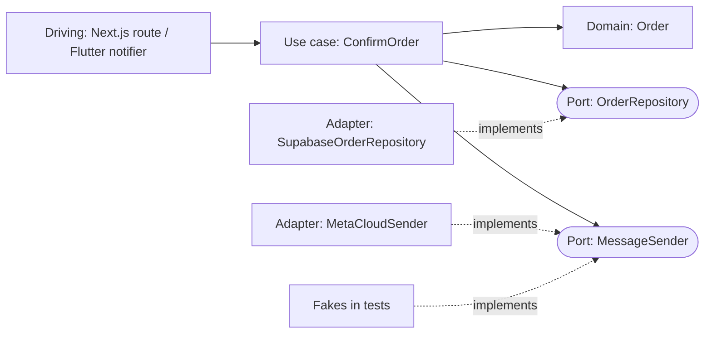

# Design Patterns - Hexagonal Architecture in TypeScript & Dart

> [!info] Deep dive of [[Design Patterns]]

> [!abstract] TL;DR
> The domain and use cases own **ports**: interfaces they need, such as `OrderRepository` and `MessageSender`. Infrastructure provides **adapters**: Supabase, Meta Cloud API, HTTP. One **composition root** wires them together.
> The payoff is swapping vendors and fast tests with fakes. The cost is indirection. Apply it to the 20% of code with real business rules and third-party churn, not to CRUD screens.

## Concept
- **Dependency rule**: source dependencies point inward. `domain ← application ← adapters ← composition root`. The domain imports nothing from frameworks, SDKs or generated DB types.
- **Driving (primary) adapters** call into the app: Next.js route handlers, server actions, Flutter widgets/notifiers, n8n webhooks, CLI. **Driven (secondary) adapters** are called by the app: DB, payment gateway, WhatsApp, email, clock, ID generator.
- **Ports are shaped by the use case, not by the vendor.** Write `MessageSender.sendTemplate(to, template, vars)`, not `MetaGraphClient.postMessages(body)`. That is the whole point: the interface survives a vendor switch.
- Hexagonal (Cockburn, 2005), onion and clean architecture are the same idea with different layer names. Don't argue about naming. Enforce the dependency direction.

| Layer | Contains | May import |
|---|---|---|
| `domain` | Entities, value objects, domain errors, pure rules | Nothing (std lib only) |
| `application` | Use cases, port interfaces | `domain` |
| `adapters` | Supabase repos, Meta API client, HTTP controllers | `application`, `domain`, SDKs |
| `main` / composition root | Wiring, config, env | Everything |

## How It Works

1. The driving adapter parses input (Zod / `fromJson`), then calls the use case with plain domain types.
2. The use case loads aggregates via a port, runs domain rules, persists, and emits side effects via ports.
3. The adapter maps domain types to and from vendor or DB shapes. **Mapping lives only in adapters.**

## Practical Usage
**TypeScript**: domain and port, no imports from Supabase or Next.
```ts
// domain/order.ts
export type OrderId = string & { readonly __brand: 'OrderId' };
export class Order {
  private constructor(readonly id: OrderId, readonly phone: string, private _status: 'pending' | 'confirmed') {}
  static rehydrate(p: { id: OrderId; phone: string; status: 'pending' | 'confirmed' }) {
    return new Order(p.id, p.phone, p.status);
  }
  get status() { return this._status; }
  confirm() {
    if (this._status !== 'pending') throw new OrderAlreadyConfirmed(this.id);
    this._status = 'confirmed';
  }
}

// application/ports.ts
export interface OrderRepository { byId(id: OrderId): Promise<Order | null>; save(o: Order): Promise<void>; }
export interface MessageSender { sendTemplate(to: string, template: string, vars: string[]): Promise<void>; }

// application/confirm-order.ts
export const confirmOrder = (deps: { orders: OrderRepository; messages: MessageSender }) =>
  async (id: OrderId) => {
    const order = await deps.orders.byId(id);
    if (!order) throw new OrderNotFound(id);
    order.confirm();
    await deps.orders.save(order);
    await deps.messages.sendTemplate(order.phone, 'order_confirmed', [order.id]);
  };
```
**Adapter + composition root** (Next.js, server-only):
```ts
// adapters/supabase-order-repository.ts
import 'server-only';
export const supabaseOrderRepository = (db: SupabaseClient<Database>): OrderRepository => ({
  async byId(id) {
    const { data, error } = await db.from('orders').select('id, phone, status').eq('id', id).maybeSingle();
    if (error) throw error;
    return data ? Order.rehydrate({ ...data, id: data.id as OrderId }) : null;   // map row → domain
  },
  async save(o) {
    const { error } = await db.from('orders').update({ status: o.status }).eq('id', o.id);
    if (error) throw error;
  },
});

// app/api/orders/[id]/confirm/route.ts — composition root for this request
export async function POST(_: Request, { params }: { params: Promise<{ id: string }> }) {
  const { id } = await params;
  const run = confirmOrder({ orders: supabaseOrderRepository(await createServerClient()), messages: metaCloudSender(env.META_TOKEN) });
  await run(id as OrderId);
  return Response.json({ ok: true });
}
```
**Dart / Flutter**: Dart 3 `abstract interface class` for ports, Riverpod as the composition root.
```dart
// domain + application: pure Dart package, no package:flutter imports
abstract interface class OrderRepository {
  Future<Order?> byId(OrderId id);
  Future<void> save(Order order);
}

final class ConfirmOrder {
  const ConfirmOrder(this._orders, this._api);
  final OrderRepository _orders;
  final OrdersApi _api;                       // port to your backend, not to Meta directly
  Future<void> call(OrderId id) async {
    final order = await _orders.byId(id) ?? (throw OrderNotFound(id));
    await _orders.save(order.confirm());     // immutable: confirm() returns a copy
    await _api.notifyConfirmed(id);
  }
}

// composition root (app layer)
final orderRepoProvider = Provider<OrderRepository>((ref) => SupabaseOrderRepository(Supabase.instance.client));
final confirmOrderProvider = Provider((ref) => ConfirmOrder(ref.watch(orderRepoProvider), ref.watch(ordersApiProvider)));
```
```dart
// test: override the port, no network
final container = ProviderContainer(overrides: [orderRepoProvider.overrideWithValue(InMemoryOrderRepository())]);
```

**Wrong way**: the use case knows the vendor.
```ts
// ❌ domain logic coupled to Supabase row types and Meta payload shape
async function confirm(id: string) {
  const { data } = await supabase.from('orders').update({ status: 'confirmed' }).eq('id', id).select().single();
  await fetch(`https://graph.facebook.com/v23.0/${PHONE_ID}/messages`, { method: 'POST', body: JSON.stringify({ /* … */ }) });
}
```

## Patterns & Anti-patterns
| Pattern | When | Anti-pattern to avoid |
|---|---|---|
| Ports named by capability (`MessageSender`) | Any third-party dependency | `MetaApiPort` mirroring vendor endpoints 1:1 |
| Functional DI (`(deps) => (input) => …`) in TS | Next.js, serverless, no container | Decorator DI containers needing `experimentalDecorators` and `reflect-metadata` |
| Pure-Dart `domain` package in a melos/pub workspace | Flutter apps with real rules | `domain/` folder importing `package:flutter` or `supabase_flutter` |
| Unit of Work port for multi-aggregate writes | Two repos in one transaction | Two independent `save()` calls with no atomicity |
| Outbox port for side effects | "Save then send WhatsApp" must not drop | Sending inside the DB transaction, or after it with no retry ([[System Design - Reliability Patterns]]) |
| In-memory fakes per port | Use-case unit tests | Mocking Supabase query builder chains |
| Lint-enforced boundaries | Every repo using this | Relying on folder names and discipline |

## Performance & Trade-offs
- **Indirection cost**: about +2 files per feature (port + adapter) and mapping code. Over ~20 CRUD-only tables this is pure overhead. Keep CRUD on a "thin path" (route → Supabase with RLS) and reserve hexagonal for modules with rules: billing, orders, messaging, integrations.
- **Mapping cost** is negligible at runtime. The real cost is keeping DB rows, domain types and DTOs in sync. Generate DB types (`supabase gen types`), but use them **only** in adapters.
- **RLS vs domain rules**: authorization stays in Postgres RLS, which is the last line of defence. Business invariants ("can't confirm twice") stay in the domain. Duplicating authz in use cases is fine for error messages but not a replacement.
- **Testing speed**: use-case tests with fakes run in milliseconds. Keep a small set of adapter integration tests against real Postgres ([[Testing Strategy - Integration Testing with Testcontainers & Supabase]]) to catch mapping bugs fakes can't.

## Tips & Reminders
> [!tip] In ZP's stack
> The highest-ROI port is **`MessageSender`/`ChannelGateway`** over Meta Cloud API, Telegram, Messenger and Chatwoot. Vendor churn there is constant (Graph API versions roughly every 3–4 months, template policy changes). Also worth it: `PaymentGateway` (Billplz / Stripe / ToyyibPay) and `Clock` for testable billing dates. n8n workflows act as driving adapters calling your API, not as places for domain rules.

- Enforce the dependency rule:
  - TS: `eslint-plugin-boundaries` or `dependency-cruiser` rules like `domain ↛ adapters`.
  - Dart: separate packages in a pub workspace, so `domain/pubspec.yaml` lists no Flutter or Supabase dependencies.
- Domain errors are typed (`OrderAlreadyConfirmed`) and mapped to HTTP status or UI messages in the driving adapter only.
- In Dart, return `sealed class Result` or throw domain exceptions, but pick one per codebase.
- Inject `Clock` and `IdGenerator` ports. `DateTime.now()` and `crypto.randomUUID()` inside domain code make tests flaky.

## Version Notes
| Version | Relevance |
|---|---|
| Dart 3.0 | `interface`, `base`, `final`, `sealed` class modifiers. `abstract interface class` is the idiomatic port; `sealed` enables exhaustive `Result` switches |
| Dart 3.6+ | Pub workspaces simplify multi-package (domain/app) monorepos |
| TS 5.0 | Standard (TC39) decorators. Legacy DI containers still rely on `experimentalDecorators` + `emitDecoratorMetadata` |
| TS 5.8 | `--erasableSyntaxOnly` flags parameter properties (`constructor(private repo: Repo)`), enums and namespaces |
| Node 22.18+/23.6+ | Native type stripping on by default. Non-erasable syntax fails at runtime, which favours functional DI or explicit fields |

## Critical Issues & Gotchas
> [!danger] Leaking generated DB types into the domain
> If `Database['public']['Tables']['orders']['Row']` appears in a use case, every migration ripples through business code and the port is fiction. Map at the adapter boundary, every time.

> [!danger] Lost side effects between ports
> Without a transaction or outbox, `orders.save()` followed by `messages.sendTemplate()` can either send without saving or save without sending. Hexagonal architecture does not give you atomicity. Model it with a Unit of Work or outbox port.

- **Over-abstraction**: one interface with one implementation and no test fake is ceremony. Add the port when a second implementation (fake, vendor B) actually exists or is clearly coming.
- **Anemic domain**: entities that are pure data plus "service" classes with all the logic are just layered architecture with extra files. Put invariants on the entity.
- **Server-only leakage in Next.js**: adapters holding secrets must `import 'server-only'`. A client component importing a use case that pulls in the adapter would leak tokens into the bundle.
- **Riverpod overrides in prod code**: `overrideWithValue` belongs in tests and flavours (`main_dev.dart`). Scattering overrides hides the real wiring.

## Related
- [[Design Patterns]]
- [[TypeScript]] · [[Dart]] — interfaces, branded types, class modifiers
- [[Flutter - State Management]] — Riverpod as composition root
- [[Testing Strategy]] — fakes vs integration tests
- [[System Design - Reliability Patterns]] — outbox, idempotency for side-effect ports
- [[Design Patterns - State Machines for Business Workflows]] — domain state transitions inside entities

## References
- https://alistair.cockburn.us/hexagonal-architecture/
- https://dart.dev/language/class-modifiers
- https://www.typescriptlang.org/docs/handbook/release-notes/typescript-5-8.html
- https://nodejs.org/api/typescript.html
