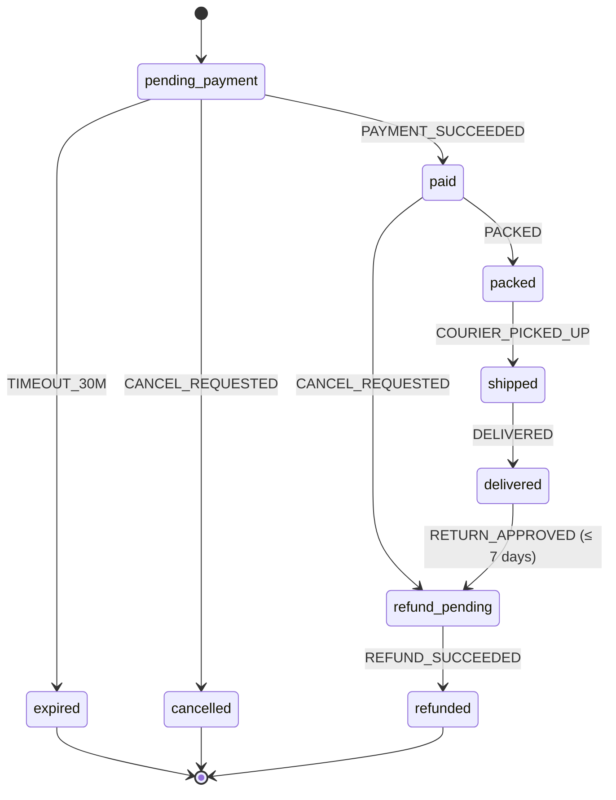

# Design Patterns - State Machines for Business Workflows

> [!info] Deep dive of [[Design Patterns]]

> [!abstract] TL;DR
> Model every business entity with a lifecycle (order, payment, booking, subscription, KYC case, support ticket) as an **explicit finite state machine**:
> - a closed set of states
> - a whitelist of transitions triggered by named events
> - guards, and side effects emitted *after* the transition commits
>
> Enforce transitions **atomically in the database** (`UPDATE … WHERE status = :from`) so retries, duplicate webhooks and race conditions can't create impossible states.

## Concept

### Vocabulary
| Term | Meaning | Order example |
|---|---|---|
| **State** | Mutually exclusive status | `pending_payment`, `paid`, `packed`, `shipped`, `delivered`, `cancelled`, `refunded` |
| **Event** | Something that happened / was requested | `PAYMENT_SUCCEEDED`, `CANCEL_REQUESTED`, `COURIER_PICKED_UP` |
| **Transition** | `(from, event) → to` | `(pending_payment, PAYMENT_SUCCEEDED) → paid` |
| **Guard** | Condition that must hold | `CANCEL_REQUESTED` allowed only before `shipped` |
| **Action / effect** | Side effect after transition | Send WhatsApp receipt, reserve stock, notify warehouse |
| **Terminal state** | No outgoing transitions | `delivered` (after return window), `refunded` |
| **Timeout** | Time-based event | `pending_payment` → `expired` after 30 min |

### Why not boolean flags
| Flags (`is_paid`, `is_shipped`, `is_cancelled`) | State machine |
|---|---|
| 2ⁿ combinations, many invalid (`paid=false, shipped=true`) | Only valid states exist |
| Logic scattered across handlers | One transition table = executable spec |
| Hard to audit "what happened" | Transition log per entity |
| Duplicate events cause double effects | `WHERE status = from` makes repeats no-ops |

## How It Works

1. An event arrives (API call, webhook, scheduled timeout, staff action).
2. The machine checks **current state + event + guards** and decides the target state, or rejects it.
3. One DB transaction performs a **conditional update**, writes the **transition log**, and enqueues side effects in an **outbox**.
4. Workers execute the effects (messages, payments, stock) idempotently. Failures retry without re-running the transition.

## Practical Usage

### Transition table in TypeScript (single source of truth)
```ts
export const orderMachine = {
  pending_payment: { PAYMENT_SUCCEEDED: "paid", TIMEOUT_30M: "expired", CANCEL_REQUESTED: "cancelled" },
  paid:            { PACKED: "packed", CANCEL_REQUESTED: "refund_pending" },
  packed:          { COURIER_PICKED_UP: "shipped" },
  shipped:         { DELIVERED: "delivered" },
  delivered:       { RETURN_APPROVED: "refund_pending" },
  refund_pending:  { REFUND_SUCCEEDED: "refunded" },
  expired: {}, cancelled: {}, refunded: {},
} as const satisfies Record<string, Record<string, string>>;

type State = keyof typeof orderMachine;

export function next(state: State, event: string): State | null {
  return (orderMachine[state] as Record<string, State>)[event] ?? null;
}
```

### Atomic, idempotent transition in Postgres
```sql
create table order_transitions (
  id bigint generated always as identity primary key,
  tenant_id uuid not null, order_id uuid not null,
  from_state text not null, to_state text not null, event text not null,
  event_id text not null,                 -- webhook/event id → dedupe
  actor text not null,                    -- 'system', 'webhook:stripe', 'staff:<uuid>'
  created_at timestamptz not null default now(),
  unique (tenant_id, event_id)
);
```
```ts
export async function transition(orderId: string, event: string, eventId: string, actor: string) {
  return db.begin(async (tx) => {
    const [o] = await tx`select status, tenant_id, delivered_at from orders where id = ${orderId} for update`;
    const to = next(o.status, event);
    if (!to) return { ok: false, reason: `invalid ${event} in ${o.status}` };          // log + 409, never throw silently
    if (event === "RETURN_APPROVED" && daysSince(o.delivered_at) > 7) return { ok: false, reason: "return window closed" };

    const ins = await tx`insert into order_transitions (tenant_id, order_id, from_state, to_state, event, event_id, actor)
                         values (${o.tenant_id}, ${orderId}, ${o.status}, ${to}, ${event}, ${eventId}, ${actor})
                         on conflict (tenant_id, event_id) do nothing returning id`;
    if (ins.length === 0) return { ok: true, duplicate: true };                         // same webhook twice → no-op

    await tx`update orders set status = ${to}, updated_at = now() where id = ${orderId} and status = ${o.status}`;
    await tx`insert into outbox (topic, aggregate_id, payload) values (${`order.${to}`}, ${orderId}, ${{ event }})`;
    return { ok: true, to };
  });
}
```
- **`for update` + `where status = from`** make concurrent events (a payment webhook racing a cancel) serialize. Exactly one wins, and the loser gets "invalid transition".
- Effects go to the **outbox** and are processed by workers ([[Message Queues - BullMQ in Production]], [[REST API - Webhooks & Idempotency]]).

### DB-level guard (defence in depth)
```sql
create table order_allowed_transitions (from_state text, to_state text, primary key (from_state, to_state));
create or replace function enforce_order_transition() returns trigger language plpgsql as $$
begin
  if new.status <> old.status and not exists (
     select 1 from order_allowed_transitions where from_state = old.status and to_state = new.status) then
    raise exception 'illegal order transition % -> %', old.status, new.status;
  end if;
  return new;
end $$;
create trigger trg_order_transition before update of status on orders
for each row execute function enforce_order_transition();
```

### Timeouts as events
```ts
// On entering pending_payment: schedule the timeout event; it becomes a no-op if payment arrived first
await timeouts.add("order-timeout", { orderId, event: "TIMEOUT_30M" },
  { delay: 30 * 60_000, jobId: `timeout:${orderId}:pending_payment` });
```

### Client side: sealed states (Dart/Flutter)
```dart
sealed class OrderState {}
class PendingPayment extends OrderState { PendingPayment(this.expiresAt); final DateTime expiresAt; }
class Paid extends OrderState {}
class Shipped extends OrderState { Shipped(this.trackingNo); final String trackingNo; }
class Refunded extends OrderState {}

Widget banner(OrderState s) => switch (s) {           // exhaustive: compiler errors if a state is unhandled
  PendingPayment(:final expiresAt) => Text('Pay before ${DateFormat.Hm().format(expiresAt)}'),
  Paid() => const Text('Paid, preparing your order'),
  Shipped(:final trackingNo) => Text('Shipped · $trackingNo'),
  Refunded() => const Text('Refunded'),
};
```
- For complex UI/agent flows with parallel or nested states, **XState v5** statecharts (actors, `setup()`, typed events) give visualisation and model-based tests.

## Patterns & Anti-patterns
| Pattern | When | Anti-pattern to avoid |
|---|---|---|
| Single transition table shared by API, workers, tests | Every lifecycle entity | Status strings mutated ad hoc in 12 handlers |
| Conditional update + transition log + outbox in one transaction | Webhook-driven flows | Send email, then update DB (crash → email sent, state unchanged) |
| Dedupe on event ID | Payment/courier webhooks | Re-running effects on duplicate deliveries |
| Timeouts as scheduled events | Expiring carts, bookings, approvals | Cron scanning all rows every minute with racy updates |
| Separate machines per concern (order vs payment vs fulfilment) | Complex commerce | One 25-state mega machine mixing payment and shipping |
| Saga/compensation across services | Multi-step distributed flows | Distributed transactions or hoping all calls succeed |

## Performance & Trade-offs
- **Row lock per transition** (`for update`) serializes events per entity, which is the correctness you want. Throughput across entities is unaffected. Avoid long work inside the transaction.
- **Transition log** grows linearly with events. Partition by month for high-volume systems, and it doubles as audit evidence for disputes.
- **Library vs hand-rolled**: a 20-line table is enough for most backend entities. XState pays off for UI flows, agents and nested/parallel states, at the cost of a dependency and learning curve.
- **Workflow engines** ([[n8n]], Temporal) can drive transitions, but keep the **state of record in your DB**, not in workflow execution history.

## Tips & Reminders
> [!tip]
> - **Write the transition table first** with the client (it's a great discovery workshop artefact), and put it in the SOW as the agreed process.
> - **Generate the Mermaid diagram** from the code table for docs, so they never drift.
> - **Test exhaustively**: for every state × event pair, assert the allowed target or rejection. That's 10 states × 8 events = 80 cheap tests ([[Testing Strategy]]).
> - **Make states customer-meaningful** for WhatsApp/status pages (`Preparing`, `Out for delivery`), mapped from internal states.
> - **In ZP's stack**:
>   - **Storage**: order, booking and subscription states live in [[Supabase]] Postgres with a trigger guard plus `order_transitions`.
>   - **Events**: payment webhooks (Billplz/Stripe) and courier webhooks feed `transition()`.
>   - **Effects**: BullMQ delayed jobs handle timeouts, and n8n consumes outbox events for notifications.

## Version Notes
N/A: pattern. Tooling notes:
- **XState v5** (Dec 2023): actor model, `setup()` API, better TypeScript inference.
- **Dart 3** sealed classes plus exhaustive `switch` (2023) make client-side state modelling safe.

## Critical Issues & Gotchas
> [!danger] Race conditions create impossible states
> - **The race**: a `PAYMENT_SUCCEEDED` webhook and a customer's `CANCEL_REQUESTED` arrive within milliseconds. Without row locks or conditional updates, both "succeed": the order shows cancelled while money was captured and no refund was triggered.
> - **The fix**: lock or conditionally update, define the losing path explicitly (`paid --CANCEL--> refund_pending`), and alert on rejected transitions.

> [!danger] Side effects before commit
> Sending the WhatsApp receipt, charging a card or calling a courier API **inside** or **before** the transaction means a rollback leaves the effect done but the state unchanged (or vice versa). Always persist the transition plus outbox first, and execute effects asynchronously with idempotency keys.

> [!warning] Gotchas
> - Adding a state later requires a migration: enum/check constraints, allowed-transition rows, UI mapping and analytics. Use `text` + check constraint or a lookup table rather than Postgres enums if states change often.
> - Admin "force status" tools bypass guards. Route them through `transition()` with an `admin_override` event and audit.
> - Timeout jobs must check the current state (transition no-op) because the entity may have moved on.
> - Reporting on "current state" alone loses history. Derive metrics (time-to-ship, drop-off) from the transition log.

## Related
- [[Design Patterns]]
- [[System Design - Multi-Tenant SaaS Architecture]] — tenant-scoped entities and outbox
- [[REST API - Webhooks & Idempotency]] — event dedupe and outbox delivery
- [[Message Queues - BullMQ in Production]] — timeouts and effect workers
- [[PostgreSQL - Transactions & MVCC]] — row locks and isolation
- [[Dart]] — sealed classes and exhaustive switches

## References
- XState v5 docs: https://stately.ai/docs/xstate
- Statecharts (Harel, 1987): https://www.inf.ed.ac.uk/teaching/courses/seoc/2005_2006/resources/statecharts.pdf
- Transactional outbox: https://microservices.io/patterns/data/transactional-outbox.html
- Saga pattern: https://microservices.io/patterns/data/saga.html
- PostgreSQL explicit locking: https://www.postgresql.org/docs/current/explicit-locking.html
