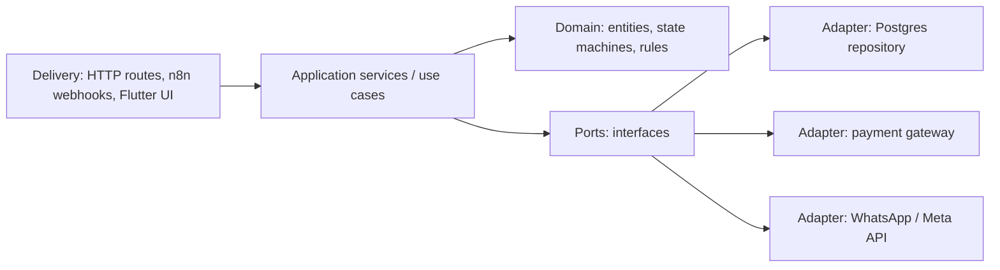

# Design Patterns

> [!abstract] TL;DR
> Design patterns are named, reusable solutions to recurring design problems. They're a **shared vocabulary**, not a checklist. The 23 Gang of Four (GoF) patterns (1994) fall into creational, structural and behavioral groups. Modern codebases also lean on **architectural patterns**: layered/clean/hexagonal, repository, dependency injection, CQRS, pub/sub.
> - **In 2026 TypeScript/Dart/Kotlin**: many GoF patterns collapse into language features (first-class functions = strategy/command, modules = singleton, sealed types + pattern matching = visitor).
> - **The patterns that still matter most**: adapter (wrap third-party APIs), strategy, observer, repository, DI, factory, decorator/middleware, state machines, and outbox/saga at the system level ([[System Design]]).
> - **Main failure mode**: over-engineering, i.e. abstractions with one implementation.

## Introduction
- **Origin**: Christopher Alexander's architecture *pattern language* (1977), then Gamma, Helm, Johnson & Vlissides, *Design Patterns* (1994, the "Gang of Four"). Later: Fowler's *Patterns of Enterprise Application Architecture* (2002), Evans' *Domain-Driven Design* (2003), Hohpe & Woolf's *Enterprise Integration Patterns* (2003).
- **Problem**: communicating and reusing design decisions about coupling, extensibility and testability.
- **Where it sits**: in frameworks you use daily: React hooks (observer/composition), Express/Koa/Traefik middleware (chain of responsibility/decorator), [[Spring Boot]] (DI, proxies, template method), Flutter widgets (composite), BLoC/Riverpod (observer/state), [[n8n]] nodes (adapter, pipeline).

## Core Concepts

### GoF catalog, what still matters
| Group | Pattern | Intent | Modern take |
|---|---|---|---|
| Creational | **Factory / Factory method** | Create objects without hard-coding classes | `createPaymentGateway(config)` returning an interface |
| Creational | Builder | Step-by-step construction | Fluent query builders (Kysely, Drizzle), `copyWith` in Dart |
| Creational | Singleton | One instance | ES/Dart module-level instance or DI container scope. Avoid hidden global state |
| Structural | **Adapter** | Make incompatible interfaces work together | Wrap Stripe/Billplz/Meta APIs behind your own interface |
| Structural | **Decorator** | Add behaviour without subclassing | Middleware, HOFs, TS decorators, caching/retry wrappers |
| Structural | Facade | Simple API over a complex subsystem | SDK clients, service layers |
| Structural | Composite | Tree of uniform components | UI trees (React, Flutter widgets), menus |
| Structural | Proxy | Control access to an object | Lazy loading, caching proxies, Spring `@Transactional` |
| Behavioral | **Strategy** | Swap algorithms at runtime | Functions/maps of functions: pricing rules, payment providers |
| Behavioral | **Observer** | Notify subscribers of changes | Events, streams, signals, React state, webhooks |
| Behavioral | Command | Encapsulate actions as objects | Job payloads in queues, undo/redo, CQRS commands |
| Behavioral | **State** | Behaviour varies by internal state | Explicit state machines (XState, sealed classes) for orders/payments |
| Behavioral | Chain of responsibility | Pass a request along handlers | HTTP middleware, validation pipelines |
| Behavioral | Template method | Skeleton algorithm with overridable steps | Framework lifecycle hooks |
| Behavioral | Visitor | Operations over a type hierarchy | Sealed classes + exhaustive `switch`/`when` |
| Behavioral | Iterator | Sequential access | Built into languages (generators, `for…of`, streams) |

### Principles behind patterns
- **SOLID**: Single responsibility · Open/closed · Liskov substitution · Interface segregation · Dependency inversion.
- **Composition over inheritance**. **Program to interfaces**. **Encapsulate what varies**.
- **YAGNI / KISS / DRY (with judgment)**: duplication is cheaper than the wrong abstraction.

### Adapter + strategy in TypeScript
```ts
// Your domain port: stable interface your app depends on
export interface PaymentGateway {
  createPayment(input: { orderId: string; amountSen: number; customerEmail: string }): Promise<{ redirectUrl: string; ref: string }>;
  verifyWebhook(rawBody: string, signature: string): boolean;
}

// Adapters: one per provider, all external SDK details stay here
class BillplzGateway implements PaymentGateway { /* calls Billplz API, maps fields, HMAC verify */ }
class StripeGateway implements PaymentGateway { /* Stripe Checkout, webhook signature verify */ }

// Strategy selection via a factory, per tenant configuration
const gateways: Record<string, (cfg: TenantConfig) => PaymentGateway> = {
  billplz: (cfg) => new BillplzGateway(cfg.billplzKey),
  stripe: (cfg) => new StripeGateway(cfg.stripeKey),
};
export const gatewayFor = (cfg: TenantConfig) => gateways[cfg.paymentProvider](cfg);
```

### State machine for an order (sealed types, Dart)
```dart
sealed class OrderState {}
class Pending extends OrderState {}
class Paid extends OrderState { Paid(this.receipt); final String receipt; }
class Shipped extends OrderState { Shipped(this.tracking); final String tracking; }
class Cancelled extends OrderState { Cancelled(this.reason); final String reason; }

OrderState transition(OrderState s, OrderEvent e) => switch ((s, e)) {
  (Pending(), PaymentConfirmed(:final receipt)) => Paid(receipt),
  (Pending(), CancelRequested(:final reason)) => Cancelled(reason),
  (Paid(), ShipmentCreated(:final tracking)) => Shipped(tracking),
  _ => throw StateError('Invalid transition $e from $s'),   // illegal transitions are explicit
};
```

## Architecture / How It Works

- **Hexagonal / ports & adapters / clean architecture**: the domain and use cases depend only on interfaces (ports). Infrastructure implements them (adapters). Dependencies point inward, so swapping providers or testing with fakes is easy.
- **Repository**: a collection-like interface for aggregates, hiding SQL/ORM. Keep it thin, and don't wrap the ORM in pointless pass-through layers.
- **Dependency injection**: constructor injection by default. Containers ([[Spring Boot]], NestJS, Riverpod providers, get_it) only manage wiring.
- **Integration patterns** (EIP): message channel, publish-subscribe, content-based router, idempotent receiver, dead-letter channel. These map directly to queues and [[n8n]] workflows.

## Project Structure
```text
src/
├── domain/              # entities, value objects, state machines (no framework imports)
├── application/         # use cases: placeOrder, markPaid (orchestrate domain + ports)
├── ports/               # interfaces: PaymentGateway, OrderRepository, Notifier
├── adapters/
│   ├── db/              # Postgres/Supabase implementations
│   ├── payments/        # billplz.ts, stripe.ts
│   └── messaging/       # whatsapp.ts, telegram.ts
└── interfaces/http/     # routes/controllers → application
```
Keep it proportional. For a small app, `routes → services → db` with adapters for third-party APIs is enough.

## Use Cases
| Situation | Pattern |
|---|---|
| Multiple payment/SMS/WhatsApp providers per client | Adapter + strategy + factory |
| Order/payment/subscription lifecycles | State machine (state pattern, sealed classes) |
| Cross-cutting concerns (auth, logging, retry, caching) | Decorator / middleware chain |
| UI reacting to data changes | Observer (streams, signals, Riverpod/BLoC) |
| Background jobs and undoable actions | Command objects in queues |
| Complex object creation (test data, configs) | Builder / factory functions |
| Swapping infrastructure in tests | Ports & adapters + DI |

## Pros & Cons
| Pros | Cons |
|---|---|
| Shared vocabulary speeds design discussions and reviews | Pattern-itis: abstractions with one implementation, indirection everywhere |
| Decouples volatile third parties from core logic | Some GoF patterns are workarounds for missing language features |
| Improves testability (fakes behind ports) | Can hide simple logic behind ceremony |
| Proven solutions to recurring problems | Misapplied patterns create rigidity rather than flexibility |

## Alternatives & Peers
| Approach | Strength | Pick it when… |
|---|---|---|
| Functional patterns (pure functions, composition, pipelines, `Result` types) | Less ceremony, easy testing | TS/Dart/Kotlin business logic |
| Data-oriented design | Performance, simple data flow | Hot paths, games, data processing |
| Domain-Driven Design (tactical: aggregates, value objects; strategic: bounded contexts) | Aligns code with complex business domains | Complex domains (finance, logistics) |
| Framework conventions (Rails/Laravel/Next.js) | Speed, consistency | CRUD-heavy apps, small teams |

## Tips & Reminders
> [!tip]
> - Introduce an abstraction when you have **two real implementations** or a volatile third party. Not before.
> - Always wrap external APIs (Meta WhatsApp, payment gateways, LLM providers) behind your own interface. Vendor changes then touch one adapter.
> - Model lifecycles as explicit state machines with exhaustive matching. That prevents "paid but cancelled" impossible states.
> - Prefer composition and small functions. Use classes when you need state + behaviour together.
> - Name patterns in code reviews ("this is a strategy") to communicate intent quickly.
> - **In ZP's stack**: adapters for Billplz/Stripe/ToyyibPay and Meta/Telegram messaging, a state machine for orders/subscriptions in [[PostgreSQL]] (status column + allowed transitions enforced in a function or CHECK), observer via Supabase Realtime/Riverpod ([[Flutter - State Management]]), and EIP patterns (router, dead-letter, idempotent receiver) in [[n8n]] workflows.

## Versions & Breaking Changes
N/A — patterns don't version. Language features that replaced classic patterns:

| Language feature | Version | Replaces / simplifies |
|---|---|---|
| ES modules (single evaluated instance) | ES2015 | Singleton |
| First-class functions, closures | (JS/Dart/Kotlin/Swift) | Strategy, command, template method |
| Java records / Kotlin data classes / Dart records | Java 16, Kotlin 1.0, Dart 3.0 | Value objects, builders for simple data |
| Sealed classes + pattern matching | Java 17/21, Kotlin 1.5, Dart 3.0, TS discriminated unions | Visitor, state pattern boilerplate |
| Async iterators / streams | ES2018, Dart streams, Kotlin Flow | Iterator + observer for async data |
| TC39 decorators (Stage 3) in TypeScript 5.0 | 2023 | Decorator pattern for classes/methods |

## Critical Issues & Gotchas
> [!danger] Singletons and module state leaking data across requests/tenants
> Module-level singletons holding per-user state (a "current tenant" variable, a cached client with a user token) leak data between requests in long-running Node servers, serverless containers reused across invocations, and PHP/Octane worker modes. Pass context explicitly or use request-scoped DI / AsyncLocalStorage. Singletons should hold only immutable config or thread-safe clients.

> [!danger] Leaky abstractions over critical semantics
> A generic `Repository` or `PaymentGateway` interface can hide differences that matter: transactions and isolation, idempotency, webhook ordering, currency/decimal handling. Design ports around business guarantees (idempotency keys, at-least-once delivery), not just method names, or you'll get double charges when switching providers.

> [!warning] Gotchas
> - Deep inheritance hierarchies (template method abuse) are hard to change. Prefer composition.
> - Observer without unsubscription = memory leaks (see stream subscriptions in [[Dart - Async, Streams & Isolates]]).
> - DI containers hide dependency graphs. Circular dependencies signal a design problem.
> - "Clean architecture" in a 500-line CRUD app slows delivery. Match ceremony to complexity.
> - Event-driven observers make control flow non-local. Document event contracts and keep handlers idempotent.

## Deep Dives
- [[Design Patterns - Interview Questions]] — OOP and patterns-in-projects interview answers (reference)
- [[Design Patterns - State Machines for Business Workflows]]
- [[Design Patterns - Hexagonal Architecture in TypeScript & Dart]] — ports by capability, functional DI, Riverpod composition root, boundary linting

## Related
- [[System Design]] — architecture-level patterns (outbox, saga, CQRS)
- [[TypeScript]] · [[Dart]] — language features that implement patterns
- [[Flutter - State Management]] — observer/state patterns in UI
- [[Spring Boot]] — DI, proxies, template method in a framework
- [[Algorithms]] — strategy pattern for swappable algorithms

## References
- Gamma et al., *Design Patterns* (1994)
- Refactoring.Guru patterns catalog: https://refactoring.guru/design-patterns
- Fowler, *Patterns of Enterprise Application Architecture*: https://martinfowler.com/eaaCatalog/
- Enterprise Integration Patterns: https://www.enterpriseintegrationpatterns.com/
- Hexagonal architecture (Cockburn): https://alistair.cockburn.us/hexagonal-architecture/
- microservices.io patterns: https://microservices.io/patterns/
