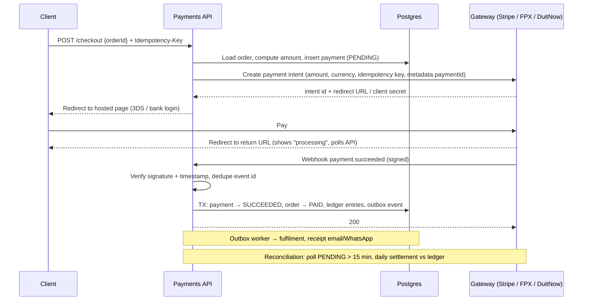
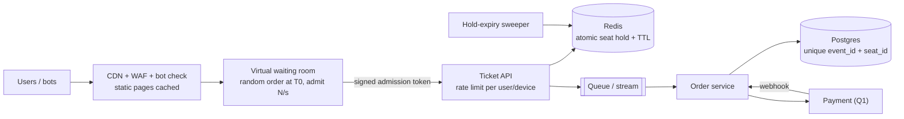

# System Design - Interview Questions

> [!info] Reference for [[System Design]] (overview planned) · index: [[Backend Interview Questions]]

> [!abstract] TL;DR
> Q1: **payment method design** — hosted checkout (minimal PCI scope), server-owned amount, webhook as source of truth, idempotency, state machine, double-entry ledger, reconciliation, Malaysian methods. Q2: **concert ticketing under huge traffic** — edge filtering, fair waiting room, atomic Redis seat holds, async orders, Postgres unique constraint as the oversell guard, Ticketmaster Eras Tour lessons.

## Q1. How would you design and implement a payment method, including the overall process flow?

**Grading**: correctness under failure (**idempotency, webhooks as source of truth, reconciliation**), money modelling, security/PCI scope. The happy path is the easy part.

### Principles to state up front
- **Never touch raw card data.** Use the gateway's hosted checkout or tokenized fields, so PCI DSS scope stays at the minimal SAQ A level (PCI DSS v4.0.1 is current).
- **The server owns the amount.** Recompute from the order in the DB. Never trust a client-sent price.
- **The webhook is the source of truth**, not the browser redirect. Redirects get closed, blocked or forged.
- **Every write is idempotent**: an idempotency key to the gateway, and unique constraints on our side.
- **Money = integer minor units** (`BIGINT` sen) plus an ISO 4217 currency. Never `float`.
- **Gateway behind an interface** (Adapter/Strategy, see [[Design Patterns - Interview Questions]]) so Stripe, FPX via Billplz/iPay88, DuitNow QR or e-wallets plug in.

### Flow


### State machine (transitions only move forward)
`CREATED → PENDING → (AUTHORIZED →) SUCCEEDED` · `PENDING → FAILED | EXPIRED` · `SUCCEEDED → REFUND_PENDING → REFUNDED | PARTIALLY_REFUNDED`

```sql
create table payments (
  id              uuid primary key default gen_random_uuid(),
  order_id        uuid not null references orders(id),
  provider        text not null,
  provider_ref    text,
  amount_minor    bigint not null check (amount_minor > 0),
  currency        char(3) not null,
  status          text not null,
  idempotency_key text not null unique,
  created_at      timestamptz not null default now(),
  unique (provider, provider_ref)
);

create table payment_events (
  provider    text not null,
  event_id    text not null,
  payment_id  uuid references payments(id),
  payload     jsonb not null,
  received_at timestamptz not null default now(),
  primary key (provider, event_id)
);
```

```typescript
export async function onGatewayWebhook(raw: string, headers: Headers): Promise<number> {
  const event = gateway.verifyAndParse(raw, headers);
  await db.transaction(async (tx) => {
    const inserted = await tx.insertIgnore('payment_events', { provider: gateway.id, eventId: event.id, payload: event });
    if (!inserted) return;
    const payment = await tx.lockPaymentByProviderRef(gateway.id, event.paymentRef);
    if (event.amountMinor !== payment.amountMinor || event.currency !== payment.currency) {
      throw new AmountMismatchError(payment.id);
    }
    if (!canTransition(payment.status, event.status)) return;
    await tx.updatePaymentStatus(payment.id, event.status);
    if (event.status === 'SUCCEEDED') {
      await tx.markOrderPaid(payment.orderId);
      await tx.insertLedger(doubleEntry(payment));
      await tx.insertOutbox('payment.succeeded', { paymentId: payment.id });
    }
  });
  return 200;
}
```

| Failure | Handling |
|---|---|
| Gateway times out on create | Don't assume failure. Retry with the **same idempotency key**, or query by our `paymentId` |
| Duplicate webhook | `(provider, event_id)` primary key → no-op |
| Out-of-order webhooks (`failed` after `succeeded`) | State machine rejects backward transitions |
| Webhook never arrives | Reconciliation job polls the gateway for `PENDING` older than N minutes (FPX bank confirmations can lag) |
| User pays twice | One active payment per order. Auto-refund duplicates found by reconciliation |
| Amount tampering | Amount comes from the DB. Webhook amount must equal the stored amount |
| Refunds | Separate flow with role check, audit log, idempotency key, and ledger reversal entries |

- **Ledger**: append-only double-entry (`debit customer_receivable / credit revenue`, fees to `gateway_fees`). Never `UPDATE` balances in place. Daily reconciliation compares gateway settlement reports with ledger totals.
- **Security**: HMAC signature + timestamp window on webhooks, secrets in env/secret store, no gateway keys on the client, refund endpoints behind step-up auth (see [[Authentication & Authorization - Interview Questions]]). PDPA covers billing details.
- **Malaysia**: FPX (online banking), DuitNow QR, cards, and e-wallets (Touch 'n Go, GrabPay, Boost) through gateways such as Stripe, Billplz, iPay88, Razer Merchant Services or senangPay. Pick by method coverage, fees, settlement time (T+1 to T+3) and webhook quality.
- **Trap**: marking the order paid on the redirect, no idempotency, floats for money, or "store the card number encrypted" (that pulls you into full PCI scope).
- Deep dive: [[PostgreSQL - Transactions & MVCC]] · [[REST API]] · [[Authentication & Authorization]]

## Q2. How would you handle huge traffic for a concert ticket purchasing system? Design the flow.

**Grading**: do you **protect the inventory core from the herd**, prevent **overselling**, keep it **fair**, and degrade gracefully? Scaling every tier "with Kubernetes" is not the answer.

**Frame the numbers first**: e.g. 50,000 seats, 1M users arriving within the first minute, > 95% of them leave without a ticket. So the design goal is to **admit only as many users as the inventory core can serve**, and reject everyone else cheaply at the edge.



| Stage | Design |
|---|---|
| **Before the sale** | Load-test to a known admit rate. Pre-scale (autoscaling is too slow for a cliff spike). Pre-load inventory into Redis. Static event pages and seat maps on the CDN. Pre-registration or verified accounts to cut bots |
| **Edge** | [[Cloudflare]] WAF, Turnstile/bot management, per-IP and per-account rate limits. Origin only accepts requests carrying a valid admission token |
| **Waiting room** | Users who arrive before T0 get a **random** position at T0 (fairer than first-click). Admit at a rate matched to downstream capacity. Admission = short-lived signed token (JWT, ~10 min, bound to user + device). Options: Cloudflare Waiting Room, Queue-it, or a Redis `ZSET` queue |
| **Seat hold** | Atomic in Redis: assigned seats with `SET seat:{evt}:{id} user NX EX 600`. General admission with a Lua decrement (below). Enforce per-user limits (e.g. 4) in the same atomic step |
| **Order creation** | Hold → enqueue → order service writes Postgres. A **unique constraint `(event_id, seat_id)`** is the final guard against overselling, even if Redis is wrong |
| **Payment** | Within the hold window, via the Q1 flow. Success → `SOLD`. Failure or expiry → seat goes back to the pool |
| **Hold expiry** | Key TTL alone doesn't return stock. Track holds in a `ZSET` scored by expiry, and a sweeper atomically restores them (keyspace notifications are not reliable delivery) |
| **Client feedback** | Async: return `202 + orderId`, then poll or SSE for status. No long-held requests |
| **Degrade** | Turn off non-critical features during the sale (recommendations, search, reviews). Show "sold out" from a cached flag. Circuit breakers on payments |

```lua
-- KEYS: stock, per-user count, holds zset · ARGV: qty, maxPerUser, expiresAtMs, holdId
local qty = tonumber(ARGV[1])
local bought = tonumber(redis.call('GET', KEYS[2]) or '0')
if bought + qty > tonumber(ARGV[2]) then return -2 end
local stock = tonumber(redis.call('GET', KEYS[1]) or '0')
if stock < qty then return -1 end
redis.call('DECRBY', KEYS[1], qty)
redis.call('INCRBY', KEYS[2], qty)
redis.call('ZADD', KEYS[3], ARGV[3], ARGV[4] .. ':' .. qty)
return stock - qty
```
- In Redis Cluster, give all keys of one event the same hash tag (`{evt:123}:stock`) so the script runs on one shard.
- **Oversell defence in depth**: Redis atomic hold (fast path) → Postgres unique constraint (truth) → reconciliation (Redis vs DB counts after the sale).
- **Postgres-only variant** (smaller events): `UPDATE inventory SET available = available - $2 WHERE event_id = $1 AND available >= $2 RETURNING available`. A single hot row serializes everything, so split stock into N bucket rows, or pick seats with `SELECT … FOR UPDATE SKIP LOCKED`.
- **Idempotency** on hold and order endpoints (a client retry must not take two holds). Unique `(user_id, event_id)` limits where policy requires.

> [!danger] Real incident: Ticketmaster, Taylor Swift Eras Tour presale (Nov 2022)
> Ticketmaster reported **3.5 billion total system requests, 4× its previous peak**, driven by bot attacks and fans without invite codes. About 1.5M of 3.5M Verified Fan registrants were invited. The next day's general public sale was cancelled for "extraordinarily high demands on ticketing systems and insufficient remaining ticket inventory". Lessons: pre-registration doesn't cap traffic unless the edge **rejects un-invited requests before they reach the origin**, and bots must be filtered at the CDN, not in the queue.

- **Trap**: "just autoscale" or "use a bigger DB". The bottleneck is a **single contended inventory**, so you must shape traffic before it, and keep the oversell guard in the system of record.
- Deep dive: [[System Design]] · [[Redis - Data Structures & Patterns]] · [[Message Queues]] · [[Kafka]] · [[Cloudflare]]

## Related
- [[System Design]] · [[Design Patterns]] — planned overviews
- [[Design Patterns - Interview Questions]] — Adapter/Strategy for gateways, idempotent consumer
- [[Redis - Interview Questions]] · [[Redis - Data Structures & Patterns]] — atomic holds, Lua
- [[PostgreSQL - Transactions & MVCC]] — row locks, `SKIP LOCKED`, constraints
- [[Message Queues]] · [[Kafka]] · [[Cloudflare]] — traffic shaping and async order pipeline
- [[Authentication & Authorization - Interview Questions]] — step-up auth for refunds
- [[Backend Interview Questions]] — interview index

## References
- Stripe idempotent requests: https://docs.stripe.com/api/idempotent_requests
- Stripe webhooks (signature verification, retries): https://docs.stripe.com/webhooks
- PCI DSS document library (v4.0.1): https://www.pcisecuritystandards.org/document_library/
- Cloudflare Waiting Room: https://developers.cloudflare.com/waiting-room/
- Ticketmaster Eras Tour presale (Fortune): https://fortune.com/2022/11/17/ticketmaster-cancels-general-sale-taylor-swifts-eras-tour
