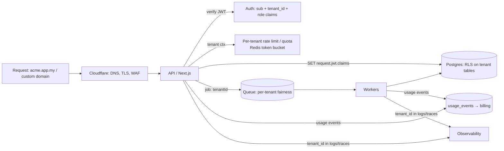

# System Design - Multi-Tenant SaaS Architecture

> [!info] Deep dive of [[System Design]]

> [!abstract] TL;DR
> - **Default model**: a **pooled** model (shared DB, `tenant_id` on every row, Postgres **RLS**).
> - **Tenant identity**: comes from **authenticated identity** (a JWT claim plus a membership check), never from request parameters.
> - **Hard requirements, not polish**: isolation tests, per-tenant rate limits and queue fairness, `tenant_id` in every log and trace, per-tenant cost metering, and tenant export/delete.
> - **Escalation**: move only the tenants that pay for it (compliance, scale) to **silo** (own DB/stack). Keep one codebase with a tenancy abstraction so you can.

## Concept

### Tenancy models
| Model | Data | Compute | Isolation | Cost per tenant | Ops burden | Pick it when… |
|---|---|---|---|---|---|---|
| **Pool** (shared everything) | Shared tables + `tenant_id` + RLS | Shared | Logical (code + RLS) | Lowest | Lowest | **Default for SME SaaS** (hundreds–thousands of small tenants) |
| **Bridge** (schema-per-tenant) | Shared DB, one schema per tenant | Shared | Stronger logical | Medium | Migrations × N schemas, connection/search_path care | Moderate tenant count needing per-tenant customization |
| **Silo** (DB- or stack-per-tenant) | Dedicated DB/project | Dedicated or shared | Physical | Highest | N deployments to patch/migrate/monitor | Enterprise, regulated data, data-residency, big noisy tenants |
| **Hybrid tiering** | Pool for Free/Pro, silo for Enterprise | Mixed | Per tier | — | Two paths to maintain | Mature SaaS with enterprise deals |

### Tenant isolation layers (defence in depth)
| Layer | Control |
|---|---|
| Identity | `tenant_id` from verified JWT claim + `memberships` row. Support users get explicit, audited impersonation |
| API | Every query scoped by tenant from context. Authorization matrix tests (role × tenant × action) |
| Database | RLS on every tenant table, composite FKs `(tenant_id, id)`, `tenant_id NOT NULL` |
| Storage | Object keys prefixed `tenants/<id>/…` + bucket policies/RLS on storage |
| Cache/queues | Keys and job IDs prefixed with tenant. Per-tenant rate limits |
| Search/vectors | Tenant filter enforced in SQL/index, never only in prompts ([[Vector Databases - pgvector Tuning & Hybrid Search]]) |
| Observability | `tenant_id` on every log line/span. Per-tenant dashboards and cost |

## How It Works

1. **Resolve the tenant**: use the subdomain or custom domain for *branding/routing hints*. Use the JWT `tenant_id` claim (validated against membership) for *authorization*. Never trust a `tenantId` in the body or query.
2. **Enforce in the database**: RLS reads the tenant from the JWT, so a forgotten `WHERE` in app code still can't cross tenants.
3. **Protect shared capacity**: quotas and fairness stop one tenant's import or bot storm from starving others.
4. **Meter usage per tenant** (messages, LLM tokens, storage), so pricing and margins are visible.

## Practical Usage

### Core schema (pooled, Postgres/Supabase)
```sql
create table tenants (
  id uuid primary key default gen_random_uuid(),
  slug text unique not null,            -- acme → acme.app.my
  plan text not null default 'pro',
  status text not null default 'active' check (status in ('active','suspended','deleting'))
);
create table memberships (
  tenant_id uuid references tenants(id) on delete cascade,
  user_id uuid not null,                -- auth.users.id
  role text not null check (role in ('owner','admin','staff')),
  primary key (tenant_id, user_id)
);
-- customers (tenant_id, id, …) defined the same way, with primary key (tenant_id, id)
create table orders (
  tenant_id uuid not null references tenants(id),
  id uuid not null default gen_random_uuid(),
  customer_id uuid not null,
  total_sen bigint not null,
  created_at timestamptz not null default now(),
  primary key (tenant_id, id),
  foreign key (tenant_id, customer_id) references customers (tenant_id, id)   -- can't link across tenants
);
create index on orders (tenant_id, created_at desc);
alter table orders enable row level security;
create policy orders_tenant on orders
  using (tenant_id = (auth.jwt() -> 'app_metadata' ->> 'tenant_id')::uuid)
  with check (tenant_id = (auth.jwt() -> 'app_metadata' ->> 'tenant_id')::uuid);
```
- **Supabase**: put `tenant_id` and `role` into the token via the **Custom Access Token Hook** (from `memberships`), so policies read claims instead of joining on every row. Re-issue tokens when membership changes ([[Supabase - Row Level Security]]).
- **Multi-tenant users** (one person in several businesses): store the *active* tenant in the session, re-mint the token on switch, and verify membership server-side.

### Tenant context in Node (non-Supabase stacks)
```ts
// Every DB transaction runs with the tenant set; RLS policies read current_setting('app.tenant_id')
export async function withTenant<T>(tenantId: string, fn: (tx: Tx) => Promise<T>) {
  return db.begin(async (tx) => {
    await tx`select set_config('app.tenant_id', ${tenantId}, true)`;
    await tx`set local role app_user`;               // non-superuser role that RLS applies to
    return fn(tx);
  });
}
```

### Noisy-neighbour controls
| Resource | Control |
|---|---|
| API requests | Redis token bucket per tenant + per user (`rl:{tenant}:{route}`), plan-based limits |
| Background jobs | Per-tenant concurrency caps (BullMQ Pro groups, or one queue per heavy tenant), job priority by plan ([[Message Queues - BullMQ in Production]]) |
| Database | `statement_timeout` per role, pagination limits, per-tenant import throttling, partitioning for very large tenants |
| LLM / WhatsApp / external APIs | Per-tenant token/message budgets. Provider rate limits shared across tenants → fair queueing |
| Storage | Quotas per plan, enforced at upload URL issuance |

### Metering & billing
```sql
create table usage_events (
  tenant_id uuid not null, kind text not null,        -- 'wa_message', 'llm_tokens', 'storage_mb'
  quantity numeric not null, unit_cost_sen numeric,    -- cost at time of use (LLM price, Meta conversation fee)
  occurred_at timestamptz not null default now()
) partition by range (occurred_at);
-- Monthly: sum per tenant/kind → invoice lines + gross margin per tenant
```

### Tenant lifecycle
- **Provision**: create the tenant row, owner membership, default settings, a Stripe/Billplz customer and seed data, inside one idempotent job.
- **Suspend**: set `status = 'suspended'`, and have middleware block writes (keep reads/export for the grace period).
- **Export**: a per-tenant JSON/CSV dump job. This is a PDPA data-portability expectation and a contract exit requirement.
- **Delete**: soft-delete, then hard delete after the retention window, including storage prefixes, vectors, backups policy and third-party processors. Log the deletion certificate.

## Patterns & Anti-patterns
| Pattern | When | Anti-pattern to avoid |
|---|---|---|
| Pool + RLS + composite keys | SME SaaS | App-only `WHERE tenant_id = ?` with no DB enforcement |
| Tenant from verified token + membership | Every request | `?tenantId=` or `X-Tenant` header trusted from the client |
| `tenant_id` leading in indexes | Large tables | Global indexes forcing scans across all tenants |
| Silo tier as an upgrade path | Enterprise/regulated customers | Starting with DB-per-tenant for 5-person SMEs (ops explosion) |
| Per-tenant limits and fair queues | Shared workers/APIs | One tenant's 50k-row import blocking everyone's WhatsApp replies |
| Cross-tenant tests in CI | Always | Manual "I checked with two accounts once" |
| Per-tenant usage metering from day 1 | Usage-based costs (LLM, Meta) | Flat pricing with unknown per-tenant cost, so heavy users eat margin |

## Performance & Trade-offs
- **RLS cost**: claims-based policies (`auth.jwt()` comparisons) are cheap. Policies with subqueries per row (`exists (select … memberships)`) can dominate query time, so wrap them in `security definer` helpers with stable results, or use claims ([[PostgreSQL - Query Planning & EXPLAIN]]).
- **Large tenant skew**: one tenant with 80% of the rows distorts planner statistics and caches. Partition by tenant (list/hash) or move it to a silo.
- **Schema-per-tenant** breaks at scale: thousands of schemas slow catalog queries, migrations run N times, and pooled connections need `search_path` per request.
- **Per-tenant restore** is hard in pooled DBs: backups are whole-database. Build a tenant-scoped export/import tool so "restore Acme's deleted orders from yesterday" is possible without rolling back everyone.

## Tips & Reminders
> [!tip]
> - Put `tenant_id` on **every** table from the first migration, including join tables and logs. Retrofitting it later is a multi-week project.
> - **Custom domains**: Cloudflare for SaaS (custom hostnames) handles TLS for `shop.client.my` → your app, and the app maps hostname → tenant for branding only.
> - **Support access**: implement "impersonate tenant" with audit logs and time limits, instead of a superuser bypassing RLS from the dashboard.
> - Document the tenancy model, data location and deletion process in the client contract and privacy notice (PDPA).
> - **In ZP's stack**:
>   - **Default**: [[Supabase]] pooled tenancy with RLS and token-hook claims, plus BullMQ with per-tenant job IDs/limits and `usage_events` for WhatsApp/LLM cost.
>   - **Silo**: offer it as a separate Supabase project and Coolify stack for clients that need it, priced accordingly.

## Version Notes
N/A: architecture patterns. Platform specifics:
- Supabase Custom Access Token Hook (2024+) for tenant claims.
- Supabase asymmetric JWT signing keys (2025) for verifying claims in other services ([[JWT - Signing Algorithms, Keys & Rotation]]).

## Critical Issues & Gotchas
> [!danger] Cross-tenant data leaks are the SaaS extinction event
> Typical causes:
> - a missing tenant filter in one endpoint (BOLA/IDOR)
> - a `security definer` function or view without tenant checks
> - service-role keys used in user-facing code
> - caches keyed without the tenant
> - vector search without a tenant filter
> - analytics exports joining across tenants
>
> One leak can end client trust and trigger PDPA notification duties. Enforce in the DB, test negative cases in CI ([[Testing Strategy - Integration Testing with Testcontainers & Supabase]]), and review every `security definer` object.

> [!danger] Stale tenant claims after membership changes
> If a removed staff member's JWT still carries `tenant_id` until it expires, they keep access. With long-lived tokens, that's hours or days. Keep access tokens short (≤ 15 min), revoke refresh tokens on removal, and for sensitive tables check `memberships` in policies or via a helper rather than claims alone.

> [!warning] Gotchas
> - Sequences and serial IDs leak tenant volume (`/orders/10342`). Use UUIDs/ULIDs in public URLs.
> - Unique constraints must usually include `tenant_id` (`unique (tenant_id, email)`), not global uniqueness.
> - Background jobs lose request context. Pass `tenantId` explicitly and re-establish it (`withTenant`) in the worker.
> - Webhooks from shared integrations (one Meta app for all tenants) must map phone-number IDs to tenants before processing.
> - Per-tenant feature flags and settings caches must invalidate on change, or tenants see each other's settings after a cache-key collision.

## Related
- [[System Design]]
- [[Supabase - Row Level Security]] — enforcing tenant boundaries in Postgres
- [[Authentication & Authorization]] — memberships, roles, impersonation
- [[Message Queues - BullMQ in Production]] — fairness and per-tenant limits
- [[Cloudflare]] — custom hostnames, edge rate limiting
- [[Redis]] — per-tenant rate limits and cache keys

## References
- AWS SaaS Lens (tenant isolation, silo/pool/bridge): https://docs.aws.amazon.com/wellarchitected/latest/saas-lens/saas-lens.html
- Supabase Custom Access Token Hook: https://supabase.com/docs/guides/auth/auth-hooks/custom-access-token-hook
- Supabase RLS performance recommendations: https://supabase.com/docs/guides/database/postgres/row-level-security#rls-performance-recommendations
- PostgreSQL row security policies: https://www.postgresql.org/docs/current/ddl-rowsecurity.html
- Cloudflare for SaaS (custom hostnames): https://developers.cloudflare.com/cloudflare-for-platforms/cloudflare-for-saas/
