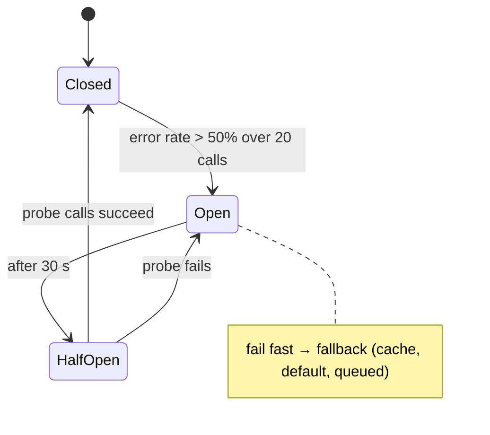

# System Design - Reliability Patterns

> [!info] Deep dive of [[System Design]]

> [!abstract] TL;DR
> Every call across a network can be slow, fail, or succeed without you knowing.
> 1. **Timeouts everywhere**, with a deadline budget per request.
> 2. **Retries** only for idempotent or keyed operations, with **exponential backoff + full jitter**, a **retry budget**, and respect for `Retry-After`.
> 3. **Circuit breakers** to stop hammering failing dependencies.
> 4. **Bulkheads** and **load shedding** to contain blast radius.
> 5. **Fallbacks/degradation** for non-critical features.
> 6. **Sagas** (with compensations) for multi-step business flows, plus outbox + idempotency for delivery.

## Concept

### Pattern map
| Pattern | Protects against | Key parameters |
|---|---|---|
| **Timeout / deadline** | Hung calls holding threads, sockets, memory | Per-hop timeout < remaining request deadline |
| **Retry with backoff + jitter** | Transient errors (network blips, 502/503, 429) | Max attempts (2–3 for sync), base delay, cap, jitter |
| **Retry budget** | Retry storms amplifying outages | Retries ≤ ~10–20% of requests per client |
| **Circuit breaker** | Repeatedly calling a dead dependency | Error-rate threshold, open duration, half-open probes |
| **Bulkhead** | One dependency exhausting shared resources | Separate pools/queues/concurrency limits per dependency |
| **Load shedding / admission control** | Overload collapse (latency → timeouts → retries) | Concurrency limit, queue length, priority classes |
| **Fallback / graceful degradation** | Non-critical feature failure taking down the page | Cached/stale data, default values, feature off |
| **Hedged requests** | Tail latency on replicated reads | Send 2nd request after p95 delay, cancel loser |
| **Idempotency + outbox** | Duplicates and lost events across retries | Idempotency keys, unique constraints ([[REST API - Webhooks & Idempotency]]) |
| **Saga** | Partial failure in multi-step workflows | Steps + compensations, orchestration state machine |

### What to retry
| Response | Retry? |
|---|---|
| Connection reset, DNS failure, timeout on **idempotent** request | ✅ |
| 502 / 503 / 504 | ✅ (honour `Retry-After`) |
| 429 | ✅ after `Retry-After`. Better: queue + rate limit upstream |
| 500 | ⚠️ Only if the operation is idempotent or keyed |
| 400 / 401 / 403 / 404 / 409 / 422 | ❌ Fix input or auth. Retrying just adds load |
| Timeout on **non-idempotent** POST without an idempotency key | ❌ The first attempt may have succeeded. Reconcile first |

## How It Works

- **Deadline propagation**: the edge request gets a total budget (e.g. 3 s). Each downstream call uses `min(own timeout, remaining budget − margin)`, so nothing keeps working after the client has given up.
- **Metastable failures**: an overload causes timeouts, timeouts cause retries, and retries cause more overload. The system stays down even after the trigger is gone. Budgets, jitter, breakers and shedding break the loop.

## Practical Usage

### Resilient fetch: timeout + jittered retries + Retry-After (Node 24+)
```ts
type Opts = { attempts?: number; baseMs?: number; capMs?: number; timeoutMs?: number; idempotent?: boolean };

export async function resilientFetch(url: string, init: RequestInit = {}, o: Opts = {}) {
  const { attempts = 3, baseMs = 200, capMs = 3000, timeoutMs = 2000, idempotent = init.method === undefined || init.method === "GET" } = o;
  let lastErr: unknown;
  for (let i = 0; i < attempts; i++) {
    try {
      const res = await fetch(url, { ...init, signal: AbortSignal.timeout(timeoutMs) });
      if (![429, 502, 503, 504].includes(res.status) || i === attempts - 1) return res;
      const ra = Number(res.headers.get("retry-after"));
      await sleep(Number.isFinite(ra) && ra > 0 ? ra * 1000 : fullJitter(i, baseMs, capMs));
    } catch (e) {
      lastErr = e;
      if (!idempotent || i === attempts - 1) throw e;     // never blind-retry non-idempotent writes
      await sleep(fullJitter(i, baseMs, capMs));
    }
  }
  throw lastErr;
}
const fullJitter = (attempt: number, base: number, cap: number) => Math.random() * Math.min(cap, base * 2 ** attempt);
const sleep = (ms: number) => new Promise((r) => setTimeout(r, ms));
```

### Circuit breaker + fallback (opossum)
```ts
import CircuitBreaker from "opossum";

const breaker = new CircuitBreaker((sku: string) => resilientFetch(`${STOCK_API}/${sku}`).then((r) => r.json()), {
  timeout: 1500, errorThresholdPercentage: 50, volumeThreshold: 20, resetTimeout: 30_000,
});
breaker.fallback((sku: string) => cache.get(`stock:${sku}`) ?? { sku, stock: null, stale: true });   // degrade, don't fail page
breaker.on("open", () => alert("stock API circuit open"));

const stock = await breaker.fire("A1234");
```

### Bulkheads and load shedding
```ts
import pLimit from "p-limit";
const limits = { payments: pLimit(10), llm: pLimit(5), crm: pLimit(20) };   // one pool per dependency
await limits.llm(() => callLLM(prompt));

// Admission control at the edge: shed when in-flight work is too high
let inflight = 0; const MAX = 200;
app.use(async (req, res, next) => {
  if (inflight >= MAX && !req.path.startsWith("/webhooks/payment")) {      // keep critical paths open
    res.set("Retry-After", "2").status(503).send("busy"); return;
  }
  inflight++; res.on("finish", () => inflight--); next();
});
```
- Also enforce at infrastructure level: Traefik `inFlightReq`/`rateLimit` middlewares, and Postgres `statement_timeout` per role ([[Traefik - Middlewares, TLS & Routing]]).

### Saga: order with payment, stock and delivery (orchestrated)
```ts
const steps = [
  { name: "reserveStock", run: (o) => stock.reserve(o),      undo: (o) => stock.release(o) },
  { name: "chargePayment", run: (o) => payments.charge(o),   undo: (o) => payments.refund(o) },
  { name: "bookCourier",  run: (o) => courier.book(o),       undo: (o) => courier.cancel(o) },
];
export async function placeOrder(o: Order) {
  const done: typeof steps = [];
  for (const s of steps) {
    try { await s.run(o); done.push(s); await sagaLog.record(o.id, s.name, "done"); }
    catch (e) {
      for (const d of done.reverse()) await retryForever(() => d.undo(o));  // compensations must be idempotent + retried
      await sagaLog.record(o.id, s.name, "failed"); throw e;
    }
  }
}
// Production: persist saga state per step (state machine) and drive it from a queue so crashes resume
```

### Health checks
| Probe | Checks | Failure action |
|---|---|---|
| Liveness | Process event loop responsive | Restart container |
| Readiness | Can serve: DB pool OK, migrations done, not draining | Remove from load balancer |
| Dependency health | Downstream breakers state | Report, **don't** fail readiness for optional deps |

## Patterns & Anti-patterns
| Pattern | When | Anti-pattern to avoid |
|---|---|---|
| Timeout on every network call + deadline budget | Always | Default infinite timeouts (Node `fetch` has none by default) |
| Retries at **one** layer with jitter + budget | Client SDKs, workers | Retries in browser + API + SDK + queue (3×3×3 = 27× load) |
| Breakers with fallbacks for optional features | Recommendations, stock badges, LLM summaries | Whole checkout failing because the "recommended products" API is down |
| Queue + async processing for slow/fragile deps | Payments, LLM, Meta API | Synchronous chains of 4 external APIs inside one request |
| Sagas with persisted state and idempotent compensations | Multi-step business transactions | Distributed transactions/2PC across SaaS APIs (impossible) |
| Readiness excludes optional deps | Kubernetes/Coolify health checks | Readiness failing when an optional cache is down → full outage |

## Performance & Trade-offs
- **Retries trade latency for success rate**. For user-facing calls, keep total retry time within the deadline (often 1 retry). Background jobs can retry for hours with queues ([[Message Queues - BullMQ in Production]]).
- **Breaker thresholds**: too sensitive and you get flapping plus false fallbacks. Too lax and you hammer a dead service. Require a minimum volume (`volumeThreshold`) and monitor state changes.
- **Hedged requests** cut p99 latency but add 5–10% load. Use them only for idempotent reads on replicated backends.
- **Load shedding** hurts some users to save all users. Prioritise payments/webhooks over browsing traffic, and tell clients when to retry.

## Tips & Reminders
> [!tip]
> - **Publish SLOs per critical journey** (checkout success ≥ 99.5%, webhook ack p95 < 1 s), and alert on burn rate, not on every error.
> - **Run a game day**: kill the payment sandbox, slow the DB (`pg_sleep` in a proxy), cut Redis, and watch what users see. Fix what surprises you.
> - **LLM calls**: set timeouts per model, retry on 429/529 with jitter, fall back to a cheaper model or a canned reply, and stream to keep connections alive ([[LLM APIs & SDKs]]).
> - **In ZP's stack**:
>   - **Request path**: Next.js/Node APIs use `resilientFetch` + opossum for third parties.
>   - **Background**: BullMQ handles retries, with Traefik rate/in-flight limits at the edge and Postgres `statement_timeout` per role.
>   - **Business flows**: order/payment sagas live as state machines in Postgres ([[Design Patterns - State Machines for Business Workflows]]).

## Version Notes
N/A: patterns. Platform notes:
- **Node 18+**: `fetch` (undici) has no default overall timeout, so use `AbortSignal.timeout()` (Node 17.3+).
- **Postgres**: `statement_timeout`, `idle_in_transaction_session_timeout`, and `transaction_timeout` (PG 17).

## Critical Issues & Gotchas
> [!danger] Retry storms turn blips into outages
> Synchronised retries without jitter, retries at multiple layers, and no retry budget multiply load exactly when a dependency is weakest. Several large cloud outages had this "metastable" shape: recovery fails because retry traffic keeps the system saturated. Use full jitter, cap attempts, enforce retry budgets, and open breakers.

> [!danger] Timeouts on non-idempotent writes
> A timeout doesn't mean failure: the payment may have been captured and the WhatsApp message sent. Retrying blindly double-charges or double-sends. Use idempotency keys for every external write, and reconcile by querying status before retrying when no key is supported.

> [!warning] Gotchas
> - Client timeout must be shorter than server/proxy timeouts, or the server keeps working on abandoned requests. Align Cloudflare (100 s), Traefik, Node and DB timeouts.
> - Circuit breakers per *instance* see only local traffic. With many replicas, use shared metrics or accept slower detection.
> - Fallbacks that hit the same failing dependency (e.g. "fallback" cache in the same down Redis) aren't fallbacks.
> - Compensations can fail too. Log, retry with backoff, and alert for manual intervention (refund queue).
> - Health checks that call downstreams on every probe create load and cascading restarts. Cache dependency status.

## Related
- [[System Design]]
- [[REST API - Webhooks & Idempotency]] — idempotency keys, outbox, retries on webhooks
- [[Design Patterns - State Machines for Business Workflows]] — saga state
- [[Message Queues - BullMQ in Production]] — async retries, DLQs
- [[Node.js - Performance & Diagnostics]] — event-loop health, timeouts
- [[Traefik - Middlewares, TLS & Routing]] — edge rate limiting, in-flight limits

## References
- AWS Builders' Library, timeouts, retries and backoff with jitter: https://aws.amazon.com/builders-library/timeouts-retries-and-backoff-with-jitter/
- Marc Brooker, exponential backoff and jitter: https://aws.amazon.com/blogs/architecture/exponential-backoff-and-jitter/
- Google SRE book, handling overload: https://sre.google/sre-book/handling-overload/
- Metastable failures in distributed systems (HotOS 2021): https://sigops.org/s/conferences/hotos/2021/papers/hotos21-s11-bronson.pdf
- opossum circuit breaker: https://github.com/nodeshift/opossum
- Microservices.io, saga pattern: https://microservices.io/patterns/data/saga.html
