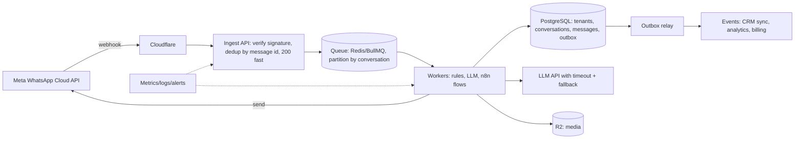

# System Design

> [!abstract] TL;DR
> System design is choosing components and their interactions to meet **functional requirements** plus **non-functional** ones (latency, throughput, availability, consistency, cost, security, operability) under real constraints like budget and team size.
> - **Toolkit**: stateless services behind load balancers, caches, a relational system of record, replicas/partitioning, queues/streams for async work, CDNs/object storage, and observability.
> - **Discipline**: estimate first, design for failure (timeouts, retries with jitter, idempotency, backpressure), and **choose the simplest architecture that meets the SLOs**. For a solo founder that's usually a modular monolith on [[PostgreSQL]] + [[Redis]] + a queue, not microservices.

## Introduction
- **What**: the architecture of software systems at the component level: data flow, storage, scaling, failure handling and trade-offs.
- **Roots**: classic distributed-systems research (Lamport clocks 1978, Paxos 1989/1998, Raft 2014), industry papers (Google File System 2003, MapReduce 2004, Bigtable 2006, Amazon Dynamo 2007, Spanner 2012), and books (Kleppmann's *Designing Data-Intensive Applications*).
- **Where it sits**: every product decision with scaling, reliability or cost consequences. Also client proposals (architecture diagrams, SLAs) and interviews.

## Core Concepts

### Requirements and estimation
| Question | Example (SME WhatsApp automation SaaS) |
|---|---|
| Users / tenants | 300 SMEs, 2M end-customers |
| Peak load | 50 msg/s inbound, bursts ×10 during promotions |
| Latency target | Auto-reply p95 < 3 s (LLM included) |
| Availability (SLO) | 99.9% → ~43 min downtime/month |
| Data volume | 50M messages/year × ~1 KB ≈ 50 GB/year + media in object storage |
| Consistency needs | No duplicate replies, ordered per conversation |
| Compliance | PDPA (consent, retention, cross-border transfer), Meta platform policies |

Rules of thumb: 1 day ≈ 86,400 s (~10⁵). 1M requests/day ≈ 12 req/s average. Peak ≈ 3–10× average.

### Building blocks
| Block | Purpose | Examples |
|---|---|---|
| DNS + CDN/edge | Routing, caching, DDoS/WAF | [[Cloudflare]] |
| Load balancer / reverse proxy | Distribute load, TLS, health checks | [[Traefik]], [[Nginx]], cloud LBs |
| Stateless app tier | Horizontal scaling, rolling deploys | Node/Next.js containers on [[Coolify]]/[[Kubernetes]] |
| Cache | Reduce latency/DB load | [[Redis]] (cache-aside), CDN, in-process LRU |
| System of record | Durable, consistent data | [[PostgreSQL]] (+ read replicas) |
| Queue / stream | Async work, buffering, decoupling | BullMQ/[[Redis]], [[Kafka]], SQS, n8n queue mode |
| Object storage | Files/media/backups | R2, S3 |
| Search / analytics | Specialized reads | OpenSearch/Meilisearch, ClickHouse, [[Vector Databases]] |
| Observability | Metrics, logs, traces, alerts | Prometheus/Grafana, OpenTelemetry, Sentry |

### Scaling data
| Technique | Solves | Cost |
|---|---|---|
| Indexing + query tuning | Slow reads | Write overhead |
| Read replicas | Read throughput | Replication lag (stale reads) |
| Caching (cache-aside, write-through) | Hot reads | Invalidation complexity, stampedes |
| Partitioning (time/tenant) | Huge tables, retention | Query routing, cross-partition queries |
| Sharding (horizontal) | Write throughput beyond one primary | Cross-shard joins/transactions, rebalancing |
| CQRS / read models | Divergent read/write shapes | Eventual consistency, more moving parts |
| Event sourcing | Full audit/history | Complexity, schema evolution |

### Consistency and reliability patterns
- **CAP/PACELC**: under partitions choose consistency or availability. Otherwise latency vs consistency ([[NoSQL]]).
- **Idempotency keys** for every externally triggered write (webhooks, payments, retries).
- **Transactional outbox**: write the business row + an outbox event in one DB transaction, then a relay publishes to the queue. No lost or phantom events.
- **Sagas** for multi-service workflows: a sequence of local transactions with compensations (refund if shipping fails).
- **Timeouts + retries with exponential backoff and jitter + circuit breakers + bulkheads**, so one slow dependency doesn't take down everything.
- **Backpressure / load shedding**: bounded queues, 429/503 with `Retry-After`, prioritize critical traffic.
- **Multi-tenancy**: shared schema + `tenant_id` + RLS (cheapest), schema-per-tenant, or DB-per-tenant (strongest isolation, highest ops cost).

## Architecture / How It Works
Example: WhatsApp automation platform for SMEs (ZP's domain).

- **Ingest fast, process async**: webhook handlers must return 200 within seconds (Meta retries otherwise), so verify the signature, store or enqueue, and acknowledge.
- **Ordering per key**: partition the queue by conversation ID so messages from one customer are processed in order while different conversations run in parallel.
- **Exactly-once is a myth**: deliveries are at-least-once, so make processing idempotent (unique constraint on the provider message ID).
- **Rate limits are part of the design**: Meta messaging tiers, LLM tokens per minute, and per-tenant quotas, enforced with token buckets in Redis.

## Project Structure
N/A — a discipline, not a codebase. A lightweight design doc template per client project:
```text
docs/design/<feature>.md
1. Context & goals (business outcome, success metrics)
2. Requirements: functional, non-functional (SLOs, RPO/RTO, PDPA), constraints (budget, team)
3. Estimates (traffic, storage, cost per month in RM)
4. Architecture diagram + data model
5. Failure modes & mitigations (each dependency: what if slow/down?)
6. Security & access control
7. Alternatives considered & why rejected
8. Rollout, migration, rollback plan
9. Open questions / risks (third-party platform dependencies)
```

## Use Cases
| Scenario | Typical design |
|---|---|
| SME SaaS (≤ 10k users) | Modular monolith + Postgres (RLS) + Redis + queue + CDN, on 1–2 VPSs |
| Webhook-heavy integrations (WhatsApp, payments) | Ingest → queue → idempotent workers → outbox |
| Read-heavy content/catalog | CDN + cache + read replicas + static generation |
| Realtime chat/notifications | WebSocket gateway + Redis pub/sub/streams + presence store |
| Analytics/reporting | CDC/ETL to a columnar store, never heavy reports on the OLTP primary |
| AI features (RAG, agents) | Async jobs, vector index, LLM gateway with caching/fallbacks/cost limits |

## Pros & Cons
| Architecture | Pros | Cons |
|---|---|---|
| Monolith (modular) | Simple deploys, transactions, debugging. Ideal for solo/small teams | Scaling by component is coarse. Discipline needed to keep modules clean |
| Microservices | Independent scaling/deploys, team autonomy | Distributed failures, network latency, observability and ops cost |
| Serverless | No servers, scale to zero | Cold starts, vendor limits, cost at sustained load |
| Event-driven | Decoupling, audit trails, resilience to spikes | Eventual consistency, harder debugging |

## Alternatives & Peers
| Approach | Strength | Pick it when… |
|---|---|---|
| Modular monolith + managed services ([[Supabase]]) | Fastest delivery, fewest moving parts | Default for SME products |
| Microservices on [[Kubernetes]] | Org scale, polyglot | Many teams, clear bounded contexts |
| Serverless/edge (Workers, Lambda) | Spiky traffic, zero idle cost | Webhooks, lightweight APIs |
| Workflow engines ([[n8n]], [[Windmill]], Temporal) | Orchestration, retries and visibility built in | Integration-heavy business processes |

## Tips & Reminders
> [!tip]
> - Start with SLOs and failure modes, not technologies. Ask for every dependency: what happens when it's slow, down, or returns garbage?
> - Put timeouts on everything (HTTP clients, DB statements `statement_timeout`, LLM calls). Retries without timeouts multiply outages.
> - Design idempotency in from day one (unique constraints, idempotency keys). It's cheap early and painful later.
> - Prefer boring tech you can operate alone at 3 a.m. Each extra datastore is a backup, upgrade and security burden.
> - Track cost per tenant/request. Unit economics is a design requirement for SaaS.
> - **In ZP's stack**:
>   - **Default architecture**: [[Cloudflare]] → [[Traefik]]/[[Coolify]] → Next.js/Node API → [[Supabase]]/[[PostgreSQL]] with RLS → [[Redis]] (cache/BullMQ) → [[n8n]] queue mode for integrations, with R2 backups. It scales to thousands of SME tenants on a few VPSs.
>   - **Documentation**: write RPO/RTO and third-party dependencies (Meta, payment gateways, LLM providers) into client contracts.

## Versions & Breaking Changes
N/A — concepts don't version. Influential papers/milestones that shaped modern design:

| Work | Year | Contribution |
|---|---|---|
| Google File System / MapReduce | 2003 / 2004 | Commodity-hardware distributed storage and batch processing |
| Bigtable / Amazon Dynamo | 2006 / 2007 | Wide-column stores. Leaderless, eventually consistent KV (consistent hashing, quorums) |
| Kafka (LinkedIn) | 2011 | The log as the backbone of data integration |
| Spanner | 2012 | Globally consistent SQL with TrueTime |
| Raft | 2014 | Understandable consensus (etcd, Consul, CockroachDB) |
| *Designing Data-Intensive Applications* (2nd ed. 2025–26) | 2017 / 2025 | Standard reference for trade-offs |

## Critical Issues & Gotchas
> [!danger] Single-provider and control-plane failures
> - **AWS us-east-1 (2025-10-20)**: a DNS automation race condition for DynamoDB endpoints cascaded into EC2, Lambda and many dependent services for ~15 hours, taking down thousands of apps worldwide.
> - **CrowdStrike (2024-07-19)**: a faulty update crashed ~8.5M Windows hosts.
> - **Cloudflare (2025-11-18)**: a bad config file crashed its proxy globally.
>
> Lesson: map critical dependencies, keep break-glass paths, avoid putting all control planes in one region/provider when SLAs demand it, and communicate realistic SLAs to clients.

> [!danger] Retry storms, thundering herds and cache stampedes
> When a dependency recovers, synchronized retries or simultaneous cache expiry can knock it down again (metastable failures). Use jittered backoff, retry budgets, circuit breakers, request coalescing (single-flight), staggered TTLs and stale-while-revalidate.

> [!warning] Gotchas
> - Distributed transactions across services/APIs don't exist in practice. Use outbox + sagas + idempotency.
> - Read replicas lag, so read-your-own-writes needs routing to the primary after writes.
> - Clocks drift. Don't order events across machines by wall-clock time. Use DB sequences/ULIDs/UUIDv7 or logical clocks.
> - "Unlimited" auto-scaling + a bug (or an attack) = an unlimited bill. Set budgets, quotas and alerts.
> - Microservices for a 1–3 person team usually reduce velocity and reliability.

## Deep Dives
- [[System Design - Interview Questions]] — payment flow and high-traffic ticketing interview answers (reference)
- [[System Design - Multi-Tenant SaaS Architecture]]

Candidates: reliability patterns (timeouts, retries, outbox, sagas).

## Related
- [[Data Structures]] · [[Algorithms]] — building blocks inside components
- [[PostgreSQL]] · [[Redis]] · [[Kafka]] · [[NoSQL]] — storage and messaging choices
- [[Cloudflare]] · [[Traefik]] · [[Kubernetes]] — edge and runtime
- [[n8n]] — workflow orchestration in ZP's stack
- [[Design Patterns]] — code-level counterparts (adapter, strategy, observer)

## References
- Kleppmann, *Designing Data-Intensive Applications*
- Google SRE books: https://sre.google/books/
- AWS Builders' Library (timeouts, retries, backoff): https://aws.amazon.com/builders-library/
- System Design Primer: https://github.com/donnemartin/system-design-primer
- Transactional outbox pattern: https://microservices.io/patterns/data/transactional-outbox.html
- AWS us-east-1 2025-10 summary: https://aws.amazon.com/message/101925/
