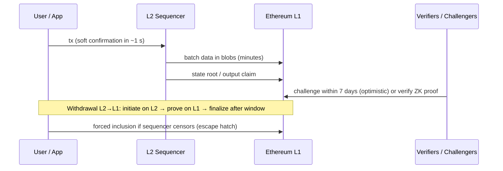

# Blockchain Fundamentals - L2 Rollups & Bridges

> [!info] Deep dive of [[Blockchain Fundamentals]]

> [!abstract] TL;DR
> - **Rollups**: execute transactions off L1 and post **data** (blobs) plus **proofs/claims** to Ethereum, inheriting L1 security *to the degree* their proof system, upgrade keys and exit mechanisms allow. **L2BEAT stages 0/1/2** rate exactly that.
> - **Bridges**: move value between chains, and their **trust model** (multisig vs light client/ZK vs native rollup bridge) decides your risk. Bridges remain the largest crypto-hack category, with ~USD 340M+ lost to bridge exploits in H1 2026 alone.
> - **For apps**: pick rollups by stage and ecosystem, prefer canonical/native bridges and native stablecoins (CCTP), and wait for proper finality before crediting large deposits.

## Concept

### Rollup anatomy
| Component | Role | Trust/centralisation today |
|---|---|---|
| **Sequencer** | Orders txs, gives soft confirmations in ~0.25–2 s | Usually one operator (censorship/downtime risk). Forced inclusion via L1 as escape hatch |
| Batcher | Posts compressed tx data to L1 (blobs since EIP-4844) | Operator |
| **Data availability (DA)** | Anyone can reconstruct state from posted data | Ethereum blobs = rollup. Off-chain DA (Celestia, EigenDA, committees) = validium/optimium (weaker) |
| **Proof system** | Optimistic: fraud proofs in a challenge window (~7 days). ZK: validity proofs | Permissionless proofs are what make a rollup more than a multisig |
| Upgrade keys / Security Council | Can change contracts | The biggest residual risk at Stage 0/1 |
| Canonical bridge | L1↔L2 deposits/withdrawals via the rollup's own contracts | As secure as the rollup itself |

### L2BEAT stages (simplified)
| Stage | Meaning | Key requirements |
|---|---|---|
| **0** | "Training wheels": effectively operator-trusted | Data on L1 + state reconstructable, but proofs may be absent/permissioned |
| **1** | Limited trust in a Security Council | Working permissionless proof system. Users can exit without the operator. Council override needs a high threshold (e.g. ≥75% of ≥8 members) |
| **2** | Trust-minimised | Council can act only on on-chain-provable bugs. Long exit window (≥30 days) before upgrades |

### Optimistic vs ZK rollups
| | Optimistic (Arbitrum, OP Mainnet, Base) | ZK (zkSync, Starknet, Scroll, Linea, Polygon zkEVM lineage) |
|---|---|---|
| Correctness | Assumed unless challenged (fraud proof) | Proven per batch (validity proof) |
| Withdrawal to L1 | ~7-day challenge window (fast bridges offer liquidity at a fee) | Hours (proof generation + verification) |
| EVM equivalence | High | Varies (type 1–4 zkEVMs). Some opcode/precompile differences |
| Cost driver | L1 data | L1 data + proving compute |

### Bridge trust models
| Model | Examples | Trust assumption | Risk profile |
|---|---|---|---|
| **Native/canonical rollup bridge** | Arbitrum/OP/Base bridges | Rollup security (stage-dependent) | Best for L1↔L2. Slow optimistic withdrawals |
| External validator / multisig (lock-and-mint) | Many historical bridges | m-of-n signers honest and secure | Largest historical losses (key compromise) |
| Oracle/messaging networks | Chainlink CCIP, LayerZero, Wormhole, Hyperlane | Decentralised oracle/guardian sets, configurable verifiers | Configuration mistakes (single verifier, weak DVN set) |
| Light-client / ZK bridges | IBC, ZK light clients | Cryptographic verification of source chain | Strongest, but newer, complex, limited routes |
| Liquidity / intent-based | Across, relayer networks | Solvers front liquidity, settle later | Smaller per-transfer risk, relies on settlement security |
| Issuer burn-and-mint | Circle CCTP for USDC | Stablecoin issuer | No wrapped tokens. Issuer trust (already implied by holding USDC) |

## How It Works

- **Three finality levels for an L2 tx**:
  1. sequencer soft confirmation (trust the operator)
  2. batch posted to L1 (data available)
  3. L1 finality of that batch (~13 min), plus the proof/challenge window for withdrawals
- **Bridge message verification** is the critical piece. Most catastrophic bridge hacks were **forged messages** accepted because verification (signatures, proofs, configuration) was broken or keys were stolen.

## Practical Usage

### Crediting deposits safely (viem)
```ts
import { createPublicClient, http } from "viem";
import { base } from "viem/chains";

const client = createPublicClient({ chain: base, transport: http(process.env.BASE_RPC) });

export async function isDepositFinal(txHash: `0x${string}`, amountUsd: number) {
  const receipt = await client.getTransactionReceipt({ hash: txHash });
  if (receipt.status !== "success") return false;
  if (amountUsd < 500) return true;                                   // small amounts: soft confirmation OK (business decision)
  const finalized = await client.getBlock({ blockTag: "finalized" }); // L2 block derived from finalized L1 data
  return receipt.blockNumber <= finalized.number;
}
```
- **Index deposits by event logs**, deduplicate on `(chainId, txHash, logIndex)`, and handle reorgs of soft-confirmed blocks ([[REST API - Webhooks & Idempotency]] style idempotency).

### Choosing chains and bridges for a payments/loyalty product
1. **Chain**: a Stage 1+ rollup with deep USDC/USDT liquidity and wallet support (Base and Arbitrum in 2026 per secondary sources). Check L2BEAT live data.
2. **Stablecoin**: use the **native** USDC (issued by Circle on that chain), not a bridged `USDC.e`. Move cross-chain via CCTP.
3. **User bridging**: link users to canonical bridges or reputable aggregators. Never deploy your own lock-and-mint bridge.
4. **Contracts**: set the compiler `evmVersion` per chain, and test on each target's testnet. L2s differ in precompiles, `block.number` semantics and gas pricing ([[Ethereum & EVM - Gas Optimization & EVM Internals]]).

## Patterns & Anti-patterns
| Pattern | When | Anti-pattern to avoid |
|---|---|---|
| Native rollup bridge or issuer burn/mint (CCTP) | Moving value to/from L1, USDC | Wrapped tokens from obscure multisig bridges |
| Tiered confirmation policy by amount | Deposits, payments | Crediting large deposits on sequencer soft confirmation |
| Check L2BEAT stage + upgrade delays before committing | Chain selection | Choosing purely on fees or grants |
| Multi-verifier configs on messaging bridges | Cross-chain apps | Single-signer/single-DVN defaults |
| Rate limits / circuit breakers on bridged mint paths | Token issuers, protocols | Unlimited mint on a single verified message |
| Reorg-aware indexers (finalized vs latest) | Backends | Treating `latest` as final |

## Performance & Trade-offs
- **Cost**: post-Dencun, L2 txs cost cents or less. PeerDAS (Fusaka) raises blob capacity further. Alt-DA chains are cheaper still, but trade away Ethereum DA guarantees.
- **UX vs security**: fast bridges and soft confirmations give instant UX with extra trust. Canonical optimistic withdrawals take days. Offer both, explain the difference, and limit amounts on fast paths.
- **Fragmentation**: liquidity and users split across many L2s. Consolidating on 1–2 leading rollups keeps support costs down for an SME product.
- **Sequencer downtime** happens (multi-hour incidents have occurred on major L2s). Design for "chain unavailable" states in the UI and queue actions.

## Tips & Reminders
> [!tip]
> - **Track the "exit window"** (time users have to exit before an upgrade takes effect). It's a better single risk indicator than TVL.
> - **Monitor bridge contracts** you depend on (pauses, admin changes, unusual mints) with alerting. Many hacks drain within minutes.
> - **Accounting**: record chain ID plus token contract address (not just the symbol), because "USDC" on different chains or bridges are different assets.
> - **In ZP's stack**: for crypto-enabled client products (loyalty points, stablecoin payments), use Base or Arbitrum with native USDC, viem/wagmi on the frontend, an indexer writing to Supabase with finalized-block confirmation for large amounts, and ERC-4337/7702 smart wallets ([[Web3 Wallets - Key Management & Account Abstraction]]). Check Malaysian SC/BNM rules before touching custody or payments.

## Version Notes
| Date | Milestone |
|---|---|
| 2021 | Arbitrum One and Optimism mainnets (rollup-centric roadmap) |
| 2023 | OP Stack / Base launch. ZK rollup mainnets (zkSync Era, Polygon zkEVM, Linea, Scroll) |
| 2024-03 | Dencun (EIP-4844 blobs): L2 fees drop 10–100× |
| 2024–25 | Permissionless fraud proofs (Arbitrum BoLD, OP fault proofs). L2BEAT stages widely adopted |
| 2025-12 | Fusaka PeerDAS: more blob throughput |
| 2026 | Major optimistic rollups reported at Stage 1. Bridge exploits again the top loss category |

> [!warning] Unverified — check before relying on this
> Current L2BEAT stages per chain (sources disagree on whether OP Mainnet/Base are Stage 1) and the 2026 incident figures come from secondary sources. Check l2beat.com and incident post-mortems before citing them.

## Critical Issues & Gotchas
> [!danger] Bridges are the biggest honeypots
> - **History**: Ronin (2022, ~USD 625M, 5/9 validator keys), Wormhole (2022, ~USD 325M, signature verification bug), Nomad (2022, ~USD 190M, initialisation bug made any message valid), Multichain (2023, key custody collapse).
> - **2026 so far**: bridge losses passed **USD 340M by June** (PeckShield), including **Kelp DAO** (Apr 2026, ~USD 292M via a forged cross-chain message) and AFX/Verus (Jul 2026, ~USD 31.7M).
> - **Rule**: avoid holding user funds in bridged representations you can't redeem natively.

> [!danger] Stage 0 means "trust the operator"
> On Stage 0 rollups and most alt-DA chains, upgrade keys can change contracts, including the bridge, with little or no delay. User funds are then only as safe as those keys. For client funds or payment flows, require Stage 1+ (and preferably long exit windows), or keep balances minimal on L2.

> [!warning] Gotchas
> - The same address can mean different contracts on different chains (or none). Always pair it with the chain ID.
> - `block.timestamp` and `block.number` behave differently on some L2s (L1 block number vs L2). Don't use them for fine-grained timing.
> - Withdrawals from optimistic rollups need **two L1 transactions** (prove + finalize) after the window. Users forget the second step.
> - Some L2s lack specific precompiles/opcodes, or price them differently. Test deployments per chain.
> - Bridged token metadata (symbol/decimals) can mislead. Verify contract addresses against official lists.

## Related
- [[Blockchain Fundamentals]]
- [[Ethereum & EVM]] — L1 settlement, blobs, finality
- [[Ethereum & EVM - Gas Optimization & EVM Internals]] — L2 fee composition
- [[Solidity - Smart Contract Security]] — bridge/message verification bugs
- [[Web3 Wallets - Key Management & Account Abstraction]] — smart wallets on L2s
- [[System Design]] — finality, idempotent indexing

## References
- L2BEAT (stages, risk analysis): https://l2beat.com/scaling/summary
- L2BEAT stages framework: https://medium.com/l2beat/introducing-stages-a-framework-to-evaluate-rollups-maturity-d290bb22befe
- Ethereum.org, Layer 2: https://ethereum.org/en/layer-2/
- Ethereum.org, bridges: https://ethereum.org/en/bridges/
- Circle CCTP: https://developers.circle.com/stablecoins/cctp-getting-started
- PeckShield bridge hacks 2026 coverage (DEXTools): https://www.dextools.io/news/crypto-bridge-hacks-340-million-2026-peckshield-alert-june-2026-de
