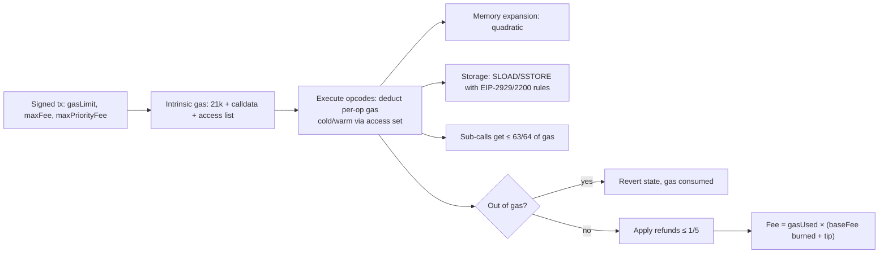

# Ethereum & EVM - Gas Optimization & EVM Internals

> [!info] Deep dive of [[Ethereum & EVM]]

> [!abstract] TL;DR
> - **What costs gas**: the EVM is a 256-bit stack machine, and gas prices **state access**, not computation. A cold `SLOAD` costs 2,100, a new non-zero `SSTORE` 20,000+, while an `ADD` costs 3.
> - **Where to optimize**: fewer storage writes, packed slots, cached reads, `immutable`/`constant`, calldata over memory, events for history, and transient storage for intra-tx flags.
> - **On L2s**: the cost driver is L1 **data**, so minimize calldata/blob bytes.
> - **Don't hard-code gas**: Glamsterdam's state repricing (EIP-8037/8038) will shift costs, so never hard-code gas amounts or stipends.

## Concept

### Data locations
| Location | Lifetime | Cost profile | Use for |
|---|---|---|---|
| Stack | Instruction | 2–3 gas per op, 1,024 depth, only top 16 reachable (`DUP`/`SWAP`) | Locals |
| Memory | Call frame | 3 gas/word + **quadratic** expansion | Temporary arrays, ABI encoding |
| Calldata | Tx (read-only) | 16 gas/non-zero byte, 4/zero byte (EIP-7623 floor for data-heavy txs) | External function inputs |
| **Storage** | Permanent | Cold read 2,100. Write 0→x 20,000, x→y 2,900 (+2,100 if cold) | State that must persist |
| **Transient** (EIP-1153) | Tx | `TSTORE`/`TLOAD` ~100 | Reentrancy locks, intra-tx flags |
| Code / immutables | Contract life | Read via `CODECOPY`/embedded, cheap | Config fixed at deploy |
| Logs | Permanent (not readable on-chain) | 375 + 375/topic + 8/byte | History, indexing (off-chain) |

### Key gas facts (post-Berlin/London/Cancun)
| Operation | Gas | Source |
|---|---|---|
| Tx base | 21,000 | Yellow Paper |
| Cold account access (`CALL`, `BALANCE`, `EXTCODESIZE`) | 2,600. Warm: 100 | EIP-2929 |
| Cold `SLOAD` / warm `SLOAD` | 2,100 / 100 | EIP-2929 |
| `SSTORE` zero → non-zero | 20,000 (+2,100 cold) | EIP-2200/2929 |
| `SSTORE` non-zero → non-zero | 2,900 (+2,100 cold) | EIP-2929 |
| Clearing a slot refund | 4,800, refunds capped at 1/5 of tx gas | EIP-3529 |
| `CREATE` | 32,000 + init code + 200/byte deployed | EIP-3860 adds init-code word cost |
| `KECCAK256` | 30 + 6/word | — |
| Call forwarding | At most 63/64 of remaining gas | EIP-150 |
| Single tx gas cap | ~16.7M (2²⁴) | EIP-7825 (Fusaka) |

## How It Works

- **Access sets**: the first touch of an address/slot in a tx is **cold** and later touches are **warm**. Access lists (EIP-2930) prepay warming, which is worth it only when you'd touch those slots anyway.
- **Storage slot layout**: state variables fill 32-byte slots in declaration order, packing smaller types together. Mappings live at `keccak256(key . slot)`, and dynamic arrays at `keccak256(slot) + index`.

## Practical Usage

### Storage packing and caching
```solidity
// ❌ 3 slots: each write/read pays separately
contract Bad {
    uint256 price;      // slot 0
    bool active;        // slot 1
    uint64 updatedAt;   // slot 2
}

// ✅ 2 slots: price alone; active + updatedAt + owner share slot 1
contract Good {
    uint256 public price;          // slot 0
    address public owner;          // slot 1 (20 bytes)
    uint64 public updatedAt;       // slot 1 (8 bytes)
    bool public active;            // slot 1 (1 byte)
    uint256 public immutable feeBps;   // no storage at all (embedded in code)
    bytes32 public constant ROLE_ADMIN = keccak256("ADMIN");  // compile-time constant

    constructor(uint256 _feeBps) { feeBps = _feeBps; owner = msg.sender; }

    function payout(address[] calldata to, uint256[] calldata amt) external {   // calldata: no copy to memory
        uint256 total;
        uint256 len = to.length;                    // cache length
        for (uint256 i; i < len; ) {
            total += amt[i];
            unchecked { ++i; }                      // overflow impossible: bounded by len
        }
        uint256 p = price;                          // cache SLOAD once (2,100 cold), reuse from stack
        require(total <= p * 10, ExceedsCap(total));
        // ...
    }
    error ExceedsCap(uint256 total);                // custom errors: cheaper than revert strings
}
```

### Common wins (ordered by typical impact)
| Technique | Saves | Notes |
|---|---|---|
| Avoid storage writes (emit events, compute off-chain, store hashes/Merkle roots) | 5k–20k per write | Indexers (The Graph, own Postgres) read events |
| Pack related fields into one slot, write them together | 2.9k–20k per avoided slot | Order fields by size. Use structs |
| Keep slots non-zero (counters start at 1, use `1/2` instead of `false/true` for flags) | ~17k per 0→non-zero avoided | OpenZeppelin `ReentrancyGuard` uses 1/2 for this reason |
| Cache storage in locals inside loops | 100 per repeated warm read | Big for loops |
| `immutable` / `constant` for config | 2.1k per read | Set in constructor |
| `calldata` params for external functions | Copy cost | Especially arrays/bytes |
| Mappings + bitmaps over arrays | Avoid O(n) loops and expansions | E.g. claimed-airdrop bitmaps: 256 flags per slot |
| Transient storage for locks | Most of the SSTORE lock cost (~100 vs thousands per call) | `ReentrancyGuardTransient` (OZ 5.1+) |
| Minimal proxies (ERC-1167) / clones for many instances | Deployment gas | Watch storage layout for upgradeable proxies |
| Batch operations (multicall, EIP-7702 batched calls) | 21k base per extra tx | Wallet UX too ([[Web3 Wallets - Key Management & Account Abstraction]]) |

### Measure, don't guess (Foundry)
```bash
forge test --gas-report                    # per-function min/avg/max
forge snapshot && forge snapshot --diff    # CI regression on gas
forge build --optimize --optimizer-runs 200 --via-ir    # runs: low = cheaper deploy, high = cheaper calls
cast run <txhash> --trace                  # opcode-level trace of a mainnet tx
```

### L2 economics
- **Fee composition**: on rollups (Base, Arbitrum, Optimism, zkSync), fee ≈ L2 execution (cheap) + **L1 data cost** (blobs since EIP-4844).
- **Implication**: storage and opcode tricks matter less than **bytes posted**.
- **How to cut bytes**: shorter calldata (packed `bytes` instead of ABI-encoded structs, IDs instead of addresses), batched txs, and compression-friendly encodings.

## Patterns & Anti-patterns
| Pattern | When | Anti-pattern to avoid |
|---|---|---|
| Events for history, storage for current state | Logs, audit trails | Storing every historical record in arrays on-chain |
| Merkle roots + proofs | Airdrops, allowlists | Writing 10,000 addresses into a mapping |
| Bounded loops or pull-payments | Payouts, distributions | Unbounded loops over user arrays (DoS when gas exceeds limits) |
| `--via-ir` + tuned optimizer runs | Production builds | Shipping unoptimized builds, or golfing assembly before measuring |
| Audited libraries (OpenZeppelin, Solady) | Common primitives | Hand-written assembly copied from tweets |
| Gas-agnostic code (`call{value:}` with checks) | Transfers to unknown recipients | `transfer`/`send` with the 2,300 stipend (breaks with smart accounts and repricings) |

## Performance & Trade-offs
- **Readability vs gas**: assembly and bit-packing save hundreds of gas but raise audit cost and bug risk ([[Solidity - Smart Contract Security]]). Optimize hot paths only, measured by `forge snapshot`.
- **Optimizer runs**: `runs = 200` is a balanced default. High-traffic contracts (DEX routers) use 10k+ (bigger bytecode, cheaper calls), and one-shot deploys use 1.
- **Contract size limit** (24 KB, EIP-170; Glamsterdam proposals raise it): fighting the limit with libraries or diamonds adds call overhead.
- **Upgradeable proxies** add a `DELEGATECALL` plus cold implementation access per call (~2.6k+). That's acceptable for flexibility, but immutable contracts are cheaper and simpler to trust.

## Tips & Reminders
> [!tip]
> - Use **evm.codes** for opcode costs per fork, and verify assumptions after each hard fork.
> - **Simulate** user-facing txs (`eth_estimateGas`, Tenderly) and add a 10–20% buffer. Don't hard-code `gasLimit` in frontends.
> - For **payments/stablecoin apps**, the user-facing cost is mostly L2 data plus paymaster sponsorship. Model gas per action × expected volume before choosing a chain.
> - **In ZP's stack**: Web3 features usually run on an L2 (Base/Arbitrum/Polygon), with indexing via events into [[PostgreSQL]]/Supabase, gas sponsorship via ERC-4337/7702 paymasters, and Foundry gas snapshots in CI ([[CI-CD]]).

## Version Notes
| Fork | Gas-relevant changes |
|---|---|
| Berlin (2021-04) | EIP-2929 cold/warm access costs, EIP-2930 access lists |
| London (2021-08) | EIP-1559 base fee burn, EIP-3529 reduced refunds (no more gas tokens) |
| Shanghai (2023-04) | `PUSH0` (EIP-3855), init-code metering (EIP-3860) |
| Dencun (2024-03) | Transient storage `TSTORE`/`TLOAD` (EIP-1153), `MCOPY` (EIP-5656), blobs (EIP-4844) |
| Pectra (2025-05) | Calldata floor pricing for data-heavy txs (EIP-7623), EIP-7702 delegation |
| Fusaka (2025-12) | Tx gas cap ~16.7M (EIP-7825), gas limit ~60M, PeerDAS (cheaper blobs at scale) |
| **Glamsterdam** (testing, H2 2026+) | State access/creation repricing (EIP-8037/8038 scheduled), block access lists (EIP-7928), ePBS (EIP-7732), gas-limit path toward ~200M |

> [!warning] Unverified — check before relying on this
> Glamsterdam's final EIP set, exact new gas costs and mainnet date were still in flux in October 2026 (the EF repricing-testing post is dated 2026-08-24). Check Forkcast/ACD notes, and re-run gas snapshots on Glamsterdam devnets.

## Critical Issues & Gotchas
> [!danger] Gas repricing breaks hard-coded assumptions
> - **The trigger**: the EF's Glamsterdam replay testing found contracts that rely on today's gas costs, e.g. fixed gas stipends, `gasleft()` checks, or loops sized to a gas budget. These can break or degrade when state access is repriced.
> - **Precedents**: EIP-1884 (2019) broke contracts relying on 2,300-gas `transfer` to proxies. EIP-3529 killed gas-token refunds.
> - **Fix**: write gas-agnostic code and test on upgrade devnets.

> [!danger] Gas-optimised ≠ safe
> - **Typical failures**: unchecked arithmetic in the wrong place, packing that truncates values (`uint64` timestamps fine, `uint64` token amounts not), and assembly that skips bounds or zero checks.
> - **Reality**: these bugs have lost far more money than gas ever saved.
> - **Discipline**: optimise after tests and fuzzing, never before.

> [!warning] Gotchas
> - Gas refunds don't reduce `gasLimit` needs. The tx must still have enough gas before refunds apply.
> - Reading `array.length` inside loop conditions re-reads storage for storage arrays. Cache it.
> - `delete` on large structs/arrays can exceed block/tx gas caps (Fusaka cap ~16.7M per tx).
> - Precompile and opcode availability differs on some L2s/sidechains (`PUSH0` saga). Set the compiler `evmVersion` to the target chain.
> - Memory expansion is quadratic, so building huge in-memory arrays can cost more than storage reads.

## Related
- [[Ethereum & EVM]]
- [[Solidity]] — language features affecting gas (immutables, custom errors, unchecked)
- [[Solidity - Smart Contract Security]] — where optimisations introduce bugs
- [[Web3 Wallets - Key Management & Account Abstraction]] — batching, paymasters, EIP-7702
- [[Blockchain Fundamentals]] — fee markets, rollups, data availability
- [[Data Structures]] — bitmaps, Merkle trees, mappings

## References
- evm.codes (opcode gas by fork): https://www.evm.codes/
- Ethereum Yellow Paper: https://ethereum.github.io/yellowpaper/paper.pdf
- EIP-2929 (gas cost increases for state access): https://eips.ethereum.org/EIPS/eip-2929
- EIP-1153 (transient storage): https://eips.ethereum.org/EIPS/eip-1153
- EF blog, Glamsterdam repricing testing (2026-08-24): https://blog.ethereum.org/2026/08/24/glamsterdam-repricing-testing
- Foundry gas tracking: https://book.getfoundry.sh/guides/gas
