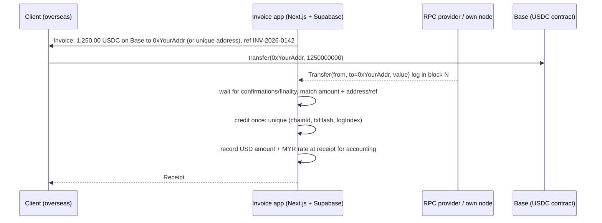

# Ethereum & EVM - Stablecoin Payments & On-Chain Settlement

> [!info] Deep dive of [[Ethereum & EVM]]

> [!abstract] TL;DR
> Stablecoins (USDC, USDT) settle **cross-border B2B and digital-service payments** in minutes, for cents, 24/7, on L2s (Base, Arbitrum, Polygon) or other chains. The engineering is simple:
> - a unique payment reference or address per invoice;
> - watch ERC-20 `Transfer` logs;
> - wait for appropriate finality;
> - credit idempotently by `(chainId, txHash, logIndex)`.
>
> The hard parts are **custody, compliance and accounting**. In Malaysia, ringgit stablecoins are still in **BNM's 2026 sandbox** (wholesale pilots only), and acting as a payment intermediary for others can require licensing. Start by accepting USD stablecoins for your *own* invoices from overseas clients, or use a regulated processor, never as a payment rail for Malaysian consumers.

## Concept
| Approach | How | Pros | Cons | Pick it when… |
|---|---|---|---|---|
| Regulated processor (e.g. Stripe stablecoin payments, crypto payment gateways) | Hosted checkout, fiat payout | Compliance, FX and accounting handled | Fees, KYC onboarding, supported regions | Client-facing checkout, fiat settlement |
| **Direct transfer to your wallet** | Invoice shows address + amount + network | Cheapest, simplest | Matching payments, custody, accounting yourself | Your own B2B invoices to overseas clients |
| Unique deposit address per invoice | HD-derived addresses or CREATE2 forwarders | Exact matching | Sweeping funds, gas management | Higher volume self-hosted acceptance |
| Smart-contract checkout (payment router with invoice ID) | `pay(invoiceId)` emits an event | Clean matching | Contract risk, audits | Products built on-chain |

**Network choice for USD stablecoins**:

| Network | Fee (typical) | Notes |
|---|---|---|
| Ethereum L1 | Dollars at busy times | Highest security, expensive for small invoices |
| Base / Arbitrum / Optimism (L2) | Cents | Native USDC (Circle). Sequencer centralization, 7-day withdrawals for optimistic rollups |
| Polygon PoS | Cents | Widely supported by exchanges |
| Tron (USDT) | Low | Very common in Asia OTC flows, but higher AML/sanctions exposure |
| Solana (USDC) | Fractions of a cent | Non-EVM: different tooling |

**Malaysia context (as of 2026)**:

| Item | Status |
|---|---|
| BNM Digital Asset Innovation Hub | 3 pilots onboarded (Feb 2026): Standard Chartered + Capital A B2B ringgit stablecoin settlement, Maybank and CIMB tokenised deposits. Wholesale focus |
| Policy clarity on ringgit stablecoins/tokenised deposits | Promised by end-2026 |
| Securities Commission | Regulates digital-asset exchanges (DAX), custodians and token offerings |
| Crypto as legal tender | No. Ringgit only |

## How It Works


## Practical Usage
**Watch USDC transfers to your address** (viem; verify the token address from Circle's docs):
```ts
import { createPublicClient, http, parseAbiItem } from 'viem';
import { base } from 'viem/chains';

const client = createPublicClient({ chain: base, transport: http(process.env.BASE_RPC_URL) });
const USDC_BASE = '0x833589fCD6eDb6E08f4c7C32D4f71b54bdA02913';   // check official list before use
const transfer = parseAbiItem('event Transfer(address indexed from, address indexed to, uint256 value)');

const logs = await client.getLogs({
  address: USDC_BASE, event: transfer, args: { to: process.env.RECEIVE_ADDRESS as `0x${string}` },
  fromBlock: lastScannedBlock + 1n, toBlock: (await client.getBlockNumber()) - 12n,   // confirmation buffer
});
for (const l of logs) {
  await db.rpc('credit_stablecoin_payment', {
    p_chain_id: base.id, p_tx_hash: l.transactionHash, p_log_index: l.logIndex,
    p_from: l.args.from, p_amount_units: l.args.value!.toString(), p_decimals: 6,
  });                                                                 // unique constraint → idempotent
}
```
**Idempotent crediting table**:
```sql
create table public.chain_payments (
  chain_id int not null, tx_hash text not null, log_index int not null,
  invoice_id uuid references public.invoices, amount_units numeric(78,0) not null, decimals int not null,
  usd_amount numeric(18,6) generated always as (amount_units / power(10::numeric, decimals)) stored,
  myr_rate numeric(18,6), status text not null default 'pending',     -- pending | confirmed | matched | refunded
  primary key (chain_id, tx_hash, log_index)
);
```
**Payment request URI** (EIP-681; wallets that support it prefill the transfer):
```text
ethereum:0x833589fCD6eDb6E08f4c7C32D4f71b54bdA02913@8453/transfer?address=0xYourReceiveAddress&uint256=1250000000
```
**Wrong way**:
```text
❌ Match payments by amount alone across all invoices       → two RM-equivalent invoices, one payment, wrong credit
❌ Credit on first sighting (0 confirmations)              → reorgs / dropped txs credit money you never got
❌ Hot wallet private key in .env on the web server         → server compromise = funds gone, irreversibly
❌ Accepting "USDT" without stating the network             → client sends on the wrong chain; funds stuck or lost
```

## Patterns & Anti-patterns
| Pattern | When | Anti-pattern to avoid |
|---|---|---|
| Invoice states exact token, network, address, amount, expiry | Every invoice | "Send USDT to this address" |
| Unique address or on-chain reference per invoice | > a few payments/month | Amount-only matching |
| Confirmation policy per network (e.g. L2: wait for batch posting or N blocks; L1: finality) | Crediting | Instant credit |
| Receive-only address. Treasury in multisig/hardware wallet | Custody | Spending from the same hot key that receives |
| Record USD value + MYR rate at receipt time | Accounting/tax | Reconstructing rates at year end |
| Sanctions/risk screening of sending addresses for larger amounts | B2B | Ignoring source of funds |
| Regulated processor for consumer checkout | Selling to the public | DIY crypto checkout for Malaysian retail |

## Performance & Trade-offs
- **Settlement speed vs finality**: L2s give fast confirmations, but full L1 finality takes longer (optimistic rollups' withdrawal window is 7 days, though deposits to your L2 address are usable sooner). Choose a risk-based policy by amount.
- **Costs**: L2 transfers cost cents versus SWIFT/wire fees and FX spreads, which is a real advantage for overseas B2B clients. Off-ramping to MYR via a licensed DAX adds fees/spreads and KYC.
- **Issuer risk**: USDC/USDT issuers can freeze addresses, and depegs have happened (USDC briefly in 2023). Don't hold operating cash long-term in one stablecoin.
- **RPC dependence**: use a reliable provider or two, and re-scan ranges after outages to avoid missed payments.

## Tips & Reminders
> [!tip] In ZP's stack
> - **Practical first step**: let overseas clients pay Rarticle invoices in USDC on Base/Arbitrum to a receive address. Supabase stores invoices and `chain_payments`, a small worker scans logs, and n8n sends the receipt. Off-ramp via a Malaysian SC-registered DAX ([[System Design - Event-Driven Architecture & Outbox Pattern]]).
> - **For clients**: don't build crypto acceptance for Malaysian SME retail customers until BNM's ringgit stablecoin framework is clear (end-2026). Recommend licensed processors if a client insists.
> - **Your CEX background helps** with deposit address management, confirmation policies, sweeping and reconciliation, the same patterns at much smaller scale.

- Keep a separate wallet per business entity, and document addresses in the finance SOP.
- Reconcile monthly: on-chain balances versus credited payments versus accounting entries.
- Use hardware wallets/multisig (Safe) for treasury, and smart accounts with spending limits for operations ([[Web3 Wallets - Key Management & Account Abstraction]]).
- Get tax/accounting advice on digital-asset receipts (LHDN treatment). Mark this in the client SOW if you invoice in stablecoins.

## Version Notes
| Date | Change |
|---|---|
| 2023-03 | USDC briefly depegs (SVB exposure), a reminder of issuer/reserve risk |
| 2024–25 | Major processors add stablecoin acceptance. Native USDC on major L2s replaces bridged versions |
| 2025-12 | Fusaka upgrade: more blob capacity, cheaper L2 data costs ([[Ethereum & EVM]]) |
| 2026-02 | BNM onboards 3 ringgit stablecoin / tokenised-deposit pilots (wholesale) in its Digital Asset Innovation Hub |
| End-2026 (planned) | BNM clarity on ringgit stablecoins and tokenised deposits |

> [!warning] Unverified — check before relying on this
> Malaysian licensing requirements for accepting or intermediating stablecoin payments, tax treatment, the RMJDT stablecoin's status, and the USDC contract address on Base weren't verified against primary sources. Check BNM, SC and Circle documentation, and get legal advice before offering this to clients.

## Critical Issues & Gotchas
> [!danger] Regulatory exposure: intermediating payments
> Receiving stablecoins for your own invoices is very different from accepting them on behalf of clients (holding customer funds, converting, paying out). The latter can fall under payment-system, money-services or digital-asset custody rules, plus AML/CFT obligations (KYC, record-keeping, suspicious-transaction reporting). Don't build custodial payment features without legal sign-off and the right licenses.

> [!danger] Irreversible losses: keys, wrong networks, phishing
> On-chain transfers can't be reversed. Leaked private keys, malicious token approvals, address-poisoning look-alike addresses and wrong-network sends all mean permanent loss. Use receive-only addresses, hardware/multisig custody, address allowlists for payouts, and confirm the full address out-of-band for first payments ([[Solidity - Smart Contract Security]]).

- **Fake tokens**: anyone can deploy a token named "USDC". Match the official contract address, never the symbol.
- **Decimals**: USDC/USDT use 6 decimals on most chains. Store integer units and convert only for display.
- **Partial/over-payments**: define a policy (tolerance, top-up, refund) in the invoice terms.
- **Sanctioned addresses**: receiving from sanctioned wallets can taint funds and freeze exchange accounts. Screen larger payments.

## Related
- [[Ethereum & EVM]]
- [[Web3 Wallets - Key Management & Account Abstraction]] — custody, smart accounts, multisig
- [[Ethereum & EVM - Gas Optimization & EVM Internals]] — gas, logs and events
- [[Solidity - Smart Contract Security]] — approvals, phishing, contract risks
- [[REST API - Webhooks & Idempotency]] — idempotent crediting patterns
- [[Blockchain Fundamentals]] — finality, reorgs, confirmations

## References
- https://www.theblock.co/post/389370/malaysias-central-bank-stablecoin-initiatives
- https://www.thestar.com.my/business/business-news/2026/02/05/bank-negara-receives-30-35-stablecoin-applications-tests-ringgit-based-initiative
- https://developers.circle.com/stablecoins/usdc-contract-addresses
- https://eips.ethereum.org/EIPS/eip-681
- https://viem.sh/docs/actions/public/getLogs
