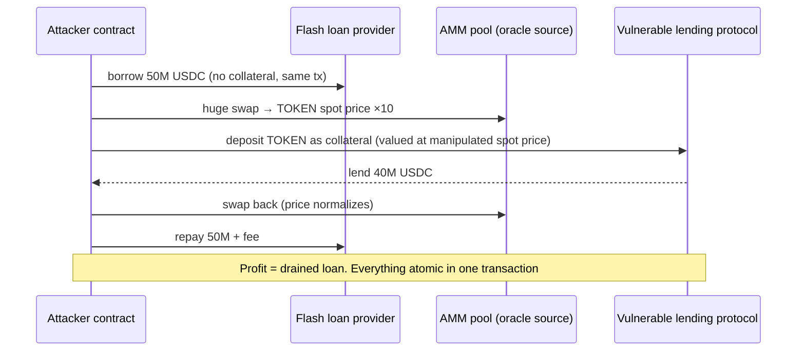

# Solidity - Smart Contract Security

> [!info] Deep dive of [[Solidity]]

> [!abstract] TL;DR
> Smart contracts are **public, immutable, adversarial programs holding money**. Every external function will be called in the worst possible order, with flash-loaned capital, by bots watching the mempool. The recurring loss classes:
> - Access control mistakes.
> - Price/oracle manipulation.
> - Reentrancy.
> - Rounding/precision errors.
> - Upgrade/initialization bugs.
> - Signature replay.
> - Off-chain key and front-end compromise.
>
> Defend in layers:
> - Minimal code on audited building blocks (OpenZeppelin).
> - Explicit invariants tested with fuzzing/invariant tests.
> - Static analysis.
> - External audits.
> - Timelocked upgrades.
> - On-chain monitoring with pause switches.

## Concept

### Vulnerability classes
| Class | Mechanism | Defence |
|---|---|---|
| **Access control** | Missing `onlyOwner`/role checks, unprotected `initialize`, `tx.origin` auth | `AccessControl`/`Ownable2Step`, initializer guards, `_disableInitializers()`, tests for every privileged function |
| **Reentrancy** (single, cross-function, cross-contract, read-only) | External call before state update lets the callee re-enter | Checks-effects-interactions, `nonReentrant` on all functions sharing state, don't use other protocols' `view` state mid-tx |
| **Oracle / price manipulation** | Spot prices from AMM pools moved with flash loans in one tx | TWAPs, Chainlink/Pyth with staleness + deviation checks, multiple sources, caps |
| **Rounding / precision** | Division truncation, ERC-4626 share inflation, accumulated rounding in favour of the user | Round in protocol's favour, `mulDiv` with explicit rounding, virtual shares/offsets, invariant tests |
| **Upgradeable proxy issues** | Storage collisions, uninitialized implementations, malicious upgrades | ERC-7201 namespaced storage, OZ upgrades plugin checks, timelock + multisig |
| **Signature issues** | Replay across chains/contracts, malleability, missing nonce/deadline | EIP-712 domain (chainId, verifyingContract), nonces, deadlines, OZ `ECDSA`/`SignatureChecker` (ERC-1271) |
| **Front-running / MEV** | Bots reorder/sandwich transactions | Slippage limits, commit-reveal, private orderflow, batch auctions |
| **Denial of service** | Unbounded loops, push payments that revert, gas griefing | Pull payments, bounded iterations, pagination, `call` with gas considerations |
| **Unsafe external calls** | Ignoring return values, `delegatecall` to untrusted code | `SafeERC20`, check returns, never `delegatecall` user-supplied addresses |
| **Token integration quirks** | Fee-on-transfer, rebasing, non-standard returns (USDT), ERC-777 hooks, blocklists | Measure balance deltas, allow-list tokens, `SafeERC20` |
| **Bad randomness** | `block.timestamp`, `prevrandao`, blockhash | Chainlink VRF, commit-reveal |
| **Business-logic flaws** | Wrong accounting, missing edge cases | Specification + invariants + review. The largest category in modern audits |

## How It Works

- **Atomicity cuts both ways**: attacks execute in a single transaction (flash loans make capital free), and they revert harmlessly if unprofitable. Attackers iterate on mainnet forks at no cost.
- **Composability**: your contract's safety depends on every token, oracle and protocol it calls. Read-only reentrancy exploits *other* protocols reading your mid-transaction state.
- **Immutability**: bugs can't be hot-fixed unless you planned an upgrade or pause path, and those paths are themselves attack surfaces (admin keys).

## Practical Usage

### Reentrancy: vulnerable vs fixed
```solidity
// VULNERABLE: external call before state update
function withdraw(uint256 amount) external {
    require(balances[msg.sender] >= amount, "insufficient");
    (bool ok, ) = msg.sender.call{value: amount}("");   // attacker's receive() re-enters withdraw()
    require(ok);
    balances[msg.sender] -= amount;                       // too late
}

// FIXED: checks-effects-interactions + guard
function withdraw(uint256 amount) external nonReentrant {
    uint256 bal = balances[msg.sender];
    if (bal < amount) revert Insufficient(bal, amount);
    balances[msg.sender] = bal - amount;                  // effects first
    (bool ok, ) = msg.sender.call{value: amount}("");    // interaction last
    if (!ok) revert TransferFailed();
}
```

### Oracle with staleness and sanity checks
```solidity
function _price() internal view returns (uint256) {
    (, int256 answer, , uint256 updatedAt, ) = feed.latestRoundData();
    if (answer <= 0) revert BadPrice();
    if (block.timestamp - updatedAt > MAX_STALENESS) revert StalePrice();   // e.g. 1 hour (match heartbeat)
    return uint256(answer);
}
```

### Invariant testing with Foundry
```solidity
// test/invariant/VaultInvariants.t.sol
contract VaultInvariants is StdInvariant, Test {
    Vault vault; Handler handler;
    function setUp() public {
        vault = new Vault(asset);
        handler = new Handler(vault);                 // bounded random deposits/withdraws/transfers by many actors
        targetContract(address(handler));
    }
    function invariant_solvency() public view {      // assets held ≥ total owed to depositors
        assertGe(asset.balanceOf(address(vault)), vault.totalAssetsOwed());
    }
    function invariant_sharesMatchSupply() public view {
        assertEq(vault.totalSupply(), handler.sumOfUserShares());
    }
}
```
```bash
slither . --exclude-dependencies          # static analysis (also: Aderyn)
forge test --fuzz-runs 50000              # fuzz + invariant tests
halmos                                    # symbolic testing of properties (a16z)
forge test --fork-url $MAINNET_RPC        # test integrations against real deployed protocols
```

## Patterns & Anti-patterns
| Pattern | When | Anti-pattern to avoid |
|---|---|---|
| Write invariants first (solvency, conservation, access) | Every protocol | Only unit-testing happy paths |
| OpenZeppelin/Solady audited components | Tokens, access control, upgrades, math | Hand-rolled ERC-20/proxies/signature checks |
| Pausable + rate limits / caps on new deployments | Launch phase | Unlimited TVL on day one |
| Timelock (24–72 h) + multisig for upgrades and parameters | Upgradeable systems | EOA admin keys with instant upgrade power |
| Pull over push payments | Distributions, refunds | Looping over users and `transfer`-ing in one tx |
| Independent tx simulation before multisig signing | Admin operations | Blind-signing payloads shown by a web UI |

## Performance & Trade-offs
- Security features cost gas: reentrancy guards (cheap with transient storage, `ReentrancyGuardTransient`), oracle checks, and extra storage for nonces. Small compared to exploit risk.
- Upgradeability trades immutability (trustlessness) for fixability, and adds governance and key-management risk. Immutable + minimal is safest when feasible.
- Audit cost/time: typically 1–4 weeks per ~1–2k lines of Solidity from reputable firms, with contests (Code4rena, Sherlock, Cantina) as complements. Audits reduce risk, they don't eliminate it.

## Tips & Reminders
> [!tip]
> - Freeze the code, write a spec + invariants, then audit. Re-audit any change before deployment (most exploits hit post-audit modifications).
> - Run a bug bounty (Immunefi) scaled to TVL (common rule: 10% of funds at risk, capped).
> - Monitor on-chain: alerts on large flows, admin calls, oracle deviations (Forta, Tenderly alerts, custom indexers to [[PostgreSQL]] + [[n8n]] alerts), with a tested pause runbook.
> - Pin compiler versions, and check the Solidity known-bugs list for your exact version/pipeline (e.g. the 0.8.34 IR transient-storage fix).
> - **In ZP's stack**: client "token/escrow" requests should start from OpenZeppelin Wizard with minimal custom logic. Budget an external audit, and never custody client funds in unaudited contracts. Contract liability belongs in the SOW (scope, audit responsibility, no guarantee of security).

## Version Notes
| Version / event | Change |
|---|---|
| Solidity 0.8.0 (2020-12) | Checked arithmetic by default: overflow class mostly gone (except in `unchecked` / assembly) |
| Cancun (2024-03) + Solidity 0.8.24+ | Transient storage → cheap reentrancy guards. `SELFDESTRUCT` neutered (EIP-6780) |
| Pectra (2025-05) | EIP-7702 breaks `tx.origin == msg.sender` / `extcodesize` EOA checks. Delegated EOAs can run code |
| OpenZeppelin Contracts 5.x | Custom errors, `Ownable` requires initial owner, ERC-7201 namespaced storage for upgradeables, `ReentrancyGuardTransient` |
| Solidity 0.8.34–0.8.36 (2026) | Bug-fix releases incl. a high-severity IR pipeline issue (transient `delete`) |

> [!warning] Unverified — check before relying on this
> Incident loss figures (notably Balancer 2025-11) are approximate and weren't re-checked this run. See rekt.news and the protocols' post-mortems.

## Critical Issues & Gotchas
> [!danger] Real losses come from logic, oracles and keys, not just classic bugs
> - **Euler Finance** (2023-03, ~USD 197M): a missing health check in `donateToReserves` enabled self-liquidation profit. Funds were later returned.
> - **Curve/Vyper** (2023-07, ~USD 70M): a compiler bug broke reentrancy locks.
> - **Balancer v2** (2025-11, ~USD 120M+): rounding/precision manipulation in composable stable pools across chains, in long-audited code.
> - **Bybit** (2025-02, ~USD 1.5B): a compromised multisig UI got signers to approve a malicious `delegatecall` upgrade.
>
> Lessons: invariant-test accounting edge cases, review compiler/toolchain risk, minimize admin power, and verify every signed payload independently.

> [!danger] Upgrade keys are the master key
> An upgradeable proxy controlled by one key (or a small multisig without timelock) means whoever compromises that key can replace the logic and drain everything. Users and auditors treat it as custodial. Use timelocks, multisigs with hardware signers on separate devices, monitoring of upgrade events, and plans to renounce or limit upgradeability over time.

> [!warning] Gotchas
> - `tx.origin` and `extcodesize == 0` aren't EOA checks (constructors, EIP-7702).
> - Rounding direction matters: deposits should round shares down, withdrawals should round assets down (in the protocol's favour).
> - `abi.encodePacked` with multiple dynamic types causes hash collisions in signatures/keys. Use `abi.encode`.
> - Events aren't state. Never use logs for authorization or accounting.
> - Cross-chain deployments: same address ≠ same code, chain-specific opcodes/EVM versions (`PUSH0`), and replay across chains without `chainid` in signatures.

## Related
- [[Solidity]]
- [[Ethereum & EVM]] — EVM semantics, Pectra/EIP-7702 implications
- [[Web3 Wallets]] — signer security, blind signing, multisig operations
- [[Blockchain Fundamentals]] — finality, MEV, oracle/bridge risks
- [[OWASP Top 10]] — web-app risk analogues (access control, integrity)
- [[Testing Strategy]] — property/invariant testing mindset

## References
- Solidity security considerations: https://docs.soliditylang.org/en/latest/security-considerations.html
- OpenZeppelin Contracts 5.x: https://docs.openzeppelin.com/contracts/5.x/
- Foundry invariant testing: https://book.getfoundry.sh/forge/invariant-testing
- Slither: https://github.com/crytic/slither
- SWC Registry / Smart Contract Weakness Classification: https://swcregistry.io/
- Rekt leaderboard (exploit post-mortems): https://rekt.news/leaderboard/
- Secureum security pitfalls: https://secureum.substack.com/
