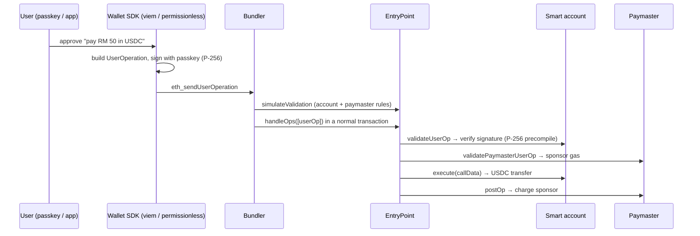

# Web3 Wallets - Key Management & Account Abstraction

> [!info] Deep dive of [[Web3 Wallets]]

> [!abstract] TL;DR
> - **Key management** decides who can move funds and how you recover. It covers:
>   - HD seeds (BIP-39/32/44).
>   - Hardware secure elements.
>   - **MPC/TSS**: keys split across parties, never assembled.
>   - HSMs, and policy engines for business custody.
> - **Account abstraction** moves authorization into code, so accounts can use passkeys, multisig, spending limits, session keys, gas sponsorship and social recovery.
>   - **ERC-4337**: UserOperations, bundlers, EntryPoint, paymasters. No protocol change needed.
>   - **EIP-7702** (Pectra, 2025): existing EOAs delegate their code to a smart-account implementation.
> - **The one thing to remember**: whatever validates signatures (a key share, a passkey, a contract) is the security boundary, and so is the UI that shows users what they sign.

## Concept

### Key management options
| Approach | How keys exist | Recovery | Best for |
|---|---|---|---|
| Seed phrase (BIP-39 → BIP-32 HD tree, BIP-44 paths) | One master secret derives all keys | Seed backup (paper/metal), optional passphrase | Individuals |
| Shamir / SLIP-39 | Seed split into M-of-N shares | Collect M shares | Individuals with distributed backups |
| Hardware wallet | Keys generated and kept in a secure element | Seed backup | High-value personal funds, multisig signers |
| **MPC / TSS** (GG20, CGGMP21, FROST for Schnorr/EdDSA) | Key shares on separate devices/servers. Signature computed jointly, the full key never exists | Re-sharing protocol, provider-assisted | Exchanges, fintechs, embedded wallets |
| HSM / cloud KMS (secp256k1 support) | Key inside tamper-resistant hardware, API-gated | Backup HSMs, key ceremonies | Regulated custodians, signing services |
| Multisig smart account (Safe) | M-of-N independent signer keys checked on-chain | Replace signers via the remaining quorum | Treasuries, protocol admin |

### Custody architecture for a business
- **Tiers**:
  - **Hot**: automated, small float, MPC/HSM.
  - **Warm**: policy approvals, quorum.
  - **Cold**: offline, manual ceremonies.
- **Policy engine**: whitelisted addresses, velocity/amount limits, time delays for new destinations, separation of duties, quorum per amount band.
- **Operations**: key ceremonies documented, signer devices dedicated (no email/browsing), independent transaction simulation, and an audit log for every approval.

### ERC-4337 components
| Component | Role |
|---|---|
| **Smart account** | Contract wallet with `validateUserOp` (custom auth: passkeys, multisig, session keys) |
| **UserOperation** | Signed intent: `sender`, `nonce`, `callData`, gas fields, `paymasterAndData`, `signature` |
| **Bundler** | Off-chain node collecting UserOps from an alt-mempool, simulating them, and submitting `handleOps` txs |
| **EntryPoint** | Singleton contract that validates and executes UserOps and handles gas accounting (versions v0.6 → v0.7 → v0.8) |
| **Paymaster** | Sponsors gas, or accepts ERC-20 for fees, under its own validation rules |
| **Factory** | Deploys accounts at **counterfactual** (CREATE2) addresses on the first UserOp |

### EIP-7702 (type-4 transaction)
- The EOA signs an **authorization** `(chain_id, delegate_address, nonce)`. The EOA's code becomes a delegation designator pointing to the delegate contract.
- The account keeps its address, balance and history, and gains batching, sponsorship and session keys via the delegate's logic. Delegating to `address(0)` revokes it.
- The original private key **still has full control**, so 7702 adds features without removing the single-key risk unless the delegate enforces more.

## How It Works

- **Validation vs execution split**: validation must be cheap and deterministic (ERC-7562 rules restrict storage and opcodes), so bundlers can't be griefed by ops that pass simulation and fail on-chain.
- **Passkeys**: WebAuthn P-256 signatures verified on-chain via the RIP-7212 precompile (L2s) and **EIP-7951** (L1, Fusaka), at a few thousand gas instead of ~300k for Solidity P-256 verification.
- **Modular accounts** (ERC-7579 / ERC-6900): pluggable validators (passkey, multisig), executors (automation) and hooks (spending limits), so you can upgrade features without migrating funds.
- **Signature validation for dApps**: ERC-1271 (`isValidSignature` on deployed contracts) and ERC-6492 (signatures from not-yet-deployed counterfactual accounts).

## Practical Usage

### Sending a sponsored UserOperation (viem account-abstraction)
```ts
import { createPublicClient, http, parseUnits, encodeFunctionData, erc20Abi } from "viem";
import { base } from "viem/chains";
import { createBundlerClient, createPaymasterClient } from "viem/account-abstraction";

const publicClient = createPublicClient({ chain: base, transport: http(RPC_URL) });
const account = await toPasskeySmartAccount({ client: publicClient, credential });   // provider-specific factory (e.g. Coinbase/Kernel/Safe adapters)

const bundler = createBundlerClient({
  account, client: publicClient, transport: http(BUNDLER_URL),
  paymaster: createPaymasterClient({ transport: http(PAYMASTER_URL) }),   // gas sponsored by the app
});

const hash = await bundler.sendUserOperation({
  calls: [{ to: USDC, data: encodeFunctionData({ abi: erc20Abi, functionName: "transfer", args: [merchant, parseUnits("50", 6)] }) }],
});
const receipt = await bundler.waitForUserOperationReceipt({ hash });
```

### EIP-7702 delegation (viem)
```ts
const authorization = await walletClient.signAuthorization({ contractAddress: AUDITED_DELEGATE });   // EOA → smart-account logic
await walletClient.sendTransaction({
  authorizationList: [authorization],
  to: walletClient.account.address,
  data: encodeFunctionData({ abi: delegateAbi, functionName: "executeBatch", args: [calls] }),
});
```

### Session key policy (concept)
```text
Session key K (stored in app, 24h expiry) may:
  - call USDC.transfer only to MERCHANT_ADDRESSES
  - max 200 USDC per day, max 10 calls
  - cannot change signers, cannot call delegate upgrades
Validated in the account's validator module; revocable by the owner passkey at any time.
```

## Patterns & Anti-patterns
| Pattern | When | Anti-pattern to avoid |
|---|---|---|
| Passkey owner + recovery guardians/backup signer | Consumer smart accounts | Seed phrases shown to non-technical users |
| Scoped, expiring session keys | Games, subscriptions, agent automation | Giving a backend hot key unlimited control of user accounts |
| Paymaster with per-user/per-op limits | Gasless onboarding | Open paymasters that attackers drain with spam UserOps |
| MPC/HSM + policy engine + quorum | Business/exchange custody | A single hot-wallet private key in an env var |
| Audited, widely used delegate contracts for 7702 | EOA upgrades | Delegating to unaudited/custom contracts |
| Simulate + decode before signing (wallet UX) | Every signature | Blind signing typed data or 7702 authorizations |

## Performance & Trade-offs
- **Gas**: 4337 UserOps cost more than plain EOA transfers (validation overhead plus the EntryPoint). Batching and L2s offset this. 7702 accounts avoid deployment cost.
- **Infra dependencies**: bundlers and paymasters are services (Pimlico, Alchemy, Coinbase, self-hosted). Their uptime and policies are now in your critical path.
- **MPC**: signing latency is network round trips between share holders (100 ms–seconds). Vendor protocols differ, so share portability between vendors is usually impossible.
- **Chain coverage**: smart accounts must be deployed per chain (same address via CREATE2 factories, but deployment state differs). Passkey precompiles vary by chain.

## Tips & Reminders
> [!tip]
> - Decide custody model and regulatory position **before** writing code: non-custodial (user holds keys/passkeys), hybrid MPC, or custodial (licensing). In Malaysia, holding customers' digital assets requires SC registration as a digital asset custodian.
> - Never generate or store user private keys on your servers for "convenience". Use passkeys, MPC providers or user-held keys.
> - Track EntryPoint version compatibility for accounts, bundlers and paymasters. Accounts are bound to an EntryPoint.
> - Support ERC-1271/6492 in backend SIWE verification so smart-account users can log in ([[Authentication & Authorization]]).
> - **In ZP's stack**: for crypto-payment or loyalty features, use an embedded wallet/MPC provider or passkey smart accounts on an L2 (Base/Arbitrum), sponsor gas with capped paymaster policies, and index UserOperation events into [[PostgreSQL]]. Keep any server-side signer in an isolated service with HSM/MPC and withdrawal policies ([[Network Security]]).

## Version Notes
| Change | Date | Notes |
|---|---|---|
| BIP-32/39/44, SLIP-39 | 2012–2019 | HD wallets, mnemonic standards |
| ERC-4337 EntryPoint v0.6 (mainnet) | 2023-03 | Account abstraction without a hard fork |
| EntryPoint v0.7 | 2024 | Packed UserOperation, gas efficiency |
| ERC-7579 modular accounts | 2024 | Interoperable validator/executor/hook modules |
| **EIP-7702** (Pectra) | 2025-05 | EOA code delegation (type-4 txs) |
| EntryPoint v0.8 | 2025 | 7702 support in 4337 flows |
| **EIP-7951** (Fusaka) | 2025-12 | secp256r1 (P-256) precompile on L1 → cheap passkey verification |

> [!warning] Unverified — check before relying on this
> EntryPoint versions, bundler/paymaster provider APIs and viem account-abstraction helper names evolve quickly. Check https://docs.erc4337.io/, https://viem.sh/account-abstraction and your provider's docs.

## Critical Issues & Gotchas
> [!danger] Delegation and approval phishing
> A single malicious EIP-7702 authorization, Permit/Permit2 signature or `setApprovalForAll` gives attackers ongoing control of an account's assets. Drainer kits targeting 7702 appeared within weeks of Pectra. Wallets must render delegation requests as high-risk, dApps should never ask users to delegate to unknown contracts, and users should periodically review and revoke delegations and approvals.

> [!danger] Smart-account and paymaster bugs are protocol-level losses
> Account implementations, validator modules and paymasters are smart contracts, with every bug class in [[Solidity - Smart Contract Security]]. A flaw in a widely used account factory or module can affect every user at once, and an unbounded paymaster can be drained by spam. Use audited implementations, cap paymaster spend per user/period, and monitor.

> [!warning] Gotchas
> - Counterfactual addresses: funds sent to an undeployed account address on a chain where the factory differs can be stuck. Verify factory + salt per chain.
> - The 7702 private key remains a single point of failure. Losing or leaking it bypasses all delegated logic.
> - Nonce models differ (4337 uses 2D nonces: key + sequence). Parallel UserOps need distinct nonce keys.
> - Passkeys synced across a user's cloud account mean an account compromise (Apple ID/Google) = wallet compromise. Offer a second factor or recovery guardians for large balances.
> - MPC vendor lock-in: key shares and recovery flows usually can't move to another provider without moving funds.

## Related
- [[Web3 Wallets]]
- [[Ethereum & EVM]] — transaction types, EIP-7702, precompiles
- [[Solidity - Smart Contract Security]] — risks in account/paymaster contracts
- [[Authentication & Authorization]] — passkeys/WebAuthn, SIWE
- [[Network Security]] — protecting signing infrastructure
- [[Blockchain Fundamentals]] — keys, signatures, finality

## References
- ERC-4337: https://eips.ethereum.org/EIPS/eip-4337
- EIP-7702: https://eips.ethereum.org/EIPS/eip-7702
- ERC-7579 (modular smart accounts): https://eips.ethereum.org/EIPS/eip-7579
- ERC-4337 docs: https://docs.erc4337.io/
- viem account abstraction: https://viem.sh/account-abstraction
- Safe docs: https://docs.safe.global/
