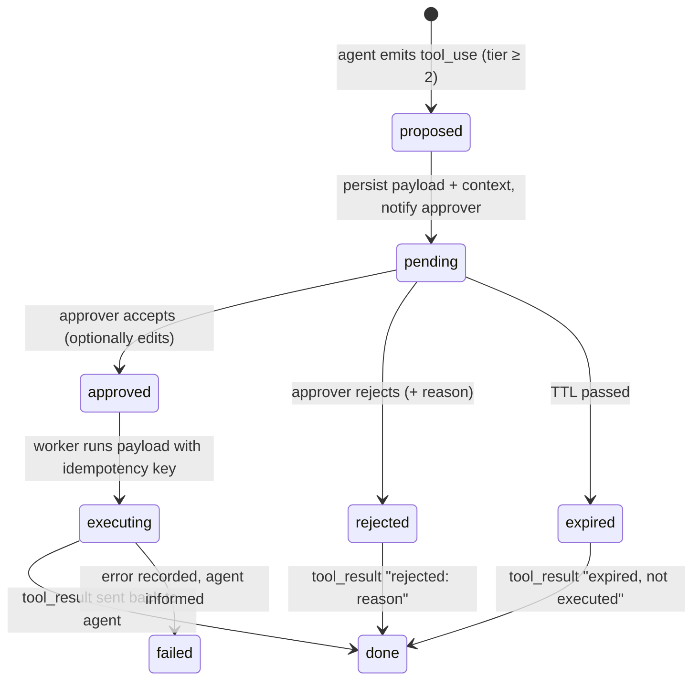

# AI Agents - Human-in-the-Loop & Approval Workflows

> [!info] Deep dive of [[AI Agents]]

> [!abstract] TL;DR
> Gate tools by **risk tier**:
> - **read-only** runs freely;
> - **reversible writes** run and get logged;
> - **irreversible, external or money-moving** actions become a **pending action** that a human approves, edits or rejects.
>
> Persist the paused state (DB/checkpointer), and never hold an HTTP request or worker open waiting for a person. Give approvals an expiry, an idempotency key and an audit trail.
> Execute the *approved payload*, not a fresh model call. Design for **approval fatigue**: few, clear, batched approvals with the facts needed to decide, or people will click "approve" blindly.

## Concept
| Risk tier | Examples | Policy |
|---|---|---|
| 0 Read | Look up order, search FAQ, check stock | Auto |
| 1 Reversible internal write | Tag conversation, draft reply, create a task | Auto + log, undo available |
| 2 External / customer-visible | Send WhatsApp/email to a customer, post publicly | Approve (or auto for whitelisted templates) |
| 3 Irreversible / financial / privileged | Refund, cancel order, change price, delete data, grant access | Approve, possibly two people (four-eyes) above a threshold |
| 4 Forbidden | Bulk export of customers, payouts to new accounts | Not a tool at all |

**Where HITL lives in each stack**:

| Stack | Mechanism |
|---|---|
| Raw Claude/OpenAI loop | Intercept `tool_use` for gated tools → persist → later send `tool_result` (approved result or rejection) |
| LangGraph | `interrupt(payload)` + checkpointer, resume with `Command(resume=…)` ([[LangChain & LangGraph - Persistence, Memory & Human-in-the-Loop]]) |
| n8n | Human review of tool calls / "send and wait for response" nodes (Slack, Telegram, email, form) |
| MCP | Client-side confirmation of tool calls, and **elicitation** (server asks the user for input) |
| Claude Managed Agents | Permission policies per tool: `always_allow`, `always_ask`, `auto` (server-evaluated) with a tool-confirmation round trip |

## How It Works


## Practical Usage
**Pending action table**:
```sql
create table public.agent_pending_actions (
  id uuid primary key default gen_random_uuid(),
  tenant_id uuid not null,
  run_id uuid not null,                         -- agent conversation / thread
  tool_use_id text not null unique,             -- ties back to the model's tool_use block
  tool text not null,
  payload jsonb not null,                       -- exactly what will execute
  summary text not null,                        -- human-readable: "Refund RM 45.00 for ORD-1042 (damaged item)"
  risk_tier smallint not null,
  status text not null default 'pending' check (status in ('pending','approved','rejected','expired','done','failed')),
  decided_by uuid, decided_at timestamptz, reason text,
  expires_at timestamptz not null default now() + interval '4 hours',
  created_at timestamptz not null default now()
);
```
**Intercepting gated tools in a manual agent loop**:
```ts
const GATED = new Set(['refund_payment', 'send_customer_message', 'cancel_order']);

for (const block of response.content) {
  if (block.type !== 'tool_use') continue;
  if (!GATED.has(block.name)) { results.push(await runTool(block)); continue; }
  await db.from('agent_pending_actions').insert({
    tenant_id, run_id, tool_use_id: block.id, tool: block.name,
    payload: block.input, summary: describe(block), risk_tier: tierOf(block.name),
  });
  await notifyApprover(tenant_id, block);              // WhatsApp/Telegram buttons, dashboard badge
  return pauseRun(run_id, response);                   // persist transcript append-only; end this worker job
}
```
**Resume after the decision** (append the tool_result to the unchanged transcript):
```ts
const action = await getAction(id);
const result = action.status === 'approved'
  ? await runTool({ name: action.tool, input: action.payload, idempotencyKey: action.id })
  : { error: `${action.status}: ${action.reason ?? 'no reason given'}` };
messages.push({ role: 'user', content: [{ type: 'tool_result', tool_use_id: action.tool_use_id,
  content: JSON.stringify(result), is_error: action.status !== 'approved' }] });
await continueRun(run_id, messages);                   // never edit earlier turns: replayed thinking blocks must stay valid
```
**Approval message with buttons** (staff WhatsApp/Telegram; signed callback):
```text
🔔 Approval needed — Kedai Ah Seng
Refund RM 45.00 for ORD-1042 (customer reports damaged item, photo attached)
Agent confidence: medium · Expires 18:30
[Approve]  [Reject]  [Open in dashboard]
→ callback: /approvals/{id}?decision=approve&sig=HMAC(id|decision|exp)
```
**Wrong way**:
```text
❌ await waitForHuman() inside the HTTP request / n8n execution for hours → timeouts, lost state, worker slots held
❌ Approve → ask the model again to "do the refund" → executes a different amount than the one approved
❌ "Approve all" button for 40 mixed actions → rubber-stamping
❌ Approval link without auth or signature → anyone with the URL approves refunds
```

## Patterns & Anti-patterns
| Pattern | When | Anti-pattern to avoid |
|---|---|---|
| Risk tiers decided in code (tool registry), not by the model | All agents | Letting the model decide whether approval is needed |
| Persist and pause, resume via event | Any wait longer than seconds | Blocking loops or long-held requests |
| Execute the stored payload with an idempotency key | Approved actions | Re-generating the action after approval |
| Edit-before-approve (human adjusts amount/text) | Customer messages, refunds | Only approve/reject, forcing re-runs |
| Thresholds: auto under RM 20, one approver up to RM 500, two above | Money | One rule for all amounts |
| Expiry + "expired" tool_result to the agent | All pending actions | Stale approvals executing days later |
| Audit log: who, when, what payload, which model/prompt version | Compliance, disputes | Approvals only in chat history |

## Performance & Trade-offs
- **Latency vs safety**: approvals turn seconds into minutes or hours. Reserve them for tier ≥ 2, and pre-approve safe variants (whitelisted templates, refunds under a threshold).
- **Approval fatigue**: past ~20–30 approvals a day per person, quality drops. Batch similar low-risk actions, show diffs and evidence, and track approve rates (≈100% approval suggests the gate can be relaxed or the reviewer is rubber-stamping).
- **Confidence routing**: let low-confidence or policy-edge cases go to humans, and high-confidence routine ones auto-execute with sampling audits (e.g. 5% reviewed after the fact).
- **State cost**: paused runs hold transcripts in the DB. Expire and archive them, and keep payload size small.

## Tips & Reminders
> [!tip] In ZP's stack
> - **SME owners approve from WhatsApp**: send the approval request to the owner's or manager's number with reply buttons, and record the decision via the webhook ([[n8n - WhatsApp Cloud API Workflows & Template Messaging]]). Also show a dashboard queue in the Next.js admin.
> - **n8n**: use the built-in human review for tool calls, or a Wait node resumed by the approval webhook. Don't keep executions waiting for days, so set timeouts ([[n8n - AI Agent Nodes & LLM Workflows]]).
> - **Contracts**: define in the SOW which actions the AI may take autonomously and which need client approval. This is your liability boundary.

- Show the evidence the agent used (order record, customer message, policy clause), not just its conclusion.
- Tell the customer when a human is reviewing ("Our team will confirm your refund within 2 hours"), and send the final outcome.
- Feed rejections (with reasons) back into evals and prompt improvements ([[AI Evals & Observability]]).
- Use separate roles for approvers. The person who configures the agent shouldn't be the only approver of its money actions.

## Version Notes
| Date | Change |
|---|---|
| 2024–25 | LangGraph `interrupt()` / `Command(resume)` replaces breakpoint-based HITL |
| 2025 | MCP adds elicitation (server-initiated user input). Clients confirm tool calls |
| 2025–26 | n8n adds human review for AI tool calls. Agent frameworks ship approval middleware |
| 2026 | Claude Managed Agents permission policies (`always_allow` / `always_ask` / `auto` with server-side evaluation) |

## Critical Issues & Gotchas
> [!danger] Prompt injection that targets the approver
> An attacker can craft a customer message so the agent's summary looks harmless ("refund RM 4.50") while the payload says RM 4,500, or hide instructions in a document the approver trusts. Render the approval card from the **structured payload** (amount, account, recipient) with code, not from model-written prose, and highlight anomalies (new recipient, unusual amount) ([[OWASP Top 10 - LLM & Agent Security]]).

> [!danger] Approval bypass through tool composition
> Gating `refund_payment` doesn't help if `update_order` can set `refund_status = 'paid'`, or a generic `http_request` tool can call the payment API. Inventory every tool's real effect, remove generic tools, and gate at the side-effect level (payment API wrapper), not the tool name.

- **Duplicate execution**: double-clicked approvals or webhook retries run the action twice without an idempotency key ([[REST API - Webhooks & Idempotency]]).
- **Transcript edits on resume** invalidate replayed thinking blocks on newer Claude models (400 errors). Keep transcripts append-only and add decisions as new `tool_result` turns.
- **Authorization of approvers**: verify that the approver belongs to the same tenant and has the role for that tier. Signed links alone aren't authorization.
- **Silent expiry**: expired actions must notify both the agent (tool_result) and the customer, or requests vanish.

## Related
- [[AI Agents]]
- [[AI Agents - Tool Calling & Agent Loops]] — where gated tool calls are intercepted
- [[LangChain & LangGraph - Persistence, Memory & Human-in-the-Loop]] — `interrupt()` and checkpointed resumes
- [[n8n - AI Agent Nodes & LLM Workflows]] — human review in n8n agents
- [[OWASP Top 10 - LLM & Agent Security]] — excessive agency and injection
- [[Model Context Protocol]] — client confirmations and elicitation

## References
- https://langchain-ai.github.io/langgraph/concepts/human_in_the_loop/
- https://modelcontextprotocol.io/specification/2025-06-18/client/elicitation
- https://docs.n8n.io/advanced-ai/
- https://genai.owasp.org/llmrisk/llm062025-excessive-agency/
- https://docs.claude.com/en/docs/agents-and-tools/tool-use/overview
