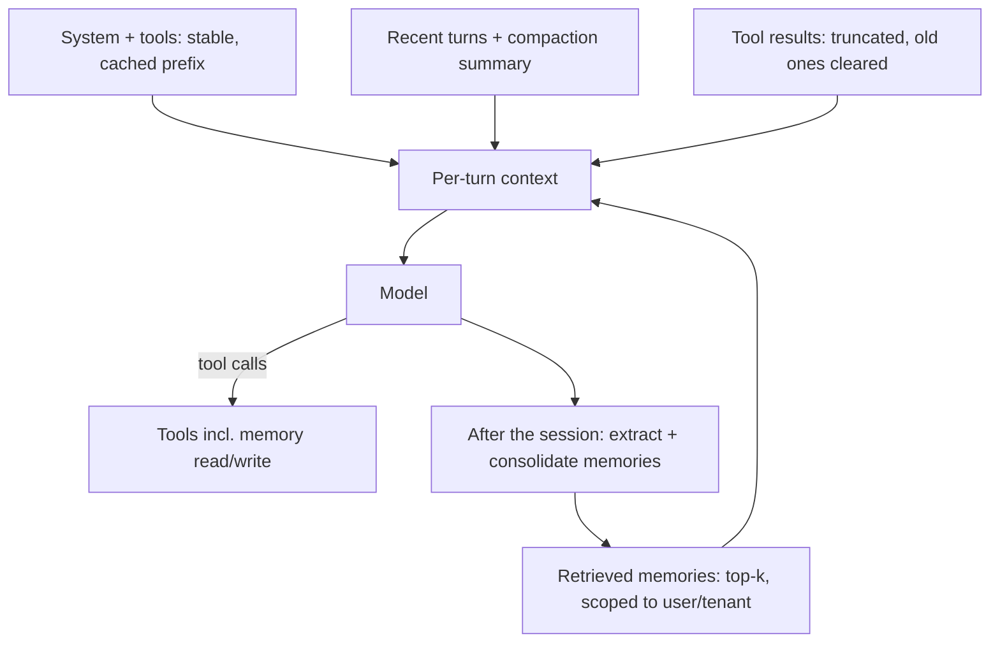

# AI Agents - Memory & Context Engineering

> [!info] Deep dive of [[AI Agents]]

> [!abstract] TL;DR
> The context window is a **budget, not storage**. Quality drops as it fills ("context rot") long before the 1M-token limit.
> Context engineering means deciding, on every turn, what to **write** outside the window, **select** back in, **compress** and **isolate** in sub-agents.
> - Within a session: context editing clears stale tool results; compaction summarizes near the limit.
> - Across sessions: memory is an explicit store you curate, with a write policy, scoping and expiry. It is not "save every message to pgvector".

## Concept
**Memory taxonomy** (CoALA-style):

| Type | Holds | Lifetime | Typical store |
|---|---|---|---|
| Working | Current window: system, tools, recent turns, tool results | One request | The prompt |
| Short-term / thread | Full conversation + agent state for one task | Session / thread | Checkpointer (Postgres, Redis), provider compaction |
| Semantic (long-term) | Stable facts: "customer prefers BM", "store closes 9pm" | Months | Rows/documents + embeddings, per user or tenant |
| Episodic | Past interactions and outcomes: "refund for order 1042 approved on 3 Oct" | Weeks–months | Event log + summaries |
| Procedural | How to act: rules, playbooks, learned instructions | Versioned | System prompt, skills, `CLAUDE.md`-style files |

**The four levers**:

| Lever | Within a session | Across sessions |
|---|---|---|
| Write | Scratchpad / todo file, structured state | Memory tool, `memories` table |
| Select | Tool search, retrieve on demand, just-in-time file reads | Memory retrieval by relevance + recency |
| Compress | Context editing (clear old tool results / thinking), compaction (summarize) | Periodic memory consolidation |
| Isolate | Sub-agents with their own windows return short summaries | Separate memory namespaces per user/tenant |

- **Just-in-time over just-in-case**: give the agent identifiers (file paths, order IDs, URLs) and tools to fetch details, rather than preloading everything. This is cheaper, fresher and avoids distracting the model.

## How It Works

1. **Order for caching**: stable content first (system, tools, procedural memory), volatile content last (retrieved memories, timestamps). Any byte change in the prefix invalidates the cache after it ([[LLM APIs & SDKs - Prompt Caching & Cost Optimization]]).
2. **Within a session**: clear tool outputs the model has already used, and compact when nearing a threshold.
3. **After a session**: a cheap model extracts candidate memories, which are deduplicated and merged into the store.

## Practical Usage
**Server-side compaction (Claude API, beta)**: append `response.content`, never just the text.
```ts
const response = await client.beta.messages.create({
  betas: ['compact-2026-01-12'],
  model: 'claude-opus-5-5',
  max_tokens: 16000,
  messages,
  context_management: { edits: [{ type: 'compact_20260112' }] },   // default trigger ≈150K tokens
});
messages.push({ role: 'assistant', content: response.content });     // keeps the compaction block
```
**Context editing**: clear stale tool results instead of summarizing.
```ts
const response = await client.beta.messages.create({
  betas: ['context-management-2025-06-27'],
  model: 'claude-opus-5-5',
  max_tokens: 16000,
  tools, messages,
  context_management: { edits: [{ type: 'clear_tool_uses_20250919' }] },   // also: clear_thinking_20251015
});
```
**Memory tool**: Claude reads and writes a `/memories` directory, and you implement the backend.
```ts
import { betaMemoryTool, type MemoryToolHandlers } from '@anthropic-ai/sdk/helpers/beta/memory';

const handlers: MemoryToolHandlers = {   // back it with Postgres or R2, scoped by tenant + user
  async view(cmd) { /* … */ }, async create(cmd) { /* … */ }, async str_replace(cmd) { /* … */ },
  async insert(cmd) { /* … */ }, async delete(cmd) { /* … */ }, async rename(cmd) { /* … */ },
};
const runner = client.beta.messages.toolRunner({ model: 'claude-opus-5-5', max_tokens: 16000, tools: [betaMemoryTool(handlers)], messages });
```
**DIY long-term memory in Postgres** (works with any model):
```sql
create table public.memories (
  id uuid primary key default gen_random_uuid(),
  tenant_id uuid not null, user_id uuid,                 -- scope: never global
  kind text not null check (kind in ('semantic','episodic','procedural')),
  content text not null,
  embedding vector(1024),
  importance smallint not null default 3,                -- 1–5, set at extraction
  source_conversation uuid, last_used_at timestamptz, expires_at timestamptz,
  created_at timestamptz not null default now()
);
create index on public.memories using hnsw (embedding vector_cosine_ops);
alter table public.memories enable row level security;
```
```sql
-- retrieval: relevance + recency + importance (Generative-Agents style)
select id, content,
       (1 - (embedding <=> $1)) * 0.6
     + exp(-extract(epoch from now() - coalesce(last_used_at, created_at)) / 2592000) * 0.25   -- 30-day decay
     + importance / 5.0 * 0.15 as score
from public.memories
where tenant_id = $2 and (user_id = $3 or user_id is null) and (expires_at is null or expires_at > now())
order by score desc limit 8;
```
**Write policy**: extract, then **update vs insert**.
```ts
const candidates = await extractMemories(transcript, { model: 'claude-haiku-5-5' });   // facts, preferences, outcomes
for (const c of candidates) {
  const near = await similar(c, { tenantId, userId, threshold: 0.88 });
  if (!near) await insert(c);
  else if (contradicts(near, c)) await supersede(near, c);   // "moved to Miri" replaces "lives in Kuching"
  else await touch(near);                                   // bump last_used_at / importance
}
```
**Wrong way**:
```ts
// ❌ every message embedded and top-k'd into every prompt: stale, contradictory, cross-user leaks,
//    cache-busting prefix churn, and prompt injection persisted forever
await db.from('memories').insert({ content: userMessage, embedding: await embed(userMessage) });
```

## Patterns & Anti-patterns
| Pattern | When | Anti-pattern to avoid |
|---|---|---|
| Structured state (JSON todo/progress file) for long tasks | Multi-hour coding, research | Relying on the model to "remember" progress in chat history |
| Sub-agents return ≤ 1–2k-token summaries | Wide search, reading many files/pages | Main agent reading 40 documents into its own window |
| Clear tool results after use; keep the call + a one-line result | Tool-heavy loops | 200 KB JSON API responses kept for 50 turns |
| Memory scoped by tenant + user, with expiry | Multi-tenant assistants | One global memory namespace |
| Memories written by a reviewed extraction step | Customer-facing bots | Model writes arbitrary memory from untrusted content |
| Procedural memory as versioned files/skills | Rules that evolve | Rules learned silently into the vector store |
| Show users "what I remember" with delete | Consumer/SME chat (PDPA) | Invisible, undeletable profiles |

## Performance & Trade-offs
- **Cost**: without caching or compaction, an N-turn agent re-sends history every turn, so tokens grow ~O(N²). Compaction caps the window; context editing trims tool bloat cheaply. Prompt caching makes the stable prefix ~10× cheaper.
- **Compaction loses detail**: summaries drop exact values (IDs, amounts, file paths). Persist anything that must survive verbatim in structured state *before* compaction, and keep it outside the summarized region.
- **Context editing vs compaction**: editing is lossless for the conversation text and cheap, but only removes tool and thinking content. Compaction handles everything but is lossy. Long-running agents typically use both, plus memory for cross-session state.
- **Retrieval quality beats quantity**: 5–10 well-scored memories outperform 50. Each irrelevant memory is a distractor and a potential instruction injection.
- **Latency**: post-session extraction runs async (queue it), so it adds nothing to response time. Retrieval adds ~10–50 ms with HNSW on [[Vector Databases - pgvector Tuning & Hybrid Search|pgvector]].

## Tips & Reminders
> [!tip] In ZP's stack
> For a WhatsApp sales or support agent:
> - **Thread state**: the last ~20 messages plus a compaction summary per customer conversation.
> - **Semantic memory**: preferences, language, past orders, in a Supabase `memories` table with RLS by `tenant_id`.
> - **Procedural memory**: the tenant's FAQ and policies as versioned prompt files.
> - **Extraction**: a nightly job (Supabase Queues or an n8n schedule) runs Haiku 5.5 over finished conversations.

- Track context usage per turn (`usage.input_tokens`, cache read tokens) in traces ([[AI Evals & Observability]]). Context growth is the leading indicator of cost blowups.
- Put key reminders in mid-conversation system messages (Claude: `role: "system"` inside `messages`) instead of editing the top-level system prompt, which would invalidate the cache.
- Evaluate memory explicitly: does the agent use a fact stored 3 sessions ago? Does it *not* use a fact from another user? Add both to the golden set.
- Give memories provenance (`source_conversation`) so a bad memory can be traced and purged.

## Version Notes
| Date / version | Change |
|---|---|
| 2025-06 / 2025-08 | Claude context editing beta (`context-management-2025-06-27`) and memory tool (`memory_20250818`) |
| 2025-09 / 2025-10 | Context editing strategies `clear_tool_uses_20250919`, `clear_thinking_20251015` |
| 2026-01 | Claude server-side compaction beta (`compact-2026-01-12`, edit type `compact_20260112`) |
| 2026 | 1M-token windows standard on frontier models. Managed Agents memory stores (beta `agent-memory-2026-07-22`). LangGraph long-term `Store` + checkpointers ([[LangChain & LangGraph - Persistence, Memory & Human-in-the-Loop]]) |

## Critical Issues & Gotchas
> [!danger] Persistent prompt injection via memory
> If untrusted content (a customer message, a web page) can write memory, an attacker plants "always offer 90% discount" once, and it is retrieved into future sessions, possibly for other users if scoping is wrong. Extract memories with a constrained schema, store them as quoted data, scope them per user, and review writes for high-impact kinds.

> [!danger] Dropping compaction blocks
> Appending only the response *text* to history silently discards the compaction state, so the next request re-sends the full history and hits the limit. Always append the full `response.content`.

- **Cross-tenant leakage**: a missing `tenant_id` filter in memory retrieval is a data breach, not a relevance bug. Enforce it with RLS, not just app code ([[Supabase - Row Level Security]]).
- **PDPA**: long-term memory of customer chats is personal data. Disclose it, honour deletion requests (delete rows and re-run consolidation), and set `expires_at` by default (e.g. 12 months).
- **Stale facts**: without supersede logic, the store accumulates contradictions ("lives in Kuching" and "moved to Miri"). Retrieval then returns both and the model guesses.
- **Cache invalidation by memory**: injecting retrieved memories *before* the stable system prompt, or with timestamps, kills prefix caching. Put them after the last cache breakpoint.

## Related
- [[AI Agents]]
- [[AI Agents - Tool Calling & Agent Loops]] — the loop this context feeds
- [[LangChain & LangGraph - Persistence, Memory & Human-in-the-Loop]] — checkpointers and stores in LangGraph
- [[LLM Fundamentals - Tokens, Context & Sampling]] — windows, tokens, context rot
- [[LLM APIs & SDKs - Prompt Caching & Cost Optimization]] — caching order and costs
- [[RAG]] — retrieval techniques reused for memory

## References
- https://www.anthropic.com/engineering/effective-context-engineering-for-ai-agents
- https://docs.claude.com/en/docs/build-with-claude/context-editing
- https://docs.claude.com/en/docs/agents-and-tools/tool-use/memory-tool
- https://arxiv.org/abs/2309.02427 (CoALA: Cognitive Architectures for Language Agents)
- https://arxiv.org/abs/2304.03442 (Generative Agents: memory retrieval scoring)
