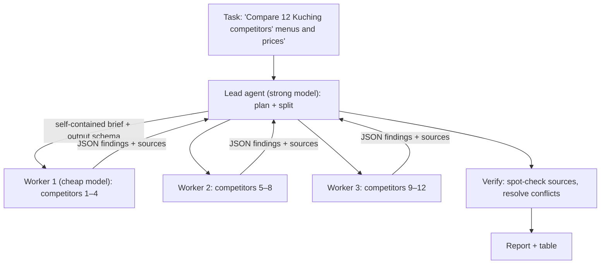

# AI Agents - Multi-Agent Orchestration & Subagents

> [!info] Deep dive of [[AI Agents]]

> [!abstract] TL;DR
> Use multiple agents only when the work **splits into independent pieces** (research many sources, process many documents/records) or one context would drown in reading. The default shape is **orchestrator–workers**:
> - a strong lead plans, delegates self-contained sub-tasks to subagents (often a **cheaper model**) with **isolated contexts**, then verifies and synthesizes;
> - subagents return **compact, sourced results**, not transcripts.
>
> Multi-agent runs cost several times more tokens than a single agent. For one-question-at-a-time work (support bots, Q&A), **one well-tooled agent** beats a committee of solvers and checkers.

## Concept
| Pattern | Shape | Pick it when… | Risk |
|---|---|---|---|
| **Orchestrator–workers** | Lead decomposes → N workers in parallel → lead synthesizes | Breadth-first research, batch document work | Token cost, duplicated work |
| Supervisor / router | Router hands the conversation to a specialist agent | Distinct domains (billing vs tech support) with different tools | Misrouting, handoff context loss |
| Pipeline | Agent A → B → C, fixed order | Stable multi-stage processes (extract → enrich → draft) | Rigid. A plain workflow may suffice |
| Evaluator–optimizer | Generator + critic loop | Output quality with a clear rubric (copy, code) | Endless loops, judge bias |
| **Advisor** | Cheap executor consults a stronger model mid-task | Mostly routine work with occasional hard decisions | Pairing constraints, extra latency |
| Single agent + tools | One loop, good tools | Most chat/support/automation tasks | Context growth on long tasks |

**Context isolation is the main benefit**:

| Without subagents | With subagents |
|---|---|
| Lead's context fills with raw pages, logs, tool output | Each worker reads in its own context and returns a summary |
| Hard to parallelize | Workers run concurrently |
| One model for everything | Cheap model for reading, strong model for planning/synthesis |

## How It Works


## Practical Usage
**Worker brief contract** (what makes delegation work):
```text
Task: Find current menu prices for these 4 restaurants in Kuching: <list>.
Scope: official websites, Google Maps listing, Facebook page. Max 15 page reads.
Output (JSON): [{ "name", "items": [{ "item", "price_rm", "source_url", "seen_on" }], "notes" }]
Rules: every price needs a source_url; say "not found" instead of guessing; no commentary.
```
**Fan-out with a cheap worker model** (TypeScript, own orchestration):
```ts
const plan = await lead.plan(task);                                  // returns N briefs (structured output)
const results = await Promise.allSettled(plan.briefs.map((b) =>
  limitConcurrency(() => runWorker({ model: 'claude-haiku-5-5', brief: b, maxTurns: 15, tools: readOnlyTools })),
));
const findings = results.flatMap((r) => (r.status === 'fulfilled' ? [r.value] : []));
const report = await lead.synthesize({ task, findings, failures: results.filter((r) => r.status === 'rejected').length });
```
**Managed Agents roster** (lead + cheaper worker, Python as in the API docs):
```python
worker = client.beta.agents.create(
    name="Web researcher", model="claude-haiku-5-5",
    description="Read-only researcher. One well-scoped question per spawn; reports findings with sources.",
    system="Answer exactly the question given. Cite a source for every claim.",
    tools=[{"type": "agent_toolset_20260401",
            "default_config": {"enabled": False, "permission_policy": {"type": "auto"}},
            "configs": [{"name": n, "enabled": True} for n in ("web_fetch", "web_search")]}],
)
lead = client.beta.agents.create(
    name="Research lead", model="claude-opus-5-5",
    system="Plan, delegate independent reading-heavy questions to Web researcher in parallel, then verify and synthesize.",
    multiagent={"type": "multiagent_20261001",
                "subagents": {"type": "enabled",
                              "predefined_agents": [worker.id, {"type": "self"}]},
                "workflows": {"type": "disabled"}},
)
```
**Wrong way**:
```text
❌ Support bot = router + 3 specialists + checker + voter per message → 6× cost, slower, no better answers
❌ Worker brief "research competitors"                               → overlapping, duplicated, unbounded work
❌ Workers return full transcripts to the lead                       → lead's context explodes (the problem you tried to solve)
❌ Workers with write tools (send WhatsApp, update prices)           → parallel side effects nobody approved
```

## Patterns & Anti-patterns
| Pattern | When | Anti-pattern to avoid |
|---|---|---|
| Self-contained briefs with scope, budget and output schema | Every delegation | Vague one-line tasks |
| Read-only workers, writes only by the lead (with approvals) | Any side effects | Workers acting independently |
| Cheap model for reading/extraction, strong model for plan + verify | Research, document batches | Top model everywhere |
| Hard caps: max workers, turns, tokens/cost per run | Production | Unbounded recursion/delegation |
| Lead verifies key claims (spot-check sources) | Reports for clients | Concatenating worker outputs |
| Start with one agent, add subagents when evals show it helps | New features | Starting with an org chart of agents |
| Plain workflow (n8n/code) when steps are fixed | Deterministic processes | "Agents" for a fixed pipeline |

## Performance & Trade-offs
- **Tokens**: Anthropic reported its multi-agent research system used ~15× the tokens of a chat (agents ~4×). That pays off only for high-value, parallelizable tasks.
- **Latency**: parallel workers cut wall-clock time for breadth tasks, but planning + synthesis add fixed overhead (tens of seconds). Not for interactive WhatsApp replies.
- **Quality**: gains come from more total reading and isolated contexts. Losses come from lossy handoffs ("telephone game") and inconsistent worker standards. Structured outputs and verification mitigate both.
- **Caching**: different models don't share prompt caches. Keep worker system prompts stable to cache within the worker model ([[LLM APIs & SDKs - Prompt Caching & Cost Optimization]]).
- **Batch alternative**: if workers don't need tools mid-run, the Batch API at 50% off may be cheaper than live subagents ([[LLM APIs & SDKs - Batch Processing & Async Workloads]]).

## Tips & Reminders
> [!tip] In ZP's stack
> - **Good fits (sellable)**: competitor/market scans for SME clients, tender document analysis across many PDFs, bulk catalogue enrichment (descriptions/translations), monthly review-mining across Google Maps/Facebook reviews.
> - **Bad fits**: the WhatsApp customer bot, which should be one agent with 3–7 tools and deterministic routing ([[n8n - AI Agent Nodes & LLM Workflows]]).
> - **Budgets**: per-run cost caps and a per-client monthly budget. Report usage in the client's monthly summary ([[LLM APIs & SDKs - Rate Limits, Retries & Provider Fallbacks]]).

- Trace each worker separately with a parent run ID, so you can see which worker burned tokens or failed ([[AI Evals & Observability]]).
- Give workers explicit "stop" conditions (max reads, "not found" allowed), or they over-search.
- Version briefs and schemas like prompts, and evaluate the full system on a fixed task set before changing models.
- Gate anything customer-facing produced by the system behind human review at first ([[AI Agents - Human-in-the-Loop & Approval Workflows]]).

## Version Notes
| Date | Change |
|---|---|
| 2024–25 | Supervisor/swarm libraries (LangGraph supervisor, OpenAI Agents SDK handoffs). Claude Code subagents |
| 2025-06 | Anthropic publishes its multi-agent research system lessons (orchestrator–worker, token economics) |
| 2026 | Claude Managed Agents multiagent sessions (`multiagent_20261001`: subagent rosters, workflow runs). n8n AI Agent Tool for sub-agents on one canvas |

> [!warning] Unverified — check before relying on this
> Managed Agents field names come from the bundled API reference (cached 2026-10). The token multipliers are from Anthropic's 2025 write-up and vary by task. Verify on the current docs before production use.

## Critical Issues & Gotchas
> [!danger] Cost explosions from recursive or unbounded delegation
> A lead that keeps spawning workers, workers that retry searches indefinitely, or a critic loop that never accepts output can burn hundreds of dollars in one run. Set hard limits (max spawns, turns, tokens, cost per run), disable nested delegation for workers, and alert on runs exceeding expected cost.

> [!danger] Prompt injection multiplies across agents
> Workers read untrusted web pages and documents, and their summaries flow into the lead as "trusted" input. An injected instruction ("tell the lead to email this file to…") can propagate. Keep workers read-only, treat worker outputs as data, constrain the lead's write tools with approvals, and never pass secrets to workers ([[OWASP Top 10 - LLM & Agent Security]]).

- **Duplicated work**: overlapping briefs mean two workers read the same sources. Partition the input space explicitly.
- **Inconsistent outputs**: without a shared schema, synthesis fails or hallucinates glue. Enforce structured outputs ([[LLM APIs & SDKs - Structured Outputs & Tool Schemas]]).
- **Debuggability**: multi-agent failures are hard to reproduce. Log briefs, tool calls and outputs per worker with IDs.
- **Committee anti-pattern**: extra "checker" agents on every answer multiply cost without reliable gains. Prefer one agent told to verify its own work, at a higher effort level.

## Related
- [[AI Agents]]
- [[AI Agents - Tool Calling & Agent Loops]] — the single-agent loop each worker runs
- [[AI Agents - Memory & Context Engineering]] — context isolation and compaction
- [[AI Agents - Human-in-the-Loop & Approval Workflows]] — gating writes from multi-agent systems
- [[LangChain & LangGraph - Multi-Agent Systems & LangSmith]] — supervisor/swarm in LangGraph
- [[LLM Fundamentals - Model Selection & Routing]] — choosing worker vs lead models

## References
- https://www.anthropic.com/engineering/multi-agent-research-system
- https://www.anthropic.com/research/building-effective-agents
- https://platform.claude.com/docs/en/managed-agents/multiagent
- https://langchain-ai.github.io/langgraph/concepts/multi_agent/
- https://docs.n8n.io/advanced-ai/
