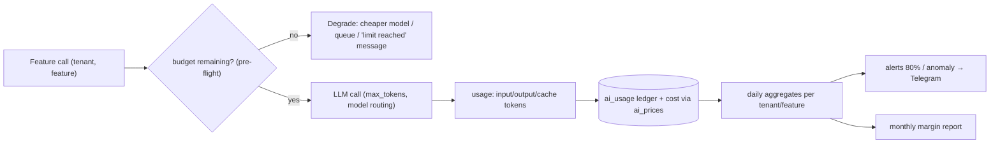

# AI Evals & Observability - Cost Tracking & Budgets per Tenant

> [!info] Deep dive of [[AI Evals & Observability]]

> [!abstract] TL;DR
> In a multi-tenant AI product (WhatsApp agents, document extraction, RAG bots), one tenant's runaway agent loop or document backlog can burn a month's margin in hours. You need:
> 1. A **usage ledger**: one row per LLM call with tenant, feature, model and tokens (input/output/cache read/cache write), plus computed cost from a **versioned price table**.
> 2. **Budgets**: per tenant and per feature, with **soft alerts** (80%) and **hard caps** (degrade to a cheaper model, queue, or block), checked **before** each call.
> 3. **Provider-level safety nets**: separate API keys/workspaces per environment or major client, provider spend limits, and per-request `max_tokens` + loop limits for agents.
> 4. **Margin reporting**: AI cost per tenant vs what they pay, reviewed monthly.

## Concept
| Component | Purpose | Implementation |
|---|---|---|
| Usage ledger | Source of truth for cost attribution | Postgres `ai_usage` table (append-only) |
| Price table | Per-model token prices, versioned by date | `ai_prices(model, valid_from, input, output, cache_read, cache_write)` |
| Budget table | Monthly limits per tenant/feature | Derived from plan entitlements |
| Pre-flight check | Block/degrade before spending | Function `ai_budget_remaining(tenant)` |
| Tracing | Debug expensive conversations | Langfuse traces linked by `trace_id` |
| Provider controls | Last-resort caps | Workspace/project spend limits, key per environment |
| Reports | Margin and anomalies | Daily cost per tenant, top conversations, cost per resolved ticket |

**Guardrail levels**:

| Level | Example | Effect |
|---|---|---|
| Per request | `max_tokens`, input truncation, context window cap | Bounds a single call |
| Per conversation/job | Max turns/tool calls (agent loop limit), max pages per document | Stops runaway loops |
| Per tenant/day | Daily budget, burst limit | Contains one tenant's abuse |
| Per tenant/month | Plan quota (e.g. 2,000 AI replies) | Commercial alignment |
| Per provider account | Spend limit, alerts | Catastrophe protection |

## How It Works


## Practical Usage
**Ledger and prices**:
```sql
create table public.ai_prices (
  model text not null, valid_from date not null,
  input_per_mtok numeric not null, output_per_mtok numeric not null,
  cache_read_per_mtok numeric not null default 0, cache_write_per_mtok numeric not null default 0,
  primary key (model, valid_from)
);
create table public.ai_usage (
  id bigint generated always as identity primary key,
  at timestamptz not null default now(),
  tenant_id uuid not null, feature text not null,           -- 'wa_agent', 'doc_extract', 'rag'
  model text not null, trace_id text,
  input_tokens int not null, output_tokens int not null,
  cache_read_tokens int not null default 0, cache_write_tokens int not null default 0,
  cost_usd numeric(12,6) not null
);
create index on public.ai_usage (tenant_id, at);
```
**Record usage after every call** (provider-agnostic wrapper):
```ts
export async function trackedCall<T>(ctx: { tenantId: string; feature: string; traceId?: string },
                                     model: string, call: () => Promise<{ result: T; usage: Usage }>) {
  await assertBudget(ctx.tenantId, ctx.feature);                    // pre-flight
  const { result, usage } = await call();
  const p = await prices.get(model);                                 // cached, by valid_from
  const cost = (usage.input * p.input + usage.output * p.output +
                usage.cacheRead * p.cacheRead + usage.cacheWrite * p.cacheWrite) / 1_000_000;
  await db.none(`insert into ai_usage (tenant_id, feature, model, trace_id, input_tokens, output_tokens,
                 cache_read_tokens, cache_write_tokens, cost_usd) values ($1,$2,$3,$4,$5,$6,$7,$8,$9)`,
    [ctx.tenantId, ctx.feature, model, ctx.traceId, usage.input, usage.output, usage.cacheRead, usage.cacheWrite, cost]);
  return result;
}
```
**Budget check** (plan-based monthly + daily burst):
```sql
create or replace function public.ai_budget_remaining(p_tenant uuid) returns numeric
language sql stable as $$
  select public.limit_for(p_tenant, 'ai_budget_usd_month')::numeric
       - coalesce((select sum(cost_usd) from public.ai_usage
                   where tenant_id = p_tenant and at >= date_trunc('month', now())), 0)
$$;
```
```ts
async function assertBudget(tenantId: string, feature: string) {
  const remaining = await db.one("select ai_budget_remaining($1) as r", [tenantId]).then((x) => Number(x.r));
  if (remaining <= 0) throw new BudgetExceeded(tenantId, feature);          // caller degrades gracefully
  if (remaining < 0.2 * (await monthlyBudget(tenantId))) await notifyOnce(tenantId, "ai_budget_80");
}
```
**Agent loop limits**:
```ts
for (let turn = 0; turn < 8; turn++) {                      // hard cap on tool-use iterations
  const res = await trackedCall(ctx, model, () => llm.step(messages, { max_tokens: 800 }));
  if (res.done) break;
}
```
**Daily anomaly query** (tenant cost > 3× its 14-day average):
```sql
with d as (select tenant_id, date_trunc('day', at) day, sum(cost_usd) c from ai_usage
           where at > now() - interval '15 days' group by 1, 2)
select t.tenant_id, t.c as today, avg(h.c) as avg14
from d t join d h on h.tenant_id = t.tenant_id and h.day < t.day
where t.day = date_trunc('day', now())
group by t.tenant_id, t.c having t.c > 3 * avg(h.c);
```
**Wrong way**:
```text
❌ Checking the provider invoice monthly as "cost tracking"   → no attribution, surprises after the fact
❌ Hard-coding prices in code                               → wrong costs after price changes
❌ Agents without iteration/token caps                       → one stuck conversation loops for hours
❌ One API key for all clients and environments              → can't isolate, cap or revoke per client
```

## Patterns & Anti-patterns
| Pattern | When | Anti-pattern to avoid |
|---|---|---|
| Ledger row per call, cost from versioned prices | Always | Estimating from averages |
| Pre-flight budget check + graceful degradation | Paid plans with AI quotas | Failing hard mid-conversation |
| Model routing (cheap first, escalate) | Cost-sensitive features | Frontier model for every call ([[LLM Fundamentals - Model Selection & Routing]]) |
| Prompt caching for stable system prompts/context | High-volume bots | Paying full price for repeated context |
| Per-feature budgets | Mixed AI features | One pool consumed by a backlog job |
| Monthly margin review per tenant | SaaS pricing | Pricing set once and forgotten |
| Separate keys/workspaces per env/major client | Agencies | Shared keys everywhere |

## Performance & Trade-offs
- **Pre-flight queries** add a DB round trip. Cache budget remaining per tenant for 30–60 s, and accept small overshoot.
- **Hard caps vs UX**: blocking a paying customer's WhatsApp bot mid-day is worse than a small overrun. Prefer degrade (cheaper model, shorter answers, human handoff) before block.
- **Ledger volume**: one row per call is fine for SME scale (millions/month). Aggregate daily and partition monthly if needed.
- **Batch APIs** cut cost (often ~50%) for non-urgent workloads like document backlogs ([[LLM APIs & SDKs - Batch Processing & Async Workloads]]).

## Tips & Reminders
> [!tip] In ZP's stack
> - **Pricing your AI products**: compute cost per unit (per AI reply, per document) from the ledger, then price plans at 3–5× cost to cover failures, retries, support and margin ([[Next.js - SaaS Subscription Billing & Plan Entitlements]]).
> - **Client-paid keys**: for agency builds, use the client's own provider account and keys. AI spend is theirs, and you still track usage for reporting and debugging.
> - **WhatsApp agents**: track cost per resolved conversation, not just per message. That's the metric clients understand ([[AI Agents - Customer Support Agents for WhatsApp & Messaging]]).

- Include cache read/write tokens. Caching changes unit costs significantly ([[LLM APIs & SDKs - Prompt Caching & Cost Optimization]]).
- Convert USD to MYR in reports with a monthly rate and buffer.
- Tag usage with `feature` and `trace_id`, so expensive traces open directly in Langfuse.
- Set provider-side spend alerts as a backstop even with app-level budgets.

## Version Notes
| Date | Change relevant here |
|---|---|
| 2024 | Prompt caching across major providers (cache read/write token fields in usage) |
| 2024–25 | Batch APIs (~50% discount) and workspace/project-level spend limits on major platforms |
| 2025–26 | Usage/cost admin APIs for programmatic reconciliation. OpenTelemetry GenAI semantic conventions for token usage |

> [!warning] Unverified — check before relying on this
> Current model prices, provider spend-limit features and usage/cost API endpoints change often and weren't verified this run. Load prices from provider pricing pages into `ai_prices` with `valid_from` dates.

## Critical Issues & Gotchas
> [!danger] Runaway loops and abuse burn money silently
> An agent stuck in a tool-call loop, a retry storm after a provider outage, a malicious user spamming your WhatsApp bot, or a 2,000-page PDF uploaded "by mistake" can generate hundreds of dollars overnight. Enforce per-request, per-conversation and per-tenant caps, rate-limit inbound messages, and alert on anomalies daily ([[LLM APIs & SDKs - Rate Limits, Retries & Provider Fallbacks]]).

> [!danger] Unpriced AI features destroy margins
> Flat-priced plans with unlimited AI use attract heavy users whose cost exceeds their subscription. Without per-tenant cost data you won't notice until the provider invoice. Meter usage from day one, include quotas in plans, and review margins monthly.

- **Retries count**: failed/retried calls still cost tokens. Log them too.
- **Streaming responses** report usage at the end. Make sure aborted streams are still recorded.
- **Embeddings and reranking** costs are often forgotten. Track them as features too.
- **Price changes** apply from a date. Keep historical prices for accurate past reports.

## Related
- [[AI Evals & Observability]]
- [[AI Evals & Observability - Tracing & Production Monitoring with Langfuse]] — traces behind the costs
- [[LLM APIs & SDKs - Prompt Caching & Cost Optimization]] — reducing unit cost
- [[Next.js - SaaS Subscription Billing & Plan Entitlements]] — quotas tied to plans
- [[LLM APIs & SDKs - Rate Limits, Retries & Provider Fallbacks]] — retry storms and limits
- [[LLM Fundamentals - Model Selection & Routing]] — cheaper model routing

## References
- https://langfuse.com/docs/model-usage-and-cost
- https://opentelemetry.io/docs/specs/semconv/gen-ai/
- https://docs.anthropic.com/en/api/usage-cost-api
- https://platform.openai.com/docs/guides/batch
- https://docs.anthropic.com/en/docs/build-with-claude/prompt-caching
