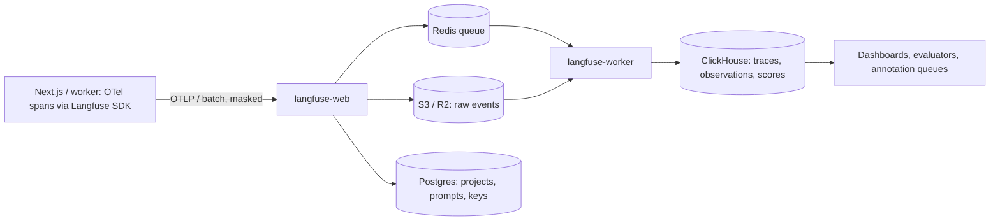

# AI Evals & Observability - Tracing & Production Monitoring with Langfuse

> [!info] Deep dive of [[AI Evals & Observability]]

> [!abstract] TL;DR
> - Trace **every** LLM request as a tree: trace → spans (retrieval, tools) → generations (model, tokens, cost, latency, prompt version). Group traces by `sessionId` (e.g. a WhatsApp conversation) and `userId`.
> - Attach **scores**: user feedback, online LLM-as-judge, human annotation. Then monitor cost, latency, error rate and quality per tenant.
> - Langfuse (MIT, ClickHouse-owned since 2026-01) self-hosts as **web + worker + Postgres + ClickHouse + Redis + S3/R2**, so plan ~8 GB+ RAM. Mask PII **before** export.

## Concept
| Object | What it is | Example |
|---|---|---|
| **Trace** | One end-to-end request | "Customer message → reply" |
| **Span** | A unit of work inside a trace | `retrieve_kb`, `call_tool:get_order` |
| **Generation** | A span that is an LLM call | model, input/output, usage, cost, latency |
| **Session** | Traces grouped by conversation | `sessionId = wa:<tenant>:<conversation_id>` |
| **Score** | Numeric/categorical judgement attached to trace or observation | `user_feedback=1`, `faithfulness=0.8`, `policy_violation=true` |
| **Prompt** | Versioned prompt in the registry, linked to generations | `support-reply@v14` |
| **Dataset / experiment** | Golden inputs + runs to compare versions | Offline evals ([[AI Evals & Observability - Eval Datasets & LLM-as-Judge]]) |

**Self-hosted architecture (v3)**: the web container receives batched events and writes them **straight to S3**, enqueuing only a reference in Redis. The worker reads from S3 and inserts into **ClickHouse** (traces/observations). **Postgres** holds users, projects, prompts and API keys. This design absorbs ingestion spikes without overloading the database.

## How It Works


## Practical Usage
**Instrument a Node service** (JS SDK v4 is OpenTelemetry-based):
```ts
// instrumentation.ts (load first: Next.js `instrumentation.ts` or `node --import`)
import { NodeSDK } from '@opentelemetry/sdk-node';
import { LangfuseSpanProcessor } from '@langfuse/otel';

export const sdk = new NodeSDK({
  spanProcessors: [new LangfuseSpanProcessor({
    publicKey: process.env.LANGFUSE_PUBLIC_KEY, secretKey: process.env.LANGFUSE_SECRET_KEY,
    baseUrl: process.env.LANGFUSE_BASE_URL,               // https://langfuse.internal.example.my
    mask: ({ data }) => redactPII(data),                  // phone, IC, email out before export
  })],
});
sdk.start();
```
```ts
import { startActiveObservation } from '@langfuse/tracing';

export async function replyToCustomer(msg: InboundMessage) {
  return startActiveObservation('wa-reply', async (trace) => {
    trace.updateTrace({ sessionId: `wa:${msg.tenantId}:${msg.conversationId}`, userId: hash(msg.from),
                        tags: [msg.tenantId, 'whatsapp'], metadata: { promptVersion: 'support-reply@v14' } });
    const docs = await startActiveObservation('retrieve_kb', async (s) => {
      const r = await kb.search(msg.tenantId, msg.text); s.update({ output: r.map((d) => d.id) }); return r;
    });
    return startActiveObservation('llm', async (gen) => {
      const res = await anthropic.messages.create({ model: 'claude-sonnet-5-5', max_tokens: 2000, messages: build(msg, docs) });
      gen.update({ model: res.model, input: build(msg, docs), output: res.content,
                   usageDetails: { input: res.usage.input_tokens, output: res.usage.output_tokens,
                                   cache_read: res.usage.cache_read_input_tokens ?? 0 } });
      return res;
    }, { asType: 'generation' });
  });
}
```
**User feedback as a score** (thumbs from the inbox UI, or a "did this solve it?" reply):
```ts
await langfuse.score.create({ traceId, name: 'user_feedback', value: thumbsUp ? 1 : 0, comment });
```
**Self-host on Coolify** (env essentials for the compose stack):
```bash
DATABASE_URL=postgresql://langfuse:…@postgres:5432/langfuse
CLICKHOUSE_URL=http://clickhouse:8123
CLICKHOUSE_MIGRATION_URL=clickhouse://clickhouse:9000
REDIS_CONNECTION_STRING=redis://:…@redis:6379
LANGFUSE_S3_EVENT_UPLOAD_BUCKET=langfuse-events
LANGFUSE_S3_EVENT_UPLOAD_ENDPOINT=https://<account>.r2.cloudflarestorage.com
LANGFUSE_S3_EVENT_UPLOAD_REGION=auto
NEXTAUTH_SECRET=…  SALT=…  ENCRYPTION_KEY=<64 hex chars>
```
**Wrong way**:
```ts
console.log(JSON.stringify({ prompt, completion }));   // ❌ unsearchable, no cost/latency tree, PII in plain logs
await langfuse.trace({ input: rawCustomerMessage });   // ❌ IC numbers and phones exported to the observability store
```

## Patterns & Anti-patterns
| Pattern | When | Anti-pattern to avoid |
|---|---|---|
| `sessionId` per conversation, hashed `userId`, `tenant` tag | Multi-tenant chat products | Unlinked traces you can't replay as a conversation |
| Prompt version in metadata (or registry-linked prompts) | Every generation | "Which prompt produced this?" guessing |
| Mask PII in the SDK before export | Customer data (PDPA) | Relying on UI-level hiding |
| Online evaluators on a **sample** (5–20%) with cheap judges | Production quality monitoring | Judging 100% of traffic with an expensive model |
| Annotation queue for low scores + negative feedback | Weekly error analysis | Dashboards nobody reads |
| Cost per tenant/feature dashboards + alerts | Metered SaaS | Finding the LLM bill spike at month end |

## Performance & Trade-offs
- **Overhead**: SDK exports are async and batched, so request latency impact is negligible. Make sure batches flush on shutdown (`await sdk.shutdown()`) in serverless and workers.
- **Self-host footprint**: ClickHouse is the heavy part. Plan a dedicated 4 vCPU / 8–16 GB server for moderate volume, not your 4 GB app KVM. Langfuse Cloud is the alternative when ops time matters more than data residency.
- **Storage growth**: full prompts and completions are large. Set data retention per project (e.g. 30–90 days), sample verbose debug traces, and keep media (images, PDFs) in S3/R2 instead of inline.
- **Langfuse vs alternatives**: LangSmith for LangGraph-heavy stacks, Arize Phoenix for notebook/OTel-first analysis, or plain OTel → Grafana Tempo if you only need latency and errors without eval workflows.

## Tips & Reminders
> [!tip] In ZP's stack
> - **One Langfuse project per product**, tenants as tags plus metadata. Use a separate project for clients with contractual data isolation.
> - **Self-host on a dedicated Coolify server**, with R2 for event storage, behind Cloudflare Access for the UI, and SDK ingestion over the private network or an authenticated hostname.
> - **Weekly 30-minute review**: lowest-scored traces + negative feedback → new eval cases → prompt changes.

- Track the metrics that matter per route: p50/p95 latency, cost per resolved conversation, tool-error rate, escalation-to-human rate, user feedback ratio.
- Include cache-read tokens in usage, so cost reflects prompt-caching savings ([[LLM APIs & SDKs - Prompt Caching & Cost Optimization]]).
- Tag releases (`release: git sha`) on traces, so quality changes line up with deploys.
- For n8n AI workflows, use n8n's Langfuse integration or send OTel from a Code node, so automation-driven LLM calls show up too.

## Version Notes
| Version / date | Change |
|---|---|
| Langfuse v2 | Postgres-only storage |
| Langfuse v3 (2024-12) | ClickHouse + Redis + S3 architecture for scale. Separate worker container |
| JS SDK v4 / Python SDK v3 (2025) | OpenTelemetry-based SDKs (`@langfuse/otel` span processor, `@langfuse/tracing`) |
| 2026-01 | Langfuse acquired by ClickHouse. Remains MIT-licensed open source |

> [!warning] Unverified — check before relying on this
> SDK method names (`startActiveObservation`, `updateTrace`, `score.create`) and env var names were written from SDK v4 docs knowledge, not re-verified in this run. Check https://langfuse.com/docs and the self-hosting configuration reference before deploying.

## Critical Issues & Gotchas
> [!danger] Observability store = second copy of customer data
> Traces contain full conversations, retrieved documents and tool outputs. Under PDPA that's personal data in another system. Mask at the SDK, restrict UI access (SSO + Cloudflare Access), set retention, and include Langfuse in data-deletion requests.

> [!danger] Lost spans on shutdown
> Workers and serverless functions that exit before the span processor flushes silently drop the traces of exactly the failing runs. Call `forceFlush()`/`shutdown()` in shutdown hooks and before function return.

- **ClickHouse disk growth** can fill a VPS in weeks at high volume. Monitor disk, set TTL/retention, and keep ClickHouse on its own volume.
- **Encryption key loss**: `ENCRYPTION_KEY` and `SALT` protect stored secrets (LLM API keys for evaluators). Losing them breaks the instance, and rotating them carelessly locks you out. Back them up with the Coolify env.
- **Judge drift**: online evaluator prompts and models change scores over time. Version evaluator configs and recalibrate on human-labelled samples.
- **Vendor change**: after the ClickHouse acquisition, watch licence and roadmap announcements. Self-hosted MIT code and OTel-based instrumentation keep migration open.

## Related
- [[AI Evals & Observability]]
- [[AI Evals & Observability - Eval Datasets & LLM-as-Judge]] — offline evals that use these traces
- [[AI Agents - Memory & Context Engineering]] — context growth visible in traces
- [[LLM APIs & SDKs - Prompt Caching & Cost Optimization]] — cost attribution
- [[Coolify]] — self-hosting the Langfuse stack
- [[Cloudflare - R2 Storage & Presigned Uploads]] — S3-compatible event storage

## References
- https://langfuse.com/self-hosting
- https://langfuse.com/docs/observability/overview
- https://js-sdk-v4-docs-snapshot.langfuse.com/self-hosting/
- https://opentelemetry.io/docs/specs/semconv/gen-ai/
- https://railway.com/deploy/langfuse-v3-1
