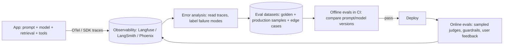

# AI Evals & Observability

> [!abstract] TL;DR
> LLM features are **non-deterministic and fail silently**: wrong answers look fluent. **Evals** are the test suite for that behaviour: datasets of real inputs, graded by code checks, LLM-as-judge rubrics, or humans, run offline before shipping and online on production samples. **Observability** captures traces of every call (prompt, context, tool calls, tokens, cost, latency, user feedback) so you can debug and turn failures into new eval cases.
> - **The loop**: look at data → write failure-driven evals → change prompt/model/retrieval → compare → ship → monitor → repeat.
> - **Tooling**: Langfuse (open source, MIT, **acquired by ClickHouse 2026-01**), LangSmith, Braintrust, Arize Phoenix, promptfoo/DeepEval, and OpenTelemetry GenAI conventions.

## Introduction
- **Why it exists**: traditional unit tests assume deterministic outputs. LLM apps need statistical quality measurement across many cases, plus monitoring for drift as models, prompts, documents and user behaviour change.
- **Lineage**: NLP benchmarks (BLEU/ROUGE, MMLU) → application-specific evals (2023+: OpenAI Evals, RAGAS, LLM-as-judge research like MT-Bench) → eval-driven development as standard practice for AI products (2024–26).
- **Where it sits**: around [[RAG]] pipelines, [[AI Agents]], chatbots (WhatsApp support bots), extraction/classification workflows in [[n8n]], and model/provider migrations (switching models requires evals to know if quality holds).

## Core Concepts

### Grader types
| Grader | How | Strengths | Weaknesses |
|---|---|---|---|
| **Code-based assertions** | Exact match, regex, JSON schema validation, contains/not-contains, numeric tolerance, tool-call arguments | Cheap, deterministic, fast | Only for checkable outputs |
| **LLM-as-judge** | A model scores output against a rubric (binary pass/fail preferred) or compares pairwise | Scales to open-ended text | Biases (position, verbosity, self-preference). Must be validated against human labels |
| Human review | Experts label samples | Ground truth, finds unknown failure modes | Slow, expensive |
| Reference-based metrics | Similarity to a gold answer (embedding similarity, ROUGE) | Simple | Weak correlation with usefulness |
| User signals | Thumbs, edits, escalations, resolution rate | Real-world outcome | Sparse, biased |

### What to measure by system type
| System | Metrics |
|---|---|
| Classification / extraction (invoice fields, intents) | Accuracy, precision/recall per class, schema validity |
| [[RAG]] | Retrieval: recall@k, MRR, context precision. Generation: faithfulness/groundedness, answer relevance, citation correctness |
| Chat support bots | Task resolution, correct escalation, policy compliance, tone, hallucinated promises (prices, refunds) |
| [[AI Agents]] | Task success, trajectory quality (right tools, right order), tool-call argument accuracy, steps/cost per task, safety violations |
| All | Latency (p50/p95, time to first token), cost per request/tenant, refusal rate, error rate |

### A minimal eval harness (TypeScript)
```ts
type Case = { id: string; input: string; expect: { intent: string; mustNotContain?: string[] } };

const cases: Case[] = loadJsonl('evals/whatsapp-intents.jsonl');   // 50–200 real, labelled messages (BM/EN/Manglish)

const results = await Promise.all(cases.map(async (c) => {
  const out = await classifyIntent(c.input);                         // the system under test (prompt + model)
  const pass = out.intent === c.expect.intent &&
    !(c.expect.mustNotContain ?? []).some((s) => out.reply.includes(s));
  return { id: c.id, pass, out };
}));

const accuracy = results.filter((r) => r.pass).length / results.length;
console.table(results.filter((r) => !r.pass).slice(0, 20));         // read the failures, not just the score
if (accuracy < 0.92) process.exit(1);                                 // CI gate on regression
```

### LLM-as-judge rubric (binary, with reasoning)
```text
You are grading a customer-support reply for a Malaysian SME.
Context documents: {{context}}
Customer message: {{input}}
Reply: {{output}}
Criteria — answer PASS only if ALL hold:
1. Every factual claim (prices, hours, policies) is supported by the context.
2. No promises of refunds/discounts not stated in the context.
3. Escalates to a human when the customer is angry or asks for a manager.
Return JSON: {"reasoning": "...", "verdict": "PASS" | "FAIL"}
```
Validate the judge: label ~100 cases yourself and measure judge-vs-human agreement (aim for > 85–90%) before trusting it.

## Architecture / How It Works

- **Traces/spans**: one trace per request, with child spans for retrieval, each LLM call (model, params, prompt, completion, tokens, cost, latency), tool calls and guardrail checks. OpenTelemetry's **GenAI semantic conventions** (`gen_ai.*` attributes) standardize this across vendors (status: still in development).
- **Prompt management**: version prompts (Git or the platform's prompt registry), link each trace to the prompt version, and roll back like code.
- **Error analysis first**: read 50–100 traces, write down failure categories (e.g. "hallucinated store hours", "wrong language reply"), then build evals targeting the most frequent and costly ones. Generic metric dashboards come later.

## Project Structure
```text
ai/
├── prompts/                     # versioned prompt templates
├── evals/
│   ├── datasets/*.jsonl         # inputs + expected properties, tagged by failure mode
│   ├── graders/                 # code assertions + judge prompts
│   ├── run.ts                   # harness: runs system × dataset, writes report
│   └── reports/                 # CI artifacts: score per version, failures
├── observability/otel.ts        # tracer setup → Langfuse/OTLP endpoint
└── .github/workflows/evals.yml  # run on prompt/model changes; compare to baseline
```
```bash
# promptfoo-style quick comparison of models/prompts on a dataset
npx promptfoo eval -c evals/promptfooconfig.yaml && npx promptfoo view
```

## Use Cases
| Use case | Eval/observability approach |
|---|---|
| Switching models (cost/quality) | Same dataset across models, compare accuracy + cost + latency |
| WhatsApp/Telegram support bot | Trace every conversation, judge for policy compliance, alert on escalation failures |
| RAG over client SOPs | Retrieval recall@k on labelled questions + faithfulness judge |
| n8n AI workflows (classification, extraction) | Dataset of real messages/documents, schema validity + field accuracy |
| Agents with tools | Trajectory evals, tool-call accuracy, cost/step budgets |
| Client reporting | Monthly quality metrics (resolution rate, accuracy) as part of the retainer |

## Pros & Cons
| Practice | Pros | Cons |
|---|---|---|
| Offline eval suites in CI | Catches regressions before users do | Dataset creation effort. Can overfit |
| LLM-as-judge | Scales nuanced grading | Cost, bias, needs validation |
| Human review | Highest fidelity | Doesn't scale |
| Full tracing | Debuggability, cost control | Stores sensitive data (PII). Storage cost |
| Online sampling | Real distribution | Delayed signal, privacy considerations |

## Alternatives & Peers
| Tool | Strength | Weakness | Pick it when… |
|---|---|---|---|
| **Langfuse** | Open source (MIT), self-hostable, tracing + prompts + evals, OTel-native | Self-hosting needs ClickHouse + Postgres + Redis + S3 | Data residency, cost control (self-host on Coolify) |
| LangSmith | Deep LangChain/LangGraph integration | SaaS-first, per-trace pricing | LangChain stacks ([[LangChain & LangGraph - Multi-Agent Systems & LangSmith]]) |
| Braintrust | Strong eval UX, experiments, dataset management | Commercial | Eval-heavy product teams |
| Arize Phoenix | Open source, OTel/OpenInference, notebooks | Fewer prompt-management features | Data-science-heavy teams |
| promptfoo / DeepEval / Inspect | CLI/code-first eval frameworks, red-teaming | No production tracing (mostly) | CI eval gates, security red-teaming |
| Plain logs + SQL | No new vendor | Manual analysis | Very early prototypes |

## Tips & Reminders
> [!tip]
> - Start with 30–50 real cases and binary pass/fail criteria. Grow datasets from production failures, and tag cases by failure mode.
> - Look at the data yourself every week. Most wins come from reading traces, not from adding metrics.
> - Pin model versions (dated snapshots) and re-run evals before any model/provider change, including "silent" provider updates.
> - Track cost per conversation/tenant and set budgets/alerts. Agent loops can explode token usage.
> - Redact PII (IC numbers, phone numbers, addresses) before sending traces to third-party SaaS. Document cross-border transfers for PDPA.
> - **In ZP's stack**:
>   - Self-host Langfuse on [[Coolify]] (or Langfuse Cloud) for n8n/Node AI workflows.
>   - Keep eval datasets per client in Git, run promptfoo/Vitest evals in GitHub Actions on prompt changes, and report quality metrics to clients as part of AI retainers.
>   - Language mix (BM/EN/Manglish/Chinese) must be represented in datasets.

## Versions & Breaking Changes
| Change | Date | Impact |
|---|---|---|
| OpenAI Evals open-sourced | 2023-03 | Early public eval framework |
| RAGAS / DeepEval / promptfoo mature | 2023–2025 | Standard metrics and CLI eval workflows |
| OpenTelemetry GenAI semantic conventions | 2024– (development) | Vendor-neutral `gen_ai.*` span attributes. Names may still change |
| Langfuse v3 | 2024-12 | ClickHouse-backed architecture for scale (self-host needs ClickHouse) |
| **ClickHouse acquires Langfuse** | 2026-01-16 | Core stays MIT open source. Langfuse Cloud continues |
| Helicone acquired by Mintlify (reported) | 2026-03 | Consolidation in LLM observability vendors |

> [!warning] Unverified — check before relying on this
> OTel GenAI convention stability and vendor feature sets change quickly. Check https://opentelemetry.io/docs/specs/semconv/gen-ai/ and each vendor's docs before committing.

## Critical Issues & Gotchas
> [!danger] Traces are a PII and secrets honeypot
> Full prompt/response logging captures customer messages, IC numbers, addresses, and sometimes API keys pasted by users. Sending that to a SaaS observability vendor is a **cross-border data transfer** under PDPA and a breach risk. Redact at the SDK level, set retention limits, restrict access, and prefer self-hosting for sensitive clients.

> [!danger] Goodhart's law: optimizing the judge, not the product
> Prompt tweaks that raise an LLM-judge score can make outputs worse for users (longer, more hedged, judge-pleasing). Judges also share blind spots with the model being graded (self-preference). Keep human-labelled calibration sets, use binary rubrics tied to business outcomes, and watch real user metrics (resolution, escalations, complaints).

> [!warning] Gotchas
> - Tiny datasets give noisy scores. A 2-point "improvement" on 50 cases is usually noise. Look at confidence intervals or pairwise wins.
> - Evaluating with temperature > 0 needs multiple runs per case (pass@k / majority) to separate variance from regressions.
> - Judge prompts are prompts: version them, and re-validate them when you change the judge model.
> - Online evals on every request double LLM cost. Sample (e.g. 5–10%) and prioritize risky intents.
> - Model providers deprecate snapshots on fixed schedules. Track deprecation dates and re-run evals before forced migrations.

## Deep Dives
- [[AI Evals & Observability - Eval Datasets & LLM-as-Judge]]

## Related
- [[LLM Fundamentals]] — sampling, non-determinism, tokens and cost
- [[RAG]] — retrieval and faithfulness metrics
- [[AI Agents]] — trajectory and tool-call evaluation
- [[Prompt Engineering]] — eval-driven prompt iteration
- [[LangChain & LangGraph - Multi-Agent Systems & LangSmith]] — LangSmith tracing/evals
- [[Testing Strategy]] — evals as the AI counterpart of tests

## References
- Hamel Husain, "Your AI product needs evals": https://hamel.dev/blog/posts/evals/
- Langfuse docs: https://langfuse.com/docs
- ClickHouse acquires Langfuse (2026-01): https://clickhouse.com/blog/clickhouse-acquires-langfuse-open-source-llm-observability
- OpenTelemetry GenAI semantic conventions: https://opentelemetry.io/docs/specs/semconv/gen-ai/
- promptfoo: https://www.promptfoo.dev/docs/intro/
- RAGAS metrics: https://docs.ragas.io/
- Open-source LLM observability landscape (2026): https://hackernoon.com/two-acquisitions-deep-two-still-standing-whats-really-happening-to-open-source-llm-observability
