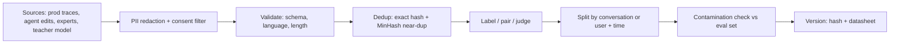

# Fine-tuning LLMs - Dataset Curation for SFT & DPO

> [!info] Deep dive of [[Fine-tuning LLMs]]

> [!abstract] TL;DR
> Data quality beats every hyperparameter. For a narrow task, **500–3,000 clean SFT demonstrations** plus **1k–5k on-policy DPO pairs** beat 50k scraped rows.
> - The pipeline: source from real traffic → redact PII → dedupe → validate → split by conversation → check eval contamination → version.
> - The best DPO pairs in a support or WhatsApp product are free: **model draft = rejected, human-edited reply = chosen**.

## Concept
- **SFT** imitates demonstrations. It teaches format, tone, tool-call shape and domain vocabulary. It cannot teach "better vs worse", because every example is treated as equally ideal.
- **DPO** learns from `(prompt, chosen, rejected)` triples. It raises the likelihood of `chosen` relative to `rejected` against a frozen reference model, scaled by `beta`. It only learns what **differs** between the pair, so pairs must differ in the dimension you care about.
- **KTO** takes unpaired 👍/👎 labels, which suits thumbs-feedback logs. **ORPO** folds the preference into SFT in one stage. Both use the same curation pipeline.
- **On-policy beats off-policy**: DPO works best when `rejected` (ideally both sides) was sampled from *your* SFT model. Pairs from another model teach the gap between two other models.

| Dataset | Format (TRL) | Typical size, narrow task | Main failure mode |
|---|---|---|---|
| SFT conversational | `{"messages": [...]}` | 500–5k | Inconsistent style across annotators |
| SFT prompt/completion | `{"prompt": ..., "completion": ...}` | 500–5k | Prompt text accidentally included in loss |
| Preference (DPO/ORPO) | `{"prompt", "chosen", "rejected"}` | 1k–10k pairs | Length bias, near-identical pairs |
| Unpaired (KTO) | `{"prompt", "completion", "label": bool}` | 2k+ | Heavy class imbalance |

## How It Works

1. **Source**: production traces from [[AI Evals & Observability]] tooling are best. Human experts fill gaps. A teacher model generates synthetic rows only where real data is thin, and must respect the provider's ToS.
2. **Redact and filter**: drop rows without consent, mask PII, strip secrets.
3. **Validate**: tool calls parse, JSON matches the schema, language is as expected, and assistant turns stay within the token budget.
4. **Dedup**: exact (normalized hash), then near-duplicates (MinHash/LSH, Jaccard ≥ 0.8). Templated messages ("Thank you for contacting…") otherwise dominate.
5. **Split by group**: by conversation or customer, and preferably by time (train ≤ June, eval = July). Row-level random splits leak the same thread into both sets.
6. **Version**: content hash, row counts, source mix and filters applied. Train configs reference the hash.

## Practical Usage
**SFT row** (conversational, with tool call), in JSONL:
```json
{"messages": [
  {"role": "system", "content": "You are Kedai Ali's order assistant. Reply in the customer's language."},
  {"role": "user", "content": "boleh hantar esok? order 1042"},
  {"role": "assistant", "tool_calls": [{"type": "function", "function": {"name": "get_order", "arguments": "{\"id\": \"1042\"}"}}]},
  {"role": "tool", "name": "get_order", "content": "{\"status\": \"packed\", \"eta\": \"2026-10-22\"}"},
  {"role": "assistant", "content": "Boleh! Order 1042 dah siap dibungkus, dijangka sampai esok 22 Okt."}
]}
```
**DPO row** built from human edits:
```json
{"prompt": [{"role": "user", "content": "Saya nak refund, barang rosak"}],
 "chosen": [{"role": "assistant", "content": "Maaf atas kesulitan. Boleh hantar gambar barang dan nombor order? Kami proses refund dalam 3 hari bekerja."}],
 "rejected": [{"role": "assistant", "content": "Sila rujuk polisi refund kami di laman web."}]}
```
**Curation script**: redaction, dedup and group split.
```python
import hashlib, json, re
from datasketch import MinHash, MinHashLSH

MY_IC = re.compile(r"\b\d{6}-?\d{2}-?\d{4}\b")           # MyKad
PHONE = re.compile(r"(\+?6?01)[0-9][- ]?\d{3,4}[- ]?\d{4}")
EMAIL = re.compile(r"[\w.+-]+@[\w-]+\.[\w.]+")

def redact(t: str) -> str:
    return EMAIL.sub("<EMAIL>", PHONE.sub("<PHONE>", MY_IC.sub("<IC>", t)))

def norm(t: str) -> str:
    return re.sub(r"\s+", " ", t.lower()).strip()

def minhash(t: str) -> MinHash:
    m = MinHash(num_perm=128)
    for i in range(len(t) - 4):
        m.update(t[i:i + 5].encode())
    return m

lsh, seen, kept = MinHashLSH(threshold=0.8, num_perm=128), set(), []
for row in map(json.loads, open("raw.jsonl")):
    for m in row["messages"]:
        m["content"] = redact(m.get("content") or "")
    text = norm(" ".join(m["content"] for m in row["messages"]))
    h = hashlib.sha256(text.encode()).hexdigest()
    if h in seen:
        continue
    mh = minhash(text)
    if lsh.query(mh):
        continue
    seen.add(h); lsh.insert(h, mh); kept.append(row)

bucket = lambda conv_id: int(hashlib.md5(conv_id.encode()).hexdigest(), 16) % 10
train = [r for r in kept if bucket(r["conversation_id"]) < 9]       # split by conversation, not row
eval_ = [r for r in kept if bucket(r["conversation_id"]) == 9]
```
**On-policy DPO pairs** with a judge and margin filter:
```python
for prompt in prompts:
    cands = sft_model.generate(prompt, n=4, temperature=0.9)
    scored = sorted(((judge(prompt, c, rubric), c) for c in cands), reverse=True)
    (top_s, top), (low_s, low) = scored[0], scored[-1]
    if top_s - low_s >= 2 and abs(len(top) - len(low)) / max(len(top), len(low)) < 0.3:   # margin + length balance
        pairs.append({"prompt": prompt, "chosen": top, "rejected": low})
```
**Wrong way**: training on the raw export.
```python
# ❌ PII included, duplicated templates, random row split leaks threads into eval,
#    loss computed on user turns (model learns to write like customers)
ds = load_dataset("json", data_files="chatwoot_export.jsonl").train_test_split(0.1)
```

## Patterns & Anti-patterns
| Pattern | When | Anti-pattern to avoid |
|---|---|---|
| Edit pairs (draft → human fix) | Any human-in-the-loop product | Asking annotators to write "rejected" answers (unrealistic failures) |
| Assistant-only loss | Multi-turn SFT | Loss on system/user tokens, so the model parrots prompts |
| Group + time split | Always | Random row split, giving inflated eval scores |
| Length-balanced pairs | DPO | `chosen` systematically longer, so the model learns verbosity, not quality |
| Hard negatives (plausible but wrong) | DPO for factuality or tool choice | Trivially bad `rejected` ("asdf"), which teaches nothing |
| Datasheet per version (sources, filters, counts) | Every dataset | "final_v3_fixed.jsonl" on someone's laptop |
| Keep 10–20% general/refusal rows | Narrow SFT | Pure task data, causing safety and instruction-following erosion |

## Performance & Trade-offs
- **Quantity curve**: narrow format tasks plateau around 1–3k rows. Adding noisy rows past that hurts more than it helps. Double the data only if eval improves on the last doubling.
- **Token budget**: cost scales with tokens × epochs. Truncate tool outputs and long histories to the last N turns the model actually needs at inference.
- **DPO `beta`**: about 0.1 by default. Lower values (0.05) push harder from the reference, with more drift risk; higher values (0.3–0.5) are conservative. Run SFT first on the same distribution; DPO on a model that hasn't seen the format is unstable.
- **Judge cost**: LLM-as-judge pairing costs roughly 4–8 generations plus 1 judge call per prompt. Use a cheap model like Haiku 5.5 for rubric scoring, and calibrate it on ~100 human-labelled pairs first. Agreement below ~80% means the rubric is wrong.
- **Synthetic vs real**: synthetic data is cheap and clean but drifts from real user phrasing, which in Malaysia means code-switched BM/EN/Manglish with typos. Cap synthetic data at about 30–50% and always eval on real traffic.

## Tips & Reminders
> [!tip] In ZP's stack
> - Log every agent turn in a [[Supabase]] table: `conversation_id, tenant_id, model_output, final_sent, edited_by, consent_training bool, created_at`.
> - Rows where `final_sent <> model_output` are DPO pairs. Rows sent unedited with positive outcomes are SFT candidates.
> - Export with SQL to JSONL, then train with [[Fine-tuning LLMs - LoRA & QLoRA with Unsloth|Unsloth]].
> - Keep per-tenant datasets separate unless the contract allows pooling.

- Render each row with the **target model's chat template** (`tokenizer.apply_chat_template`) and inspect 20 rendered samples before training. Template bugs look fine in JSON.
- Track the source mix (prod / expert / synthetic) as a column. When eval regresses, slice by source first.
- Freeze a **golden eval set** of 100–300 real cases and never train on it. Re-run contamination checks (n-gram or MinHash against it) on every new dataset version.
- For reasoning models with thinking tokens (Qwen 3.x, gpt-oss harmony format), decide whether training data includes reasoning traces, and match the template's handling of them.

## Version Notes
| Version / date | Change relevant here |
|---|---|
| DPO paper (2023) | Preference tuning without a reward model or PPO |
| KTO, ORPO (2024) | Unpaired-label and single-stage alternatives |
| TRL 0.1x (2025) | Unified dataset formats (conversational, prompt-completion, preference, unpaired). Settings moved into `SFTConfig`/`DPOConfig` |
| TRL 1.x (2026) | Docs show v1.10. Dataset-type conventions carried forward |
| Malaysia PDPA amendments (2024–25) | Mandatory breach notification, DPO appointment, data portability. Training on customer chats needs a lawful basis and a stated purpose |

> [!warning] Unverified — check before relying on this
> The exact current TRL version and the loss-masking option names (`assistant_only_loss`, `completion_only_loss`) should be checked against https://huggingface.co/docs/trl before copying configs.

## Critical Issues & Gotchas
> [!danger] Eval leakage makes every result fake
> The same conversation, a near-duplicate template, or a paraphrase in both train and eval inflates scores by 10–30 points. Split by conversation or customer and time, and MinHash-check eval against train.

> [!danger] Provider ToS on synthetic data
> Several API providers' terms restrict using outputs to build competing models. Read the current terms before generating training data with a hosted model, and record the generator model per row.

> [!danger] PII and consent (PDPA)
> Customer chats contain IC numbers, phone numbers and addresses. Fine-tuned weights can **memorize and regurgitate** rare strings. Redact before training, honour opt-outs, and keep a deletion path: retraining without a deleted user's rows.

- **Dataset licences**: many public instruction sets are CC-BY-NC or carry model-output restrictions. They are unusable for commercial client models.
- **Length and style bias in DPO**: if annotators prefer longer, more polite answers, the model learns length. Check `mean(len(chosen)) / mean(len(rejected))`; a ratio above ~1.3 is a red flag.
- **Label noise from multiple annotators**: write a 1-page style guide with 10 worked examples, and measure inter-annotator agreement on a 50-row overlap.
- **System prompt baked in**: training every row with one system prompt makes the model ignore different prompts at inference. Vary system prompts, or train without them if serving without them.

## Related
- [[Fine-tuning LLMs]]
- [[Fine-tuning LLMs - LoRA & QLoRA with Unsloth]] — training the curated set
- [[AI Evals & Observability]] — traces as data source, golden sets, judges
- [[AI Evals & Observability - Eval Datasets & LLM-as-Judge]] — judge calibration, golden-set construction
- [[LLM Fundamentals]] — tokens, chat templates, post-training stages
- [[Prompt Engineering]] — few-shot baseline to beat before fine-tuning
- [[Supabase]] — trace and feedback storage

## References
- https://huggingface.co/docs/trl/dataset_formats
- https://arxiv.org/abs/2305.18290 (DPO)
- https://arxiv.org/abs/2305.11206 (LIMA: less is more for alignment)
- https://huggingface.co/spaces/hf-skills/llm-trainer/blob/main/references/training_methods.md
- https://github.com/ekzhu/datasketch
