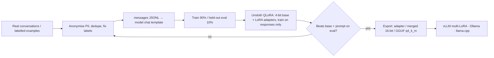

# Fine-tuning LLMs - LoRA & QLoRA with Unsloth

> [!info] Deep dive of [[Fine-tuning LLMs]]

> [!abstract] TL;DR
> **Unsloth** wraps Hugging Face Transformers + PEFT + TRL with custom kernels that typically train **~2× faster with much less VRAM**, so 7–14B models fit on one consumer GPU with **QLoRA**.
> - **Workflow**: clean a few hundred to a few thousand **chat-formatted examples**, then train a LoRA adapter (`r=16`, lr `2e-4`, 1–3 epochs) on **responses only**. Evaluate against the base model on a held-out set, then export (merged 16-bit for vLLM, or GGUF for Ollama/llama.cpp).
> - **When to use it**: for format, style and narrow skills, **not to teach facts**. Facts belong in [[RAG]].

## Concept

### When fine-tuning is the right tool
| Goal | Fine-tune? | Better first step |
|---|---|---|
| Consistent output format/tone (e.g. WhatsApp replies in Manglish brand voice) | ✅ Good fit | Few-shot prompt, then SFT if prompts get long or costly |
| Narrow classification/extraction at high volume, cheaply | ✅ Small model SFT (1–8B) | Prompted small model plus eval |
| Know the client's product catalogue / policies | ❌ | RAG (facts change; fine-tuned facts go stale and hallucinate) |
| Reasoning on verifiable tasks (math, SQL, tool use) | ⚠️ GRPO/RL with rewards | Strong base model + prompting |
| Data must stay on-prem / no API | ✅ Open-weight + LoRA | — |

### VRAM rough guide (QLoRA 4-bit, LoRA r=16, seq 2–4k, gradient checkpointing)
| Base model size | Approx. VRAM | GPU examples |
|---|---|---|
| 1–4B | 4–8 GB | T4 (Colab), RTX 3060 |
| 7–9B | 8–12 GB | RTX 4070/4080, L4 |
| 14B | 12–18 GB | RTX 4090 (24 GB), L4 tight |
| 30–32B dense / 30B MoE | 20–26 GB | RTX 4090 / A6000 / L40S |
| 70B | 40–48 GB | A100/H100 80 GB, 2× 4090 |

These are approximate. Longer sequences and larger batches scale memory up, so measure with `nvidia-smi`.

### Key hyperparameters
| Param | Start with | Effect |
|---|---|---|
| `r` (rank) | 16 (8–64) | Adapter capacity. Higher = more expressive, more overfit risk |
| `lora_alpha` | = r or 2×r | Scaling of the update |
| `target_modules` | q,k,v,o,gate,up,down proj | All linear layers usually beats attention-only |
| Learning rate | 2e-4 (LoRA) | Too high → collapse/garbage. Too low → no change |
| Epochs | 1–3 | More epochs on small data = memorisation |
| Effective batch | 8–32 (batch × grad accumulation) | Stability |
| `max_seq_length` | Fit 95th percentile of examples | Memory scales with it |

## How It Works

- **QLoRA**: base weights are frozen in 4-bit NF4, small LoRA matrices (A, B) train in bf16, and gradients flow through the quantised base. Quality is close to 16-bit LoRA for most tasks.
- **Responses-only loss**: mask the system/user tokens so the model learns to *answer*, not to imitate user messages.

## Practical Usage

### Data format (`train.jsonl`)
```json
{"messages": [
  {"role": "system", "content": "You are Kedai X support. Reply briefly in the customer's language."},
  {"role": "user", "content": "boleh hantar ke Kuching esok?"},
  {"role": "assistant", "content": "Boleh! Order sebelum 3pm hari ni, kami hantar esok guna J&T. Nak saya semak alamat anda?"}
]}
```
- Use 300–3,000 high-quality examples, drawn from real distribution plus edge cases. Quality beats quantity: 500 clean examples outperform 20,000 noisy ones.
- Keep a **held-out eval set** (≥ 100 cases) that is never trained on ([[AI Evals & Observability - Eval Datasets & LLM-as-Judge]]).

### Train (Unsloth + TRL)
```python
from unsloth import FastLanguageModel
from unsloth.chat_templates import get_chat_template, train_on_responses_only
from datasets import load_dataset
from trl import SFTTrainer, SFTConfig

model, tok = FastLanguageModel.from_pretrained(
    "unsloth/Qwen3-8B", max_seq_length=4096, load_in_4bit=True)          # QLoRA
model = FastLanguageModel.get_peft_model(
    model, r=16, lora_alpha=16, lora_dropout=0.0,
    target_modules=["q_proj", "k_proj", "v_proj", "o_proj", "gate_proj", "up_proj", "down_proj"],
    use_gradient_checkpointing="unsloth", random_state=42)

tok = get_chat_template(tok, chat_template="qwen3")                      # match the base model's template
ds = load_dataset("json", data_files={"train": "train.jsonl", "eval": "eval.jsonl"})
fmt = lambda b: {"text": [tok.apply_chat_template(m, tokenize=False) for m in b["messages"]]}
ds = ds.map(fmt, batched=True)

trainer = SFTTrainer(
    model=model, tokenizer=tok, train_dataset=ds["train"], eval_dataset=ds["eval"],
    args=SFTConfig(dataset_text_field="text", per_device_train_batch_size=2, gradient_accumulation_steps=8,
                   num_train_epochs=2, learning_rate=2e-4, lr_scheduler_type="cosine", warmup_ratio=0.05,
                   logging_steps=10, eval_strategy="steps", eval_steps=50, bf16=True, optim="adamw_8bit",
                   output_dir="out", seed=42),
)
trainer = train_on_responses_only(trainer,
    instruction_part="<|im_start|>user\n", response_part="<|im_start|>assistant\n")   # template-specific markers
trainer.train()
```

### Export and serve
```python
model.save_pretrained("out/adapter"); tok.save_pretrained("out/adapter")                 # MB-sized LoRA adapter
model.save_pretrained_merged("out/merged16", tok, save_method="merged_16bit")             # for vLLM / TGI
model.save_pretrained_gguf("out/gguf", tok, quantization_method="q4_k_m")                 # for Ollama / llama.cpp
```
```bash
# vLLM: one base model, many tenant adapters
vllm serve Qwen/Qwen3-8B --enable-lora --lora-modules kedaix=out/adapter --max-lora-rank 16
# Ollama: Modelfile → FROM ./out/gguf/model-q4_k_m.gguf ; ollama create kedaix -f Modelfile
```

### Evaluate before shipping
| Compare | Metric |
|---|---|
| Base model + best prompt vs fine-tuned | Task pass rate on held-out set (judge or programmatic) |
| Fine-tuned vs frontier API (cost/latency) | Quality at p50/p95 latency and RM per 1k requests |
| Regression set (general instructions, safety, refusals) | No collapse in general behaviour |

## Patterns & Anti-patterns
| Pattern | When | Anti-pattern to avoid |
|---|---|---|
| Prompt + RAG baseline first, fine-tune only on measured gaps | Always | Fine-tuning because "custom model" sounds better to a client |
| Responses-only loss with the exact chat template | SFT | Training on raw concatenated text with a mismatched template |
| Small held-out eval + base comparison every run | Every training run | Judging by a handful of cherry-picked chats |
| One base + many LoRA adapters (multi-tenant) | SaaS per-client styles | A full merged model per client (storage/VRAM ×N) |
| Version datasets, configs and adapters together | Reproducibility | "Final_v3_really_final" checkpoints with unknown data |
| Facts via RAG, behaviour via fine-tune | Knowledge-heavy bots | Fine-tuning the product catalogue into weights |

## Performance & Trade-offs
- **QLoRA vs LoRA 16-bit**: QLoRA uses ~⅓–½ the VRAM for small quality loss. 16-bit LoRA is a bit better when VRAM allows (A100/H100).
- **Model size**: a fine-tuned 8B can match a frontier model on a narrow task at a fraction of per-request cost, but you take on serving ops (GPU, scaling, updates) instead of an API bill.
- **GGUF quantisation**: q4_k_m is the sweet spot for CPU/edge, while q8_0 is near-lossless but 2× bigger. Re-run evals after quantising, because quality can drop on reasoning-heavy tasks.
- **Cost**: a 1–2 h QLoRA run on a rented 24 GB GPU costs ~RM 5–20. Data preparation and evaluation cost far more of your time.

## Tips & Reminders
> [!tip]
> - **Check the EOS token and template**: missing EOS in training data makes models ramble. Mismatched templates make outputs break at inference.
> - **Start tiny**: 50 steps on 100 examples to verify the pipeline end to end (train → export → serve → eval) before the real run.
> - **Use the right GPU**: Colab/Kaggle free GPUs are fine for experiments. For client work, use RunPod/Lambda/Vast rentals, and never upload client data to unvetted notebooks.
> - **In ZP's stack**:
>   - **When it fits**: offer fine-tuning only after a prompt+RAG bot is live and evals show a format/tone gap.
>   - **How**: train per-client LoRA adapters on anonymised WhatsApp transcripts (with consent), and serve with vLLM multi-LoRA on a GPU VPS, or Ollama for low volume.
>   - **Proof**: keep the eval report as the deliverable that justifies the cost.

## Version Notes
| Item | Note |
|---|---|
| LoRA (2021) / QLoRA (2023) | Core methods. NF4 + double quantisation + paged optimisers |
| TRL `SFTTrainer`/`SFTConfig` | Config object replaced trainer kwargs. Check field names per TRL version |
| Unsloth 2025–26 | GRPO/DPO, FP8 training, MoE support (e.g. Qwen3-30B-A3B on ~17.5 GB per vendor claims), vision/audio models, "Unsloth Studio". Calendar versioning on PyPI (2026.9.x seen) |
| vLLM | Multi-LoRA serving (`--enable-lora`). Check max rank and adapter count limits |

> [!warning] Unverified — check before relying on this
> Unsloth supported-model lists, chat-template names (`qwen3`, response markers) and VRAM claims come from vendor/third-party pages and change quickly. Check the Unsloth docs/notebooks for your exact base model before training.

## Critical Issues & Gotchas
> [!danger] Training data = data processing (PDPA) and leakage risk
> Fine-tuned weights can **memorise and regurgitate** training text: phone numbers, addresses, IC numbers, order details. Anonymise before training, get consent or another lawful basis for using customer chats, restrict who can download adapters, and test with extraction prompts ("repeat a customer conversation"). Under PDPA, deleting a person's data may mean retraining without it.

> [!danger] Licence terms of the base model
> Open-weight doesn't mean unrestricted. Llama's community licence has acceptable-use and size-based terms, Gemma has its own terms, and Qwen/Mistral/gpt-oss vary (Apache-2.0 or custom). Check commercial use, redistribution of fine-tunes and attribution requirements before selling a fine-tuned model to a client.

> [!warning] Gotchas
> - Catastrophic forgetting: aggressive LR or epochs degrade general ability. Include a small slice of general instruction data, or keep epochs ≤ 2.
> - Eval contamination: near-duplicates of eval examples in training inflate scores. Dedupe across splits.
> - 4-bit merged exports: merge into 16-bit weights, not into the 4-bit quantised base, or quality drops.
> - Sampling settings at inference (temperature, repetition penalty) change behaviour a lot. Fix them in serving config and eval with the same settings.
> - Thinking/reasoning-mode templates (e.g. Qwen3 think tags) must be handled consistently in data and inference.

## Related
- [[Fine-tuning LLMs]]
- [[AI Evals & Observability - Eval Datasets & LLM-as-Judge]] — proving the fine-tune helped
- [[RAG]] — facts and freshness outside the weights
- [[Prompt Engineering]] — the baseline to beat
- [[LLM Fundamentals]] — tokenisation, chat templates, quantisation
- [[Python]] — training stack

## References
- Unsloth docs: https://docs.unsloth.ai/
- Unsloth GitHub: https://github.com/unslothai/unsloth
- TRL SFTTrainer: https://huggingface.co/docs/trl/sft_trainer
- QLoRA paper (Dettmers et al., 2023): https://arxiv.org/abs/2305.14314
- vLLM LoRA adapters: https://docs.vllm.ai/en/latest/features/lora.html
