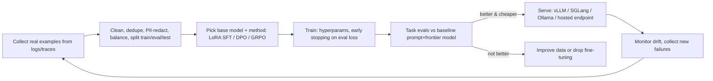

# Fine-tuning LLMs

> [!abstract] TL;DR
> Fine-tuning continues training a pretrained model on your examples to change its **behaviour**: format, style, task specialization, tool-use patterns, reasoning on a narrow domain. It's **not** the right tool for injecting fresh or private **knowledge**, which is what [[RAG]] is for.
> - **Method ladder** (cheapest first): better prompts and few-shot examples → RAG → **LoRA/QLoRA supervised fine-tuning (SFT)** → preference tuning (DPO) → **reinforcement fine-tuning (GRPO/RFT)** with verifiable rewards → full fine-tuning or distillation.
> - **2026 reality**: frontier API models plus good prompts beat most small fine-tunes for SME use cases. Fine-tuning pays off for **high-volume, narrow tasks** (cost/latency via a smaller model), strict output formats, or on-prem/data-residency needs with open-weight models.

## Introduction
- **Lineage**:
  - Transfer learning (ULMFiT 2018, BERT 2018).
  - Instruction tuning (FLAN, 2021).
  - RLHF (InstructGPT, 2022).
  - PEFT/LoRA (2021) and QLoRA (2023) made consumer-GPU fine-tuning possible.
  - DPO (2023) simplified preference tuning.
  - GRPO (DeepSeekMath/R1, 2024–25) popularized RL with verifiable rewards for reasoning.
- **Who offers it**:
  - Hosted APIs: OpenAI (SFT, DPO, and RFT on selected models), Google Vertex AI (Gemini tuning), AWS Bedrock (selected models), Together, Fireworks, Mistral.
  - Self-managed open-weight models: Qwen 3.x, Gemma, Llama, Mistral, gpt-oss, DeepSeek distills.
- **Where it sits**: after prompt engineering and evals ([[AI Evals & Observability]]). It's a model-layer optimization inside an AI system, not a replacement for retrieval, tools or guardrails.

## Core Concepts

### Approaches
| Method | Data needed | What it changes | Cost |
|---|---|---|---|
| Prompting / few-shot | 0–20 examples | Behaviour at inference | Tokens per call |
| [[RAG]] | Documents | Knowledge available per query | Retrieval infra |
| **SFT (full)** | 1k–100k+ input→output pairs | All weights | High GPU memory |
| **LoRA / QLoRA (PEFT)** | 100s–10k+ pairs | Small low-rank adapter matrices (QLoRA: 4-bit base model) | Single GPU (8–24 GB for 7–8B models) |
| **DPO / ORPO / KTO** | Preference pairs (chosen vs rejected) | Style/quality preferences | Similar to SFT |
| **RL fine-tuning (GRPO, RFT)** | Prompts + a reward function/grader (verifiable: tests pass, JSON valid, answer correct) | Reasoning/policy toward reward | Higher compute. Reward hacking risk |
| Distillation | Teacher model outputs | Small model imitates a large one | Teacher API cost + training |
| Continued pretraining | Large unlabelled domain corpus | Domain language/knowledge | Expensive. Rarely worth it for SMEs |

### When to fine-tune (decision rules)
- ✅ Consistent output format/style that prompting can't hold reliably at scale.
- ✅ A narrow, high-volume task (classification, extraction, routing) where a small fine-tuned model replaces a large model and cuts **cost/latency 5–20×**.
- ✅ On-prem/air-gapped or data-residency constraints requiring open-weight models.
- ✅ Teaching tool-calling patterns or domain-specific reasoning with verifiable rewards.
- ❌ "The model should know our latest products/prices/SOPs" → RAG (knowledge changes, needs citations).
- ❌ Fewer than ~100 quality examples, or no eval set to prove improvement.

### LoRA with TRL / Unsloth (Python)
```python
from unsloth import FastLanguageModel           # or transformers + peft + trl directly
from trl import SFTTrainer, SFTConfig
from datasets import load_dataset

model, tok = FastLanguageModel.from_pretrained("Qwen/Qwen3-8B", load_in_4bit=True, max_seq_length=4096)   # QLoRA
model = FastLanguageModel.get_peft_model(model, r=16, lora_alpha=32, lora_dropout=0.0,
                                         target_modules=["q_proj", "k_proj", "v_proj", "o_proj", "gate_proj", "up_proj", "down_proj"])

ds = load_dataset("json", data_files={"train": "data/train.jsonl", "eval": "data/eval.jsonl"})   # chat-format messages
trainer = SFTTrainer(model=model, tokenizer=tok, train_dataset=ds["train"], eval_dataset=ds["eval"],
                     args=SFTConfig(per_device_train_batch_size=2, gradient_accumulation_steps=8, num_train_epochs=2,
                                    learning_rate=2e-4, lr_scheduler_type="cosine", logging_steps=10, output_dir="out"))
trainer.train()
model.save_pretrained("out/lora-adapter")       # small adapter; merge or serve with vLLM LoRA support
```
```jsonl
{"messages":[{"role":"system","content":"Extract invoice fields as JSON."},{"role":"user","content":"INVOICE No: INV-2026-0042 ... Jumlah: RM 1,250.00"},{"role":"assistant","content":"{\"number\":\"INV-2026-0042\",\"total_sen\":125000,\"currency\":\"MYR\"}"}]}
```

## Architecture / How It Works

- **LoRA**: freeze base weights W and learn a low-rank update ΔW = B·A (rank r ≈ 8–64) on attention/MLP projections. Adapters are MBs, swappable per task/tenant, and servable on one base model (multi-LoRA serving in vLLM).
- **QLoRA**: load the base in 4-bit NF4, train LoRA adapters in higher precision. Fine-tune 7–14B models on a single 24 GB GPU, or ~70B on a single 80 GB card.
- **Chat templates matter**: train and serve with the same template and special tokens, otherwise outputs degrade badly.
- **GRPO**: sample several completions per prompt, score them with reward functions, and push the policy toward above-group-average answers. No separate value model, so it's cheaper than PPO. It works best with **verifiable rewards** (unit tests, schema validation, exact answers).

## Project Structure
```text
ft-invoice-extractor/
├── data/
│   ├── raw/                  # exported traces (PII-redacted)
│   ├── train.jsonl / eval.jsonl / test.jsonl   # held-out test never used for tuning decisions
│   └── DATA_CARD.md          # sources, consent/PDPA basis, label guidelines
├── configs/qwen3-8b-lora.yaml
├── train.py                  # TRL/Unsloth/Axolotl
├── evals/                    # same harness as production evals (AI Evals & Observability)
└── serve/                    # vLLM config, adapter registry, model card
```

## Use Cases
| Use case | Approach |
|---|---|
| Invoice/receipt/IC field extraction at volume | LoRA on a small open model, or a hosted SFT on a mini model. Schema-valid JSON |
| Intent classification for WhatsApp messages (BM/EN/Manglish) | Small fine-tuned classifier/LLM for cost and latency |
| Brand voice for marketing copy | Few-shot first. DPO if consistency matters at scale |
| Tool-calling agent for a fixed toolset | SFT on successful trajectories, then RL with task-success rewards |
| On-prem assistant for regulated clients | Open-weight model + LoRA + RAG, self-hosted |
| "Bot must know our product catalog" | **Not fine-tuning**. Use [[RAG]] |

## Pros & Cons
| Pros | Cons |
|---|---|
| Lower cost/latency by moving tasks to smaller models | Data collection/labelling is the real cost |
| Reliable formats and styles | Catastrophic forgetting and degraded general abilities |
| Data residency with open-weight models | GPU infra/MLOps burden for self-hosting |
| Encodes tacit task knowledge prompts can't | Frontier models improve fast. Fine-tunes become obsolete |
| Adapters are small and swappable | Hosted fine-tuned models tie you to that provider/model version (deprecations) |

## Alternatives & Peers
| Alternative | Strength vs fine-tuning | Pick it when… |
|---|---|---|
| [[Prompt Engineering]] + few-shot | Zero training, instant iteration | Always try first |
| [[RAG]] | Fresh, citable knowledge | Knowledge changes or must be traceable |
| Structured outputs / constrained decoding | Guaranteed JSON schemas without training | Format problems |
| Model routing (small model first, escalate to large) | Cost savings without training | Mixed difficulty traffic |
| Prompt caching | Cheaper long system prompts | Large static instructions/examples |
| Distillation via API outputs | Small model learns from a large one | High-volume narrow task. Check provider ToS |

## Tips & Reminders
> [!tip]
> - Build the **eval set first** (held-out, realistic). Compare the fine-tune against "best prompt + frontier model" on quality, cost and latency.
> - Quality over quantity: 500 clean, diverse, correctly labelled examples beat 50k noisy ones. Include hard and negative cases.
> - Start with LoRA r=16, lr ≈ 1e-4–2e-4, 1–3 epochs. Watch eval loss for overfitting. Keep the base model's chat template.
> - Version datasets, configs and adapters together, and write a model card (intended use, data sources, limits).
> - **In ZP's stack**: default to frontier APIs + prompts + RAG for clients. Consider fine-tuning only for a high-volume extraction/classification workload in [[n8n]] where cost matters. Rent GPUs by the hour (RunPod, Lambda, Modal) rather than buying, and serve with vLLM or a hosted provider. PDPA: get a documented legal basis before training on customer messages, and redact PII.

## Versions & Breaking Changes
| Milestone | Year | Impact |
|---|---|---|
| LoRA paper | 2021 | Parameter-efficient fine-tuning |
| InstructGPT / RLHF | 2022 | Instruction-following via human feedback |
| QLoRA, DPO | 2023 | Single-GPU fine-tuning. RL-free preference tuning |
| Hosted fine-tuning APIs widen (SFT/DPO, vision) | 2024 | Easy managed fine-tuning on mini models |
| GRPO / reasoning RL (DeepSeek-R1), hosted RFT | 2025 | RL with verifiable rewards goes mainstream |
| gpt-oss open-weight models (Apache 2.0) | 2025-08 | Permissive open models from OpenAI |
| TRL 0.15 improved GRPO, Unsloth low-VRAM GRPO | 2026 | RL fine-tuning on a single 24 GB GPU |

> [!warning] Unverified — check before relying on this
> Which hosted models currently support SFT/DPO/RFT, their pricing and deprecation dates change often. Check provider docs (OpenAI, Vertex AI, Bedrock) before quoting clients.

## Critical Issues & Gotchas
> [!danger] Fine-tuning can remove safety behaviour and leak training data
> Research (2023–24) showed that fine-tuning on as few as ~100 examples, even benign ones, can erode a model's safety alignment. Fine-tuned models can also **memorize and regurgitate** training data (customer names, phone numbers, IC numbers). Redact PII, red-team the fine-tuned model, keep guardrails outside the model, and never train on data you lack rights/consent to use.

> [!danger] Vendor lock-in and forced deprecations
> Hosted fine-tunes are tied to a specific base model snapshot. When the provider deprecates it, your fine-tune stops working and must be retrained, often on short notice. Keep datasets and training scripts portable, and prefer open-weight bases when longevity matters.

> [!warning] Gotchas
> - Reward hacking in RL: models exploit weak reward functions (e.g. valid JSON with wrong values). Combine rewards and inspect samples.
> - Evaluation leakage: test examples in training data inflate scores. Dedupe across splits.
> - Licenses: open-weight models carry different licenses (Apache 2.0 vs Llama/Gemma custom terms with usage policies). Check commercial terms.
> - Tokenizer/chat-template mismatches between training and serving silently ruin outputs.
> - Fine-tuning won't fix hallucinations about facts the model doesn't know. That's a retrieval problem.

## Deep Dives
N/A — no deep dives planned yet. Candidates: LoRA/QLoRA hands-on with Unsloth, dataset curation for SFT/DPO.

## Related
- [[LLM Fundamentals]] — training stages, tokens, sampling
- [[Prompt Engineering]] — the first lever before fine-tuning
- [[RAG]] — knowledge injection alternative
- [[AI Evals & Observability]] — proving a fine-tune helps
- [[LLM APIs & SDKs]] — hosted fine-tuning endpoints
- [[Python]] — the training ecosystem (PyTorch, TRL)

## References
- LoRA paper: https://arxiv.org/abs/2106.09685
- QLoRA paper: https://arxiv.org/abs/2305.14314
- DPO paper: https://arxiv.org/abs/2305.18290
- Hugging Face TRL: https://huggingface.co/docs/trl
- Unsloth docs: https://docs.unsloth.ai/
- How to fine-tune LLMs in 2026: https://blog.dailydoseofds.com/p/how-to-fine-tune-llms-in-2026
- Unsloth GRPO explained: https://www.yottalabs.ai/post/unsloth-vs-traditional-fine-tuning-faster-grpo-training-explained
