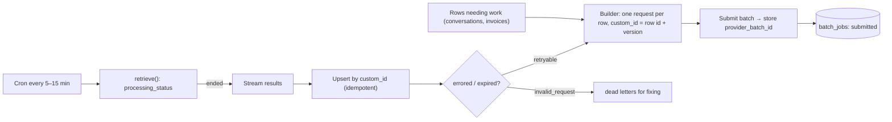

# LLM APIs & SDKs - Batch Processing & Async Workloads

> [!info] Deep dive of [[LLM APIs & SDKs]]

> [!abstract] TL;DR
> If **nobody is waiting** for the answer (nightly classification, backfills, evals, bulk extraction, summaries), use the **Batch API**: **50% off every token**, stacking with prompt caching.
> - Results arrive asynchronously (most within an hour, at most 24 h) and in **any order**, so map them by `custom_id`.
> - Batch requests are single-shot, with **no tool loops**.
> - Wrap batches in a Postgres job table: submit, poll on cron, ingest idempotently, resubmit errored/expired items.
>
> Keep user-facing work synchronous, and drive non-batchable async work through a queue with concurrency limits.

## Concept
| Workload | Mode | Why |
|---|---|---|
| WhatsApp reply, chat, form assist | Synchronous (streaming) | A user is waiting |
| Nightly tagging/sentiment of yesterday's conversations | **Batch** | Hours of slack, big volume |
| Re-extracting 20k invoices after a schema change | **Batch** | Backfill |
| Eval runs on a golden set per prompt version | **Batch** | Cost, no latency need |
| Agent tasks needing tools mid-run | Queue + workers (async, not batch) | Batches can't loop tools |
| Embeddings backfill | Provider's embedding batch/bulk endpoint or a self-hosted model | Different API |

**Claude Message Batches** (key facts):

| Property | Value |
|---|---|
| Discount | **50%** on all tokens (input, output, cache reads/writes) |
| Size | Up to 100,000 requests or 256 MB per batch |
| Completion | Most within 1 hour, max 24 hours (expiry, not SLA) |
| Results retention | 29 days |
| Features | Same params as Messages (tools definitions, structured outputs, vision, caching), but **one response per request** |
| Result types | `succeeded`, `errored` (`invalid_request` → fix; others → retry), `canceled`, `expired` (resubmit) |

## How It Works


## Practical Usage
**Job table**:
```sql
create table public.llm_batches (
  id uuid primary key default gen_random_uuid(),
  purpose text not null,                     -- 'nightly_tagging', 'invoice_reextract_v3'
  provider_batch_id text unique,
  status text not null default 'building',   -- building | submitted | ended | ingested | failed
  item_count int not null default 0,
  submitted_at timestamptz, ended_at timestamptz, ingested_at timestamptz
);
create table public.llm_batch_items (
  batch_id uuid references public.llm_batches on delete cascade,
  custom_id text primary key,                -- e.g. 'conv:9f1c…:tag-v4'
  status text not null default 'pending',    -- pending | succeeded | errored | expired | invalid
  attempts int not null default 0
);
```
**Submit** (structured output per request; `custom_id` encodes row + schema version):
```ts
const requests = rows.map((r) => ({
  custom_id: `conv:${r.id}:tag-v4`,
  params: {
    model: 'claude-haiku-5-5',
    max_tokens: 512,
    system: [{ type: 'text', text: TAGGING_SYSTEM_PROMPT, cache_control: { type: 'ephemeral' } }],   // shared prefix
    messages: [{ role: 'user', content: renderTranscript(r) }],
    output_config: { format: TagFormat },        // JSON schema for {intent, sentiment, escalate}
  },
}));
const batch = await client.messages.batches.create({ requests });
await db.from('llm_batches').update({ provider_batch_id: batch.id, status: 'submitted', submitted_at: new Date().toISOString() }).eq('id', jobId);
```
**Poll + ingest** (cron worker; idempotent upserts keyed by `custom_id`):
```ts
const b = await client.messages.batches.retrieve(job.provider_batch_id);
if (b.processing_status !== 'ended') return;

for await (const r of await client.messages.batches.results(b.id)) {
  const [, convId, version] = r.custom_id.split(':');
  switch (r.result.type) {
    case 'succeeded': {
      const tags = parseTags(r.result.message);                 // validate with Zod; stop_reason must be end_turn
      await db.from('conversation_tags').upsert({ conversation_id: convId, version, ...tags }, { onConflict: 'conversation_id,version' });
      await markItem(r.custom_id, 'succeeded');
      break;
    }
    case 'errored':
      await markItem(r.custom_id, r.result.error.type === 'invalid_request' ? 'invalid' : 'errored');
      break;
    case 'expired':
    case 'canceled':
      await markItem(r.custom_id, 'expired');                   // resubmitted in the next batch
      break;
  }
}
await db.from('llm_batches').update({ status: 'ingested', ingested_at: new Date().toISOString() }).eq('id', job.id);
```
**Non-batchable async work** (agent tasks with tools): use a queue with concurrency and rate limits instead:
```ts
new Worker('agent-tasks', runAgentTask, { connection, concurrency: 4, limiter: { max: 30, duration: 60_000 } });   // stay under org rate limits
```
**Wrong way**:
```ts
for (const r of rows) await client.messages.create(build(r));          // ❌ 20k sequential calls at full price, rate-limit 429s
results.forEach((res, i) => save(rows[i].id, res));                    // ❌ assumes result order matches request order
```

## Patterns & Anti-patterns
| Pattern | When | Anti-pattern to avoid |
|---|---|---|
| `custom_id` = entity ID + schema/prompt version | Every batch | Positional mapping of results |
| Shared cached system prompt across requests | Large uniform batches | Unique preambles per request (no cache reuse) |
| Chunk into batches of ~1–10k items | Big backfills | One giant batch you can't partially retry |
| Idempotent upserts + item status table | Ingestion | Duplicate rows after a re-run |
| Validate each result (schema + `stop_reason`) | Structured outputs | Trusting every `succeeded` blindly |
| Cheapest adequate model per batch purpose | Tagging, summaries | Top-tier model for simple classification |

## Performance & Trade-offs
- **Cost math**: tagging 10,000 conversations × ~1,500 input + 100 output tokens on Haiku 5.5 is ≈ (15M × $0.10 + 1M × $0.50) / 1M ≈ $2.00 synchronous, **≈ $1.00 batched**, less again with cached system prompts.
- **Latency**: plan for "by tomorrow morning", not "in an hour". Most batches end quickly, but the contract is 24 h. Schedule nightly jobs early (e.g. 01:00 MYT) so results land before business hours.
- **Batch vs queue**: batches are cheaper and avoid rate-limit management, but are single-shot and slower. Queues give per-item control, tool loops and priority, at full price.
- **Cache behaviour inside batches** is best-effort, because concurrent requests may miss each other's cache writes. Don't budget on full cache hit rates.

## Tips & Reminders
> [!tip] In ZP's stack
> - **Nightly batch jobs**:
>   - classify the day's WhatsApp conversations (intent, sentiment, escalation, FAQ gaps) for SME owner dashboards;
>   - summarize long tickets;
>   - re-run extraction when schemas change;
>   - run prompt-version evals ([[AI Evals & Observability]]).
> - **Orchestration**: pg_cron/Supabase Cron or a Coolify cron container submits and polls, and results land in Supabase tables with RLS.

- Track batch cost per purpose and tenant (sum usage from results). Bill clients for heavy analytics features accordingly.
- Expired or errored retries go into the **next** scheduled batch. Don't immediately resubmit in a tight loop.
- Keep the transcript/PII sent to the provider minimal (redact IC numbers and phones where the task doesn't need them).
- Version prompts and schemas in `custom_id`, so you can tell which results came from which logic ([[Prompt Engineering]]).

## Version Notes
| Date | Change |
|---|---|
| 2024 | Message Batches API (50% discount) on Claude. OpenAI Batch API similar |
| 2025–26 | Structured outputs, caching and newer models supported in batches. Discounts stack with caching |
| 2026 | Current models (Opus 5.5 / Sonnet 5.5 / Haiku 5.5) batchable. Forced `tool_choice` is rejected in batches too on models that reject it |

> [!warning] Unverified — check before relying on this
> Limits and discount figures come from the bundled Claude API reference. Confirm current numbers on the Batch Processing docs and pricing page before quoting costs.

## Critical Issues & Gotchas
> [!danger] Result order is not request order
> Results stream in any order. Mapping by array index writes tags onto the wrong conversations, and silently. Always key by `custom_id` and validate the ID format on ingest.

> [!danger] Duplicate spend on re-runs
> Re-submitting a whole batch after a partial failure re-bills the items that succeeded. Track per-item status and resubmit only `errored`/`expired` items.

- **No tool loops**: requests needing multiple tool calls (lookups mid-reasoning) can't be batched as-is. Pre-fetch inputs into the prompt (flattening) or use a queue.
- **Schema drift**: if the output schema changes between submit and ingest (deploy in between), parsing fails. Version schemas, and keep old parsers until in-flight batches finish.
- **Model deprecation**: a batch referencing a retiring model may fail validation. Pin models in config and check deprecation dates before backfills.
- **Data retention**: results stay retrievable for 29 days on the provider. Factor that into PDPA data-processing documentation for client data.

## Related
- [[LLM APIs & SDKs]]
- [[LLM APIs & SDKs - Prompt Caching & Cost Optimization]] — stacking batch with caching
- [[LLM APIs & SDKs - Structured Outputs & Tool Schemas]] — schema'd batch outputs
- [[Supabase - Edge Functions, Cron & Queues]] — cron-driven submit/poll workers
- [[Message Queues - Choosing BullMQ, pgmq, RabbitMQ or NATS]] — queues for non-batchable async work
- [[AI Evals & Observability]] — batch eval runs

## References
- https://docs.claude.com/en/docs/build-with-claude/batch-processing
- https://docs.claude.com/en/api/creating-message-batches
- https://www.anthropic.com/pricing
- https://platform.openai.com/docs/guides/batch
