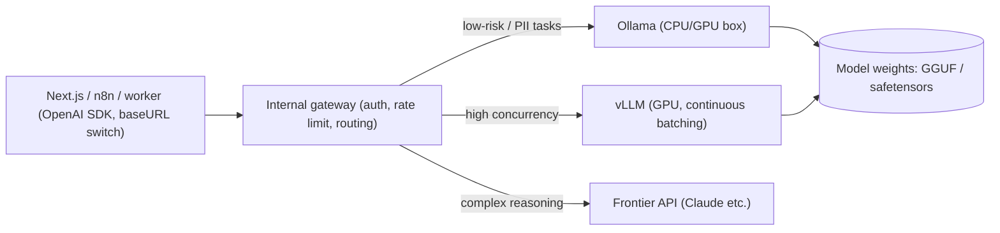

# LLM APIs & SDKs - Local & Open-Weight Models with Ollama & vLLM

> [!info] Deep dive of [[LLM APIs & SDKs]]

> [!abstract] TL;DR
> - **Ollama** is the easiest local runtime: `ollama pull` + an OpenAI-compatible API on `:11434`, GGUF quantized models via llama.cpp. Great for dev, prototypes, embeddings and low-concurrency internal tools.
> - **vLLM** is the production serving engine: PagedAttention, continuous batching, high throughput on **GPUs**, OpenAI-compatible `vllm serve`. Use it when many concurrent users hit the same model.
>
> Reasons to go local/open-weight: **data residency/PDPA**, offline/air-gapped, predictable cost at high volume, fine-tuned models.
> Reasons not to: frontier APIs still win on quality for complex reasoning/agents, and GPU ops is real work.
> **A CPU-only VPS** (Hostinger KVM) runs only small models (≈ 1–8B, 4-bit) at a few to ~15 tokens/s. Fine for classification/extraction/embeddings, too slow for chat at scale.
> **Never expose Ollama/vLLM ports publicly without auth**: they ship unauthenticated by default.

## Concept
| Runtime | Strength | Weakness | Pick it when… |
|---|---|---|---|
| Ollama | One-command setup, model library, OpenAI API, CPU/Apple/GPU | Limited multi-user throughput, few auth features | Dev, internal tools, embeddings, small teams |
| llama.cpp server | Minimal, GGUF, CPU-friendly, fine control | More manual | Edge/CPU deployments |
| vLLM | Throughput (continuous batching), many model formats, tensor parallel | GPU required in practice, heavier ops | Production multi-user serving |
| SGLang / TGI | Alternatives to vLLM | Similar trade-offs | Specific perf needs/ecosystems |
| Hosted open-weight APIs (Groq, Together, Fireworks, Bedrock) | No ops, open models | Data leaves your infra | Open models without GPU ops |

**Sizing rule of thumb** (weights only, plus KV cache for context):

| Model size | FP16 | 8-bit | 4-bit (Q4/AWQ) | Runs on |
|---|---|---|---|---|
| 3–4B | ~8 GB | ~4 GB | ~2.5 GB | CPU VPS (slow), any GPU |
| 7–9B | ~16 GB | ~9 GB | ~5 GB | 8–12 GB GPU, Apple M-series 16 GB |
| 14B | ~28 GB | ~15 GB | ~9 GB | 16–24 GB GPU |
| 30–32B | ~64 GB | ~34 GB | ~20 GB | 24–48 GB GPU |
| 70B | ~140 GB | ~75 GB | ~40 GB | 2× 48 GB / 80 GB GPU |

## How It Works


## Practical Usage
**Ollama in Docker** (internal network only):
```yaml
services:
  ollama:
    image: ollama/ollama:latest            # pin a version tag in production
    volumes: ["ollama:/root/.ollama"]
    environment:
      OLLAMA_KEEP_ALIVE: "30m"             # keep model in memory between requests
      OLLAMA_NUM_PARALLEL: "2"
      OLLAMA_MAX_LOADED_MODELS: "1"
    expose: ["11434"]                      # never publish to the internet
    deploy: { resources: { limits: { memory: 12g } } }
volumes: { ollama: {} }
```
```bash
docker exec ollama ollama pull qwen3:8b           # example model tag; check the library for current names
docker exec ollama ollama pull nomic-embed-text
```
**Same code, different backend** (OpenAI-compatible endpoints):
```ts
import OpenAI from "openai";
const local = new OpenAI({ baseURL: "http://ollama:11434/v1", apiKey: "ollama" });   // key ignored by Ollama
const r = await local.chat.completions.create({
  model: "qwen3:8b",
  messages: [{ role: "system", content: "Classify the WhatsApp message intent. Reply JSON." },
             { role: "user", content: msg }],
  response_format: { type: "json_object" },
  temperature: 0,
});
```
**vLLM server** (GPU host):
```bash
vllm serve Qwen/Qwen3-14B-AWQ \
  --api-key "$VLLM_API_KEY" \
  --max-model-len 16384 \
  --gpu-memory-utilization 0.90 \
  --enable-prefix-caching \
  --port 8000
# clients: baseURL http://gpu-host:8000/v1, Authorization: Bearer $VLLM_API_KEY
```
**Embeddings locally** (keeps document text in-house for RAG):
```ts
const e = await local.embeddings.create({ model: "nomic-embed-text", input: chunks });
```
**Wrong way**:
```text
❌ ports: "11434:11434" on a public VPS          → anyone can use your compute, pull/delete models, probe for CVEs
❌ 70B model on a 16 GB CPU VPS                   → swap thrash, minutes per answer
❌ Assuming local = PDPA-compliant automatically  → logs, prompts and backups still hold personal data
❌ Evaluating with frontier prompts unchanged      → smaller models need simpler prompts and constrained output
```

## Patterns & Anti-patterns
| Pattern | When | Anti-pattern to avoid |
|---|---|---|
| Route by task: small local model for classify/extract, frontier for reasoning | Mixed workloads | One model for everything |
| OpenAI-compatible abstraction + config-driven `baseURL` | Portability | Vendor-specific code paths everywhere |
| Constrained/JSON output + validation | Small models | Free-form parsing of local model output |
| Eval set comparing local vs API on your tasks | Before switching | Choosing models by leaderboards |
| Gateway with auth/rate limits in front | Shared servers | Direct unauthenticated access |
| Pin model tags/digests | Reproducibility | `:latest` model tags changing behaviour |
| Local embeddings + API generation | Privacy-sensitive RAG | Sending entire corpora to third parties |

## Performance & Trade-offs
- **Throughput**: vLLM's continuous batching serves many concurrent requests efficiently. Ollama's parallelism is modest. For > ~5 concurrent chat users on one model, vLLM (GPU) is the right tool.
- **Quantization**: 4-bit (Q4_K_M, AWQ) cuts memory ~4× with small quality loss for most tasks. Extraction/classification tolerate it well, and math/code degrade more.
- **Cost**: a rented 24 GB GPU (~US$0.3–0.8/h on marketplaces) running 24/7 costs more than API usage for most SME volumes. Local wins at sustained high volume, or when data can't leave.
- **Latency**: first token on cold load can take seconds to minutes (model load). Keep models warm (`OLLAMA_KEEP_ALIVE`) and size RAM accordingly.

## Tips & Reminders
> [!tip] In ZP's stack
> - **Realistic first use**: local embeddings + intent classification for WhatsApp messages on a GPU-less box or a Mac mini, with Claude/GPT for reply generation. Cuts token cost while keeping quality where it matters ([[LLM Fundamentals - Model Selection & Routing]]).
> - **PDPA selling point**: "documents never leave your server" for clinics, legal and HR clients. Pair it with access controls and log retention, not just a local model.
> - **n8n**: the Ollama credential/nodes work with internal hostnames (`http://ollama:11434`). Keep it on the same Docker network ([[n8n - AI Agent Nodes & LLM Workflows]]).

- Test BM/EN/ZH mixed inputs. Multilingual quality varies widely across open models.
- Check model licences (some restrict commercial use or require attribution).
- Use a fallback chain: local → API on timeout or low confidence ([[LLM APIs & SDKs - Rate Limits, Retries & Provider Fallbacks]]).
- Monitor GPU memory (`nvidia-smi`), tokens/s and queue depth.

## Version Notes
| Date | Change relevant here |
|---|---|
| 2023 | llama.cpp/GGUF, Ollama launch, vLLM (PagedAttention paper) |
| 2024 | Ollama OpenAI-compatible API, tool calling. CVE-2024-37032 ("Probllama") path traversal fixed in 0.1.34 |
| 2025 | Open-weight reasoning models (gpt-oss, Qwen3), Ollama new engine, vLLM V1 engine |
| 2026 | Ollama MLX backend on Apple Silicon (preview). Gemma 4 / Qwen 3.x families. Ollama versions reported in 0.3x–0.40 range |

> [!warning] Unverified — check before relying on this
> Current Ollama version (sources conflict: 0.32.x vs 0.40.x), vLLM version and flags, and current model tags weren't verified from primary sources. Check https://github.com/ollama/ollama/releases and https://docs.vllm.ai before deploying.

## Critical Issues & Gotchas
> [!danger] Exposed, unauthenticated model servers
> Ollama has no built-in auth, and scans regularly find thousands of internet-exposed instances. Attackers use them for free compute, pull/delete models, and exploit past vulnerabilities (e.g. Probllama path traversal leading to RCE in older versions). Keep ports internal, put an authenticating proxy in front, patch promptly, and run as a non-root container.

> [!danger] Quality cliffs in production
> A 7–8B model that looks fine in demos may misclassify Malay slang, hallucinate prices, or break JSON under real traffic, silently degrading customer-facing automations. Gate switches behind evals on real transcripts, constrain outputs, and keep a frontier-model fallback for low-confidence cases ([[AI Evals & Observability - Eval Datasets & LLM-as-Judge]]).

- **Context length** settings (`num_ctx` in Ollama, `--max-model-len` in vLLM) default lower than model maximums. Long prompts get truncated silently.
- **Model updates** under the same tag change behaviour. Pin digests.
- **Licences**: Llama community licence limits and other model licences apply to commercial client deployments.
- **CPU inference** competes with Postgres/n8n on a shared VPS. Isolate it or rate-limit.

## Related
- [[LLM APIs & SDKs]]
- [[LLM Fundamentals - Model Selection & Routing]] — when local vs frontier
- [[LLM APIs & SDKs - Rate Limits, Retries & Provider Fallbacks]] — fallback chains
- [[Fine-tuning LLMs - LoRA & QLoRA with Unsloth]] — custom open-weight models
- [[n8n - AI Agent Nodes & LLM Workflows]] — Ollama in workflows
- [[Vector Databases - Embedding Models & Multilingual Retrieval]] — local embedding models

## References
- https://github.com/ollama/ollama
- https://github.com/ollama/ollama/blob/main/docs/openai.md
- https://docs.vllm.ai/en/latest/
- https://github.com/ggml-org/llama.cpp
- https://releases.sh/ollama/overview
