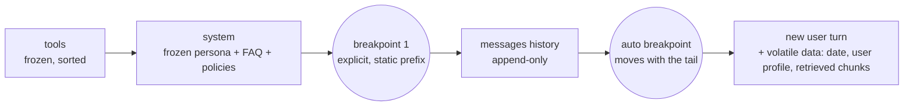

# LLM APIs & SDKs - Prompt Caching & Cost Optimization

> [!info] Deep dive of [[LLM APIs & SDKs]]

> [!abstract] TL;DR
> Measure and optimise **cost per completed task**, not cost per request. Work the levers in this order:
> 1. **Free wins** (quality unchanged): prompt caching, then input hygiene, agent-loop hygiene, output control, and batch.
> 2. **Trade-offs** (measure each against an eval): effort level, then model choice.
>
> Prompt caching is a **byte-exact prefix match** over `tools → system → messages`.
> - **Price**: reads cost ~0.1× input (0.05× on Opus 5.5), writes 1.25× (5-min TTL) or 2× (1-hour TTL).
> - **Verify**: `usage.cache_read_input_tokens` is the only ground truth. Caching regressions are silent: requests keep succeeding, only the bill goes up.

## Concept

### Where the money goes
| Cost driver | Typical share | Lever |
|---|---|---|
| Repeated input prefix (system prompt, tools, docs, history) | Largest in chatbots and agent loops | **Prompt caching** |
| Bloated input (whole files, every tool, verbose history) | High in agents/RAG | Progressive disclosure, fewer/leaner tools, retrieval top-k |
| Output tokens (5× input price on Claude) | High for long generations | `max_tokens`, structured outputs, terse formats |
| Thinking tokens (billed as output) | High at `xhigh`/`max` effort | `output_config.effort` per route |
| Non-interactive volume | Nightly jobs, evals, backfills | **Batch API: 50% off** every token, including cache reads/writes (stacks) |
| Model tier | Everything | Cheaper tier only where evals show quality holds |

### Claude pricing reference (first-party, $/MTok, cached 2026-10-06)
| Model | Input | Output | Cache read | 5-min write (1.25×) | 1-h write (2×) |
|---|---|---|---|---|---|
| `claude-fable-5-1` | 10.00 | 50.00 | 0.25 (0.025×) | 12.50 | 20.00 |
| `claude-opus-5-5` | 4.00 | 20.00 | 0.20 (0.05×) | 5.00 | 8.00 |
| `claude-sonnet-5-5` | 2.00 | 10.00 | 0.20 (0.1×) | 2.50 | 4.00 |
| `claude-haiku-5-5` (≤100K prompt) | 0.10 | 0.50 | ~0.01 (0.1×) | ~0.125 | ~0.20 |

- **Haiku 5.5 long prompts**: above 100K prompt tokens, the price rises to $0.50 / $2.50.
- **Bedrock / Vertex**: partner pricing differs.
- **Batch**: halves all of the above.

### Caching rules (Claude API)
| Rule | Value |
|---|---|
| Marker | `cache_control: { type: "ephemeral" }` (5 min) or `{ type: "ephemeral", ttl: "1h" }` |
| Placement | On a content block (system text, tool def, message block), or **top-level** for automatic placement on the last cacheable block |
| Max breakpoints | **4** per request (automatic caching uses one) |
| Minimum cacheable prefix | **512 tokens** on current 5.x models. 1024 on Opus 4.8/Sonnet 4.6, 2048 on Opus 4.7, **4096 on Opus 4.6/Haiku 4.5**. Below the minimum it silently doesn't cache |
| TTL refresh | Every read refreshes the timer for free. Lifetime counts from request **start** |
| Scope | Per **workspace** (Claude API) and per **model**. Never shared across orgs |
| TTL ordering | Longer-TTL entries must come **before** shorter ones |
| Lookback | A read only lands within ~20 blocks of a previous breakpoint. One turn appending >20 blocks loses the previous entry |

### Break-even
- **5-min TTL**: 2 requests break even. 1.25 + 0.1 = 1.35× vs 2× uncached.
- **1-h TTL**: needs ≥3 requests. 2 + 0.2 = 2.2× vs 3×.
- **Rule**: if requests sharing a prefix start <5 min apart, the 5-min cache stays warm indefinitely, so the 1-h TTL only adds cost. Use 1-h for bursty traffic with 5–60 min gaps.

## How It Works

- **Render order**: the request renders as `tools → system → messages`. Any byte change at position *n* invalidates every cached position after *n*.
- **Invalidation tiers**:
  - Editing **message content** keeps the tools and system caches.
  - Changing **system prompt** content invalidates system and messages, but not tools.
  - **Tool definition** or **model** changes rebuild everything.
  - Changing **`thinking`/`effort`** always invalidates the messages cache. Pin both per route.
- **Escape hatches on 5.x models**:
  - Mid-conversation operator instructions: append `{ role: "system", ... }` inside `messages[]` instead of editing top-level `system`.
  - Mid-conversation effort changes: an effort-only system message (beta). Neither touches the cached prefix.

## Practical Usage

### Idiomatic: frozen prefix + automatic tail caching
```typescript
import Anthropic from "@anthropic-ai/sdk";
const client = new Anthropic();

const SYSTEM = await loadPrompt("support-bot-v12.md");   // versioned file, never templated per request

const response = await client.messages.create({
  model: "claude-sonnet-5-5",
  max_tokens: 2048,
  cache_control: { type: "ephemeral" },                 // auto breakpoint on the growing tail
  system: [
    { type: "text", text: SYSTEM, cache_control: { type: "ephemeral" } }, // guaranteed read point for the static prefix
  ],
  tools: TOOLS,                                          // constant array, stable order
  messages: [
    ...history,                                          // append-only; never rewrite earlier turns
    { role: "user", content: `Today: ${today}\nCustomer tier: ${tier}\n\n${userText}` }, // volatile data LAST
  ],
});

const u = response.usage;
log({ input: u.input_tokens, write: u.cache_creation_input_tokens, read: u.cache_read_input_tokens, out: u.output_tokens });
```

### Wrong: silent cache breakers
```typescript
// ❌ Every request has a unique prefix → 0 cache reads, full price forever
system: `You are Aisyah from ${tenant.name}. Current time: ${new Date().toISOString()}. Session ${crypto.randomUUID()}`,
tools: buildToolsFor(user),               // per-user tool set renders at position 0
messages: [{ role: "user", content: JSON.stringify(ctx) }], // key order varies → different bytes
```
| Breaker | Fix |
|---|---|
| `Date.now()` / UUID / request ID in system | Move into the latest user turn |
| Per-tenant data in system | Per-tenant prefix is fine if each tenant gets traffic within the TTL. Otherwise move it after the breakpoint |
| Non-deterministic JSON (`set`, unsorted keys) | Stable serialisation (sorted keys) |
| Conditional system sections (`if (flag) system += …`) | Each flag combination is its own cache. Move flags into messages |
| Varying tool list per request | One fixed superset. Use tool search / deferred loading for large catalogues |
| Rewriting/truncating history client-side | Append-only history. Use server-side compaction/context editing sparingly |

### Verify (make it a test, not a one-time check)
```typescript
// CI / staging probe: two byte-identical requests; the second must read from cache
const a = await client.messages.create(req);
const b = await client.messages.create(req);
if (b.usage.cache_read_input_tokens === 0) throw new Error("prompt cache broken");
// total prompt = input_tokens + cache_creation_input_tokens + cache_read_input_tokens
```
- **Healthy agent loop**: `cache_read_input_tokens` grows each turn, `cache_creation_input_tokens` ≈ the last turn's delta, and `input_tokens` is only the tail.
- **Broken loop**: if the write count is near the full conversation size on every turn, something upstream rewrites the prefix. Diff consecutive request payloads, or use the cache diagnostics beta (`diagnostics.previous_message_id`) on the Claude API.

### Batch for anything nobody is waiting on
```typescript
const batch = await client.messages.batches.create({
  requests: invoices.map((inv) => ({
    custom_id: inv.id,                                   // results arrive in any order: key by custom_id
    params: { model: "claude-haiku-5-5", max_tokens: 1024, system: EXTRACT_PROMPT, messages: [{ role: "user", content: inv.text }] },
  })),
});
// poll batches.retrieve(batch.id) until processing_status === "ended", then stream results
```

### Count before you send
```typescript
const { input_tokens } = await client.messages.countTokens({ model: "claude-sonnet-5-5", system: SYSTEM, tools: TOOLS, messages });
if (input_tokens > 150_000) messages = await summariseOldTurns(messages);
```
- Tokenizers differ by model generation. Opus 4.7+ uses ~1–1.35× the tokens of older models for the same text, so re-baseline with `countTokens` when migrating. Never estimate with `tiktoken`.

## Patterns & Anti-patterns
| Pattern | When | Anti-pattern to avoid |
|---|---|---|
| Explicit breakpoint on static system + automatic tail caching | Chatbots, agent loops | No caching on a 10K-token system prompt sent 50k×/day |
| One model per conversation; subagents for cheap subtasks | Agents | Model cascade mid-conversation (caches are model-scoped; every switch is a cold write) |
| Effort per route (`low` chat/classification, `high`/`xhigh` coding) | Mixed workloads | Global `max` effort "for quality" |
| Batch + caching for evals and backfills | Offline work | Running 10k evaluation prompts synchronously at full price |
| Tight `max_tokens` + structured outputs for extraction | JSON/extraction routes | Free-text answers parsed by regex, with retries on parse failure |
| Retrieval top-k tuned by eval ([[RAG]]) | RAG | Stuffing 30 chunks "just in case" |
| Cost per tenant from `usage` × price, with budgets | Multi-tenant SaaS | One shared API key, no attribution |

## Performance & Trade-offs
- **Latency**: cache hits also cut time-to-first-token substantially on long prefixes. Pre-warm with a `max_tokens: 0` request (non-streaming) before a burst if the first-user latency matters.
- **1-h TTL vs keep-alive**:
  - On models with very cheap reads (Fable 5.1 at 0.025×), re-sending a `max_tokens: 0` keep-alive every ~4.5 min usually beats the 2× write of the 1-h TTL.
  - On 0.1× models, the 1-h TTL is simpler for bursty traffic.
- **Concurrency**: parallel requests that start before the first write completes all miss. Send one request first, then fan out.
- **Semantic/response caching** (app side, e.g. [[Redis]] keyed by normalised question hash) eliminates calls entirely for FAQ-like traffic. It's a different layer from prompt caching. Watch staleness and per-tenant isolation.
- **Model choice last**: on the newest models, a capable model at lower effort often matches an older or cheaper model at high effort, with one cache namespace. Decide with an eval ([[AI Evals & Observability]]), not intuition.

### Worked example: WhatsApp support bot
- **Workload**: 8K-token system prompt + FAQ on `claude-sonnet-5-5`, 2,000 conversations/day × 5 turns = 10k requests.
- **Uncached prefix**: 10k × 8K = 80M tokens × $2 = **$160/day**.
- **Cached** (continuous traffic keeps it warm): reads 80M × $0.20 = $16, plus small writes ≈ **~$17/day**. That's a 90% cut on the prefix, with zero quality change.

## Tips & Reminders
> [!tip]
> - Version system prompts as files (`prompts/support-bot-v12.md`). A prompt change is a deploy, and the next request pays one cache write.
> - Log the four `usage` meters per request, alert when the cache-read ratio drops (a regression signal), and attribute cost per tenant/feature.
> - Put large reusable documents (catalogues, SOPs, policy PDFs) in the cached prefix rather than in RAG when they're under ~100K tokens and reused across many calls.
> - Check the 512/1024/4096-token minimums per model. A 3K prompt won't cache on Haiku 4.5 or Opus 4.6.
> - **In ZP's stack**:
>   - **Pricing**: client SaaS bots (WhatsApp/Chatwoot replacements) get a cached SME-specific prefix. Bill clients per conversation with margin over measured `usage` cost.
>   - **Offline work**: run nightly summaries and extraction via Batch from an [[n8n]] schedule.
>   - **Ceiling**: set a monthly spend cap in the Console per workspace.

## Version Notes
| Date | Change |
|---|---|
| 2024 | Anthropic prompt caching (explicit breakpoints, 5-min TTL). OpenAI automatic prefix caching. Gemini context caching |
| 2025 | 1-hour TTL option. Automatic (top-level) caching on Claude |
| 2026 | 5.x models: 512-token minimum, cheaper reads on Opus 5.5 (0.05×) and Fable 5.1 (0.025×), mid-conversation system messages preserve cache, cache diagnostics beta |

> [!warning] Unverified — check before relying on this
> - **Other providers**: OpenAI/Gemini caching discounts, minimums and TTLs aren't verified here. OpenAI caches automatically above a size threshold, and Gemini offers implicit plus explicit context caching.
> - **Claude prices**: multipliers can change, so confirm on the pricing page before quoting clients.

## Critical Issues & Gotchas
> [!danger] Silent cache regressions
> The most expensive failure is invisible: a later change adds a timestamp to the system prompt, reorders tools or rewrites history, and every request becomes a cache miss. Nothing errors, and the bill can grow 5–10× for months. Guard with a CI probe asserting `cache_read_input_tokens > 0` and monitoring on the read ratio.

> [!danger] Runaway agent loops
> An agent re-sending a growing 200K-token context for 50 turns, uncached, costs more than a month of chatbot traffic. Cap turns and use task budgets (beta) or hard spend limits per run. Make sure caching is on for every loop, and alert on per-run cost outliers.

> [!warning] Gotchas
> - `input_tokens` is only the **uncached remainder**. Dashboards that sum only `input_tokens` under-report usage.
> - Caches are per workspace. Splitting the same traffic across workspaces or keys halves hit rates.
> - Toggling `thinking`/`effort` or switching `speed` per request breaks caches. Pin them per route.
> - Thinking tokens are billed as output even when `display: "omitted"` hides them.
> - Batch results can take up to 24 h and arrive unordered. Key by `custom_id`.
> - Price cuts on new models can come with tokenizer changes. Compare cost per task, not $/MTok.

## Related
- [[LLM APIs & SDKs]]
- [[LLM APIs & SDKs - Batch Processing & Async Workloads]] — the 50% batch lever that stacks with caching
- [[Prompt Engineering]] — stable prompt structure that caches well
- [[AI Agents - Tool Calling & Agent Loops]] — loop hygiene, tool surface size
- [[RAG]] — retrieval size vs caching whole documents
- [[AI Evals & Observability]] — measure quality before trading effort/model for cost
- [[Redis]] — app-side semantic/response caching

## References
- Prompt caching: https://platform.claude.com/docs/en/build-with-claude/prompt-caching
- Pricing: https://platform.claude.com/docs/en/about-claude/pricing
- Message Batches: https://platform.claude.com/docs/en/build-with-claude/batch-processing
- Token counting: https://platform.claude.com/docs/en/build-with-claude/token-counting
- Cache diagnostics: https://platform.claude.com/docs/en/build-with-claude/cache-diagnostics
