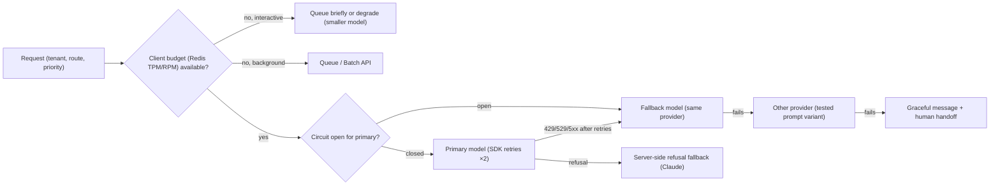

# LLM APIs & SDKs - Rate Limits, Retries & Provider Fallbacks

> [!info] Deep dive of [[LLM APIs & SDKs]]

> [!abstract] TL;DR
> Classify errors before acting:
> - **retry with backoff**: 429 `rate_limit_error` (honour `retry-after`), 529 `overloaded_error`, 5xx, connection errors;
> - **never retry**: 400/401/403/404/413 (fix the request);
> - **handle as content**: `stop_reason` `refusal` / `max_tokens`.
>
> Let the SDK do the first 2 retries, and add your own layer on top: a **client-side token/request budget** (Redis) so you rarely hit 429s, a **queue** for non-interactive work, a **circuit breaker**, and a **fallback chain** (same provider smaller model → other provider) with prompts tested on each target. On Claude, **refusal fallbacks** can run server-side. Outages and 429s are yours to route.

## Concept
| Signal | Meaning | Action |
|---|---|---|
| 429 `rate_limit_error` | RPM / input TPM / output TPM exceeded for your org/tier | Wait `retry-after`, then retry. Smooth traffic with a client-side limiter |
| 529 `overloaded_error` | Provider-side capacity | Backoff + jitter. Fall back to another model/provider for interactive traffic |
| 500 `api_error` | Transient server error | Retry with backoff |
| Connection error / timeout | Network or long generation | Retry (idempotent call). Stream long outputs |
| 400 / 413 | Bad request, too large | Don't retry. Fix, log, alert |
| 401 / 403 / 402 | Auth, permission, billing | Don't retry. Page someone (key revoked, card failed) |
| `stop_reason: "refusal"` (HTTP 200) | Safety classifier declined | Claude server-side `fallbacks`, or route to a human/other flow |
| `stop_reason: "max_tokens"` | Output truncated | Raise `max_tokens`, continue, or shorten the task |

**Limits are multi-dimensional** (per model, per org tier):

| Dimension | Typical bottleneck |
|---|---|
| Requests per minute | Chatty agents, many small calls |
| Input tokens per minute | Long contexts, RAG stuffing (cached reads may count differently, so check your tier docs) |
| Output tokens per minute | Long generations, high effort/thinking |
| Concurrency / daily caps | Batch-like bursts on interactive endpoints |

## How It Works


## Practical Usage
**Client defaults per route** (interactive vs background):
```ts
import Anthropic from '@anthropic-ai/sdk';
export const interactive = new Anthropic({ maxRetries: 2, timeout: 30_000 });     // ms in TS; worst case ≈ 30 s × 3
export const background = new Anthropic({ maxRetries: 5, timeout: 600_000 });     // long jobs, queue-driven
```
**Error chain** (most specific first; `APIConnectionError` before `APIError` in TS):
```ts
try {
  return await interactive.messages.create(params);
} catch (e) {
  if (e instanceof Anthropic.RateLimitError) throw new RetryableError('rate_limited', retryAfter(e));
  if (e instanceof Anthropic.InternalServerError) throw new RetryableError('provider_5xx');      // includes 529 overloaded
  if (e instanceof Anthropic.APIConnectionError) throw new RetryableError('network');
  if (e instanceof Anthropic.APIError) throw new FatalError(e.type ?? 'api_error', e.status);   // 4xx: fix, don't retry
  throw e;
}
const retryAfter = (e: InstanceType<typeof Anthropic.APIError>) => Number(e.headers?.get('retry-after') ?? 0) * 1000;   // headers is a Headers object in current SDKs
```
**Fallback chain with a circuit breaker** (per model, shared via Redis across replicas):
```ts
const chain = [
  { name: 'claude-sonnet-5-5', call: (p: Req) => claude(p, 'claude-sonnet-5-5') },
  { name: 'claude-haiku-5-5', call: (p: Req) => claude(p, 'claude-haiku-5-5') },
  { name: 'other-provider', call: (p: Req) => otherProvider(adaptPrompt(p)) },     // prompt tested on that model
];

export async function generate(p: Req) {
  for (const step of chain) {
    if (await breaker.isOpen(step.name)) continue;
    try {
      const out = await step.call(p);
      await breaker.success(step.name);
      return { ...out, servedBy: step.name };                                      // log which model answered
    } catch (e) {
      if (e instanceof FatalError) throw e;                                        // bad request: falling back won't help
      await breaker.failure(step.name);                                            // e.g. open after 5 failures / 60 s, half-open after 30 s
    }
  }
  throw new UnavailableError('all_models_unavailable');
}
```
**Server-side refusal fallback** (Claude; routes refused requests by category, no model list to maintain):
```ts
const msg = await client.beta.messages.create({
  model: 'claude-opus-5-5', max_tokens: 16000, messages,
  betas: ['server-side-fallback-2026-07-01'],
  fallbacks: 'default',
});
if (msg.stop_reason === 'refusal') return handoffToHuman(msg.stop_details);        // still possible after fallbacks
```
**Client-side token budget** (stay under TPM instead of discovering it via 429s):
```ts
const est = estimateInputTokens(params) + params.max_tokens;            // or count_tokens for large prompts
const ok = await tokenBucket.take(`llm:${model}`, est);                // Redis GCRA in tokens/min
if (!ok) return priority === 'interactive' ? useSmallerModel(params) : enqueue(params);
```
**Wrong way**:
```ts
while (true) { try { return await client.messages.create(p); } catch {} }   // ❌ infinite tight retries, multiplied across replicas
for (const doc of docs) await client.messages.create(build(doc));           // ❌ 5k interactive calls for a nightly job: use Batch API
await Promise.all(users.map(u => client.messages.create(f(u))));            // ❌ unbounded burst → instant 429 storm
```

## Patterns & Anti-patterns
| Pattern | When | Anti-pattern to avoid |
|---|---|---|
| SDK retries (2) + app-level policy per route | Every integration | Retry loops at three layers (SDK × app × queue) multiplying load |
| Honour `retry-after`, exponential backoff + full jitter | 429/529 | Fixed 1 s retries in lockstep across workers |
| Client-side TPM/RPM limiter per model | Shared org keys, many tenants | Letting the provider be your rate limiter |
| Per-tenant quotas and fairness | Multi-tenant SaaS | One noisy tenant exhausting the org limit |
| Batch API / queues for non-interactive work | Nightly, backfills, evals | Interactive endpoints for bulk jobs |
| Fallback models with evaluated prompts | Interactive bots | Blind provider swap with an untested prompt |
| Log `servedBy`, retries, latency, tokens per request | Production | Not knowing that 20% of answers came from the fallback |

## Performance & Trade-offs
- **Latency budget**: retries add wall-clock time (`timeout × (retries + 1)` worst case). For a WhatsApp reply, cap the total at ~20–30 s, then fall back or send a holding message.
- **Cost of fallbacks**: prompt caches are model-scoped, so failing over loses cache hits. A fallback to a bigger model costs more, and to a smaller one may lower quality. Measure both on your eval set ([[AI Evals & Observability]]).
- **Cross-provider fallback** gives the most resilience but the most variance: different tokenizers, tool-call formats, structured-output support, refusals and data-processing terms. Keep an adapter per provider and a tested prompt per model.
- **Retries aren't free**: a failed long generation may already have consumed output tokens before erroring mid-stream. Stream long outputs, and retry from scratch only when needed.
- **Circuit breakers** avoid hammering a degraded provider and cut tail latency during incidents.

## Tips & Reminders
> [!tip] In ZP's stack
> - **WhatsApp bots**: primary Sonnet/Haiku-class model, a same-provider fallback, then a fixed polite reply + human handoff via Chatwoot. Never leave the customer without a response ([[n8n - WhatsApp Cloud API Workflows & Template Messaging]]).
> - **n8n AI Agent**: set the node's fallback model, plus an error workflow that sends the fixed reply ([[n8n - AI Agent Nodes & LLM Workflows]]).
> - **Shared org key across clients**: per-tenant token quotas in Redis, so one client's backfill can't starve another's live bot ([[Redis - Rate Limiting & Distributed Locks]]).
> - **Background jobs** (tagging, summaries) go to the Batch API at 50% cost, with no rate-limit fights ([[LLM APIs & SDKs - Batch Processing & Async Workloads]]).

- Alert on fallback rate, refusal rate and 429 rate per model. Spikes are early warnings of provider incidents or a prompt regression.
- Keep provider API keys per environment and per client where billing must be separated.
- Check the provider status page (status.anthropic.com etc.) in the runbook, and link it in the alert.
- Treat model IDs as config. Retirements and new versions are routine, so pin them and review them quarterly.

## Version Notes
| Date | Change |
|---|---|
| 2024 | Token-based rate limits (input/output TPM) and tiered orgs standard across providers |
| 2025 | Claude `stop_reason: "refusal"` with `stop_details` on newer models |
| 2026-06/07 | Claude server-side refusal fallbacks (beta), `fallbacks: "default"` with header `server-side-fallback-2026-07-01` |
| 2026 | Typed `.type` on SDK errors (`rate_limit_error`, `overloaded_error`) for classification |

> [!warning] Unverified — check before relying on this
> Facts come from the bundled Claude API reference (cached 2026-10), not live docs. Rate-limit header names, how cached tokens count toward ITPM per tier, and OpenAI/Gemini error semantics weren't checked. Confirm at https://docs.claude.com/en/api/rate-limits before sizing quotas.

## Critical Issues & Gotchas
> [!danger] Retry storms during provider incidents
> When a provider degrades, every replica, n8n worker and queue retries at once, which amplifies load, burns your rate limit and delays recovery. Use jittered backoff, a circuit breaker shared across instances, and caps on in-flight requests. Fail over or degrade instead of retrying harder.

> [!danger] Fallback to a provider your clients didn't agree to
> Switching a client's data to another LLM provider during an outage can breach the client contract or PDPA processor commitments, especially for personal data. List all possible processors in the agreement, or restrict fallbacks to approved providers per tenant.

- **Non-idempotent side effects**: if the model's tool call already executed (refund, booking) and then the call fails, a blind retry repeats the side effect. Use idempotency keys on tools ([[REST API - Webhooks & Idempotency]]).
- **Mid-stream errors** (overloaded during streaming) can't be resumed. Show partial output as incomplete and retry the whole request, or fall back.
- **Timeout units differ** across SDKs (TypeScript ms, Python seconds), and a misread 30 can mean 30 ms.
- **Fallback model differences**: forced `tool_choice`, prefill and sampling params are rejected on some current models. Validate request shapes per model in tests.

## Related
- [[LLM APIs & SDKs]]
- [[LLM APIs & SDKs - Batch Processing & Async Workloads]] — moving bulk work off rate-limited interactive paths
- [[LLM APIs & SDKs - Prompt Caching & Cost Optimization]] — cache scope and fallback cost
- [[System Design - Reliability Patterns]] — retries, circuit breakers, bulkheads
- [[Redis - Rate Limiting & Distributed Locks]] — token-bucket budgets and quotas
- [[Message Queues - BullMQ in Production]] — queue limiters for LLM workers

## References
- https://docs.claude.com/en/api/errors
- https://docs.claude.com/en/api/rate-limits
- https://platform.claude.com/docs/en/build-with-claude/refusals-and-fallback
- https://github.com/anthropics/anthropic-sdk-typescript
- https://status.anthropic.com/
