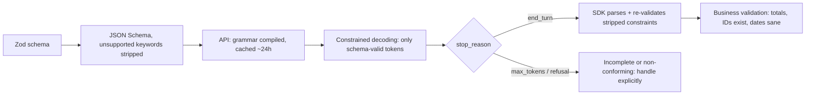

# LLM APIs & SDKs - Structured Outputs & Tool Schemas

> [!info] Deep dive of [[LLM APIs & SDKs]]

> [!abstract] TL;DR
> There are two mechanisms. Pick by intent:
> - **Structured outputs** (`output_config.format` with a JSON Schema): "give me data in this shape".
> - **Strict tools** (`strict: true` + `additionalProperties: false`): "call this action with valid arguments".
>
> Both use **constrained decoding**, so the JSON is schema-valid by construction. That covers *syntax*, not *truth*: keep validating business rules, handle `refusal` / `max_tokens` stop reasons, and design schemas the model can actually fill well (flat, enum-heavy, described fields).

## Concept
| Need | Mechanism (Claude API) | Notes |
|---|---|---|
| Extract/classify into JSON | `output_config: { format: { type: "json_schema", schema } }`, or the SDK `messages.parse()` + `zodOutputFormat()` | `response.parsed_output` is typed. It is `null` if parsing failed |
| Model decides whether to act | Tools with `strict: true` | Arguments guaranteed valid against `input_schema` |
| Must call a specific tool | `tool_choice: auto` + prompt instruction (+ `strict`) | **Forced `any`/`tool` returns 400** on Opus 5.5, Sonnet 5.5 and Fable 5.1. Check a call happened and retry if not |
| Legacy "JSON mode" / prefill `{` | Don't | Prefill is removed on current Claude models |

**JSON Schema support (Claude structured outputs)**:

| Supported | Not supported (SDKs strip these and validate client-side) |
|---|---|
| object, array, string, integer, number, boolean, null | Recursive schemas |
| `enum`, `const`, `anyOf`, `allOf`, `$ref`/`$defs` | `minimum`, `maximum`, `multipleOf` |
| formats: `date-time`, `date`, `time`, `duration`, `email`, `hostname`, `uri`, `ipv4`, `ipv6`, `uuid` | `minLength`, `maxLength`, complex array constraints |
| `additionalProperties: false` (**required on every object**) | `additionalProperties` other than `false` |

- **Cross-provider**: OpenAI strict JSON schema mode also needs `additionalProperties: false` and **every property listed in `required`** (use a nullable type for optional fields). Gemini uses an OpenAPI-subset `responseSchema`. Write schemas to the strictest common subset if you route between providers.

## How It Works

- The first request with a new schema pays a one-time compilation cost. The same schema is then cached for ~24 h, so keep schemas **stable** (no per-request enums built from user data).
- Structured outputs work with streaming, Batches, token counting and thinking. They are **incompatible with citations** (400) and prefill.

## Practical Usage
**Extraction with Zod** (TypeScript SDK):
```ts
import Anthropic from '@anthropic-ai/sdk';
import { z } from 'zod';
import { zodOutputFormat } from '@anthropic-ai/sdk/helpers/zod';

const Invoice = z.object({
  supplier_name: z.string(),
  invoice_number: z.string(),
  issue_date: z.iso.date(),
  currency: z.enum(['MYR', 'SGD', 'USD']),
  total: z.number(),                       // min/max are validated client-side, not by the decoder
  sst_amount: z.number().nullable(),       // null when absent: never invent
  line_items: z.array(z.object({ description: z.string(), qty: z.number(), unit_price: z.number() })),
  confidence: z.enum(['high', 'medium', 'low']),
});

const res = await client.messages.parse({
  model: 'claude-opus-5-5',
  max_tokens: 16000,
  system: 'Extract invoice fields. Use null for fields not present. Do not compute values that are not printed.',
  messages: [{ role: 'user', content: [pdfBlock, { type: 'text', text: 'Extract this invoice.' }] }],
  output_config: { format: zodOutputFormat(Invoice) },
});

if (res.stop_reason !== 'end_turn' || !res.parsed_output) throw new ExtractionFailed(res.stop_reason);
const inv = res.parsed_output;
const sum = inv.line_items.reduce((s, l) => s + l.qty * l.unit_price, 0);
if (Math.abs(sum + (inv.sst_amount ?? 0) - inv.total) > 0.05) flagForReview(inv);   // semantic check
```
**Strict tool** (raw JSON Schema):
```ts
const tools: Anthropic.Tool[] = [{
  name: 'create_refund',
  description: 'Create a refund for an existing order. Use only after the customer confirmed the amount. Amount in MYR, max the order total.',
  strict: true,
  input_schema: {
    type: 'object',
    properties: {
      order_id: { type: 'string', description: 'Order ID like ORD-12345, from get_order' },
      amount_myr: { type: 'number' },
      reason: { type: 'string', enum: ['damaged', 'wrong_item', 'late', 'other'] },
    },
    required: ['order_id', 'amount_myr', 'reason'],
    additionalProperties: false,
  },
}];
```
**"Must call the tool" without forced `tool_choice`**:
```ts
const res = await client.messages.create({ model: 'claude-opus-5-5', max_tokens: 16000, tools, tool_choice: { type: 'auto' },
  messages: [{ role: 'user', content: 'Use classify_ticket to classify this ticket: …' }] });
const call = res.content.find((b) => b.type === 'tool_use');
if (!call) { /* retry once with a clearer instruction, or switch this route to output_config.format */ }
```
**Wrong way**:
```ts
// ❌ regex the JSON out of free text, then cast
const data = JSON.parse(text.match(/\{[\s\S]*\}/)![0]) as Invoice;
// ❌ string-matching tool input: escaping varies (unicode, slashes) across models
if (JSON.stringify(call.input).includes('"reason":"late"')) { … }
// ❌ forced tool use on current models → 400
tool_choice: { type: 'tool', name: 'classify_ticket' }
```

## Patterns & Anti-patterns
| Pattern | When | Anti-pattern to avoid |
|---|---|---|
| Enums for categorical fields | Classification, routing | Free-text `category` you then fuzzy-match |
| `nullable` + "use null if absent" instruction | Extraction | Required fields the model fills by guessing |
| `reasoning`/`evidence` field **before** the answer field | Judgments, classification | Answer-only schemas for hard decisions (no room to think in-output when thinking is off/low) |
| Flat schemas, ≤ 2–3 nesting levels | Most tasks | Deep recursive trees (unsupported) or 200-field mega-schemas |
| Tool descriptions say *when* to use the tool, the units, and where IDs come from | Every tool | `"description": "refund tool"` |
| One schema = one version; bump on change | Production pipelines | Editing the schema in place, so old stored outputs no longer parse |
| Validate semantics after parsing | Money, dates, IDs | Trusting schema-valid output as correct |

## Performance & Trade-offs
- **Cost**: schemas add input tokens (tool definitions and format schema are part of the prompt). Large schemas on every call add up, so put them inside the cached prefix ([[LLM APIs & SDKs - Prompt Caching & Cost Optimization]]).
- **Latency**: grammar compilation affects only the first request per schema (≈24 h cache). Dynamic per-request schemas pay it every time.
- **Quality**: constrained decoding can push a model into a valid-but-wrong value when the schema leaves no "escape hatch". Add `null`, `"other"` or `confidence` options so the model can express uncertainty.
- **Structured outputs vs tools for extraction**: `output_config.format` is simpler (no tool loop, a direct `parsed_output`). Use tools when the model must *choose* among actions, or interleave reasoning with multiple calls.
- **Streaming large tool inputs** (`eager_input_streaming`) cuts latency, but the API then doesn't validate. Validate parsed input yourself and check `stop_reason` before executing.

## Tips & Reminders
> [!tip] In ZP's stack
> - **Invoice/receipt/IC extraction for SME clients**: `messages.parse()` + Zod schema + a semantic total check, then a human review queue for `confidence: low` or failed checks.
> - **WhatsApp intent routing**: an enum `intent` + `entities` object via structured outputs on Haiku 5.5 is cheap and fast. Escalate to Opus 5.5 only for complex flows.
> - **n8n**: the AI Agent / LLM nodes' structured output parsers wrap the same idea. Keep the schema in git and paste the generated JSON Schema into the node.

- Reuse one Zod schema for the LLM contract, the API response type and the DB JSONB column ([[TypeScript - Runtime Validation with Zod & Type-Safe APIs]]).
- Log `stop_reason`, schema version, and parse/validation failures as eval signals ([[AI Evals & Observability]]).
- Keep tool names `verb_noun` and stable. Renames change the cached prefix, and models pattern-match on names.
- Return tool errors as `tool_result` with `is_error: true` and an actionable message ("order not found: ORD-12345; call search_orders first"). Don't drop the result.

## Version Notes
| Date / version | Change |
|---|---|
| 2023–24 | Function calling / tool use across providers. "JSON mode" without schema guarantees |
| 2024–25 | Schema-constrained structured outputs (OpenAI strict mode, then Claude structured outputs + strict tools) |
| Claude API (current) | `output_config.format` replaces the deprecated `output_format`. `messages.parse()` + `zodOutputFormat` helpers. `strict: true` on tools |
| Claude Opus 5.5 / Sonnet 5.5 / Fable 5.1 | Forced `tool_choice` (`any` / `tool`) returns 400. Use `auto` + `strict` + instruction, or structured outputs. Prefill removed on current models |

## Critical Issues & Gotchas
> [!danger] Schema-valid ≠ correct
> Constrained decoding guarantees the *shape*. The model can still hallucinate an invoice number, mis-read RM 1,250.00 as 125000, or pick the wrong enum. For money, identity (IC numbers) and legal data, add deterministic checks and human review thresholds.

> [!danger] Refusal and truncation break the contract
> With `stop_reason: "refusal"` the output may not match the schema. With `"max_tokens"` it's cut off, and SDK tolerant parsers can return a silently **truncated** object for streamed tool inputs. Always branch on `stop_reason` before using the parsed value or executing a tool.

- **Unsupported constraints are silently moved client-side**: `min`, `max` and `maxLength` aren't enforced by the decoder, so the model can produce out-of-range values that then fail SDK validation. Expect parse failures and retry, or relax the schema.
- **Citations + structured outputs = 400**: for "extract with sources", use a tool with an `evidence` field, or two calls.
- **Provider portability**: a schema valid for Claude may fail OpenAI strict mode (optional fields not in `required`) and vice versa. Test against each routed provider.
- **Prompt-injected arguments**: strict tools ensure valid JSON, not safe values. A document can steer `amount_myr` to the maximum. Authorize and bound every side-effecting tool in code ([[Model Context Protocol - Building MCP Servers]]).

## Related
- [[LLM APIs & SDKs]]
- [[TypeScript - Runtime Validation with Zod & Type-Safe APIs]] — the same schemas at other boundaries
- [[AI Agents - Tool Calling & Agent Loops]] — tool loops, parallel calls, error results
- [[Prompt Engineering]] — instructions that make schemas fill well
- [[AI Evals & Observability]] — measuring extraction accuracy
- [[LLM APIs & SDKs - Prompt Caching & Cost Optimization]] — caching schema-heavy prefixes

## References
- https://docs.claude.com/en/docs/build-with-claude/structured-outputs
- https://docs.claude.com/en/docs/agents-and-tools/tool-use/implement-tool-use
- https://github.com/anthropics/anthropic-sdk-typescript (helpers/zod)
- https://platform.openai.com/docs/guides/structured-outputs
- https://ai.google.dev/gemini-api/docs/structured-output
