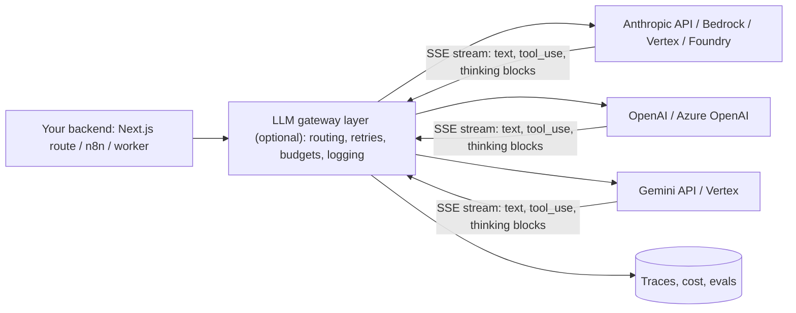

# LLM APIs & SDKs

> [!abstract] TL;DR
> Every production AI feature ultimately calls an LLM API: an HTTP endpoint that takes messages (+ tools, images, documents) and returns content blocks, usually streamed. The big three:
> - **Anthropic Claude**: Messages API, `@anthropic-ai/sdk` / `anthropic`.
> - **OpenAI**: Responses API, `openai`.
> - **Google Gemini**: Gemini API, `@google/genai` / `google-genai`.
>
> They share a feature set (tool use, structured outputs, prompt caching, streaming, batches, token counting) with different shapes. Abstraction layers (Vercel **AI SDK**, **LiteLLM**, OpenRouter) let you switch providers.
> - **Cost/latency levers that matter most**: prompt caching, the right model tier/effort, batching, and keeping prompts stable.
> - **Biggest risks**: model deprecations, silent behaviour changes between model versions, rate limits, and data residency (PDPA).

## Introduction
- **Evolution**:
  - Completions APIs (GPT-3, 2020).
  - Chat APIs (2023).
  - Tool/function calling (2023).
  - Multimodal inputs, JSON/structured outputs, prompt caching (2024).
  - Reasoning/"thinking" models, server-side tools (web search, code execution), agent runtimes (2025–26).
- **Where it sits**: behind your backend (Node/Next.js route handlers, [[n8n]] AI nodes, Python workers), never directly in browsers or mobile apps (API keys must stay server-side). Also behind cloud marketplaces: Claude on Amazon Bedrock, Google Vertex AI, Microsoft Foundry and Claude Platform on AWS; OpenAI on Azure.

## Core Concepts

### Feature map across providers
| Capability | Anthropic Claude API | OpenAI | Google Gemini |
|---|---|---|---|
| Core endpoint | `POST /v1/messages` (Messages API) | Responses API (successor to Chat Completions) | `generateContent` / `streamGenerateContent` |
| Official SDKs | `@anthropic-ai/sdk`, `anthropic` (Python), Java, Go, Ruby, C#, PHP | `openai` (TS/Python), others | `@google/genai`, `google-genai` |
| Tool use | `tools` with JSON Schema, `strict: true`, parallel tool calls, SDK tool runner | Function calling, built-in tools | Function calling |
| Structured outputs | `output_config.format` (JSON schema), `messages.parse()` helpers | JSON schema response format | Response schema |
| Prompt caching | Explicit `cache_control` breakpoints or top-level auto-caching. Reads ~0.1× input price, writes ~1.25× (5-min TTL, optional 1 h) | Automatic prefix caching | Implicit + explicit context caching |
| Reasoning | Adaptive thinking + `output_config.effort` (`low`…`max`) | Reasoning effort parameter | Thinking budget/level |
| Streaming | SSE (`messages.stream()`, `finalMessage()`) | SSE | SSE |
| Batch (≈50% cheaper, async) | Message Batches API | Batch API | Batch mode |
| Token counting | `POST /v1/messages/count_tokens` | Tokenizer libraries/usage fields | `countTokens` |
| Server-side tools | Web search, web fetch, code execution, tool search | Web search, file search, code interpreter | Google Search grounding, code execution |
| Hosted agents | **Managed Agents** (beta): server-run agent loop + per-session sandbox | Agents platform | Agent/Vertex offerings |

> [!warning] Unverified — check before relying on this
> The OpenAI and Gemini columns are summarized from general knowledge, not checked against their current docs. Verify parameter names and features in each provider's documentation before implementing.

### Claude models (Anthropic first-party pricing, cached 2026-10-06)
| Model | ID | Context | Input / Output per 1M tokens | Use for |
|---|---|---|---|---|
| Claude Fable 5.1 | `claude-fable-5-1` | 1M | $10 / $50 | Hardest reasoning, long-horizon agents |
| **Claude Opus 5.5** | `claude-opus-5-5` | 1M | $4 / $20 | Default high-capability model |
| Claude Sonnet 5.5 | `claude-sonnet-5-5` | 1M | $2 / $10 | Everyday coding/agents at lower cost |
| Claude Haiku 5.5 | `claude-haiku-5-5` | 1M | $0.10 / $0.50 (≤100K prompt) | High-volume classification, extraction, routing |

Query live capabilities with the Models API (`GET /v1/models/{id}`: `max_input_tokens`, `max_tokens`, `capabilities`) instead of hard-coding.

### Minimal Claude call with structured output (TypeScript)
```ts
import Anthropic from "@anthropic-ai/sdk";
import { z } from "zod";
import { zodOutputFormat } from "@anthropic-ai/sdk/helpers/zod";

const client = new Anthropic();   // reads ANTHROPIC_API_KEY (server-side only)

const Intent = z.object({
  intent: z.enum(["order_status", "pricing", "complaint", "other"]),
  language: z.enum(["ms", "en", "zh", "mixed"]),
  needs_human: z.boolean(),
});

const response = await client.messages.parse({
  model: "claude-opus-5-5",
  max_tokens: 16000,
  cache_control: { type: "ephemeral" },                 // auto-cache the stable prefix
  system: "You classify WhatsApp messages for a Malaysian SME. Escalate angry customers.",
  messages: [{ role: "user", content: "Bos, order saya belum sampai lagi ke? Dah 5 hari." }],
  output_config: { format: zodOutputFormat(Intent) },
});

console.log(response.parsed_output);                     // null if parsing failed: guard it
console.log(response.usage.cache_read_input_tokens);     // verify caching works across calls
```

## Architecture / How It Works

- **Request shape**: model + system prompt + messages (multi-turn history you resend each call; the API is stateless unless you use a hosted agent runtime) + tools + output/format settings.
- **Tool loop**: model returns `tool_use` → your code executes → you send `tool_result` → repeat until `end_turn`. SDK helpers (Claude's tool runner) automate this. See [[AI Agents - Tool Calling & Agent Loops]] and [[Model Context Protocol]].
- **Prompt caching is a prefix match**: tools → system → messages render in order, and any byte change invalidates everything after it. Keep volatile data (timestamps, user IDs) after the last breakpoint, and check `cache_read_input_tokens` to verify.
- **Stop reasons**: always branch on them (`end_turn`, `tool_use`, `max_tokens`, `refusal`, …) before reading content. On current Claude models, safety classifiers can return `stop_reason: "refusal"` with `stop_details`, and server-side `fallbacks` can re-run on another model.
- **Rate limits** are per model and per organization tier (requests and tokens per minute). Handle 429/529 with exponential backoff + jitter. The SDKs retry 408/409/429/5xx twice by default.

## Project Structure
```text
src/ai/
├── client.ts            # single configured SDK client (timeouts, retries, base URL/region)
├── models.ts            # model IDs per route in config, not scattered literals
├── prompts/             # versioned system prompts (stable prefix → cacheable)
├── tools/               # tool definitions (JSON Schema / Zod) + handlers
├── routes/              # classify.ts, extract.ts, reply.ts: one function per use case
├── budget.ts            # per-tenant token/cost limits
└── evals/               # datasets + graders per route (see AI Evals & Observability)
```
```bash
npm install @anthropic-ai/sdk zod
export ANTHROPIC_API_KEY=...     # from a secret manager / Coolify env, never in client bundles
```

## Use Cases
| Use case | API features to use |
|---|---|
| WhatsApp/Telegram support bot | Streaming (or not, for chat apps), tools for order lookup, caching of the long system prompt + FAQ |
| Invoice/receipt/IC extraction | Vision/PDF input + structured outputs, batch for back-office volume |
| Message classification/routing in [[n8n]] | Small fast model (Haiku tier), structured outputs, low effort |
| RAG answers with citations | Documents + citations, caching of retrieved context where repeated ([[RAG]]) |
| Agents doing multi-step work | Tool use + tool runner, or a hosted agent runtime (Managed Agents) |
| Nightly summarization/reports | Batch API (~50% cheaper, results within 24 h) |

## Pros & Cons
| Approach | Pros | Cons |
|---|---|---|
| Provider-native SDK | Full feature access (caching, thinking, server tools), typed responses | Lock-in to one API shape |
| Abstraction layer (AI SDK, LiteLLM) | Swap providers, unified streaming/tool UX | Lowest-common-denominator features, lag behind new APIs |
| Aggregator (OpenRouter) | One key, many models, failover | Extra hop, data passes another party, markup |
| Cloud marketplace (Bedrock/Vertex/Foundry) | Enterprise billing, IAM, regional hosting | Feature/availability gaps vs first-party, separate pricing |
| Self-hosted open models (vLLM, Ollama) | Data control, fixed cost at scale | GPU ops, weaker quality than frontier for many tasks ([[Fine-tuning LLMs]]) |

## Alternatives & Peers
| Option | Strength | Pick it when… |
|---|---|---|
| Anthropic Claude API | Strong coding/agentic models, prompt caching, Managed Agents | Default for agentic and reasoning-heavy features |
| OpenAI | Broad ecosystem, multimodal, Azure availability | Client is already on OpenAI/Azure |
| Google Gemini | Long context, Google ecosystem, Vertex | Google Workspace/Cloud-centric clients |
| Vercel AI SDK | React/Next.js streaming UI primitives, provider adapters | Next.js chat UIs |
| LiteLLM / OpenRouter | Provider routing, unified keys | Multi-provider experimentation, fallbacks |

## Tips & Reminders
> [!tip]
> - Keep API keys server-side (route handlers, Edge Functions, n8n credentials). For mobile/web clients, call your own backend.
> - Put model IDs in config per route, and run evals before changing them ([[AI Evals & Observability]]).
> - Structure prompts for caching: frozen system prompt + tool list first, user-specific content last. Verify cache hits in `usage`.
> - Use structured outputs instead of "reply in JSON" instructions, and validate with Zod anyway.
> - Set timeouts and stream long outputs. Use batch for anything not user-facing.
> - Track cost per tenant (`usage` tokens × price) and enforce budgets. Agent loops can multiply tokens quickly.
> - **In ZP's stack**:
>   - **Where calls run**: Next.js route handlers or a Node worker (BullMQ on [[Redis]]) for the API calls, and n8n AI nodes for workflow automations.
>   - **Defaults**: `claude-opus-5-5` for complex reasoning, Haiku-tier models for high-volume classification, prompt caching for long SME knowledge prompts.
>   - **Fallbacks**: configure them for refusals and outages.
>   - **Proposals**: document the provider and data-transfer location in client proposals (PDPA).

## Versions & Breaking Changes
| Change | Date | Impact |
|---|---|---|
| Chat-style messages APIs replace completions | 2023 | Messages arrays, roles |
| Tool use / function calling GA across providers | 2023–2024 | Agent patterns |
| Prompt caching (Anthropic 2024, others follow) | 2024 | Large cost cuts for repeated context |
| OpenAI Responses API introduced | 2025 | Successor to Chat Completions + Assistants (Assistants being retired) |
| Claude: adaptive thinking replaces `budget_tokens` on 4.6+ models; assistant prefill removed on newer models | 2025–2026 | Use `thinking: {type: "adaptive"}` + `output_config.effort`, and structured outputs instead of prefill |
| Claude: structured outputs move to `output_config.format` (old `output_format` deprecated) | 2025–2026 | Update request code |
| Claude Opus 5.5 / Sonnet 5.5: forced `tool_choice` (`any`/`tool`) returns 400; thinking can't be disabled on Opus 5.5 (effort default `medium`) | 2026 | Use `auto` + `strict: true` tools or structured outputs. Set effort explicitly |
| Claude Files API and Skills out of beta | 2026 | Drop old beta headers. Check SDK migration notes |

## Critical Issues & Gotchas
> [!danger] Leaked API keys = unbounded bills
> Keys committed to Git, shipped in mobile apps/frontends, or pasted into n8n workflows shared publicly are scraped within minutes and used for abuse. Use workspace-scoped keys with spend limits, keep keys in secret stores, rotate on any exposure, and alert on usage spikes.

> [!danger] Model deprecations and silent behaviour shifts
> Providers retire model versions on fixed schedules, and newer models change defaults (effort levels, thinking display, tool-choice rules, refusal behaviour). A hard-coded model string in a client's production workflow will eventually fail or behave differently. Track deprecation notices, pin IDs per route, and re-run evals on every model change.

> [!warning] Gotchas
> - Never truncate inputs silently to fit context. Chunk, summarize, or tell the user.
> - Low `max_tokens` truncates output mid-thought (`stop_reason: max_tokens`). Use generous limits and streaming for long outputs.
> - Parallel tool calls: return **all** tool results in one message. Splitting them degrades future parallelism.
> - Tool-call inputs are JSON. Parse them (`JSON.parse`), never string-match the raw serialization.
> - Per-region/data residency: check where inference runs (Claude supports `inference_geo` on newer models) for regulated clients.
> - Third-party marketplaces lag first-party features and use different model ID formats (Bedrock `anthropic.` prefix).

## Deep Dives
- [[LLM APIs & SDKs - Prompt Caching & Cost Optimization]]
- [[LLM APIs & SDKs - Structured Outputs & Tool Schemas]] — output_config.format vs strict tools, schema limits, no forced tool_choice, semantic validation
- [[LLM APIs & SDKs - Batch Processing & Async Workloads]] — Batch API facts, job tables, custom_id ingestion, retries, batch vs queue, nightly analytics

## Related
- [[LLM Fundamentals]] — tokens, context windows, sampling, reasoning
- [[Prompt Engineering]] — what goes into the request
- [[AI Agents - Tool Calling & Agent Loops]] — tool loop mechanics
- [[Model Context Protocol]] — standard tool/server integration
- [[AI Evals & Observability]] — measuring model/prompt changes
- [[Fine-tuning LLMs]] — hosted vs open-weight customization

## References
- Claude API docs: https://platform.claude.com/docs
- Anthropic TypeScript SDK: https://github.com/anthropics/anthropic-sdk-typescript
- Anthropic Python SDK: https://github.com/anthropics/anthropic-sdk-python
- OpenAI API docs: https://platform.openai.com/docs
- Gemini API docs: https://ai.google.dev/gemini-api/docs
- Vercel AI SDK: https://ai-sdk.dev/
- LiteLLM: https://docs.litellm.ai/
