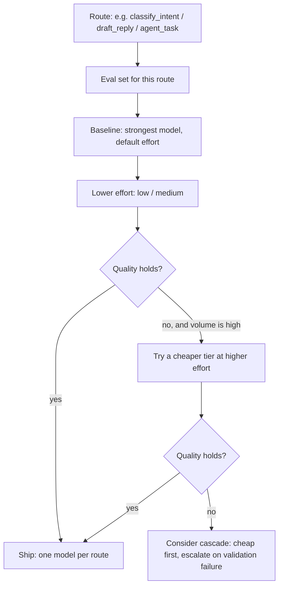

# LLM Fundamentals - Model Selection & Routing

> [!info] Deep dive of [[LLM Fundamentals]]

> [!abstract] TL;DR
> Choose per **route** (feature), not per app, and judge on **cost per completed task** on your own eval set, not price per token.
> - First lever: the strongest model at **lower effort**.
> - Then a cheaper tier for high-volume simple routes (classification, extraction, chat).
> - Only then routers or cascades: models don't share prompt caches, and every hop adds latency and failure modes.
>
> Always design fallbacks: availability (429/5xx) and safety refusals (server-side fallbacks on Claude).

## Concept
**Claude lineup** (first-party API prices per 1M tokens, from the cached model table 2026-10-06):

| Model | ID | Input / Output | Context | Notes |
|---|---|---|---|---|
| Claude Fable 5.1 | `claude-fable-5-1` | $10 / $50 | 1M | Most capable widely released. Thinking always on. Forced `tool_choice` rejected. 30-day retention required (no ZDR unless authorized) |
| Claude Opus 5.5 | `claude-opus-5-5` | $4 / $20 | 1M | Default workhorse. Thinking can't be disabled. **Effort defaults to `medium`**. Forced tool choice rejected |
| Claude Sonnet 5.5 | `claude-sonnet-5-5` | $2 / $10 | 1M | Everyday coding/agents/enterprise. Effort default `high`. `between_tools` to turn thinking off |
| Claude Haiku 5.5 | `claude-haiku-5-5` | $0.10 / $0.50 (≤100K prompt; $0.50 / $2.50 beyond) | 1M | High-volume routing, extraction, judges. Effort default `medium`. No server-side refusal fallback |

**Selection dimensions**:

| Dimension | Question | Where it bites |
|---|---|---|
| Capability | Does it pass the route's eval set? | Agentic coding, long multi-step reasoning |
| Cost per completed task | Tokens × price × retries ÷ successes | Cheap models that need 3 tries aren't cheap |
| Latency | p95 time to first token / full answer | WhatsApp replies, voice, autocomplete |
| Context | Does the job fit, and does quality hold at that length? | RAG over big docs, long agent runs |
| Data & compliance | Retention/ZDR, region, platform (Bedrock/Vertex) | Client contracts, PDPA expectations |
| Behaviour | Refusal categories, instruction following, language (BM/EN/ZH) | Customer-facing bots |
| Vendor risk | Deprecation cadence, price changes, outages | Long-lived client deployments |

## How It Works

- **Effort** (`output_config.effort`: `low` … `max`) trades thoroughness for tokens within one model. Chat, classification and latency-sensitive routes often do well at `low`. Coding and long-horizon agent work responds strongly to `high`/`xhigh`.
- **Caches are model-scoped**: a cascade or router that switches models forfeits prompt-cache reuse between them ([[LLM APIs & SDKs - Prompt Caching & Cost Optimization]]).

## Practical Usage
**Static route table** (the default: explicit, testable, cache-friendly):
```ts
type Route = 'classify_intent' | 'extract_invoice' | 'draft_reply' | 'agent_task';

export const ROUTES: Record<Route, { model: string; effort: 'low' | 'medium' | 'high' | 'xhigh'; maxTokens: number }> = {
  classify_intent: { model: 'claude-haiku-5-5',  effort: 'low',    maxTokens: 256 },
  extract_invoice: { model: 'claude-sonnet-5-5', effort: 'medium', maxTokens: 4000 },
  draft_reply:     { model: 'claude-sonnet-5-5', effort: 'low',    maxTokens: 1500 },
  agent_task:      { model: 'claude-opus-5-5',   effort: 'high',   maxTokens: 64000 },
};
```
**Escalation on validation failure** (a cascade that is cheap when it works):
```ts
async function extract(doc: PdfBlock) {
  const first = await parseWith('claude-sonnet-5-5', 'medium', doc);
  if (first.ok && semanticChecksPass(first.value)) return first.value;
  const second = await parseWith('claude-opus-5-5', 'high', doc);     // escalate only the hard ~5–10%
  if (second.ok && semanticChecksPass(second.value)) return second.value;
  return queueForHumanReview(doc);
}
```
**Refusal fallback** (Claude server-side fallbacks, beta; routes by refusal category):
```ts
const res = await client.beta.messages.create({
  model: 'claude-opus-5-5', max_tokens: 16000,
  betas: ['server-side-fallback-2026-07-01'],
  fallbacks: 'default',
  messages,
});
if (res.stop_reason === 'refusal') { /* still refused after fallback: show a safe message, log the category */ }
```
**Availability fallback** (typed SDK errors, not string matching):
```ts
try {
  return await client.messages.create({ model: ROUTES.draft_reply.model, ...params });
} catch (e) {
  if (e instanceof Anthropic.RateLimitError || e instanceof Anthropic.InternalServerError) {
    return await client.messages.create({ model: 'claude-haiku-5-5', ...params });   // degraded but answering
  }
  throw e;
}
```
**Wrong way**:
```ts
// ❌ one global model for everything: overpay on simple routes, underperform on hard ones
const MODEL = 'claude-fable-5-1';
// ❌ LLM router call before every request: +1 round trip, its own failure rate, cache misses downstream
const model = await askRouterModel(userMessage);
```

## Patterns & Anti-patterns
| Pattern | When | Anti-pattern to avoid |
|---|---|---|
| Per-route model + effort in config, versioned | Every product | Model IDs hard-coded across files |
| Effort sweep before tier changes | Cost tuning | Jumping to a smaller model first |
| Deterministic pre-routing (regex, rules, metadata) | Obvious cases (FAQ keywords, file type) | An LLM call to decide something a rule can |
| Cascade with **validator-based** escalation | Extraction, classification with checks | Escalating on the model's self-reported confidence alone |
| Fallbacks for refusal and availability | Customer-facing routes | Single model, no degraded path |
| Re-run evals on every model/effort change | Migrations | "New model is better" without measurement |

## Performance & Trade-offs
- **Cost math**: with 2,000 input + 300 output tokens per WhatsApp reply:
  - Sonnet 5.5: (2,000 × $2 + 300 × $10) / 1M ≈ **$0.007** per reply;
  - Haiku 5.5: (2,000 × $0.10 + 300 × $0.50) / 1M ≈ **$0.00035**;
  - prompt caching cuts the input side further on repeated system prompts.
- **Cascades** save money only if the cheap model resolves most traffic **and** escalation is detected reliably. Otherwise they add latency (two calls) and complexity.
- **Lower effort on a top model** often matches older or smaller models at high effort, with one model and one cache namespace. Measure that first.
- **Self-hosted open-weight models** (Qwen 3.x, Gemma, gpt-oss on vLLM/Ollama) give data control and fixed cost, but GPU rent, ops and lower capability on hard tasks usually make them a niche choice for SMEs ([[Fine-tuning LLMs]]).

## Tips & Reminders
> [!tip] In ZP's stack
> - **WhatsApp bots**: Haiku 5.5 for intent and FAQ, Sonnet 5.5 at low effort for drafted replies, Opus 5.5 only for agentic back-office tasks.
> - **Invoice extraction**: Sonnet 5.5 with escalation to Opus 5.5 on failed checks.
> - **Quote by route**: price client proposals in RM per 1,000 conversations by route, with a buffer for retries and escalations.

- Keep model IDs exact (`claude-opus-5-5`), with no date suffixes. Discover capabilities via the Models API (`max_input_tokens`, `capabilities`) rather than hard-coding.
- Trace model + effort on every generation ([[AI Evals & Observability - Tracing & Production Monitoring with Langfuse]]) and build cost-per-route dashboards.
- Re-baseline token counts with `count_tokens` when moving between tokenizer generations (the Opus 4.7+ tokenizer uses ~1–1.35× the tokens of older models for the same text).
- When switching models mid-conversation, thinking blocks from the previous model are dropped (unbilled). Expect slightly different behaviour after a fallback.

## Version Notes
| Date | Change relevant here |
|---|---|
| 2025 | Adaptive thinking + `effort` replace fixed thinking budgets on newer Claude models |
| 2026 | Opus 5.5 (cheaper Opus, effort default `medium`), Sonnet 5.5, Haiku 5.5 (tiered price above 100K prompt), Fable 5.1 |
| 2026 | Forced `tool_choice` (`any`/`tool`) rejected on Fable 5.1, Opus 5.5 and Sonnet 5.5. Sampling params removed. Prefill removed |
| 2026-07 | Server-side refusal fallbacks (`fallbacks: "default"`, beta `server-side-fallback-2026-07-01`) |

> [!warning] Unverified — check before relying on this
> Prices and model capabilities come from a cached model table (2026-10-06). Confirm current pricing at https://www.anthropic.com/pricing (and Bedrock/Vertex pricing pages if routing through them) before quoting clients.

## Critical Issues & Gotchas
> [!danger] Model deprecation breaks long-lived deployments
> Client projects outlive model versions. Pin models in config, subscribe to deprecation notices, keep eval sets per route so migrations are a measured change, and put "model migration" in maintenance contracts.

> [!danger] Silent cost blowups from defaults
> Effort defaults differ per model (Opus 5.5 / Haiku 5.5: `medium`; Sonnet 5.5: `high`), and Haiku 5.5's price jumps above 100K-token prompts. A long-context RAG route on Haiku can cost 5× more than planned. Set effort explicitly and alert on tokens per request.

- **Feature support differs by model and platform**: fast mode, task budgets, priority tier and fallbacks aren't available everywhere. Check before routing a feature-dependent request to another model.
- **Language quality**: Malay and Manglish performance varies by model and effort. Include real BM/code-switched samples in every route's eval set.
- **Router drift**: a classifier router trained or prompted on last quarter's traffic misroutes new intents. Monitor the escalation rate and route distribution.

## Related
- [[LLM Fundamentals]]
- [[LLM Fundamentals - Tokens, Context & Sampling]] — tokens, context, effort
- [[LLM APIs & SDKs - Prompt Caching & Cost Optimization]] — cost levers per route
- [[LLM APIs & SDKs - Structured Outputs & Tool Schemas]] — validators that drive escalation
- [[AI Evals & Observability - Tracing & Production Monitoring with Langfuse]] — measuring cost and quality per route
- [[Fine-tuning LLMs]] — when a small tuned model beats routing

## References
- https://docs.claude.com/en/docs/about-claude/models/overview
- https://www.anthropic.com/pricing
- https://docs.claude.com/en/docs/build-with-claude/effort
- https://docs.claude.com/en/api/models
