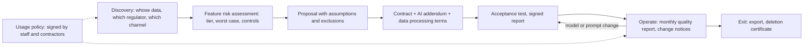

# LLM Security & Governance - Acceptable Use Policy & Client Contracts

> [!info] Deep dive of [[LLM Security & Governance]]

> [!abstract] TL;DR
> - Two documents turn this whole topic into commitments: an **acceptable use policy** (what your people may put into which AI tool, and who checks AI output before it ships) and an **AI addendum** to the client contract (roles, accuracy, human review, model changes, data, liability).
> - Without them the defaults apply, and the default is that the builder carries the blame for anything the AI gets wrong.
> - Keep both short enough to be read. One page of policy and one schedule of clauses beat a binder nobody opens.

> [!warning] Starting positions, not legal advice. Have a Malaysian lawyer review any clause before it goes into a contract.

## Concept

### Acceptable use: tool × data class
| Tool category | Public | Internal | Client confidential | Personal data | Secrets |
|---|---|---|---|---|---|
| Provider API through the gateway, company account | ✅ | ✅ | ✅ | ✅ tokenised | ❌ |
| Approved business-plan assistants (chat, coding), training off, admin controls | ✅ | ✅ | ✅ if the client contract allows | Ask first | ❌ |
| Personal or free consumer accounts | ✅ | ❌ | ❌ | ❌ | ❌ |
| Unvetted browser extensions, plugins, meeting recorders | ❌ | ❌ | ❌ | ❌ | ❌ |
| Coding agents with repository access | ✅ | ✅ in a sandbox | Only in the client's approved environment | ❌ | ❌ No production credentials in reach |

### The seven rules a usage policy needs
1. **A named human owns every AI-assisted deliverable** and has checked its facts, references and code.
2. **Only listed tools** touch company or client data. The list has an owner and a date.
3. **Data classes decide the tool**, per the matrix above.
4. **Generated code is reviewed and tested** like any other code, including its licence.
5. **Client rules win.** If a client's contract restricts AI use, that restriction applies to their work.
6. **Mistakes are reported within 24 hours, without blame.** A paste into the wrong tool is an incident to contain, not to hide.
7. **Consent before recording.** No AI note-taker joins a call without everyone agreeing.

### Contract clause map
| Clause | What it settles | Builder-side position |
|---|---|---|
| Roles | Who is controller and deployer, who is processor and developer | Client decides purposes and owns the lawful basis. Builder processes on instructions |
| Scope and intended use | Named use cases, excluded uses, risk tier | No use for hiring, credit, medical or legal decisions unless separately agreed |
| Accuracy and acceptance | Metric, method, threshold | Measured lower bound on an agreed sample. No warranty of error-free output |
| Human oversight | Who reviews what | Client staffs the review queue and makes final decisions |
| AI disclosure | Who tells end users | Client's channel, wording supplied by builder |
| Model and provider change | When the underlying model may change | Builder may change with notice, immediately for retirement or security, with a re-test |
| Third-party providers | Sub-processors, outages, terms | Listed sub-processors. Provider outages and policy changes outside the SLA |
| Data | Instructions, retention, training use, deletion, breach notice | No training on client data. Deletion on exit. Notice to client within 24 h of awareness |
| Usage costs | Who pays for tokens | Pass-through at cost with a monthly cap and alerts, or the client's own provider account |
| Intellectual property | Data, outputs, prompts, tooling | Client owns its data and outputs. Builder keeps reusable tooling and know-how |
| Liability | Cap and exclusions | Cap at fees paid in the prior 12 months. No liability for decisions taken on unreviewed output |
| Suspension | Right to switch the feature off | Builder may suspend an AI feature during a security or safety incident |
| Evidence and audit | Decision logs, reports | Retention period, access on request, monthly quality report |
| Exit | What the client leaves with | Data export, prompts and eval sets as agreed, deletion certificate |

## How It Works

The risk assessment is the hinge. It fixes the tier, and the tier decides how much of the addendum applies: a T0 internal tool needs a paragraph, a T3 workflow needs every clause.

## Practical Usage

### One-page usage policy skeleton
```text
AI ACCEPTABLE USE POLICY  ·  v1.3  ·  owner: [name]  ·  reviewed: 2026-11-28

1. Approved tools        [list with account type and data classes allowed]
2. Never                 Secrets in any prompt. Client data in personal accounts. Unapproved extensions.
3. Before you ship       You verify facts, numbers, references and code. Your name is on it.
4. Client restrictions   Check the client file. Their AI clause overrides this policy.
5. Coding assistants     Sandbox only. No production credentials. Review every diff. Check licences.
6. Meetings              Ask before using an AI recorder. Store transcripts in the client folder only.
7. If something goes wrong   Tell [contact] within 24 hours. We fix first and ask questions later.
8. Requests for a new tool   Send to [contact]. Decision within 5 working days.

Signed by every employee and contractor at onboarding and at each revision.
```

### Feature risk assessment, one page per T2–T3 feature
```yaml
feature: invoice extraction to accounting system
client: [name]
tier: T3
data_classes: [supplier bank details, invoice amounts]
worst_case: payment posted to the wrong payee or for the wrong amount
controls:
  - field-level evidence with recomputed totals
  - dual extraction agreement, auto-post limit RM 5,000
  - maker-checker above the limit and for new suppliers
  - hash-chained decision log, 7-year retention
acceptance: field accuracy lower bound >= 98% on 500 unseen documents, zero S1
human_reviewer: client finance executive (named)
kill_switch_owner: builder, client finance manager
review_date: 2027-05-28
```

### Clause wording to adapt
```text
MODEL CHANGE. The Supplier may change the underlying AI model or provider on 30 days' written notice,
or immediately where a provider retires a model or a change is needed for security. Before a change
takes effect in production the Supplier will repeat the acceptance test and share the result.
The Services are not tied to any named model.

ACCURACY. AI output is probabilistic and may contain errors. The Supplier warrants that the Services met
the Acceptance Criteria on the Acceptance Date, and does not warrant that every output is correct.

HUMAN OVERSIGHT. The Client will review items routed to the review queue and remains responsible for
decisions made using the Services. The Client will not use the Services for [excluded uses].

SUSPENSION. The Supplier may suspend an AI feature without notice where it reasonably believes
continued operation risks harm, data loss or a breach of law, and will inform the Client without delay.

USAGE COSTS. Third-party model charges are passed through at cost. The Supplier will alert the Client
at 50%, 80% and 100% of the monthly cap of RM [amount] and will not exceed it without written approval.
```

### Proposal assumptions that prevent later disputes
```text
- Accuracy figures in this proposal are targets until measured on the Client's own documents.
- The Client provides ground truth for acceptance and a named reviewer for production.
- Channel and provider terms can change. Work needed to follow such changes is billed as change requests.
- Source formats not present in the acceptance sample are routed to human review until sampled.
- Token costs are estimates based on [volume]. Actual costs are passed through.
```

## Patterns & Anti-patterns
| Pattern | When | Anti-pattern to avoid |
|---|---|---|
| Tiered paperwork: a paragraph for T0–T1, the full addendum for T2–T3 | Every engagement | The same 12-page schedule for a FAQ bot |
| Client-owned provider account | Client-funded production | Reselling tokens through your own key with no cap |
| Acceptance report signed before go-live | T2–T3 | "It worked in the demo" as the acceptance record |
| Contractors sign the usage policy | Any subcontracted work | Assuming freelancers follow rules they never saw |
| Capabilities and thresholds in the contract | Always | Naming a model, "100% accuracy" or "zero retention" |
| Monthly quality report as a contract deliverable | Retainers | Quality discussed only after a complaint |
| Excluded uses written down | Always | Discovering the client used a support bot to screen job applicants |

## Performance & Trade-offs
- **Friction vs protection**: a long addendum slows a sale to an SME. Tiering keeps low-risk deals light and reserves the heavy clauses for work that can lose money.
- **Liability cap vs price**: a client who wants a higher cap is asking you to insure their process. Price it, or decline it.
- **Client-owned accounts** remove your margin on tokens and most of your billing risk. For most small builders that is a good trade.
- **Strict usage policy vs speed**: banning tools pushes people to personal accounts. Approving a good tool quickly reduces shadow use more than any rule.
- **Sharing prompts and eval sets on exit** helps win deals and removes lock-in as a retention lever. Decide per client and write it down.

## Tips & Reminders
> [!tip]
> - Say the accuracy caveat out loud in the sales call. Promises made in a demo are quoted back later.
> - Put the kill-switch right in the contract before you need it. Switching off a client's feature without that clause is itself a breach.
> - Check your professional indemnity cover for AI exclusions before signing a T3 project.
> - Keep signed acceptance reports with the contract. They are the first document asked for in a dispute.
> - Re-issue the usage policy when a tool is added or a provider's terms change. A policy dated two years ago protects nobody.
> - **In ZP's stack and business**:
>   - As a solo builder, uncapped liability on an automated financial workflow can end the company. The cap and the human-oversight clause are not optional.
>   - Keep the addendum, risk-assessment template and usage policy as Markdown in a private repo, versioned like code.
>   - Default to the client's own provider account and workspace, with you invited as a member.
>   - Bill model migrations as planned maintenance inside the retainer, with the frequency stated.

## Version Notes
N/A — practice, not a versioned technology. Triggers that should cause a review:
- The EU AI Act's AI literacy duty (since 2025-02) makes a usage policy plus training record the minimum evidence for teams with EU exposure.
- Malaysia's AI Governance Bill, once tabled, may add duties for deployers. Re-read the roles clause then.
- Any change to a provider's data or usage terms, or to a channel's platform terms.

## Critical Issues & Gotchas
> [!danger] Without clauses, the builder owns the AI's mistakes
> A tribunal held a business liable for what its chatbot told a customer, and the business's next call is to whoever built the bot. With no accuracy definition, no human-oversight duty and no liability cap, that conversation has no boundary. Agree the clauses before the first production message, however small the client.

> [!danger] Shadow AI is the norm, not the exception
> 2026 telemetry reports put 47% of generative-AI users on personal, unmanaged accounts, and 67% of users reaching AI services from non-corporate accounts on work devices, with source code the most commonly uploaded sensitive category. A policy nobody signed and an approved-tool list nobody maintains mean client data is already in tools you have not vetted.

> [!danger] Three phrases that become liabilities
> "Powered by [model name]", "100% accurate" and "we never store your data" each tie you to something a provider controls: a retirement date, a statistical impossibility, a retention policy that changed in 2026. Contract for capability, a measured bound, and a per-feature data route.

> [!warning] Gotchas
> - Copyright in purely machine-generated output is uncertain in most jurisdictions. Do not warrant exclusive ownership of it.
> - Provider indemnities usually protect the provider's direct customer. If the account is yours, the client is not covered by them.
> - A subcontractor's tools are your tools as far as the client is concerned.
> - "Notice within 24 hours" must be achievable. It requires monitoring that would actually detect the event.
> - Verbal scope creep is common with bots: "can it also answer about X?" Each new topic is a new intended use.
> - An excluded use needs a technical control as well as a sentence, or it will happen anyway.

## Related
- [[LLM Security & Governance]]
- [[LLM Security & Governance - Regulations, Standards & Platform Policies]] — the duties these clauses allocate
- [[LLM Security & Governance - Accuracy Assurance for Critical Workflows]] — the acceptance criteria referenced in the contract
- [[LLM Security & Governance - Model Migration, Deprecation & Version Pinning]] — what the model-change clause permits
- [[LLM Security & Governance - Data Privacy, PII & Provider Data Handling]] — processor list and data routes
- [[LLM Security & Governance - Incident Response & Kill Switches]] — suspension and notification in practice
- [[AI Agents - Human-in-the-Loop & Approval Workflows]] — the review queue the client must staff
- [[Git - Code Review, PR Templates & Conventional Commits]] — review rules for generated code

## References
- CIO Dive, shadow AI security risks (Netskope report): https://www.ciodive.com/news/shadow-ai-security-risks-netskope/808880/
- Infosecurity Magazine, personal LLM accounts drive shadow AI data leak risks: https://www.infosecurity-magazine.com/news/personal-llm-accounts-drive-shadow
- The Register, shadow AI surges in the workplace: https://www.theregister.com/ai-ml/2026/05/19/shadow-ai-surges-in-the-workplace/5242868
- CSA research note, shadow AI apps: https://labs.cloudsecurityalliance.org/research/csa-research-note-shadow-ai-apps-enterprise-20260530/
- Moffatt v. Air Canada, 2024 BCCRT 149: https://www.canlii.org/en/bc/bccrt/doc/2024/2024bccrt149/2024bccrt149.html
- NIST AI RMF (Govern function): https://www.nist.gov/itl/ai-risk-management-framework
- ISO/IEC 42001:2023: https://www.iso.org/standard/42001
