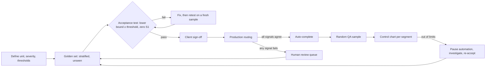

# LLM Security & Governance - Accuracy Assurance for Critical Workflows

> [!info] Deep dive of [[LLM Security & Governance]]

> [!abstract] TL;DR
> - "98% accurate" means nothing until it names the **unit** (field, document, decision), the **sample**, the **confidence bound** and the **severity** of the errors that remain.
> - Prove it once with an **acceptance test** on unseen client data, then keep proving it with **random QA sampling** of the auto-approved stream.
> - No model reaches 100%. Design for the residual: deterministic checks, automation only when independent signals agree, and a human on anything that can lose money.

## Concept

### Define the unit before the number
| Unit | Metric | Trap |
|---|---|---|
| Field | Correct fields ÷ fields | Hides bad documents |
| Document | Documents with every field correct ÷ documents | 10 fields at 99% each give 90.4% at document level. 20 fields give 81.8% |
| Decision | Correct decisions ÷ decisions | Needs per-class precision and recall, not one average |
| Critical error rate | S1 errors ÷ items | The number that matters commercially |
| Automation rate | Items completed without a human ÷ items | Easy to raise by lowering the bar |
| Abstention rate | Items the system declined ÷ items | A cost and a safety feature at once |

### Severity classes
| Class | Definition | Example | Acceptance |
|---|---|---|---|
| **S1 Critical** | Would cause financial loss, a legal or regulatory breach, or harm if acted on | Wrong payee, wrong amount, wrong eligibility decision | Zero in the acceptance sample. Every production occurrence is an incident |
| **S2 Major** | Wrong, and caught by a later control or a person | Wrong tax code flagged by the ledger | Rate inside an agreed budget |
| **S3 Minor** | Cosmetic or recoverable without consequence | Date format, casing, trailing text | Tracked, not gating |

### Assurance by risk tier
| | T1 informational | T2 acts / personal data | T3 regulated / financial |
|---|---|---|---|
| Golden set | 50–200 cases | 200+ cases, stratified by segment | 300+ cases incl. every known edge format |
| Acceptance test | Eval gate passes | Lower confidence bound ≥ agreed threshold | Same, plus zero S1 and client sign-off |
| Human review in production | None, or complaints only | Exception-based: failed checks go to a person | Maker-checker on everything above a value limit |
| QA sampling of auto-approved items | Monthly | Weekly | Daily, random plus risk-weighted |
| Re-acceptance trigger | Model change | Model, prompt or source-format change | Any change, with a recorded result |

### Signals that justify automation
Model self-reported confidence is poorly calibrated, so do not gate on it. Gate on signals that are independent of the model's opinion of itself:

- Verifier passes: spans found, totals recompute ([[LLM Security & Governance - Verifiable Outputs, Citations & Evidence Chains]])
- Two independent passes agree (different model, or different prompt and document rendering)
- Business rules pass: known counterparty, amount inside the usual range, no duplicate
- Value under the auto-approval limit

## How It Works

- **Unseen means unseen.** The acceptance sample must not overlap with prompt examples or the development set, or the measurement is of memorisation.
- **Retesting on the same sample after a fix** inflates the result. Draw a fresh sample.
- **Reviewed errors feed the golden set**, tagged with segment and failure mode.

## Practical Usage

### Sample size for a zero-failure acceptance test (95% confidence)
| To claim accuracy ≥ | 0 errors allowed | ≤ 1 error | ≤ 2 errors | ≤ 5 errors |
|---|---|---|---|---|
| 95% | 59 | 93 | 124 | 208 |
| 98% | 149 | 236 | 313 | 523 |
| 99% | 299 | 473 | 628 | 1,049 |
| 99.5% | 598 | 947 | 1,258 | 2,100 |
| 99.9% | 2,995 | 4,742 | 6,294 | 10,511 |

Rule of three: zero errors in *n* items bounds the true error rate at about 3 ÷ *n*. Zero in 300 supports "under 1%", nothing stronger.

### What an observed score actually supports
| Observed | 95% Wilson interval | Honest claim |
|---|---|---|
| 50 / 50 (100%) | 92.9% – 100% | "At least 92.9%" |
| 98 / 100 (98%) | 93.0% – 99.5% | "At least 93%" |
| 196 / 200 (98%) | 95.0% – 99.2% | "About 95% or better" |
| 490 / 500 (98%) | 96.4% – 98.9% | "At least 96.4%" |
| 300 / 300 (100%) | 98.7% – 100% | "At least 98.7%" |

### Acceptance decision in code
```ts
export function wilson(successes: number, n: number, z = 1.96) {
  const p = successes / n, d = 1 + (z * z) / n;
  const centre = (p + (z * z) / (2 * n)) / d;
  const half = (z * Math.sqrt((p * (1 - p)) / n + (z * z) / (4 * n * n))) / d;
  return { low: centre - half, high: centre + half };
}

export function accept(r: { correct: number; n: number; s1Errors: number }, threshold: number) {
  return r.s1Errors === 0 && wilson(r.correct, r.n).low >= threshold;   // gate on the lower bound, not the point estimate
}
// accept({ correct: 196, n: 200, s1Errors: 0 }, 0.98) → false.  300 / 300 → true
```

### Production routing
```ts
export function route(item: Item): "auto" | "auto+qa" | "review" {
  if (item.verifierErrors.length) return "review";
  if (!item.passesAgree) return "review";                     // two independent extractions differ
  if (item.amountCents > item.autoLimitCents) return "review";
  if (item.newCounterparty) return "review";
  return Math.random() < item.qaSampleRate ? "auto+qa" : "auto";
}
```

### QA sample and control limits
```sql
-- Daily: random sample of auto-approved items for blind re-check by a person
insert into qa_queue (item_id, tenant_id, segment)
select id, tenant_id, segment from ai_decisions
where route = 'auto' and created_at >= current_date - 1 and created_at < current_date
order by random() limit 30;
```
```text
p-chart lower limit = p̄ − 3·sqrt(p̄(1−p̄)/n)
  p̄ = 0.98, n = 50  → 0.921      (a week at 46/50 is a signal)
  p̄ = 0.98, n = 200 → 0.950
A point below the limit, or seven in a row below p̄, pauses automation for that segment.
```

### Acceptance clause for the statement of work
```text
Acceptance: field-level accuracy on [field list] of at least 98%, taken as the lower bound of the 95%
Wilson interval, measured on a random sample of at least 500 client documents not used in development,
with zero Severity 1 errors. The client supplies the ground truth and adjudicates disputes within 5
working days. Any change of model, prompt or source document format triggers a re-test on a fresh sample.
The client remains responsible for review of items routed to the review queue.
```

## Patterns & Anti-patterns
| Pattern | When | Anti-pattern to avoid |
|---|---|---|
| Lower confidence bound as the gate | Every acceptance test | Quoting the point estimate from 50 samples |
| Severity-weighted criteria with a zero-S1 rule | T2–T3 | One blended accuracy figure |
| Random sampling of the **auto-approved** stream | Production | Reviewing only flagged items, which can never reveal a miss |
| Blind re-check: reviewer enters the value before seeing the AI's | S1 fields in QA | Checker shown the AI answer and asked "correct?" |
| Results per segment (supplier, language, document type) | Reporting and control charts | Averages that hide one failing segment |
| Fresh sample after each fix | Acceptance | Iterating on the acceptance set until it passes |
| Adjudicated ground truth for disagreements | Building golden sets | Treating one annotator, or an LLM judge, as truth |

## Performance & Trade-offs
- **When to review everything**: review an item when `p_error × cost_of_error > cost_of_review`. With a RM 500 error and a RM 2 review, the break-even error rate is 0.4%. Above it, a person on every item is the cheaper option.
- **Sample size vs precision**: at 97% accuracy a sample of 100 gives ±3.3 points, and 400 gives ±1.7. Halving the interval costs four times the labelling.
- **Dual extraction** doubles model cost and catches errors a single pass repeats confidently. Use a cheaper second model: agreement, not quality, is the signal.
- **Labelling cost dominates.** 500 documents at 3 minutes each is 25 hours of client time. Put it in the project plan and the quote.
- **Automation rate is the business lever.** Stricter routing lowers both risk and savings. Report both numbers together so neither is optimised alone.

## Tips & Reminders
> [!tip]
> - Agree the unit, the threshold and the severity definitions in writing before building. Arguing about them after the demo is expensive.
> - Never claim 100%. Offer a measured bound and a process for the remainder.
> - Human labels are wrong 1–5% of the time on tedious data. When model and label disagree, a second person decides.
> - Track the reviewer rejection rate. A reviewer who never rejects is not reviewing.
> - "Best of three retries" is not the system's accuracy unless production also retries three times with the same selection rule.
> - Keep the first acceptance report. It is the baseline every later model migration is compared against.
> - **In ZP's stack**:
>   - `ai_decisions` and `qa_queue` tables in [[PostgreSQL]], with the QA insert scheduled by `pg_cron` or an [[n8n]] schedule trigger.
>   - A simple review form (n8n form or a Next.js page) that shows the source image beside the fields and records the reviewer's verdict.
>   - Segment by supplier and language from day one. BM and Chinese documents usually trail English ones.
>   - Report lower bound, automation rate and S1 count monthly to retainer clients. It is evidence of the service, and it protects you in a dispute.

## Version Notes
N/A — statistical methodology is stable. Two operational notes:
- Any model, prompt or provider change invalidates the previous acceptance result. Re-run on a fresh sample ([[LLM Security & Governance - Model Migration, Deprecation & Version Pinning]]).
- Current Claude models reject sampling parameters, so run-to-run variance cannot be removed with `temperature: 0`. Measure with repeated runs where variance matters.

## Critical Issues & Gotchas
> [!danger] An accuracy figure in a contract is a warranty
> "The system is 98% accurate" with no unit, sample or severity definition can be read as a guarantee on every document. Write the measured bound, the test method and the client's review duty into the agreement, and never state a figure you have not measured on that client's data.

> [!danger] Silent distribution shift
> A new supplier's invoice layout, a new language mix or a changed form drops accuracy with no error raised. Aggregate numbers barely move while one segment fails completely. Chart quality per segment, alert on unseen layouts or counterparties, and route first-seen formats to review until they have their own sample.

> [!danger] The checker who sees the answer first is not a check
> Shown a plausible AI result, reviewers confirm it. That is how fabricated references passed professional review in the cases cited across this topic. For S1 fields use blind double entry, show evidence spans next to every value, and cap the number of items one person approves per hour.

> [!warning] Gotchas
> - Golden cases reused as few-shot examples leak into the prompt and inflate the score.
> - Document-level and field-level accuracy differ by a large factor. Say which one every time.
> - An LLM judge used as ground truth measures agreement between two models, not correctness.
> - Reviewing only what the system flagged gives a false-negative rate of exactly unknown.
> - Seasonal data (year-end, tax period, festive promotions) is a distribution shift on a calendar. Re-sample then.
> - A threshold agreed on clean scans will not hold for phone photos. Stratify the acceptance sample by input quality.

## Related
- [[LLM Security & Governance]]
- [[LLM Security & Governance - Verifiable Outputs, Citations & Evidence Chains]] — the per-item checks that feed routing
- [[AI Evals & Observability - Eval Datasets & LLM-as-Judge]] — building and grading golden sets
- [[AI Agents - Human-in-the-Loop & Approval Workflows]] — the review queue and maker-checker mechanics
- [[AI Agents - Document Processing & Invoice Extraction]] — a T3 pipeline end to end
- [[Testing Strategy]] — where acceptance tests sit beside conventional tests
- [[LLM Security & Governance - Acceptable Use Policy & Client Contracts]] — contract wording around accuracy
- [[LLM Security & Governance - Model Migration, Deprecation & Version Pinning]] — re-acceptance on change

## References
- Binomial proportion confidence intervals (Wilson score): https://en.wikipedia.org/wiki/Binomial_proportion_confidence_interval
- Rule of three: https://en.wikipedia.org/wiki/Rule_of_three_(statistics)
- NIST AI Risk Management Framework (Measure function): https://www.nist.gov/itl/ai-risk-management-framework
- NIST AI 600-1, Generative AI Profile: https://nvlpubs.nist.gov/nistpubs/ai/NIST.AI.600-1.pdf
- Hamel Husain, "Your AI product needs evals": https://hamel.dev/blog/posts/evals/
