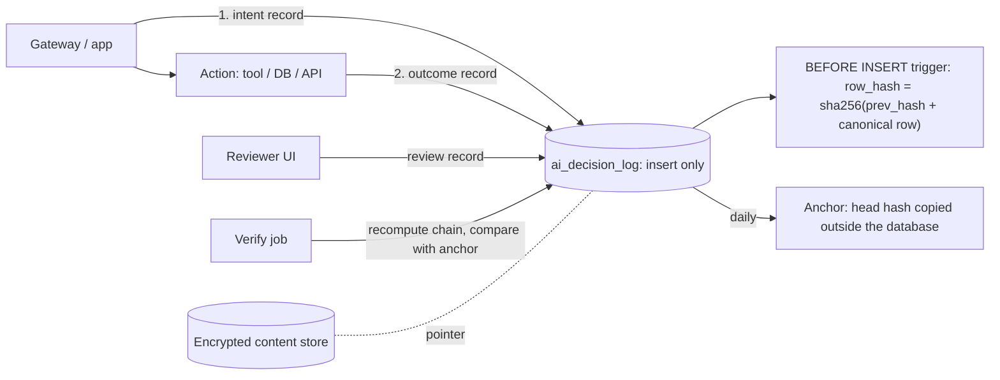

# LLM Security & Governance - Audit Trails & Decision Records

> [!info] Deep dive of [[LLM Security & Governance]]

> [!abstract] TL;DR
> - A **decision record** answers, a year later and without calling the model: what the system saw, which model and prompt produced what, which checks ran, who approved, and what was done.
> - It is **append-only and tamper-evident**, separate from debug traces, and kept as long as the business record it supports.
> - **Replay is not reproduction.** Models are non-deterministic and get retired, so the stored output is the evidence. The record proves what happened and that nobody edited it afterwards.

## Concept

### Trace vs decision record
| | Trace (Langfuse, OTel) | Decision record |
|---|---|---|
| Purpose | Debugging, quality, cost | Accountability, disputes, regulators |
| Completeness | May be sampled | Every decision, no sampling |
| Mutability | Editable, deletable | Insert only, hash-chained |
| Content | Full prompts and completions | Hashes, pointers, verdicts, minimal content |
| Retention | Days to weeks | Years, matching the underlying record |
| Readers | Developers | Restricted: compliance, client, auditor |

### What to record
| Field | Why it will be asked for |
|---|---|
| Time (database clock), tenant, feature, risk tier | Scope of the decision |
| Actor and on-behalf-of | Who triggered it |
| **Model ID as returned by the API**, provider, SDK and API version | "Which model said this?" An alias such as `latest` answers nothing |
| Provider message ID | Correlation with provider support and their logs |
| Prompt version and hash of the rendered system prompt, tool-definition hash | What instructions were in force |
| Input hash + pointer to the stored input | What it saw, without copying PII into the log |
| Sources: document ID, content hash, span | Evidence chain ([[LLM Security & Governance - Verifiable Outputs, Citations & Evidence Chains]]) |
| Output hash + pointer to the stored output | The exact text or JSON that was acted on |
| Guard and verifier verdicts | Which controls ran and what they said |
| Route, reviewer, decision, edits made | Human accountability |
| Action references: tool, arguments hash, resulting record ID, idempotency key | What changed in the world |
| `prev_hash`, `row_hash` | Tamper evidence |

### Hash in the log, content elsewhere
Raw prompts and outputs hold personal data, and an immutable log cannot honour an erasure request. Keep hashes and pointers in the chain, and put content in an encrypted blob store. To erase, delete the blob or its key (crypto-shredding) and append an erasure event. The chain stays intact and still proves that a decision happened and when.

### What can be proven
| Claim | Provable? |
|---|---|
| This exact output was produced at this time by this model and prompt | Yes, from the record |
| The record has not been altered since | Yes, by recomputing the chain against an external anchor |
| Re-running today gives the same output | No. Sampling varies and the model may be retired |
| The output was correct | Only through its evidence and the reviewer's decision |

## How It Works

- **Intent before action, outcome after.** If the process dies between the two, the missing outcome record is itself the signal. Logging only afterwards leaves actions with no record.
- **The anchor is what makes it evidence.** A database owner can rewrite every row and recompute every hash. A head hash stored where that person cannot write (object storage with retention lock, the client's mailbox, a signed timestamp) exposes the rewrite.
- **Serialised appends.** The chain needs a single order, so inserts take a transaction-scoped advisory lock.

## Practical Usage

### Table, canonical form and chain trigger
```sql
create table ai_decision_log (
  seq           bigint generated always as identity primary key,
  occurred_at   timestamptz not null default now(),
  tenant_id     uuid not null,
  feature       text not null,
  tier          smallint not null,
  actor         text not null,
  model         text not null,
  message_id    text,
  prompt_ver    text not null,
  input_sha256  bytea not null,
  output_sha256 bytea not null,
  payload       jsonb not null,       -- sources, verdicts, route, reviewer, action refs. No raw PII
  prev_hash     bytea,
  row_hash      bytea
);

create function ai_decision_canon(r ai_decision_log) returns bytea language sql immutable as $$
  select convert_to(jsonb_build_object(
    'at', to_char(r.occurred_at at time zone 'UTC', 'YYYY-MM-DD"T"HH24:MI:SS.US"Z"'),
    'tenant', r.tenant_id, 'feature', r.feature, 'tier', r.tier, 'actor', r.actor,
    'model', r.model, 'msg', r.message_id, 'prompt', r.prompt_ver,
    'in', encode(r.input_sha256, 'hex'), 'out', encode(r.output_sha256, 'hex'),
    'payload', r.payload)::text, 'UTF8')
$$;

create function ai_decision_chain() returns trigger language plpgsql as $$
begin
  perform pg_advisory_xact_lock(hashtext('ai_decision_log'));          -- one writer at a time
  select row_hash into new.prev_hash from ai_decision_log order by seq desc limit 1;
  new.row_hash := sha256(coalesce(new.prev_hash, '\x'::bytea) || ai_decision_canon(new));
  return new;
end $$;

create trigger ai_decision_chain before insert on ai_decision_log
  for each row execute function ai_decision_chain();

revoke all on ai_decision_log from public;
grant insert, select on ai_decision_log to app_role;                    -- no update, delete or truncate
```
The timestamp is formatted in UTC inside the canonical form on purpose. Hashing the session-local rendering would make verification fail from a connection with a different `TimeZone`.

### Verify the chain
```sql
select seq from (
  select l.seq, l.row_hash, l.prev_hash,
         lag(l.row_hash) over (order by l.seq) as expected_prev,
         sha256(coalesce(l.prev_hash, '\x'::bytea) || ai_decision_canon(l)) as recomputed
  from ai_decision_log l
) c
where recomputed <> row_hash or prev_hash is distinct from expected_prev
order by seq;
-- no rows = intact.  An edited row returns its own seq.  A deleted row returns the seq after the gap.
```

### Daily anchor
```sql
select seq, encode(row_hash, 'hex') as head from ai_decision_log order by seq desc limit 1;
```
Write the result somewhere the database owner cannot modify. The verify job checks that the row at the anchored `seq` still has the anchored hash.

### Hashing inputs and outputs in the application
```ts
import { createHash } from "node:crypto";

const canonical = (v: unknown): string =>
  v === null || typeof v !== "object" ? JSON.stringify(v)
  : Array.isArray(v) ? `[${v.map(canonical).join(",")}]`
  : `{${Object.keys(v as object).sort().map((k) => `${JSON.stringify(k)}:${canonical((v as Record<string, unknown>)[k])}`).join(",")}}`;

export const sha256 = (v: unknown) => createHash("sha256").update(typeof v === "string" ? v : canonical(v)).digest();

await db.query(
  `insert into ai_decision_log (tenant_id, feature, tier, actor, model, message_id, prompt_ver, input_sha256, output_sha256, payload)
   values ($1,$2,$3,$4,$5,$6,$7,$8,$9,$10)`,
  [ctx.tenantId, feature, tier, ctx.actor, res.model, res.id, promptVersion, sha256(input), sha256(output),
   { sources, verdicts, route, contentRef }],                           // res.model = what the provider actually served
);
```

### Retention guide
| Record | Keep for | Basis |
|---|---|---|
| Debug traces with full content | 30–90 days | Data minimisation |
| Decision records for financial or accounting actions | 7 years | Malaysian tax and company record-keeping periods |
| Decision records for high-risk systems under the EU AI Act | At least 6 months, longer if other law requires | Art. 19 and Art. 26(6) |
| Content blobs with personal data | As long as the purpose lasts, then erase | PDPA retention principle |
| Guard events | 90 days unless tied to an incident | Operational need |

## Patterns & Anti-patterns
| Pattern | When | Anti-pattern to avoid |
|---|---|---|
| Separate decision log from traces | T2–T3 | "It is all in Langfuse" with a 30-day TTL |
| Record the model ID from the response | Always | Recording the configured alias |
| Intent record, then action, then outcome record | Any side effect | A single log line after the action |
| Hashes and pointers in the chain, content in an erasable store | Personal data | Raw prompts in an immutable table |
| External anchor on a schedule | Anything that may become evidence | Chain head stored only in the same database |
| Named reviewer accounts | Human approval | A shared "admin" login for approvals |
| Verify job with an alert | Always | A chain nobody ever recomputes |

## Performance & Trade-offs
- **Throughput**: the advisory lock serialises inserts. One short insert per decision is fine for tens to low hundreds per second. Beyond that, chain per tenant or batch records into blocks.
- **Size**: a record is roughly 1–2 KB, so a million decisions is about 1–2 GB before indexes. Partition by month and keep old partitions on cheaper storage.
- **Verification cost**: recomputing is one sequential scan with a hash per row. Verify the last day hourly and the full chain weekly.
- **Erasure vs immutability**: crypto-shredding satisfies deletion but turns old records into proofs of existence without content. Decide per feature whether the business record requires keeping the content instead.
- **Two-phase logging** doubles the row count and removes the "did it happen?" ambiguity after a crash.

## Tips & Reminders
> [!tip]
> - Write the question each field answers next to it in the schema. Fields nobody would ask about do not belong in the record.
> - Use the database clock for `occurred_at`. Application servers drift and containers restart with wrong time.
> - Keep prompt templates in git and store the version tag plus the hash of the rendered prompt. The hash catches template variables that changed.
> - Test the dispute path once: pick a random decision from last month and reconstruct it from the record alone.
> - Backups restore old states. After a restore, compare the chain head with the latest anchor before resuming writes.
> - **In ZP's stack**:
>   - On [[Supabase]], put the table in a schema that PostgREST does not expose, and revoke `update`, `delete` and `truncate` from `anon`, `authenticated` **and** `service_role`. The `postgres` owner can still rewrite, which is what the anchor is for.
>   - Anchor to a Cloudflare R2 bucket with a retention lock, or email the head hash to the client's compliance address from an [[n8n]] schedule.
>   - Content blobs go to Supabase Storage, encrypted with a per-tenant key, referenced by `contentRef`.
>   - Langfuse stays the debugging tool with a short TTL. Link the two with the provider message ID.

## Version Notes
| Item | Status (2026-11) |
|---|---|
| OpenTelemetry GenAI semantic conventions | Every `gen_ai.*` attribute is still at Development stability. Moved to a dedicated repository in 2026-06 with no tagged release yet. Do not build an audit schema on attribute names that can change |
| EU AI Act record-keeping (Art. 12, 19, 26) | Applies to high-risk systems, whose obligations were deferred to 2027-12-02 |
| PostgreSQL | `sha256(bytea)` is built in from version 11, so `pgcrypto` is not required |

## Critical Issues & Gotchas
> [!danger] A log the application can edit is not evidence
> If the service account can `UPDATE` the table, any dispute ends with "you could have changed it". Insert-only grants stop the application, the hash chain exposes edits, and only the external anchor defends against whoever owns the database. All three are needed.

> [!danger] No model ID, no answer
> When a client asks why the bot behaved differently in March, "we use the latest model" ends the conversation badly. Aliases move and snapshots retire. Record the model the provider reports per response, with prompt version and SDK version, or behaviour changes cannot be explained at all.

> [!danger] An immutable table full of personal data is a liability
> Raw prompts in an append-only log cannot be erased, are copied into every backup, and are readable by whoever has audit access. Store hashes and pointers, encrypt the content separately, and make erasure a key deletion plus an appended event.

> [!warning] Gotchas
> - Sampling audit records is not an option. A sampled log cannot prove a specific decision.
> - Trace retention shorter than the client's dispute window means the detail is gone when it is needed. Check both numbers.
> - Canonical JSON must be identical everywhere it is hashed. Key order, number formatting and Unicode escaping all change the hash.
> - Identity sequences leave gaps after rolled-back inserts. Gaps in `seq` are normal. Breaks in `prev_hash` are not.
> - A reviewer's edit to an AI draft is itself a decision. Record the diff, not only "approved".
> - Tool calls made by a provider-hosted agent loop also need records. Pull them from the session events.

## Related
- [[LLM Security & Governance]]
- [[LLM Security & Governance - Verifiable Outputs, Citations & Evidence Chains]] — the evidence object stored in `payload`
- [[LLM Security & Governance - Accuracy Assurance for Critical Workflows]] — QA sampling reads from these records
- [[LLM Security & Governance - Incident Response & Kill Switches]] — the record is the incident timeline
- [[AI Evals & Observability - Tracing & Production Monitoring with Langfuse]] — the debugging counterpart
- [[AI Agents - Human-in-the-Loop & Approval Workflows]] — approval records
- [[Supabase - Data Retention, PDPA & Account Deletion]] — retention schedules and erasure flow
- [[PostgreSQL]] — partitioning and roles

## References
- EU AI Act, Regulation (EU) 2024/1689 (Art. 12, 19, 26): https://eur-lex.europa.eu/eli/reg/2024/1689/oj
- PostgreSQL binary string functions (`sha256`): https://www.postgresql.org/docs/current/functions-binarystring.html
- PostgreSQL advisory locks: https://www.postgresql.org/docs/current/explicit-locking.html#ADVISORY-LOCKS
- OpenTelemetry GenAI semantic conventions repository: https://github.com/open-telemetry/semantic-conventions-genai
- Dash0, OpenTelemetry GenAI semantic conventions explained: https://www.dash0.com/knowledge/opentelemetry-genai-semantic-conventions-explained
- RFC 8785, JSON Canonicalization Scheme: https://www.rfc-editor.org/rfc/rfc8785
- NIST AI RMF: https://www.nist.gov/itl/ai-risk-management-framework
