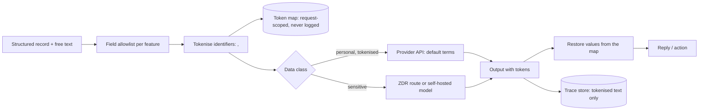

# LLM Security & Governance - Data Privacy, PII & Provider Data Handling

> [!info] Deep dive of [[LLM Security & Governance]]

> [!abstract] TL;DR
> - Every model call **discloses data to a processor**, usually across a border. For each feature know what personal data leaves, to whom, where, for how long, and whether it can train a model.
> - **Minimise before sending**: allowlist fields, tokenise identifiers, keep sensitive classes on a stricter route.
> - **API terms are not consumer-app terms**, and the copies you make yourself (traces, embeddings, eval sets, backups) usually outlive the provider's.

## Concept

### Where personal data ends up
| Location | What sits there | Erasure |
|---|---|---|
| Provider API logs | Prompts and outputs | Automatic after the retention period, or never stored under ZDR |
| Provider stateful features | Uploaded files, batches, threads, agent sessions, hosted vector stores | Until **you** delete them |
| Your gateway logs and traces | Full prompts unless masked | Your retention job |
| Vector store | Chunks and embeddings derived from personal data | Delete by document or subject ID. Re-index if chunks were merged |
| Agent long-term memory | Facts the agent chose to keep | Per-user memory delete |
| Eval and golden sets | Production samples copied for testing | Easy to forget. Anonymise at copy time |
| Fine-tuning data and weights | Training rows, and whatever the weights memorised | Rows yes, weights no |
| Backups | All of the above, at a past date | Age out on schedule |
| Other processors | OCR, speech-to-text, moderation, managed gateways | Their terms, one by one |

### Provider terms that matter (first-party APIs)
| | Claude API | OpenAI API | Gemini API |
|---|---|---|---|
| Default retention | Inputs and outputs deleted within 30 days | Abuse-monitoring logs up to 30 days | Depends on tier and settings |
| Zero data retention | By arrangement with sales. Feature-specific | By approval. Some endpoints (files, batches) are not eligible | Check current terms |
| Training on your data | Not without express permission | Not since 2023-03 unless you opt in | **Unpaid usage may be used** to improve and train models. Paid usage requires a billing-linked project |
| Residency | Inference geography parameter on supported models | Region chosen per project at creation | Region options on the cloud platform |
| 2026 change | Most capable ("covered") models require 30-day retention and are not offered under ZDR | Most capable models require 30-day retention (2026-08) | — |

### Data classes and handling
| Class | Examples | Rule |
|---|---|---|
| Business, non-personal | Catalogue, SOPs, public policies | Send |
| Personal | Name, phone, email, address, order history | Send only fields the task needs. Tokenise identifiers |
| Sensitive under PDPA | Health, political opinion, religious belief, offences, biometric data | Explicit consent. Redact, or use a ZDR or self-hosted route |
| High-risk identifiers and financial | NRIC, passport, bank account, card number, payslip | Tokenise or keep out. Validate in code, not in the model |
| Secrets | API keys, passwords, tokens | Never in a prompt |

### API account vs consumer app
Staff pasting client data into a personal chat account is a disclosure under **consumer** terms, which can allow training and multi-year retention depending on the account's settings. The API terms above do not apply to it. This is an acceptable-use problem before it is a technical one ([[LLM Security & Governance - Acceptable Use Policy & Client Contracts]]).

## How It Works

- **Allowlist beats redaction.** Building the prompt from named fields means unknown fields never leave. Redaction of free text is the fallback for what users type themselves.
- **Tokens keep structure.** The model can still reason that `<PHONE_1>` is the same number in two places, without seeing it.
- **Restore after the model, trace before the restore.** The trace store then holds tokens, and the mapping dies with the request.

## Practical Usage

### Tokeniser for Malaysian identifiers
```ts
const RULES: [string, RegExp][] = [
  ["EMAIL", /[\w.+-]+@[\w-]+(?:\.[\w-]+)+/g],
  ["CARD",  /(?<!\d)\d(?:[ -]?\d){12,18}(?!\d)/g],                                   // then Luhn-checked
  ["NRIC",  /(?<!\d)\d{6}-?\d{2}-?\d{4}(?!\d)/g],
  ["PHONE", /(?<![\d+])(?:\+?60|0)1[0-46-9][-\s]?\d{3,4}[-\s]?\d{4}(?!\d)/g],        // mobile numbers
];

export function tokenise(text: string) {
  const byToken = new Map<string, string>(), byValue = new Map<string, string>();
  const count: Record<string, number> = {};
  let out = text;
  for (const [type, re] of RULES) {
    out = out.replace(re, (m) => {
      if (type === "CARD" && !luhn(m)) return m;
      let t = byValue.get(m);
      if (!t) { t = `<${type}_${(count[type] = (count[type] ?? 0) + 1)}>`; byValue.set(m, t); byToken.set(t, m); }
      return t;
    });
  }
  return { text: out, restore: (s: string) => s.replace(/<[A-Z]+_\d+>/g, (t) => byToken.get(t) ?? t) };
}
```
```text
in   Saya Aminah, IC 900101-13-5678, call 012-345 6789. Email aminah@contoh.my. Ref 202611280001.
out  Saya Aminah, IC <NRIC_1>, call <PHONE_1>. Email <EMAIL_1>. Ref <NRIC_2>.
```
Two limits are visible in that output. The name passes through, because regexes cannot find names. The 12-digit reference is a false positive: validate the first six digits as a date and the next two as a state code to remove most of those. Add a named-entity recogniser (Presidio or similar) where free text carries names and addresses.

### Field allowlist per feature
```ts
const PROMPT_FIELDS = {
  "order-status":  ["order_id", "status", "eta", "items"],
  "refund-triage": ["order_id", "status", "reason_code", "amount_cents", "days_since_delivery"],
} as const;                                             // no name, phone or address in either

export const forPrompt = (feature: keyof typeof PROMPT_FIELDS, row: Record<string, unknown>) =>
  Object.fromEntries(PROMPT_FIELDS[feature].map((k) => [k, row[k]]));
```

### Cross-border transfer register
```yaml
# docs/ai/data-transfers.yaml: one entry per external processor
- processor: Anthropic (Claude API)
  purpose: support reply drafting
  data_categories: [order details, tokenised contact identifiers]
  location: United States
  retention_at_processor: 30 days (API default)
  training_use: none
  basis: contract necessity, transfer assessment on file
  reviewed: 2026-11-28
- processor: OCR vendor
  purpose: invoice text extraction
  data_categories: [supplier invoices incl. bank details]
  location: Singapore
  retention_at_processor: 24 hours
  training_use: none
  basis: contract, processor agreement signed
  reviewed: 2026-11-28
```
The Malaysian cross-border guidelines require controllers to keep records of every transfer. This file is that record, and it doubles as the processor list in client proposals.

### Erasure runbook for one data subject
```text
1. Primary database rows (existing deletion flow)
2. Vector store: delete chunks by subject or document ID, then re-embed any merged documents
3. Blob store: source files and stored model inputs/outputs, or destroy the per-subject key
4. Traces: delete by user ID in the trace store
5. Agent memory: per-user memory records
6. Provider-side objects created for that subject: uploaded files, batch results, threads or sessions
7. Eval sets: remove or anonymise any case derived from the subject
8. Append an erasure event to the decision log. Backups age out on the documented schedule
```
Fine-tuned weights cannot be scrubbed. Anonymise before training, or do not train on personal data.

## Patterns & Anti-patterns
| Pattern | When | Anti-pattern to avoid |
|---|---|---|
| Prompt built from an allowlist of fields | Structured data | `JSON.stringify(customer)` into the prompt |
| Tokenise at the gateway, restore after | Free text with identifiers | Each feature inventing its own redaction |
| Route by data class | Mixed sensitivity | One provider and one setting for everything |
| Anonymise production samples as they enter eval sets | Golden-set building | Raw customer conversations in the repo |
| Processor register reviewed every quarter | Always | Finding out about a sub-processor from an invoice |
| Delete provider-side objects as part of offboarding | Files, batches, sessions | Assuming the 30-day rule covers stored objects |
| Validation of identifiers in code | NRIC, card, account numbers | Asking the model whether a number "looks valid" |

## Performance & Trade-offs
- **Redaction loses information.** Tasks that need the value (address normalisation, name matching) cannot run on tokens. Generalise instead (postcode area, age band) or run that step in code.
- **False positives** replace order numbers and references with tokens, and the model then cannot quote them. Tight patterns plus validation matter more than broad coverage.
- **ZDR narrows the menu.** Stateful features are excluded, and the most capable models at two major providers now require retention. A blanket "ZDR only" promise can lock a project out of the best model.
- **Self-hosting** removes the processor and adds a GPU bill and a quality gap ([[LLM APIs & SDKs - Local & Open-Weight Models with Ollama & vLLM]]). It fits the sensitive route, not everything.
- **Regional endpoints** can add latency and lag in model availability.
- **Tokenising** is microseconds per message. Entity recognition adds tens of milliseconds and a model to host.

## Tips & Reminders
> [!tip]
> - Write the data-flow table for a feature before the first prompt. If you cannot fill in "retention at processor", you are not ready to send data.
> - Treat embeddings as personal data. They are derived from it, and text can be partly reconstructed from vectors.
> - Error trackers capture request bodies. Scrub prompts from exception payloads the same way as from traces.
> - A prototype built on a free API tier with real customer data has already disclosed it under the free-tier terms.
> - Ask every vendor in the chain the same four questions: where, how long, training use, sub-processors.
> - **In ZP's stack**:
>   - WhatsApp messages carry the sender's phone number by design. Tokenise at the webhook before any model call.
>   - Self-hosted [[n8n]] stores execution data including payloads. Set `EXECUTIONS_DATA_PRUNE=true` with a short `EXECUTIONS_DATA_MAX_AGE`, and disable saving successful executions for AI workflows that handle personal data.
>   - Self-hosted Langfuse on [[Coolify]] keeps traces inside your boundary. Still mask in the SDK so support staff do not read customer data by default.
>   - [[Supabase]] RLS scopes retrieval per tenant. Add the subject or document ID to chunk metadata so erasure is one `delete`.
>   - A managed AI gateway that logs prompts is another store. Set its log retention or turn logging off.

## Version Notes
| Date | Change |
|---|---|
| 2023-03 | OpenAI API data no longer used for training unless the customer opts in |
| 2025-02 | Malaysian Data Breach Notification Guideline issued |
| 2025-04-29 | Malaysian Cross-Border Personal Data Transfer Guidelines issued. The whitelist is replaced by a risk-based regime with record-keeping duties |
| 2025-06 | PDPA data protection officer duty in force for controllers and processors above the threshold (20,000 data subjects in the guideline) |
| 2025-08 | Anthropic consumer terms: retention extended to five years for consumer accounts that allow training. API terms unchanged |
| 2026-06-09 | Anthropic retention requirement for covered (most capable) models takes effect |
| 2026-08 | OpenAI requires 30-day retention on its most capable models and previews a zero-retention safety mechanism |

> [!warning] Unverified — check before relying on this
> - Provider terms change often and differ by contract. Read the current data-usage page and your own agreement.
> - Gemini tier rules come partly from forum reports.
> - PDPA guideline dates differ between sources.
> - This is engineering guidance, not legal advice.

## Critical Issues & Gotchas
> [!danger] "The API does not train on our data" does not cover the consumer app
> The same vendor runs different terms for its API and its chat products. A team member using a personal account for client work can place that data under terms that allow training and long retention. Provide approved accounts, name the forbidden ones in the usage policy, and check browser-extension and coding-assistant settings as well.

> [!danger] Retention can be extended by events outside your control
> In 2025 a US court order required one provider to preserve output logs, including conversations users had deleted, for several months during litigation. Contractual deletion periods yield to legal holds. Data you never sent cannot be retained, which is the argument for minimising first and negotiating terms second.

> [!danger] Zero-retention promises now collide with model choice
> Since mid-2026 the most capable models from two major providers require retained logs for safety review. A contract clause promising zero retention everywhere either excludes those models or gets breached. Promise per feature and per data class, and state which route each class uses.

> [!warning] Gotchas
> - Uploaded files, batch outputs and hosted conversations persist until deleted. The 30-day rule is about logs.
> - Prompt caches hold prompt prefixes at the provider for their time to live.
> - "Anonymised" free text is often re-identifiable from context: job title plus town plus date is a person.
> - A shared vector index without tenant filters leaks across clients through retrieval.
> - A managed workflow or gateway product in the path is a sub-processor even when it only "forwards".
> - Children's data and employee monitoring carry extra duties. Check before building.

## Related
- [[LLM Security & Governance]]
- [[Supabase - Data Retention, PDPA & Account Deletion]] — retention schedules, deletion flow, breach runbook
- [[LLM Security & Governance - LLM Gateway, API Keys & Call Hardening]] — where tokenisation runs
- [[LLM Security & Governance - Audit Trails & Decision Records]] — hashes in the log, content in an erasable store
- [[LLM Security & Governance - Regulations, Standards & Platform Policies]] — the legal side of transfers and breach duties
- [[LLM Security & Governance - Acceptable Use Policy & Client Contracts]] — staff tool rules and processor clauses
- [[AI Evals & Observability - Tracing & Production Monitoring with Langfuse]] — masking traces
- [[LLM APIs & SDKs - Local & Open-Weight Models with Ollama & vLLM]] — the self-hosted route
- [[RAG]] — tenant isolation in retrieval

## References
- Claude API and data retention: https://platform.claude.com/docs/en/manage-claude/api-and-data-retention
- Anthropic, how long commercial API data is stored: https://privacy.claude.com/en/articles/7996866-how-long-do-you-store-commercial-api-data
- Anthropic, data retention practices for covered models: https://privacy.claude.com/en/articles/15425996-data-retention-practices-for-covered-models
- Anthropic, updates to consumer terms (2025-08): https://www.anthropic.com/news/updates-to-our-consumer-terms
- OpenAI, your data: https://developers.openai.com/api/docs/guides/your-data
- OpenAI, commitment to zero data retention: https://openai.com/index/our-commitment-to-zero-data-retention
- Gemini API additional terms: https://ai.google.dev/terms
- Gemini API data logging and sharing: https://ai.google.dev/gemini-api/docs/logs-policy
- Mayer Brown, PDPA amendments and cross-border transfer guidelines: https://www.mayerbrown.com/en/insights/publications/2025/07/from-legislative-reform-to-practical-guidance-key-amendments-to-malaysias-pdpa-and-the-launch-of-cross-border-transfer-guidelines
- Future of Privacy Forum, Malaysia's data protection and AI frameworks: https://fpf.org/blog/malaysia-charts-its-digital-course-a-guide-to-the-new-frameworks-for-data-protection-and-ai-ethics/
- Malaysia PDP Commissioner: https://www.pdp.gov.my/
- Microsoft Presidio: https://microsoft.github.io/presidio/
