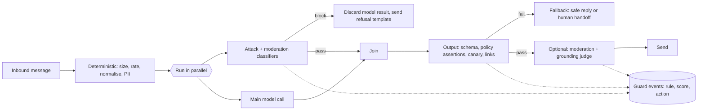

# LLM Security & Governance - Guardrails & Content Moderation

> [!info] Deep dive of [[LLM Security & Governance]]

> [!abstract] TL;DR
> - A guardrail is a **check that runs outside the main model call**: on the input before it, on the output after it. Deterministic checks first, small classifiers second, LLM judges last.
> - Guardrails enforce **business and content policy** and produce telemetry. They are **not** the security boundary against injection.
> - Three decisions matter more than the tool: **fail-open or fail-closed** per check, **what the user sees** on a block, and **how you measure false positives** in the languages your users write.

## Concept

### Check types by stage
| Stage | Check | Implementation | Catches | Misses |
|---|---|---|---|---|
| Input | Auth, rate limit, size cap | Code | Abuse volume, many-shot padding | Anything semantic |
| Input | Normalise and strip hidden text | Code | Invisible-character smuggling | Visible instructions |
| Input | Scope / topic | Small classifier or cheap LLM with enum output | Off-topic use ("write my essay") | Borderline topics |
| Input | Attack detection | Prompt Guard 2, Prompt Shields, Model Armor | Known injection and jailbreak styles | Novel and obfuscated attacks |
| Input | PII detection | Regex + Presidio → redact or tokenise | IDs, phones, emails, cards | Free-form sensitive facts |
| Both | Content moderation | Llama Guard 4, hosted moderation API | Hate, sexual, violence, self-harm, illicit | Your business rules |
| Output | Schema validation | Structured outputs + zod | Malformed or extra fields | Wrong values in valid shape |
| Output | **Policy assertions** | Code: amounts, dates, URLs, phone numbers must exist in context | Invented prices, links, contacts | Paraphrased false claims |
| Output | Prompt-leak canary | String match on a per-deployment token | Verbatim system-prompt dumps | Paraphrased leaks |
| Output | Grounding | NLI model or LLM judge against sources | Unsupported claims | Costs a model call |
| Output | Link / image allowlist | Code | Exfiltration via URLs | — |

### Ordering rule
Cheapest and most deterministic first. A regex that settles the question saves a model call, and a code check cannot be argued with.

### What generic moderation does not cover
Hosted moderation and Llama Guard classify **harm categories**. They know nothing about "never quote a price that is not in the catalogue", "do not mention competitors" or "no medical dosage advice". Those are custom rules: policy assertions in code, or a classifier given your own written policy.

## How It Works

- **Speculative execution**: start the main call while input classifiers run, then discard the result on a block. Latency becomes max(guard, model) instead of the sum, at the price of paying for discarded calls.
- **Verdict actions**: `block` (refuse), `redact` (continue with a cleaned version), `flag` (continue and log). Most checks should start as `flag` in shadow mode for one to two weeks so you can see false positives before users do.
- **Streaming**: output guards need the whole text. Either buffer and check before sending (always the case on WhatsApp), or stream with a holdback window of one sentence and cut the stream on a failed check. Tool calls must never be executed from a partially checked stream.

### Fail-open vs fail-closed
| Check | T1 (informational) | T2–T3 (acts, personal data, regulated) |
|---|---|---|
| Size, rate, auth | Closed | Closed |
| PII redaction | Closed | Closed |
| Policy assertions, schema | Closed | Closed |
| Moderation classifier outage | Open + alert | Closed |
| Attack classifier outage | Open + alert | Closed for tool-holding sessions |
| Grounding judge outage | Open + flag for review | Closed, route to human |

Fail-open without an alert is a silently removed control. Fail-closed without a fallback reply is an outage.

## Practical Usage

### Guard runner with per-check timeout and fail mode
```ts
type Verdict = { ok: boolean; rule: string; action: "block" | "redact" | "flag"; detail?: string };
type Guard = { name: string; failMode: "open" | "closed"; timeoutMs: number; run: (text: string, ctx: Ctx) => Promise<Verdict> };

export async function runGuards(guards: Guard[], text: string, ctx: Ctx): Promise<Verdict[]> {
  return Promise.all(guards.map(async (g) => {
    try {
      return await withTimeout(g.run(text, ctx), g.timeoutMs);
    } catch {
      metrics.inc("guard_unavailable", { guard: g.name });                  // alert on this counter
      const open = g.failMode === "open";
      return { ok: open, rule: `${g.name}:unavailable`, action: open ? "flag" : "block" };
    }
  }));
}
```

### Policy assertion: no amount the context does not contain
```ts
const MONEY = /RM\s?\d[\d,]*(?:\.\d{1,2})?/gi;
const norm = (s: string) => s.replace(/[\s,]/g, "").toUpperCase();

export function unsupportedAmounts(reply: string, context: string): string[] {
  const allowed = new Set((context.match(MONEY) ?? []).map(norm));
  return (reply.match(MONEY) ?? []).filter((m) => !allowed.has(norm(m)));
}
// reply "Delivery is RM 8.00 … Refund RM50", context has RM 8.00 only → ["RM50"] → block and hand off
```
The same shape works for dates, percentages, phone numbers, order IDs and URLs. It is the highest-value guard for a support bot and costs nothing per call.

### Self-hosted moderation classifier (OpenAI-compatible endpoint)
```ts
export const llamaGuard: Guard = {
  name: "llama-guard", failMode: "open", timeoutMs: 1500,
  async run(text) {
    const r = await fetch(`${process.env.GUARD_URL}/v1/chat/completions`, {
      method: "POST", headers: { "content-type": "application/json" },
      body: JSON.stringify({ model: process.env.GUARD_MODEL, max_tokens: 20, temperature: 0,
        messages: [{ role: "user", content: text }] }),
    });
    const [label, cats] = (await r.json()).choices[0].message.content.trim().split("\n");
    return { ok: label === "safe", rule: `llama-guard:${cats ?? ""}`, action: "block" };   // "unsafe\nS1,S10"
  },
};
```

### Prompt-leak canary
```ts
const CANARY = `cx-${tenantId}-${deploymentId}`;            // placed once inside the system prompt
if (output.includes(CANARY)) return { ok: false, rule: "prompt-leak", action: "block" };
```

### Block responses
```text
WRONG   "Your message was blocked by rule jailbreak_v3 (score 0.91)."      ← tells the attacker what to tune
RIGHT   "I can help with orders, delivery and returns for Kedai X. For anything else, type AGENT to reach our team."
```
Log the rule and score server-side. Show the user a fixed template with a route to a human.

## Patterns & Anti-patterns
| Pattern | When | Anti-pattern to avoid |
|---|---|---|
| Deterministic assertions before any model-based check | Always | LLM judge for something a regex can decide |
| Shadow mode first, then enforce | Every new rule or threshold | Turning on blocking with default thresholds |
| Per-check fail mode decided by tier, with an alert on unavailability | All guards | One global try/catch that swallows guard errors |
| Guard events as first-class telemetry (rule, score, action, tenant) | All tiers | Blocks that leave no trace |
| Custom policy as written rules + labelled examples, versioned with the prompts | Business rules | Stuffing "never do X" into the system prompt and calling it a guardrail |
| Fixed refusal template + human handoff | Customer-facing | Letting the main model write its own refusal after a block |
| Separate guard model from the main model | LLM-based checks | Asking the same call to grade itself |

## Performance & Trade-offs
| Option | Cost shape | Notes |
|---|---|---|
| Code checks | Microseconds | No reason to skip |
| Prompt Guard 2 (22M / 86M) | CPU-friendly small classifier | Meta positions the 22M model as up to 75% cheaper to run than the 86M one. Attack detection only |
| Llama Guard 4 (12B) | Needs a GPU, or a hosted endpoint | Text and image. 14 hazard categories. Too heavy for a CPU-only VPS |
| Hosted moderation API | One network round trip, often free or cheap | Content leaves your boundary: another data transfer to document |
| Cloud guardrail services (Bedrock Guardrails, Azure Prompt Shields, Google Model Armor) | Per-request pricing, managed | Strongest inside their own platform. Check whether they accept traffic for other providers' models |
| LLM judge (grounding, custom policy) | A full extra model call | Use the cheapest model that passes the judge-calibration set. Sample at T1, run always at T3 |
| Frameworks (NeMo Guardrails, Guardrails AI, LlamaFirewall) | Python service to run and upgrade | Worth it for dialog rails or many validators. A 100-line guard runner covers most SME bots |

- **False positives are the real cost.** Label 200+ real messages per client, including BM, Manglish and Chinese, and measure precision and recall per rule before enforcing.
- **Track block rate per tenant per day.** A sudden rise is either an attack or a broken threshold, and both need a human.
- **Discarded speculative calls** add spend in proportion to the block rate. At a 1% block rate the overhead is negligible; under attack it is not, so rate-limit first.

## Tips & Reminders
> [!tip]
> - Write each rule as a sentence a client can sign off: "The bot never states a price that is not in the product table."
> - Version guard prompts and thresholds like code, and run them through the same eval gate as the main prompt.
> - Keep guard logs short-lived and access-controlled. They concentrate the worst content and the most PII in one table.
> - A guard that never fires is either unnecessary or broken. Test each one with a known-bad case in CI.
> - Moderation categories differ per provider. Map them to your own policy table once, and store the mapped label.
> - **In ZP's stack**:
>   - [[n8n]] has a Guardrails node for quick input/output checks inside a workflow. Keep policy assertions in a Code node or a shared sub-workflow so every bot uses the same rules.
>   - A CPU-only KVM VPS runs code checks and a 22M classifier comfortably. Use a hosted endpoint for 12B-class moderation instead of renting a GPU.
>   - Store guard events in [[PostgreSQL]] next to the audit trail, keyed by tenant and conversation, with a retention job.
>   - For WhatsApp bots the handoff keyword and the refusal template are part of the approved message design, not an afterthought.

## Version Notes
| Component | Status (2026-11) |
|---|---|
| Llama Guard 4 (12B, multimodal), Prompt Guard 2, LlamaFirewall | Released 2025-04. Meta's pages still list them as current |
| NeMo Guardrails | 0.24.1 is the latest release found. 0.22.0 switched the built-in client to direct httpx calls for OpenAI-compatible endpoints |
| OWASP LLM Top 10 2026 | Guardrails map to prompt injection, sensitive information disclosure, improper output handling and misinformation |

> [!warning] Unverified — check before relying on this
> Current versions and terms of hosted moderation APIs, open-weight policy classifiers, Guardrails AI, LLM Guard and the cloud guardrail services were not verified this run. Check each vendor's docs before choosing.

## Critical Issues & Gotchas
> [!danger] Guardrail classifiers are bypassable by design
> Research in 2025 showed character-level tricks (emoji and Unicode smuggling, homoglyphs) evading several commercial and open-source injection detectors, some completely. A detector sees text differently from the model behind it, and that gap is the attack. Keep guardrails for policy and telemetry, and rely on [[LLM Security & Governance - Prompt Injection & Jailbreak Defense]] for containment.

> [!danger] A silent fail-open removes the control without anyone noticing
> A moderation endpoint that times out for a week, wrapped in a catch-all, means a week of unchecked output. Count every "unavailable" verdict, alert on the first one, and review the fail mode whenever a feature's tier changes.

> [!danger] Third-party moderation is another copy of the data
> Sending customer messages to a hosted moderation or guardrail service is a separate disclosure with its own retention terms, and for Malaysian personal data a cross-border transfer. List it in the client's data flow, redact before sending where possible, and prefer self-hosted classifiers for sensitive tenants.

> [!warning] Gotchas
> - English-trained classifiers lose accuracy on code-switched and low-resource input. Expect both more misses and more false blocks.
> - Over-blocking legitimate medical, legal or financial questions is the usual complaint. Give those intents an explicit allowed path.
> - A canary only detects verbatim leaks. Assume the prompt can be paraphrased out.
> - Guard and main model can disagree mid-conversation, which looks erratic to users. Keep refusal wording consistent.
> - Provider-side safety filters can also refuse (`stop_reason` of refusal). Handle that as a guard verdict with the same template.
> - Policy assertions need the *same* context the model saw. Checking against a fresh retrieval gives false failures.

## Related
- [[LLM Security & Governance]]
- [[LLM Security & Governance - Prompt Injection & Jailbreak Defense]] — why filters are not the boundary
- [[LLM Security & Governance - Data Privacy, PII & Provider Data Handling]] — redaction and tokenisation in depth
- [[LLM Security & Governance - Verifiable Outputs, Citations & Evidence Chains]] — grounding checks as evidence
- [[LLM APIs & SDKs - Structured Outputs & Tool Schemas]] — schema validation layer
- [[AI Evals & Observability - Eval Datasets & LLM-as-Judge]] — calibrating judge-based guards
- [[AI Agents - Customer Support Agents for WhatsApp & Messaging]] — handoff and refusal design
- [[n8n - AI Agent Nodes & LLM Workflows]] — Guardrails node

## References
- Meta Llama Protections (Llama Guard 4, Prompt Guard 2, LlamaFirewall): https://developer.meta.com/ai/llama-protections/
- Llama Guard 4 model card: https://developer.meta.com/ai/docs/model-cards-and-prompt-formats/llama-guard-4/
- LlamaFirewall paper: https://ai.meta.com/research/publications/llamafirewall-an-open-source-guardrail-system-for-building-secure-ai-agents/
- NeMo Guardrails release notes: https://docs.nvidia.com/nemo/guardrails/latest/release-notes.html
- NeMo Guardrails repository: https://github.com/NVIDIA-NeMo/Guardrails
- Microsoft Presidio: https://microsoft.github.io/presidio/
- Hackett et al., bypassing injection and jailbreak detection in guardrails: https://arxiv.org/abs/2504.11168
- TrueFoundry, benchmarking guardrail providers: https://www.truefoundry.com/blog/benchmarking-llm-guardrail-providers
- OWASP LLM Top 10: https://genai.owasp.org/llm-top-10/
