# LLM Security & Governance - Incident Response & Kill Switches

> [!info] Deep dive of [[LLM Security & Governance]]

> [!abstract] TL;DR
> - AI incidents are quiet. Nothing throws, the trigger may be a provider's change, and the damage may be one sentence sent to a thousand customers.
> - Before launch, have three things: **signals** that detect it, a **kill switch per feature** that works without a deploy and lands on a **degraded mode**, and a **runbook** with decision rights and notification clocks.
> - Contain first, **preserve evidence** before cleaning up, and turn every incident into a control fix plus a regression case.

## Concept

### Incident types
| Type | Example | First signal | First action |
|---|---|---|---|
| Wrong or harmful output at scale | Bot invents a refund policy. Extraction posts wrong amounts | Complaint, output-guard spike, QA sample failure | Feature to degraded mode. Find affected outputs in the decision log |
| Injection or abuse succeeded | Unauthorised tool call, data sent to an attacker | Gateway denials, odd tool arguments, canary hit | Tools off. Scope what was read and done |
| Data exposure | Cross-tenant answer, PII sent to an unapproved processor, staff paste | User report, trace review | Contain, then assess breach notification |
| Key compromise, cost abuse | Stolen provider key used by others | Spend or request-rate alert, 401s | Revoke and rotate. Contact the provider |
| Provider-side | Outage, silent behaviour change, retired model, account suspended | Error rate, eval drift, 404, refusals | Fallback route or previous pinned model |
| Supply chain | Compromised gateway package or tool server | Security advisory | Isolate the host. Rotate every secret it held |
| Runaway agent | Loop, mass messaging, destructive command | Turn, rate and spend caps | Kill the agent, revoke its credentials, restore |

### Severity and clocks
| Level | Definition | Act within | Tell the client within |
|---|---|---|---|
| SEV1 | Personal data exposed, money moved wrongly, safety risk, or ongoing attack | 15 minutes | 24 hours, or the contract's window |
| SEV2 | Wrong output reached users and was contained, or a degraded service | Same working day | Next working day |
| SEV3 | Caught by a control before any effect | Next working day | Monthly report |

### Kill-switch levels
| Level | Effect | Use for |
|---|---|---|
| L1 `read_only` | Model answers, every side-effect tool is disabled | Suspected injection, runaway agent |
| L2 `off` (feature) | Feature returns the fallback reply or hands off to a human | Wrong output at scale |
| L3 `off` (tenant) | One tenant's feature is off | Tenant-specific data problem |
| L4 `off` (all) | Every AI feature on fallback | Provider or supply-chain incident |
| L5 Credential revoke | Provider key or agent credential deactivated | Compromise |
| L6 Channel pause | Inbound webhook answered with a static notice | Nothing else can be trusted |

### Degraded modes worth building
| Mode | What the user gets |
|---|---|
| Human handoff | "Our team will reply shortly", with the conversation queued |
| Retrieval only | Matching source snippets or links, no generated text |
| Static FAQ | Fixed answers for the top intents |
| Manual processing | Documents queued for a person, with an honest time estimate |

## How It Works

```mermaid
flowchart LR
  DET["Detect: alert, report, auto-trip"] --> TRI["Triage in 15 min: tier, data exposed?, still happening?"]
  TRI --> CON["Contain: lowest kill-switch level that stops it"]
  CON --> PRE["Preserve: decision log, traces, provider message IDs. Pause pruning"]
  PRE --> ASS["Assess scope: tenants, records, actions taken"]
  ASS --> NOT["Notify: client, regulator and data subjects if required, provider"]
  NOT --> REC["Recover: fix the control, re-accept, re-enable by canary"]
  REC --> LRN["Review: timeline, failed control, regression case, runbook update"]
```

- **Contain at the lowest level that works.** Turning tools off keeps the bot useful while the investigation runs.
- **Preserve before repair.** A redeploy, a log-retention job or a helpful cleanup can erase the timeline you will be asked for.
- **Recovery is a release.** The fixed feature goes back through the acceptance and red-team gates, then returns by canary.

## Practical Usage

### Kill switch: strictest flag wins, and the flag store failing never re-enables tools
```ts
type Mode = "on" | "read_only" | "off";
const RANK: Record<Mode, number> = { on: 0, read_only: 1, off: 2 };
const last = new Map<string, Mode>();

export async function featureMode(feature: string, tenantId: string): Promise<Mode> {
  const key = `${feature}:${tenantId}`;
  try {
    const vals = await redis.mget("ai:kill:all", `ai:kill:${feature}`, `ai:kill:${feature}:${tenantId}`);
    const mode = (vals.filter(Boolean) as Mode[]).reduce<Mode>((a, b) => (RANK[b] > RANK[a] ? b : a), "on");
    last.set(key, mode);
    return mode;
  } catch {
    return last.get(key) === "off" ? "off" : "read_only";       // store down: answers may continue, actions may not
  }
}
```
```bash
redis-cli SET ai:kill:whatsapp-support read_only     # L1: tools off for one feature
redis-cli SET ai:kill:whatsapp-support off           # L2: fallback reply and human handoff
redis-cli SET ai:kill:all off                        # L4: every AI feature
redis-cli DEL ai:kill:whatsapp-support               # restore, only after re-acceptance
```
Every flip is appended to the decision log with who, when and why.

### Auto-trip rules, because nobody watches at 3 am
```ts
export function shouldTrip(m: Metrics): Mode | null {
  if (m.canaryHits > 0) return "off";                                     // system prompt or private canary leaked
  if (m.crossTenantRows > 0) return "off";
  if (m.spendLastHour > 3 * m.expectedSpendPerHour) return "read_only";
  if (m.deniedToolCalls15m >= 10) return "read_only";                     // someone is probing the gateway
  return null;
}
```

### Detection signals
| Signal | Threshold to start with | Likely meaning |
|---|---|---|
| Canary string in any output | 1 | Prompt or private-document leak |
| Rows returned for another tenant | 1 | Isolation failure |
| Provider 401 or 403 | 1 | Key revoked, leaked or account action |
| Provider 404 on a pinned model | 1 | Retirement or wrong ID |
| Spend per hour | 3× expected | Loop, abuse or stolen key |
| Guard block rate per tenant | 3× the 7-day baseline within 15 min | Attack, or a broken threshold |
| Denied tool calls | 10 in 15 min | Injection attempts reaching the gateway |
| Refusal or truncation rate | 2× baseline | Provider-side change |
| QA sample accuracy | Below the control limit | Drift in a segment |
| Outbound messages per minute | Above the channel cap | Runaway agent |

### Evidence to preserve
```text
[ ] Pause trace and log pruning jobs for the affected period
[ ] Export decision-log rows (with hashes) and matching traces for the window
[ ] Record provider message IDs, served model, prompt version, tool definitions in force
[ ] Snapshot the feature config, lock file, guard thresholds and kill-switch history
[ ] Copy the triggering inputs (documents, messages) to restricted storage
[ ] Note every manual action taken during response, with time and person
```

### Notification clocks
| Who | When | Trigger |
|---|---|---|
| Client | Within the contract window, commonly 24 hours from awareness | Any SEV1, and any incident touching their data |
| PDPA Commissioner | As soon as practicable. The guideline works to 72 hours | Personal data breach meeting the threshold |
| Affected individuals | Without unnecessary delay | Breach likely to cause significant harm |
| Model provider | Immediately | Key compromise, suspected provider-side fault |
| EU authority (high-risk systems) | Generally within 15 days, shorter for the gravest cases | Serious incident under the AI Act, Art. 73 |
| Insurer | Per policy | Anything that may become a claim |

The client, as data controller, normally files with the regulator. Your job is to give them facts fast enough that they can.

### Post-incident review, one page
```text
What happened      2–3 sentences, plain language
Timeline           From the decision log: first bad output → detection → containment → recovery
Impact             Tenants, records, actions, money
Detection gap      Why it took as long as it did
Failed control     The specific control, not "the AI"
Fix                Change at the control, with owner and date
Regression         Red-team or golden case ID added
Follow-ups         Contract, client report, runbook edits
```

## Patterns & Anti-patterns
| Pattern | When | Anti-pattern to avoid |
|---|---|---|
| Kill switch in a store outside the deploy path | Every T1+ feature | "We will push a hotfix" |
| Flag-store failure degrades to read-only | Always | A Redis outage silently re-enabling tools |
| Auto-trip on unambiguous signals | Solo or small teams | Paging a person to decide on a canary leak |
| Kill switch exercised monthly | Always | A switch first tested during an incident |
| Tabletop exercise per T2–T3 feature before launch | Go-live checklist | Reading the runbook for the first time under pressure |
| Blameless review that names a control | After every SEV1–2 | "The model hallucinated" as root cause |
| Queue drained or dead-lettered before re-enabling | Async pipelines | Old poisoned jobs replaying when the feature returns |

## Performance & Trade-offs
- **Cost of the check**: one `MGET` per request, well under a millisecond on the same network. Cache for a few seconds if volume demands, and accept that the switch then takes that long to bite.
- **Sensitivity**: tight auto-trip thresholds cause false shutdowns, and loose ones miss slow abuse. Start strict on unambiguous signals (canary, cross-tenant) and looser on statistical ones.
- **Degraded mode needs capacity.** Handing every conversation to a human works only if someone is there. State the expected response time in the fallback message.
- **Evidence retention vs minimisation**: an incident hold extends retention for the affected window. Record the hold and release it when the review closes.
- **A second provider** halves provider-side incident impact and doubles the testing surface. Worth it for T2–T3, optional below.

## Tips & Reminders
> [!tip]
> - Decide in advance who may flip which level. In a two-party setup, both the builder and a named client contact should be able to trigger L2.
> - Keep the runbook where it can be read when the main system is down.
> - Do not blame "the AI" in customer communication. Say what went wrong, what was affected and what changed.
> - A key that appears in any log, screenshot or chat message is compromised. Rotate first, investigate second.
> - Count near misses. A control that blocked something is the cheapest incident data available.
> - **In ZP's stack**:
>   - Flags live in [[Redis]]. Each [[n8n]] AI workflow starts with a node that reads the flag and branches to the fallback path.
>   - Emergency levers outside the app: a Cloudflare rule that returns a static notice on the chat endpoint, stopping the gateway service in [[Coolify]], and deactivating the provider key.
>   - Alerts go to a phone channel that wakes you. For a solo operator the auto-trip rules are the on-call rota.
>   - WhatsApp bots fall back to a fixed template and a staff handoff tag, which stays inside the channel's rules.

## Version Notes
| Item | Status (2026-11) |
|---|---|
| PDPA breach notification | Mandatory since the 2024 amendment was phased in. Guideline issued 2025-02 |
| EU AI Act Art. 73 | Serious-incident reporting for high-risk systems. Commission guidance was still a draft when last reported |
| AI Incident Database | 179 new incident IDs between 2026-08 and 2026-10, against 109 in 2026-02 to 2026-04 |

> [!warning] Unverified — check before relying on this
> PDPA timelines and the Article 73 application date were not re-verified against primary texts in this run. Incident details below come from secondary reports.

## Critical Issues & Gotchas
> [!danger] An agent with production credentials needs seconds, not hours
> In 2026-04 a coding agent deleted a startup's production database **and its backups** in about nine seconds, causing an outage of roughly 30 hours. A cloud provider's internal agentic tool was also reported to have caused a 13-hour service outage, after which human review became mandatory for AI-initiated production changes. No kill switch is fast enough for that. Keep destructive credentials out of an agent's reach, keep backups where the same credential cannot delete them, and require approval for irreversible operations.

> [!danger] Cleaning up destroys the evidence
> The instinct is to redeploy, purge the bad conversations and move on. That removes the timeline needed for the client report, a regulator's questions and your own root cause. Preservation is step three of the runbook, before any fix.

> [!danger] The clock starts when you become aware, not when you finish investigating
> Breach notification windows are short, and the client has duties of their own that depend on hearing from you. A solo builder who sees the alert the next morning has already spent part of the window. Auto-containment, a phone alert and a pre-written first notice to the client are what make the deadline achievable.

> [!warning] Gotchas
> - A fallback path that itself calls a model is not a fallback.
> - Turning a feature off does not stop jobs already queued. Pause the consumer as well.
> - Re-enabling without re-acceptance repeats the incident with better logging.
> - A provider can suspend an account for policy reasons with no warning. That is an L4 incident with no technical cause on your side.
> - Rotating a key in the secret store does nothing until the running services restart with it.
> - An incident in one tenant's data is still reportable to that tenant even when no regulator threshold is met.

## Related
- [[LLM Security & Governance]]
- [[LLM Security & Governance - Audit Trails & Decision Records]] — the source of the incident timeline
- [[LLM Security & Governance - Red Teaming & Security Testing]] — where incident cases go next
- [[LLM Security & Governance - LLM Gateway, API Keys & Call Hardening]] — key rotation and the gateway controls
- [[LLM Security & Governance - Acceptable Use Policy & Client Contracts]] — suspension right and notice windows
- [[LLM APIs & SDKs - Rate Limits, Retries & Provider Fallbacks]] — provider-side failures
- [[AI Evals & Observability - Cost Tracking & Budgets per Tenant]] — spend alerts
- [[Supabase - Data Retention, PDPA & Account Deletion]] — breach runbook for the data layer
- [[System Design - Reliability Patterns]] — degraded modes and circuit breakers

## References
- OECD AI incident record, coding agent deletes a production database and backups: https://oecd.ai/en/incidents/2026-04-27-6153
- BankInfoSecurity, AI agent wipes startup's data in a nine-second API call: https://www.bankinfosecurity.com/ai-agent-wipes-startups-data-in-9-second-api-call-a-31521
- AI Incident Database: https://incidentdatabase.ai
- AI Incident Database roundup, 2026-08 to 2026-10: https://incidentdatabase.ai/blog/incident-report-2026-august-september-october/
- EU AI Act, Article 73: https://artificialintelligenceact.eu/article/73/
- European Commission, draft guidance on serious AI incidents: https://digital-strategy.ec.europa.eu/en/consultations/ai-act-commission-issues-draft-guidance-and-reporting-template-serious-ai-incidents-and-seeks
- Malaysia PDP Commissioner: https://www.pdp.gov.my/
- NIST Computer Security Incident Handling Guide (SP 800-61): https://csrc.nist.gov/pubs/sp/800/61/r3/final
