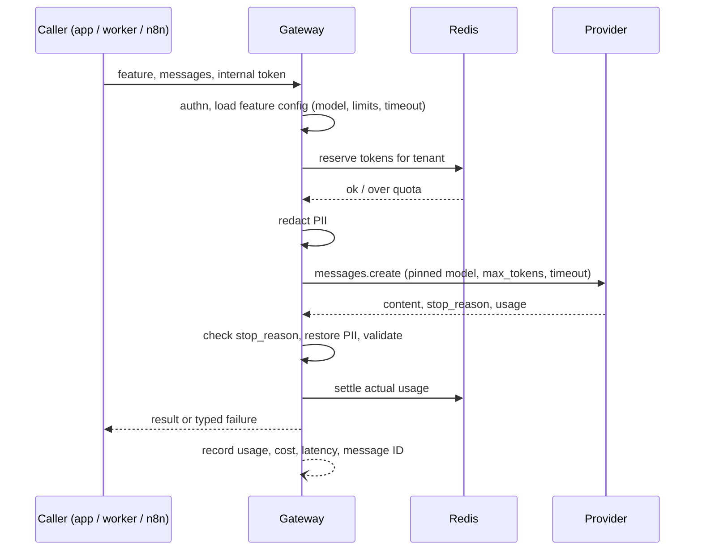

# LLM Security & Governance - LLM Gateway, API Keys & Call Hardening

> [!info] Deep dive of [[LLM Security & Governance]]

> [!abstract] TL;DR
> - **One place owns every provider call.** That gateway (a module or a small service) holds the keys, pins the model, applies quotas and redaction, sets timeouts, checks the response, and records usage.
> - **Keys**: one per environment and workspace, never in a browser bundle, mobile binary or workflow export, rotated on a schedule and on any doubt, with provider-side spend limits as the backstop.
> - **Every call**: explicit timeout, sized `max_tokens`, and a `stop_reason` check *before* the content is parsed or acted on.

## Concept

### Where the gateway lives
| Option | Strength | Weakness | Pick it when… |
|---|---|---|---|
| In-process module (`ai/gateway`) | No extra hop, no new service | Only covers one codebase | A single Next.js or Node app |
| Own gateway service ([[Node.js - Hono APIs on Node, Bun & Workers]]) | One policy for app, workers and n8n. Keys exist in one container | You run and secure it. Single point of failure | Several callers share models and budgets |
| Cloudflare AI Gateway | Managed: caching, rate limiting, logs, BYOK via Secrets Store, DLP, dynamic routing | Every prompt transits another processor. Policy is per gateway, not your tenant model | You want analytics and caching fast, and the data may pass through Cloudflare |
| LiteLLM proxy (self-hosted) | Virtual keys, budgets, 100+ providers behind one API | **Two supply-chain compromises in 2026.** Python service to patch | You need multi-provider virtual keys and can pin and isolate it |
| Hosted aggregator (OpenRouter-style) | One key, many models | Markup, plus one more company holding your prompts | Prototypes and model comparisons |

### What the gateway owns
| Concern | Mechanism |
|---|---|
| Credentials | Provider keys exist only here. Callers present an internal token or the user's JWT |
| Model pinning | Feature name → model ID from a lock file. Callers cannot pass an arbitrary model |
| Quotas | Per tenant and user: tokens per day, requests per minute, concurrency. Checked before the call |
| Redaction | PII tokenised before send, restored after ([[LLM Security & Governance - Data Privacy, PII & Provider Data Handling]]) |
| Call settings | Timeout, retries and `max_tokens` per feature |
| Response checks | `stop_reason`, schema, guardrail hooks |
| Records | Usage, cost, latency, model, prompt version and message ID per call |
| Controls | Kill switch per feature, fallback chain ([[LLM APIs & SDKs - Rate Limits, Retries & Provider Fallbacks]]) |

### Key hygiene
| Rule | Why | How |
|---|---|---|
| One key per environment and workspace | Blast radius and attribution | Dev, staging, prod. A workspace per client when budgets or data must stay separate |
| Client-funded production runs on the **client's** provider account | Billing, data ownership, clean offboarding | They invite you to a workspace. You never hold their org-admin credential |
| Never ship a key to a client device | Bundles and binaries are readable | Browser and mobile apps call your backend, which calls the gateway |
| Keep keys out of git and exports | Scrapers find a pushed key within minutes | Secret store or platform env, `.env` ignored, push protection on the repo |
| Rotate every 90 days, on offboarding, and on doubt | Limits the life of an unnoticed leak | Two-key overlap: create B → deploy → deactivate A |
| Provider-side spend limit and alerts | Your own quota code can be bypassed by a stolen key | Workspace spend and rate limits in the provider console |
| Short-lived credentials for CI | No long-lived secret to steal | Workload identity federation where the provider offers it |

## How It Works

The caller never sees a provider key, a provider error body or a raw refusal. It gets a result or one of a small set of typed failures it must handle.

## Practical Usage

### Gateway call with stop-reason and error handling
```ts
import Anthropic from "@anthropic-ai/sdk";

const client = new Anthropic({ maxRetries: 2, timeout: 60_000 });   // key from env. SDK defaults: 2 retries, 10 min

export async function call(req: GatewayRequest): Promise<GatewayResult> {
  const f = FEATURES[req.feature];                                   // model and limits come from config, never the caller
  await quota.reserve(req.ctx.tenantId, f.maxInputTokens + f.maxOutputTokens);
  const started = Date.now();
  try {
    const res = await client.messages.create(
      { model: f.model, max_tokens: f.maxOutputTokens, system: f.system, messages: req.messages },
      { timeout: f.timeoutMs },
    );
    await usage.record({ ...req.ctx, feature: req.feature, model: res.model, messageId: res.id,
      usage: res.usage, ms: Date.now() - started });

    switch (res.stop_reason) {
      case "end_turn":
      case "stop_sequence":
      case "tool_use":   return { ok: true, message: res };
      case "max_tokens": return { ok: false, reason: "truncated" };          // never parse a cut-off answer
      case "refusal":    return { ok: false, reason: "refused", category: res.stop_details?.category ?? null };
      case "pause_turn": return { ok: false, reason: "paused" };
      default:           return { ok: false, reason: "unknown_stop" };
    }
  } catch (e) {
    if (e instanceof Anthropic.RateLimitError) return { ok: false, reason: "rate_limited" };
    if (e instanceof Anthropic.AuthenticationError) { await alert.page("LLM key rejected"); return { ok: false, reason: "auth" }; }
    if (e instanceof Anthropic.BadRequestError) return { ok: false, reason: "bad_request" };
    if (e instanceof Anthropic.APIError) return { ok: false, reason: `provider_${e.status}` };
    throw e;
  }
}
```

### Per-call checklist
| Setting | Rule | Why |
|---|---|---|
| `timeout` | Explicit per feature, in milliseconds in the TypeScript SDK | The default is 10 minutes. A chat reply needs 20–60 s |
| `maxRetries` | Keep the SDK's 2 for interactive calls. Set 0 inside queue workers that retry themselves | Timeouts are retried too, so wall-clock can reach timeout × (retries + 1) |
| `max_tokens` | Size to the task: ~256 for classification, ~16,000 for general non-streaming | Too low truncates. Very large values need streaming |
| `stop_reason` | Handle all six values before reading `content` | `max_tokens` and `refusal` arrive as HTTP 200 |
| Sampling params | Do not send `temperature`, `top_p`, `top_k` to current Claude models | They return a 400, and API version `2026-10-21` rejects them on every model |
| Input caps | Max characters per message, turns per conversation, attachment size and pages | Cost abuse and many-shot padding |
| Side effects | Idempotency key on every tool that writes | A retried turn must not refund twice |
| Streaming | Pass an abort signal and cancel on client disconnect | You pay for tokens nobody reads |
| SDK version | Pin it and read the changelog before upgrading | API versions change request rules |

Determinism does not come from temperature. It comes from structured outputs, validation in code and storing the output you acted on.

### Zero-downtime key rotation
```text
1. Create key B in the same workspace (console, or the Admin API with an admin credential)
2. Set the new value in the secret store, redeploy the gateway, confirm traffic on B in the usage view
3. Deactivate key A. Delete it after 24 h without errors
4. Write the date, the key name and who rotated it into the key register
```

### CI guard: no provider key may reach the browser bundle
```bash
! grep -rnE "NEXT_PUBLIC_[A-Z_]*(ANTHROPIC|OPENAI|GEMINI|LLM)[A-Z_]*" .env* src 2>/dev/null
```

## Patterns & Anti-patterns
| Pattern | When | Anti-pattern to avoid |
|---|---|---|
| Feature name in, pinned model out | Always | Callers passing `model` strings from request bodies |
| Typed failures (`truncated`, `refused`, `rate_limited`, …) with a defined fallback for each | Always | `try { JSON.parse(text) } catch { retry }` on a truncated answer |
| Pre-flight quota reserve, settle with real usage | Multi-tenant | Finding the overrun on the monthly invoice |
| A workspace and key per client | Agency and SaaS work | One key for every client: shared rate limit, no attribution |
| Gateway on a private network, no public route | Own service | Exposing the gateway with a static bearer token |
| Egress allowlist from the gateway to provider hosts only | Self-hosted gateways | A gateway container that can reach the whole internet |
| Pin gateway dependencies by hash or image digest | LiteLLM, any proxy | `pip install -U` or `:latest` on the box that holds every key |

## Performance & Trade-offs
- **Latency**: an in-process module adds nothing. A gateway on the same Docker network adds about a millisecond. A managed edge proxy adds a network hop but can serve cache hits without a model call.
- **Availability**: a gateway service is a single point of failure for every AI feature. Run two replicas, or keep the in-process module as the fallback path.
- **Managed proxy cost**: Cloudflare's unified billing (open beta since 2025-11) charges a 5% fee on purchased credits. Its DLP scanning is free on all plans, with two predefined profiles unless you have Zero Trust.
- **Quota accuracy**: reserving the worst case (`max input + max output`) rejects some requests that would have fit. `messages.countTokens` gives the real input size when that matters.
- **Rotation overhead**: about ten minutes per key per quarter. Skipping it costs nothing until the day it costs everything.

## Tips & Reminders
> [!tip]
> - Alert on request count and on unusual models or regions, not only on spend. Attackers test stolen keys with one-token calls that stay under cost alerts.
> - Keep a key register: name, workspace, where deployed, owner, created, last rotated.
> - Treat `401` from a provider as a page, not a log line. It usually means a revoked or leaked key.
> - A gateway log with full prompts is a second PII store. Log hashes and IDs, and put content in the access-controlled trace store.
> - Reverse proxies that buffer responses break streaming. Check the proxy's flush behaviour when tokens arrive in one burst.
> - **In ZP's stack**:
>   - Run the gateway as a small Hono service on [[Coolify]], attached to the internal Docker network only. No [[Traefik]] router, so nothing outside the host can reach it.
>   - Provider keys live in Coolify environment secrets for that one service. The Next.js app and [[n8n]] hold only the internal token.
>   - Point n8n model credentials at the gateway's base URL, or call it with an HTTP Request node, so workflows get the same quota, redaction and logging.
>   - Quotas and the kill switch sit in [[Redis]]. Usage rows go to [[PostgreSQL]] ([[AI Evals & Observability - Cost Tracking & Budgets per Tenant]]).
>   - Flutter apps never embed a provider key. `--dart-define` values are readable in the shipped binary.

## Version Notes
| When | What changed |
|---|---|
| 2025-08 | Cloudflare AI Gateway adds BYOK through Secrets Store |
| 2025-11 | Cloudflare unified billing in open beta, with an opt-in zero-data-retention route for supported upstreams |
| 2026-03-24 | LiteLLM 1.82.7 and 1.82.8 on PyPI carried a credential stealer, traced to a compromised CI security scanner. 1.82.6 was the last clean release |
| 2026-08-26 | Anthropic Admin API available in all official SDKs: workspaces, API keys and rate-limit reports can be managed in code |
| 2026-10-21 | Malicious LiteLLM 1.107.0 and Docker images published about an hour after clean 1.106.2 |
| 2026-10-21 (API version) | Claude Messages requests that send sampling parameters are rejected |
| 2026-11-02 | Google threat intelligence report on LLMjacking: stolen keys resold through illicit gateways |

> [!warning] Unverified — check before relying on this
> The current LiteLLM package status and Cloudflare AI Gateway's 2026 feature set were not confirmed from primary sources this run. Check the project advisories and the Cloudflare changelog before adopting either.

## Critical Issues & Gotchas
> [!danger] LLMjacking: a leaked key becomes a five- or six-figure bill within hours
> Incident responders reported fraudulent usage above USD 100,000 per day and one attacker making over 500,000 calls in under eight hours, with keys harvested from public repositories and resold. Valid credentials and normal API calls leave no malware to detect. Set provider-side spend caps per workspace, restrict what each key may call where the provider allows it, alert on request-rate anomalies, and rotate immediately on any exposure.

> [!danger] The gateway is the highest-value target you run
> LiteLLM was backdoored twice in 2026 through its release pipeline, and both payloads stole cloud keys, SSH keys and `.env` files. A proxy holds every provider credential by design. Pin by hash or digest, upgrade deliberately, block outbound traffic except provider API hosts, and if you ran an affected version treat every secret on that machine as stolen.

> [!danger] Keys in client code are public
> A `NEXT_PUBLIC_` variable is inlined into the browser bundle, and strings inside a mobile binary are extracted with standard tools. There is no obfuscation that survives a motivated user. All model calls go through your backend with the user's own authentication and rate limits.

> [!warning] Gotchas
> - Retries multiply: SDK retries × queue retries × workflow retries can turn one failure into dozens of billed calls. Decide which layer retries.
> - A response cut at `max_tokens` is often valid-looking partial JSON. Check the stop reason first, then parse.
> - Provider rate limits apply per organisation or workspace. Without a per-tenant limiter, one noisy tenant starves the rest.
> - Hard-coded keys inside n8n HTTP Request nodes travel with every workflow export. Use credentials, which exports reference by name only.
> - An aggregator or managed proxy is one more party processing personal data. List it in the client's data flow.
> - Fallback to another provider changes retention terms, region and behaviour. The fallback needs the same review as the primary.

## Related
- [[LLM Security & Governance]]
- [[LLM APIs & SDKs]] — provider feature map and SDK basics
- [[LLM APIs & SDKs - Rate Limits, Retries & Provider Fallbacks]] — backoff, circuit breaker, fallback chain
- [[AI Evals & Observability - Cost Tracking & Budgets per Tenant]] — usage ledger and pre-flight budgets
- [[REST API - Rate Limiting & API Keys for Public APIs]] — issuing and limiting your own keys
- [[LLM Security & Governance - Data Privacy, PII & Provider Data Handling]] — redaction at the gateway
- [[LLM Security & Governance - Model Migration, Deprecation & Version Pinning]] — the lock file the gateway reads
- [[LLM Security & Governance - Incident Response & Kill Switches]] — what to do when a key leaks

## References
- Claude API errors: https://platform.claude.com/docs/en/api/errors
- Claude API rate limits: https://platform.claude.com/docs/en/api/rate-limits
- Anthropic Admin API guide: https://platform.claude.com/docs/en/manage-claude/admin-api
- Anthropic workspaces: https://platform.claude.com/docs/en/manage-claude/workspaces
- Cloudflare AI Gateway features: https://developers.cloudflare.com/ai-gateway/features/
- Cloudflare AI Gateway changelog: https://developers.cloudflare.com/ai-gateway/changelog/
- Cloudflare AI Gateway pricing: https://developers.cloudflare.com/ai-gateway/pricing/
- Simon Willison on the malicious LiteLLM release: https://simonwillison.net/2026/Mar/24/malicious-litellm/
- Socket, LiteLLM PyPI package and Docker images compromised: https://socket.dev/blog/litellm-compromise
- OSV advisory PYSEC-2026-2: https://osv.dev/vulnerability/PYSEC-2026-2
- BleepingComputer, LLMjacking attacks rack up USD 1 million in charges: https://www.bleepingcomputer.com/news/security/google-llmjacking-attacks-rack-up-1-million-in-cloud-ai-charges/
- CSA research note on LLMjacking: https://labs.cloudsecurityalliance.org/research/csa-research-note-llmjacking-offensive-ai-tooling-20260618-c/
