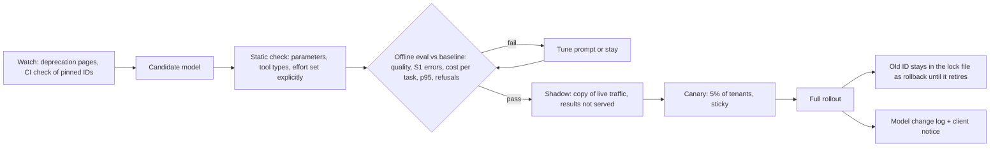

# LLM Security & Governance - Model Migration, Deprecation & Version Pinning

> [!info] Deep dive of [[LLM Security & Governance]]

> [!abstract] TL;DR
> - A model is a **dependency with an expiry date**. Recent Claude models were retired 12–14 months after release, and a retired ID returns a 404.
> - **Pin an exact ID per feature** in a lock file, track retirement dates, and record the model each response reports.
> - A new model is **not a string swap**: parameters get rejected, defaults move, tokenizers change cost, tuned prompts misfire. Treat every change as a release: static check → eval gate → shadow → canary → rollout, with a rollback path.

## Concept

### Kinds of change
| Change | Triggered by | Notice | What breaks |
|---|---|---|---|
| Forced retirement | Provider | Months, via a deprecation notice | Hard stop on the date |
| Voluntary upgrade | You | — | Regressions you did not test for |
| Silent drift | Provider: alias repointed, safety layers updated | None | Behaviour under an unchanged ID |
| Provider switch | You: outage, price, client demand | — | API shape, retention terms, prompt behaviour |
| Platform variance | Cloud platform | Their own schedule | Dates and IDs differ from the first-party API |

### Pinning rules by provider
| Provider | What to pin | Trap |
|---|---|---|
| Claude (first-party API) | Current models use a version ID with **no date suffix** (`claude-opus-5-5`). Older generations have a dated full ID behind an alias (`claude-haiku-4-5` → `claude-haiku-4-5-20251001`) | Inventing a date suffix returns a 404 |
| OpenAI | Dated snapshot, not the family alias | Alias repoints when a new snapshot ships |
| Gemini | Stable version, not `-latest` or preview | Gemini API and Vertex AI can list different retirement dates |
| Bedrock / Vertex | Platform-specific ID format (`anthropic.` prefix, `@` date separator on older Vertex IDs) | Retirement schedule set by the platform |

### What changes between versions besides quality
| Area | Example from Claude releases 2025–26 | Effect |
|---|---|---|
| Rejected parameters | `budget_tokens`, sampling parameters, assistant prefill, forced `tool_choice` on the newest tiers | HTTP 400 on the first request |
| Silent defaults | Effort default dropped from `high` to `medium` on one Opus release. Thinking display defaults to omitted | Different quality, cost and latency with no error |
| Tokenizer | One Sonnet release counted about 30% more tokens for the same text | Budgets, context limits and cost shift at an unchanged price |
| Prompt behaviour | Prompts full of `CRITICAL` and `MUST` over-trigger on newer models | Regressions that look like model faults |
| Caches | Prompt caches are scoped to the model | First requests after a switch pay cache-write prices |
| Safety layers | New refusal categories | More `stop_reason: "refusal"` on some routes |
| Tool versions | Tool `type` strings change between generations | 400, or the tool silently unavailable |
| Reasoning state | Thinking blocks are tied to the model that wrote them | A fallback model runs without that context |

## How It Works

- **Baseline first.** The acceptance result of the current model is the bar ([[LLM Security & Governance - Accuracy Assurance for Critical Workflows]]). No baseline means no way to tell improvement from regression.
- **Shadow** compares real traffic without user impact and costs double for its duration. A few days on representative load is enough.
- **Canary by tenant, not by request**, so one customer does not see two behaviours in one conversation.
- **Rollback is a config change**, which only works while the old model is still served. Start migrations early enough to keep that option.

## Practical Usage

### Lock file: the only place a model ID is written
```json
{
  "invoice-extract": {
    "provider": "anthropic", "model": "claude-opus-5-5", "effort": "medium",
    "prompt": "invoice-extract@v5", "accepted": "2026-10-12", "retires": null
  },
  "whatsapp-intent": {
    "provider": "anthropic", "model": "claude-haiku-5-5", "effort": "low",
    "prompt": "intent@v9", "accepted": "2026-10-20", "retires": null,
    "canary": { "model": "claude-sonnet-5-5", "percent": 5 }
  }
}
```
Effort is written explicitly because defaults differ between models. `accepted` points at the acceptance report for that model and prompt pair.

### CI check: every pinned model is still served
```ts
import Anthropic from "@anthropic-ai/sdk";
const client = new Anthropic();

for (const [feature, f] of Object.entries(lock)) {
  try {
    await client.models.retrieve(f.model);
  } catch (e) {
    if (e instanceof Anthropic.NotFoundError) fail(`${feature}: ${f.model} is not served`);
    else throw e;
  }
  if (f.retires && daysUntil(f.retires) < 90) warn(`${feature}: ${f.model} retires on ${f.retires}`);
}
```
Run it nightly, not only on pull requests. Retirement happens on the provider's calendar, not yours.

### Promotion gate
```ts
const gate = (base: Run, cand: Run) =>
  cand.s1Errors === 0 &&
  wilson(cand.correct, cand.n).low >= base.threshold &&      // same bar as the original acceptance
  cand.costPerTask <= base.costPerTask * 1.15 &&
  cand.p95Ms <= base.p95Ms * 1.2 &&
  cand.refusalRate <= base.refusalRate + 0.005;
```
Compare cost per completed task, never price per token. A tokenizer change or a different retry rate moves the first without touching the second.

### Sticky canary
```ts
import { createHash } from "node:crypto";
const bucket = (tenantId: string) => createHash("sha256").update(tenantId).digest().readUInt16BE(0) % 100;

export function pickModel(feature: string, tenantId: string) {
  const f = lock[feature];
  return f.canary && bucket(tenantId) < f.canary.percent ? f.canary.model : f.model;
}
```

### Migration diff checklist
```text
[ ] Request: removed or renamed parameters, thinking config, tool type strings, beta headers
[ ] Effort set explicitly. max_tokens and budgets re-measured with the token-counting endpoint
[ ] stop_reason: any new value handled (refusal categories, context-window stops)
[ ] Prompt audit: remove workarounds written for the old model, soften shouted instructions
[ ] Cache: expect cold caches on switch day, pre-warm high-volume prefixes
[ ] Rate limits: the new model may sit in a separate limit pool or tier
[ ] Fallback chain: the request must also be valid for the fallback model
[ ] Golden + red-team sets re-run. Judge model unchanged during the comparison
[ ] Lock file, model change log and decision-record fields updated
[ ] Client notified as the contract requires. Acceptance report filed
```

### Provider adapters
```text
caller → gateway (internal request shape: messages, tools, output schema, feature name)
            ├── anthropic adapter   (maps to Messages API, handles refusal + thinking)
            ├── openai adapter
            └── gemini adapter
```
Keep provider-specific fields inside the adapter. An internal shape that is only the lowest common denominator throws away features you pay for, so allow per-adapter options behind the feature config.

## Patterns & Anti-patterns
| Pattern | When | Anti-pattern to avoid |
|---|---|---|
| One lock file, read by the gateway | Always | Model IDs scattered through code, env vars and workflow nodes |
| Nightly existence check plus a retirement calendar | Always | Learning about a retirement from a production 404 |
| Eval gate with the original acceptance bar | Every change | "It looked fine on five examples" |
| Step through versions in order when several were skipped | Old integrations | Jumping four generations and debugging stacked changes at once |
| Record `response.model` on every call | Always | Trusting that the configured ID is what served the request |
| Migrate on your schedule, months before retirement | Planned work | Migrating in the last week with no rollback left |
| Separate change for prompt and for model | Debuggability | Changing both in one release |

## Performance & Trade-offs
- **Lifetime on recent Claude models**: Sonnet 3.7 and Opus 4.1 lasted 12 months, Sonnet 4 about 13, Sonnet 4.5 about 14. Plan one migration per feature per year as a baseline.
- **Skipping versions saves effort now and stacks breaking changes later.** A jump over four releases means applying each release's changes in order.
- **Shadow cost** is one extra model call per request for the test period. Sample if the feature is high-volume.
- **Cache reset** on switch day raises cost and latency until prefixes are rewritten. Schedule the switch for low traffic.
- **Newer and cheaper can coincide.** Several 2026 Claude successors launched at lower prices than the model they replaced, so staying put can cost more.
- **Adapters lag.** Third-party abstraction libraries support new provider features weeks or months late. A thin adapter you own avoids waiting.

## Tips & Reminders
> [!tip]
> - Inventory every place a model name lives: code, environment variables, workflow nodes, client-side config, eval scripts, judge prompts.
> - Subscribe to each provider's deprecation page and put the dates in a shared calendar with a 90-day reminder.
> - Keep the judge model fixed while comparing candidates, and re-calibrate the judge as its own change.
> - A fine-tuned model retires with its base model. Keep the training data and the script that rebuilds it.
> - Changing an **embedding** model is a full re-index, not a config change. Old and new vectors are not comparable.
> - On a client-owned account, confirm the client has access to the target model before planning the date.
> - **In ZP's stack**:
>   - [[n8n]] model nodes hold model names per workflow. Route them through the gateway by feature name so a migration is one lock-file change.
>   - Keep `models.lock.json` and `model-change-log.md` in the client's repository, reviewed like code.
>   - Price a yearly migration per AI feature into retainers. It is predictable work, and unbilled it erodes margin.
>   - The canary bucket uses tenant ID, which matches how [[Supabase]] RLS already scopes data.

## Version Notes
| Date | Event |
|---|---|
| 2026-01-05 → 2026-08-05 | Claude Opus 3, Sonnet 3.7, Haiku 3.5, Haiku 3, Sonnet 4, Opus 4 and Opus 4.1 retired in sequence. Requests to them return 404 |
| 2026-02-13 | OpenAI removed GPT-4o, GPT-4.1 and o4-mini from ChatGPT. The API was unaffected at that time |
| 2026-10-21 (API version) | Claude Messages requests sending sampling parameters are rejected on every model |
| **2026-11-30** | Claude Sonnet 4.5 retires. Fast mode on Claude Opus 4.8 is removed the same day |
| 2026-12-11 | OpenAI removes older GPT-5 and o3 snapshots from the API (notice given 2026-06-11) |

> [!warning] Unverified — check before relying on this
> - OpenAI and Gemini dates come from partial page snapshots and secondary reports. One snapshot listed Gemini 2.5 Pro and Flash for shutdown on 2026-10-16, and the Gemini API and Vertex AI pages disagreed on another model.
> - Bedrock and Vertex set their own retirement dates for Claude models.
> - Read the provider's live deprecation page before planning.

## Critical Issues & Gotchas
> [!danger] Retirement is a hard stop
> On the Claude API a retired model ID returns 404, on a published date, for every request. A forgotten workflow or a hard-coded ID in one client's deployment fails completely that morning. Keep the inventory, run the nightly check, and finish migrations while the old model is still available for rollback.

> [!danger] Migrating without a baseline moves the testing to your customers
> A model that scores higher on public benchmarks can still do worse on your prompts: more refusals on one intent, different formatting, a tool called less often. Without a golden set and the previous acceptance result, the first evidence is a complaint. No baseline, no migration, except under a retirement deadline with heightened human review.

> [!danger] The same name can mean a different model
> Aliases are repointed, platforms roll out at different times, and fallbacks serve another model for part of the traffic. Pin exact IDs, log the served model per response, and alert when the served model differs from the lock file.

> [!warning] Gotchas
> - A fallback request must be valid for the fallback model. Parameters accepted by the primary can be a 400 on the fallback.
> - Token budgets and context checks written in tokens silently change meaning when the tokenizer changes.
> - Removing a workaround prompt is part of the migration. Left in place it can make the new model worse.
> - SDK major upgrades change defaults and API versions. Do not combine one with a model change.
> - Eval scores from different judge models are not comparable. Freeze the judge during a migration.
> - A contract that names a specific model ties you to its retirement date. Name the capability and the acceptance bar instead.

## Related
- [[LLM Security & Governance]]
- [[LLM Fundamentals - Model Selection & Routing]] — choosing the target model per route
- [[LLM APIs & SDKs - Rate Limits, Retries & Provider Fallbacks]] — runtime failover between models
- [[AI Evals & Observability - Eval Datasets & LLM-as-Judge]] — the golden set behind the gate
- [[Prompt Engineering - System Prompts, Few-shot & Prompt Versioning]] — versioning the prompt half of the pair
- [[Fine-tuning LLMs]] — base-model retirement for tuned models
- [[LLM Security & Governance - Accuracy Assurance for Critical Workflows]] — the acceptance bar reused here
- [[LLM Security & Governance - Acceptable Use Policy & Client Contracts]] — model-change clause

## References
- Claude model deprecations: https://platform.claude.com/docs/en/about-claude/model-deprecations
- Claude models overview: https://platform.claude.com/docs/en/about-claude/models/overview
- OpenAI API deprecations: https://developers.openai.com/api/docs/deprecations
- OpenAI, retiring GPT-4o and older models in ChatGPT: https://openai.com/index/retiring-gpt-4o-and-older-models
- Gemini API deprecations: https://ai.google.dev/gemini-api/docs/deprecations
- Gemini 2.5 Flash-Lite retirement date discussion: https://discuss.ai.google.dev/t/gemini-2-5-flash-lite-retirement-date-different-for-gemini-api-vs-vertex-ai/177897
