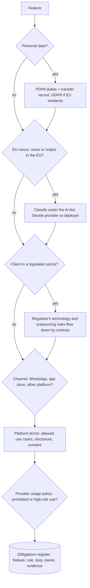

# LLM Security & Governance - Regulations, Standards & Platform Policies

> [!info] Deep dive of [[LLM Security & Governance]]

> [!abstract] TL;DR
> - Three layers of rules bind an LLM product: **law** where the users are, the **client's sector regulator**, and **private rules** from the model provider, the messaging channel and the app stores.
> - The private rules bite fastest. A platform can end a product category with one terms update, as WhatsApp did for general-purpose assistants in 2026-01.
> - Map every feature to the three layers **before quoting**, and keep the result as an obligations register per client.

> [!warning] Engineering guidance, not legal advice. Dates and scope below come largely from law-firm summaries. Confirm with counsel before relying on them in a contract.

## Concept

### Applicability map
| Rule set | Applies when | Kind | Status (2026-11) | What it asks of a small builder |
|---|---|---|---|---|
| **PDPA 2010, amended 2024** (Malaysia) | Personal data processed in commercial transactions | Law | In force, phased through 2025 | Notice and consent, security, retention, processor duties, breach notification, DPO above the threshold, records of cross-border transfers |
| Malaysia AIGE guidelines (2024) | Any AI system | Voluntary | Published | Seven principles. Public-sector and GLC buyers ask for alignment |
| **Malaysia AI Governance Bill** | To be defined | Draft law | Consultation 2026-07. Not tabled. Parliament targeted for early 2027 | Three proposed risk tiers. May reach Malaysia-based deployers of systems hosted abroad |
| Bank Negara Malaysia | Client is a regulated financial institution or payment regulatee | Regulator | RMiT revised 2026-09-25. AI discussion paper 2025-08, feedback statement 2026-11-19 | Technology and third-party risk rules flow down to vendors by contract. AI-specific requirements still forming |
| Consumer Protection Act 1999 | Statements to consumers | Law | In force | No false or misleading representations. A bot's answer is the business's statement |
| **EU AI Act** | System placed on the EU market, or its output used in the EU | Law | Phased, see below | Depends on risk class and on whether you are provider or deployer |
| GDPR | Personal data of people in the EU | Law | In force | Lawful basis, DPIA, transfer rules, rights around automated decisions |
| ISO/IEC 42001:2023 | Contract or tender requires it | Standard | Published | A certifiable AI management system |
| NIST AI RMF 1.0 + AI 600-1 | Chosen as the risk framework | Voluntary | Published | Govern, Map, Measure, Manage |
| Model provider usage policy | Always: it is your contract with the provider | Contract | Updated by the provider at will | Prohibited uses. Extra duties for high-risk consumer-facing uses, typically human review plus AI disclosure |
| **WhatsApp Business Solution Terms** | Bot runs on WhatsApp | Contract | General-purpose AI assistants barred since 2026-01-15 | Bot must serve the business's own defined tasks |
| App store rules | Mobile app with AI features | Contract | In force | Disclose and get consent before personal data goes to a third-party AI. Reporting route for generated content |

### EU AI Act in one table
| Class | Examples | Duty | Applies from |
|---|---|---|---|
| Prohibited (Art. 5) | Social scoring, manipulative techniques, emotion recognition at work or school, untargeted face scraping | Do not build | 2025-02-02 |
| AI literacy (Art. 4) | Any provider or deployer | Staff who operate AI are trained for it | 2025-02-02 |
| General-purpose models | Model providers | Documentation, copyright policy, systemic-risk duties | 2025-08-02 |
| **Transparency (Art. 50)** | Chatbots, generated or manipulated content, emotion recognition | Tell people they are dealing with AI. Mark synthetic output. Label deepfakes | 2026-08-02. Legacy generative systems have until 2026-12-02 for marking |
| High-risk, Annex III | Hiring, education, credit and essential services, biometrics, critical infrastructure | Risk management, data governance, logging, human oversight, registration | 2027-12-02 after the Omnibus delay |
| High-risk, Annex I products | AI inside regulated products | Same, via product legislation | 2028-08-02 |
| Minimal | Everything else | None beyond general law | — |

**Provider or deployer**: you are a *provider* if you place a system on the market under your own name, including a white-labelled or substantially modified one. A client using your system in their business is the *deployer*. Provider duties are the heavier set.

### Article 50 in practice
| Paragraph | Who | Duty |
|---|---|---|
| 50(1) | Provider of a system that interacts with people | People are informed they are interacting with an AI, unless obvious |
| 50(2) | Provider of a generative system | Output is marked as artificial in a machine-readable way |
| 50(3) | Deployer of emotion recognition or biometric categorisation | Affected people are informed |
| 50(4) | Deployer publishing deepfakes, or AI text on matters of public interest | Disclose, unless a human reviewed and holds editorial responsibility |

A voluntary Code of Practice on marking and labelling was finalised on 2026-06-10 and Commission guidelines on 2026-07-20. Following the Code is an accepted way to show compliance with 50(2) and 50(4).

## How It Works

The register is the output. Each row names the rule, the concrete duty, who owns it (builder or client) and where the evidence lives. It is reviewed when a feature changes and at least yearly.

## Practical Usage

### Obligations register
```yaml
# docs/ai/obligations/clinic-whatsapp-bot.yaml
feature: appointment and FAQ bot on WhatsApp for a private clinic
tier: T2
rows:
  - rule: PDPA (sensitive personal data, health)
    duty: explicit consent at first contact, tokenise identifiers, no diagnosis content sent to the model
    owner: client (controller), builder (processor measures)
    evidence: consent template, data-transfers.yaml
  - rule: PDPA breach notification
    duty: notify the Commissioner within the guideline timeline, affected people if significant harm
    owner: client, with builder support inside 24 h
    evidence: incident-runbook.md
  - rule: WhatsApp Business Solution Terms
    duty: bot limited to booking, hours, directions, clinic FAQ. Human handoff keyword. Opt-in recorded
    owner: builder
    evidence: system prompt scope, scope guard, opt-in log
  - rule: Provider usage policy (healthcare, consumer-facing)
    duty: AI disclosure, qualified human reviews anything beyond administrative answers
    owner: client
    evidence: disclosure message, escalation log
  - rule: Consumer Protection Act 1999
    duty: fees and policies quoted only from the approved table
    owner: builder
    evidence: output guard rule, golden-set cases
```

### AI disclosure at first contact
```text
EN  Hi, I'm the virtual assistant for Klinik X. I can help with appointments, opening hours and directions.
    I'm an AI, so I can't give medical advice. Type AGENT any time to reach our staff.
BM  Hai, saya pembantu maya Klinik X. Saya boleh bantu dengan temu janji, waktu operasi dan lokasi.
    Saya ialah AI dan tidak boleh memberi nasihat perubatan. Taip AGENT untuk bercakap dengan staf kami.
```

### WhatsApp scope check
| Allowed pattern | Risky pattern |
|---|---|
| A business's bot answering its own customers about orders, bookings, support, its own FAQ | An open-ended assistant that answers anything |
| AI as a feature inside a business workflow | AI chat itself as the product being distributed through WhatsApp |
| Clear handoff to staff, opt-in, template messages outside the service window | Marketing the number as "ChatGPT on WhatsApp" |

### EU nexus quick test
```text
Any "yes" means the AI Act needs a proper look:
- Is the product offered to people or businesses in the EU?
- Is output (reports, decisions, content) used in the EU, even if the system runs elsewhere?
- Does the client have EU staff operating the system? (AI literacy duty)
- Would you be the named supplier of the AI system to an EU customer? (provider role)
```

### What a regulated client will ask a vendor
```text
Data: locations, sub-processors, retention, deletion on exit
Assurance: security controls, penetration tests, model and prompt change process, eval results
Incidents: notification window (often 24–72 h), named contact, root-cause report
Oversight: audit rights, access for the regulator, business-continuity and exit plan
AI-specific: where a human reviews, how decisions are logged, how accuracy is measured
```

## Patterns & Anti-patterns
| Pattern | When | Anti-pattern to avoid |
|---|---|---|
| Obligations register per client, with owners | Every paid project | Compliance as a paragraph in the proposal |
| Controller and processor roles written in the contract | Any personal data | Assuming the builder decides the lawful basis |
| AI disclosure everywhere, not only where law demands | Customer-facing bots | Bots posing as named human staff |
| Design for the strictest likely regime when cheap | Logging, human oversight, disclosure | Rebuilding when the Malaysian bill or an EU client arrives |
| Channel terms checked before the quote | WhatsApp, app stores, marketplaces | Discovering a banned use case after delivery |
| Decline or redesign prohibited and high-risk use cases | Hiring, credit, emotion inference | "It is only a pilot" |
| Yearly review date on every register | Always | A register written once for the tender |

## Performance & Trade-offs
- **PDPA basics** are days of work for a small project: notices, a processor agreement, the transfer record, a breach runbook. Skipping them saves little and exposes both parties.
- **ISO/IEC 42001 certification** means months of documentation and recurring audit fees. Align with it for free, and certify only when a buyer pays for the difference.
- **EU market entry** as a *provider* of anything near Annex III is a compliance programme, not a feature. As a builder for an EU *deployer* of a low-risk chatbot, the main duty is Article 50 disclosure.
- **High-risk domains pay more and cost more.** Hiring, credit and health features carry human-oversight, logging and documentation duties in several regimes at once.
- **Single-channel dependence** is a business risk priced at the whole product. A second channel (web chat, another messenger) is the hedge.

## Tips & Reminders
> [!tip]
> - Ask three questions in discovery: whose data, which regulator, which channel. They decide most of the compliance scope.
> - "Voluntary" guidelines become mandatory the moment a tender lists them.
> - Keep dated copies of the provider usage policy and channel terms you built against. They change without your consent.
> - A feature that infers emotion, health or creditworthiness from messages needs a legal check before a prototype.
> - Anything resembling diagnosis or treatment advice can fall under medical-device rules. Keep health bots administrative.
> - **In ZP's stack**:
>   - WhatsApp bots are always business-specific, with the scope enforced by an input guard and stated in the system prompt ([[n8n - WhatsApp Cloud API Workflows & Template Messaging]]).
>   - Contracts name the client as data controller and you as processor, with the sub-processor list from `data-transfers.yaml`.
>   - For financial-sector clients, expect RMiT-style flow-down: cloud location, third-party risk, incident windows. Price the paperwork.
>   - Mobile apps that send user content to a model need the store disclosure and consent screens ([[Flutter - Build, Release & Store Compliance]]).

## Version Notes
| Date | Event |
|---|---|
| 2024-08-01 | EU AI Act in force |
| 2024-09 | Malaysia AIGE guidelines published |
| 2025-02 → 2025-06 | PDPA amendment phases: breach notification guideline (2025-02), cross-border transfer guidelines (2025-04-29), DPO duty (2025-06) |
| 2025-08-05 | BNM discussion paper on AI in the financial sector |
| 2025-12 | European Commission opens an antitrust investigation into WhatsApp's AI terms |
| **2026-01-15** | WhatsApp Business Solution Terms bar general-purpose AI assistants |
| 2026-06-10 / 07-20 | EU Code of Practice on AI-generated content, then Article 50 guidelines, finalised |
| 2026-07-10 | Malaysia AI Governance Bill consultation paper |
| 2026-07-27 | EU Digital Omnibus on AI in force: high-risk dates deferred |
| **2026-08-02** | EU AI Act Article 50 transparency duties apply |
| 2026-09-25 | BNM revised Risk Management in Technology policy document |
| 2026-11-19 | BNM feedback statement on the AI discussion paper |

> [!warning] Unverified — check before relying on this
> - WhatsApp policy details, including reported exceptions for Brazil, Italy and the EEA, come from third-party guides, not Meta's terms.
> - The contents of the BNM feedback statement were not read.
> - App store and provider usage-policy specifics were not re-verified this run.
> - Sources disagree on some EU dates.

## Critical Issues & Gotchas
> [!danger] A terms update can remove a product category overnight
> When WhatsApp's revised terms took effect on 2026-01-15, general-purpose assistants from several major AI companies stopped working on the platform. Antitrust probes in the EU, Italy and Brazil had not reversed it by late 2026. Build business-specific bots, never position a WhatsApp number as a general AI assistant, and keep a second channel for any product that matters.

> [!danger] White-labelling can make you the provider
> Under the EU AI Act the party that puts its name on the system carries provider duties, wherever the model comes from. A reseller arrangement or a "powered by you" clause with an EU customer shifts that weight onto a small builder. Decide the role deliberately, and write it into the contract.

> [!danger] The Malaysian bill may reach systems hosted abroad
> The consultation paper proposed risk tiers and may cover Malaysia-based deployers even when the system runs overseas. Penalties and start dates are unpublished. Feature registers, risk tiers, human oversight and decision logs are cheap now and are what such a law is likely to ask for first.

> [!warning] Gotchas
> - A bot's answer about price or policy is a representation by the business. Disclaimers do not undo a misleading statement.
> - AI literacy under the EU Act applies to deployers' staff since 2025-02, not only to builders.
> - Provider usage policies prohibit some uses outright and can suspend an account without notice.
> - Machine-readable marking of generated media is the model or tool provider's job, but stripping it downstream can become yours.
> - Guidelines on automated decision-making and on impact assessments exist under the PDPA. Check them before automating decisions about individuals.
> - A regulated client's duties do not transfer to you by default. Their regulator still holds them responsible, which is why their contracts are heavy.

## Related
- [[LLM Security & Governance]]
- [[LLM Security & Governance - Data Privacy, PII & Provider Data Handling]] — transfers, retention, erasure
- [[LLM Security & Governance - Acceptable Use Policy & Client Contracts]] — turning these duties into clauses
- [[LLM Security & Governance - Audit Trails & Decision Records]] — the logging that high-risk regimes expect
- [[LLM Security & Governance - Incident Response & Kill Switches]] — breach notification in practice
- [[Supabase - Data Retention, PDPA & Account Deletion]] — PDPA duties in a Supabase app
- [[AI Agents - Customer Support Agents for WhatsApp & Messaging]] · [[n8n - WhatsApp Cloud API Workflows & Template Messaging]] — channel mechanics
- [[Flutter - Build, Release & Store Compliance]] — store review rules

## References
- EU AI Act, Regulation (EU) 2024/1689: https://eur-lex.europa.eu/eli/reg/2024/1689/oj
- European Commission, guidelines on transparency of AI-generated content: https://digital-strategy.ec.europa.eu/policies/guidelines-transparency-ai-generated-content
- Practical guide to Article 50: https://artificialintelligenceact.eu/transparency-rules-article-50/
- Paul Weiss, EU finalises transparency rules for AI-generated content: https://www.paulweiss.com/insights/client-memos/eu-finalises-transparency-rules-for-ai-generated-content
- Mishcon de Reya, Article 50 code of practice and guidelines: https://www.mishcon.com/news/ai-act-transparency-obligations-code-of-practice-and-draft-guidelines
- EU AI Act timeline after the Omnibus: https://alicelabs.ai/en/insights/eu-ai-act-timeline-2026
- Baker McKenzie, Malaysia AI Governance Bill consultation: https://www.bakermckenzie.com/en/insight/publications/2026/07/malaysia-public-consultation-on-the-ai-governance-bill
- Chambers, Data Protection & Privacy 2026, Malaysia: https://practiceguides.chambers.com/practice-guides/data-protection-privacy-2026/malaysia
- CMS, Malaysian guidelines on cross-border data transfers: https://cms.law/en/omn/legal-updates/malaysian-guidelines-on-cross-border-data-transfers
- BNM, feedback statement on AI in the financial sector: https://www.bnm.gov.my/-/fs-aifs26
- BNM, discussion paper on AI in the financial sector: https://www.bnm.gov.my/-/dp-aifs25
- Allen & Gledhill, BNM revises the RMiT policy document: https://www.allenandgledhill.com/perspectives/publications/bulletins-malaysia/2026/bank-negara-malaysia-revises-risk-management-in-technology-policy-document/
- respond.io, WhatsApp's 2026 AI policy explained: https://respond.io/blog/whatsapp-general-purpose-chatbots-ban
- ISO/IEC 42001:2023: https://www.iso.org/standard/42001
- NIST AI RMF: https://www.nist.gov/itl/ai-risk-management-framework
