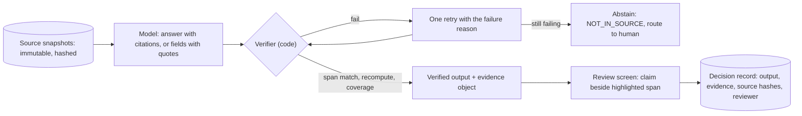

# LLM Security & Governance - Verifiable Outputs, Citations & Evidence Chains

> [!info] Deep dive of [[LLM Security & Governance]]

> [!abstract] TL;DR
> - An output is verifiable when every claim carries a **pointer to a source span**, and **code has checked the pointer** before a person sees it.
> - Three rules: **quote first** (answer only from extracted quotes), **compute outside the model** (totals, dates, tax in code), **no evidence, no answer** (abstain and escalate).
> - A valid citation proves the quote exists in the source. It does **not** prove the sentence follows from it. That last step needs an entailment check or a human looking at the span.

## Concept

### Levels of verifiability
| Level | Output carries | Automatic check | Fits |
|---|---|---|---|
| L0 Free text | Nothing | None. A human reads everything | T0 drafts |
| L1 Source-level | Document ID ("per SOP-12") | Document exists and belongs to the tenant | T1 internal Q&A |
| L2 Span-level | Document ID, version, character or page range, quoted text | Verbatim match of the quote at that location | T1–T2 customer answers |
| L3 Field-level | Each extracted field: value + quote + page | Quote on the page, value parsed from the quote, format rules | T3 extraction |
| L4 Recomputed | Derived values calculated in code from L3 fields. The model's own figure is discarded | Arithmetic equality, cross-field rules | T3 financial |

### What code can and cannot verify
| Claim type | Automatic check | Residual risk |
|---|---|---|
| Verbatim quote | Exact or whitespace-normalised match | Quote taken out of context (negated, conditional, superseded) |
| Number, date, ID copied from a source | Parse from the quoted span, compare | Right number, wrong field (subtotal read as total) |
| Arithmetic | Recompute in integer cents | Wrong inputs |
| Paraphrased claim | Entailment model or LLM judge against the span | Judge error. Sample with humans |
| Negative claim ("no penalty clause") | None from a span | Needs a list of sections searched, plus a human |
| Synthesis across documents | Each premise cited, conclusion labelled as inference | The inference itself |

### Two sources of pointers
| Source | Guarantee | Limit |
|---|---|---|
| **Native citations** (provider returns spans for document blocks) | `cited_text` is copied from the supplied document by the API, so the pointer cannot be invented | Free-text answers only. On Claude it cannot be combined with structured outputs |
| **Self-reported evidence** (quote and page as fields in your schema) | None. The model can misquote | Works with structured extraction. Verification in code is mandatory |

## How It Works

- **Snapshot the sources.** A citation into a document that was edited yesterday proves nothing. Store each source version by content hash and cite the hash.
- **Coverage check.** Every sentence that contains a number, date, name or policy statement must carry at least one verified span. Uncited factual sentences are stripped or flagged.
- **Evidence travels with the output** into the decision record ([[LLM Security & Governance - Audit Trails & Decision Records]]), so a dispute a year later can be answered from stored data.

## Practical Usage

### Native citations on a PDF (Claude)
```ts
const res = await client.messages.create({
  model: "claude-opus-5-5",
  max_tokens: 16000,
  messages: [{
    role: "user",
    content: [
      { type: "document", title: "Refund Policy v7",
        source: { type: "base64", media_type: "application/pdf", data: pdfBase64 },
        citations: { enabled: true } },                                   // all documents or none
      { type: "text", text: "Can an opened item be returned after 10 days? Answer only from the document. If it does not say, reply NOT_IN_SOURCE." },
    ],
  }],
});

const evidence = [];
for (const block of res.content) {
  if (block.type !== "text") continue;
  for (const c of block.citations ?? []) {
    if (c.type === "page_location")
      evidence.push({ claim: block.text, quote: c.cited_text, doc: c.document_index, pages: [c.start_page_number, c.end_page_number] });
  }
}
```
Plain-text documents return `char_location` with `start_char_index` and `end_char_index`. PDF pages are 1-indexed.

### Verify a span against the stored snapshot
```ts
type Evidence = { claim: string; docId: string; docSha256: string; quote: string; start: number; end: number };
const squash = (s: string) => s.normalize("NFKC").replace(/\s+/g, " ").trim();

export function verifySpan(e: Evidence, docs: Map<string, { sha256: string; text: string }>) {
  const d = docs.get(e.docId);
  if (!d || d.sha256 !== e.docSha256) return "unknown_source";            // wrong or changed document
  if (d.text.slice(e.start, e.end) === e.quote) return "ok";
  return squash(d.text).includes(squash(e.quote)) ? "ok_relocated" : "quote_not_found";
}
```

### Field-level evidence for extraction, with recomputation
```ts
const field = <T extends z.ZodTypeAny>(value: T) =>
  z.object({ value, quote: z.string().min(1), page: z.number().int().positive() });

const Invoice = z.object({
  invoiceNo: field(z.string()), subtotal: field(z.number()), tax: field(z.number()), total: field(z.number()),
  lines: z.array(z.object({ description: z.string(), qty: z.number(), unitPrice: z.number() })),
});

const cents = (s: string) => Math.round(parseFloat(s.replace(/[^\d.-]/g, "")) * 100);

export function checkInvoice(inv: z.infer<typeof Invoice>, pages: string[]): string[] {
  const errs: string[] = [];
  for (const [name, f] of Object.entries({ invoiceNo: inv.invoiceNo, subtotal: inv.subtotal, tax: inv.tax, total: inv.total })) {
    if (!squash(pages[f.page - 1] ?? "").includes(squash(f.quote))) errs.push(`${name}:quote_not_on_page`);
    else if (typeof f.value === "number" && cents(f.quote) !== Math.round(f.value * 100)) errs.push(`${name}:value_differs_from_quote`);
  }
  const lineSum = inv.lines.reduce((s, l) => s + Math.round(l.qty * l.unitPrice * 100), 0);
  if (lineSum !== Math.round(inv.subtotal.value * 100)) errs.push("lines_vs_subtotal");
  if (Math.round(inv.subtotal.value * 100) + Math.round(inv.tax.value * 100) !== Math.round(inv.total.value * 100)) errs.push("total_mismatch");
  return errs;                                                              // [] → post. Anything else → human queue
}
```
A total of 64.84 against a quote of "RM 64.48" returns `total:value_differs_from_quote` and `total_mismatch`. Nothing is posted.

### Quote-first prompt
```text
1. Copy the exact sentences from the documents that are relevant to the question into <quotes>, each with its document title and page.
2. If no sentence is relevant, write NOT_IN_SOURCE and stop.
3. Answer using only what is inside <quotes>. After each statement, give the quote number it relies on.
4. Do not add facts, numbers or dates that are not in a quote.
```

### Review screen rule
```text
WRONG   Reviewer sees the generated summary and an "Approve" button.
RIGHT   Reviewer sees each claim next to its highlighted source span and approves the pairing.
        Unverified claims appear in red and cannot be approved in bulk.
```

## Patterns & Anti-patterns
| Pattern | When | Anti-pattern to avoid |
|---|---|---|
| Native citations for prose answers, schema evidence fields for extraction | Always pick by output shape | Asking for "sources" in free text and trusting the list |
| Verifier runs before any human review | T1 and up | Humans as the first line of checking |
| Arithmetic in code from verified fields | Any money, tax, quantity, date difference | Using the model's stated total |
| Explicit abstention token and a route for it | Any grounded task | Forcing an answer when retrieval came back empty |
| Immutable source snapshots keyed by hash | Anything that may be disputed later | Citing a live URL or a mutable row |
| One retry that includes the verifier's error, then stop | Extraction, grounded Q&A | Retry loops until something passes |
| Claims labelled as *quoted*, *derived* or *inferred* in the output | Reports and advice | Presenting an inference with the same weight as a quote |

## Performance & Trade-offs
- **Span and arithmetic checks** cost microseconds and remove most fabricated-number failures. There is no reason to skip them.
- **Citations vs structure**: on Claude, enabling citations together with `output_config.format` returns a 400. Choose native citations for prose and self-reported evidence fields for JSON.
- **Entailment judging** adds one model call per answer. Sample at T1, run on everything at T3, and calibrate the judge against human labels first.
- **OCR noise** breaks exact matching on scans. Use a fuzzy threshold (for example normalised edit similarity ≥ 0.9) and keep the page image for the reviewer.
- **Strictness costs recall.** Strict grounding raises the abstention rate. Track it: a rising rate usually means a retrieval problem, not a model problem.
- **Storage**: snapshots and evidence objects are small next to the documents themselves. Keep them for the same period as the decision they support.

## Tips & Reminders
> [!tip]
> - Decide the verifiability level per feature when you set its risk tier, and write it in the feature register.
> - Evidence is worth storing even when the user never sees it. It is what you produce when a client asks "why did the bot say that?".
> - Chunk metadata must carry document ID, version hash and character offsets, or citations cannot be mapped back to the original.
> - Normalise number formats before comparing: `1,299.00`, `1299` and `RM1,299` are the same amount.
> - A correct answer with no retrieval hit is a warning sign. The model answered from memory and will do it again when memory is wrong.
> - **In ZP's stack**:
>   - Store source snapshots in [[Supabase]] Storage under their SHA-256, with a `documents` row holding tenant, title and version.
>   - In [[n8n]] extraction workflows, run the verifier in a Code node between the model and the accounting API. A non-empty error list branches to a human-review form.
>   - For WhatsApp bots, verify citations internally even though the customer sees plain text. Send the reply only when coverage passes.
>   - e-Invoice and accounting fields are L4: the amounts that reach the ledger are the ones your code computed.

## Version Notes
| Item | Status (2026-11) |
|---|---|
| Claude citations | Generally available on document blocks with no beta header. Locations: `char_location`, `page_location`, `content_block_location` |
| Citations + structured outputs | Incompatible on Claude (400). Design the two paths separately |
| Other providers | Grounding metadata and file-search annotations exist elsewhere with different shapes |

> [!warning] Unverified — check before relying on this
> Citation features of providers other than Claude were not verified this run.

## Critical Issues & Gotchas
> [!danger] Fabricated citations are now routine enough to be tracked
> A public database counted about 712 court decisions worldwide dealing with hallucinated content by 2025-12, roughly 90% of them from 2025, and over 220 more reached US federal dockets in the first quarter of 2026. Sanctions have reached USD 59,500 in a single matter. Every one of those documents was reviewed by a professional who did not check the references. A reference that code has not resolved to a real source does not ship.

> [!danger] A valid pointer is not a supported claim
> Native citations guarantee the quoted text exists. They do not stop the model from quoting "refunds within 7 days" and concluding that a 10-day return is allowed. For T2 and T3 output, add an entailment check and show the reviewer the claim beside the span.

> [!danger] Reviewers approve what looks finished
> The Deloitte Australia report (2025-10) and the court filings above all had a human in the loop. Fluent prose with reference numbers triggers approval, not scrutiny. Make the reviewer confirm claim-to-span pairs, block bulk approval of unverified items, and measure how often reviewers reject anything.

> [!warning] Gotchas
> - A quote can be real and still misleading: "is not refundable" loses its "unless faulty" from the next sentence. Cite whole sentences, and prefer whole clauses for contracts.
> - Chunk boundaries cut quotes in half. Verify against the full document text, not the retrieved chunk.
> - Citing a superseded policy version is the most common wrong-but-verified answer. Filter retrieval to the current version.
> - Tables in PDFs lose their structure in text extraction, so a number's row and column context disappears. Extract tables separately.
> - Mixed-language sources: the answer may be in English and the quote in BM or Chinese. Entailment checks need a model that handles both.
> - Floating-point money comparisons fail on 0.1 + 0.2. Compare integer cents.

## Related
- [[LLM Security & Governance]]
- [[RAG - Evaluation & Answer Grounding]] — measuring faithfulness, citation accuracy and abstention
- [[AI Agents - Document Processing & Invoice Extraction]] — the extraction pipeline these checks plug into
- [[LLM APIs & SDKs - Structured Outputs & Tool Schemas]] — schemas for evidence fields
- [[Prompt Engineering - Long-Context & Structured Reasoning Prompts]] — quote-first prompting
- [[LLM Security & Governance - Accuracy Assurance for Critical Workflows]] — acceptance thresholds and review sampling
- [[LLM Security & Governance - Audit Trails & Decision Records]] — where the evidence object is stored
- [[LLM Security & Governance - Guardrails & Content Moderation]] — policy assertions on amounts and links

## References
- Claude citations: https://platform.claude.com/docs/en/build-with-claude/citations
- Bloomberg Law, AI-faked cases become a core issue for judges: https://news.bloomberglaw.com/legal-ops-and-tech/ai-faked-cases-become-core-issue-irritating-overworked-judges
- UIC Law Library, flood of AI-related sanctions persists: https://library.law.uic.edu/news-stories/flood-of-ai-related-sanctions-persist/
- Damien Charlotin, AI hallucination cases database: https://www.damiencharlotin.com/hallucinations/
- Moffatt v. Air Canada, 2024 BCCRT 149: https://www.canlii.org/en/bc/bccrt/doc/2024/2024bccrt149/2024bccrt149.html
