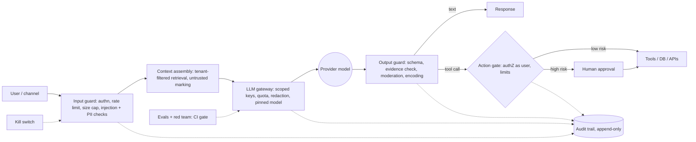

# LLM Security & Governance

> [!abstract] TL;DR
> An LLM is an **untrusted, non-deterministic, third-party component** that anything in its context can steer. Safe operation comes from code and process *around* the model, never from the prompt.
> - **Security**: limit what the model can read and do, so a successful prompt injection has a small blast radius.
> - **Reliability**: every output that matters carries **evidence a program or a person can check**.
> - **Governance**: for any AI decision you can show *which model, prompt, sources and reviewer* produced it, and you decide when the model changes.
> - **Method**: tier every AI feature by worst-case harm (T0–T3) and let the tier dictate the controls.

## Introduction
- **What it is**: the engineering controls and organisational rules that make an LLM feature safe to run for a paying client. Five strands: attack resistance, accuracy assurance, evidence and audit, model lifecycle control, privacy and regulatory compliance.
- **Why it is its own discipline**: classic AppSec assumes code and data are separable and behaviour is deterministic. LLMs break both, and the core component is operated and changed by a vendor.
- **Lineage**:
  - OWASP Top 10 for LLM Applications (2023 → 2025 → **2026**) plus the Agentic Top 10 (2025-12)
  - NIST AI RMF 1.0 (2023-01) and its Generative AI Profile, AI 600-1 (2024-07)
  - ISO/IEC 42001 (2023-12), the certifiable AI management system
  - EU AI Act (in force 2024-08), Malaysia's AIGE guidelines (2024-09) and the pending AI Governance Bill
- **Where it sits**: it wraps every other topic in this domain: [[RAG]], [[AI Agents]], [[Model Context Protocol]], [[AI Evals & Observability]], [[LLM APIs & SDKs]]. The risk taxonomy lives in [[OWASP Top 10 - LLM & Agent Security]]. This topic covers how to build and operate against it.

## Core Concepts

### Six properties that break classic assumptions
| Property | What breaks | Control family |
|---|---|---|
| **No instruction/data separation** | Any text in context can act as an instruction (prompt injection) | Privilege separation, tool gateway, guardrails |
| **Non-determinism** | Same input, different output. A single passing test proves little | Eval sets, QA sampling, store outputs instead of regenerating |
| **Fluent failure** | Wrong answers look right. No error code, no stack trace | Evidence checks, abstention paths, human review |
| **Agency** | Tool access turns a text error into a real action | Least privilege, authorization in code, approvals |
| **Vendor-operated component** | Provider updates, deprecates, reprices, or has an outage | Snapshot pinning, migration playbook, fallbacks |
| **Data egress by design** | Prompts, files and traces leave your boundary | Redaction, provider terms, retention limits |

### Trust boundaries
| Content | Trust | Rule |
|---|---|---|
| Your code, tool definitions | Trusted | The only place authorization and limits may live |
| System prompt | Trusted but **assume it leaks** | No secrets, no pricing logic, no access rules inside |
| End-user message | Untrusted | Validate size, rate, intent |
| Retrieved docs, emails, PDFs, web pages, tool results | Untrusted (indirect injection) | "Internal" systems still hold text written by outsiders |
| Long-term memory | Untrusted once untrusted content can be written to it | Provenance, TTL, per-user isolation |
| Model output | Untrusted | Validate before it is rendered, executed, stored or sent |
| Messages from other agents | Untrusted | Same checks as user input |

### Risk tiers for AI features
Controls are cumulative: each tier inherits the ones above it.

| Tier | Example | Worst case | Minimum controls added |
|---|---|---|---|
| **T0** Internal assist | Staff drafting, summarising, code help. A human reads every output | Client data pasted into an unapproved tool | Acceptable use policy, approved tool list, no-training provider terms, key hygiene, spend caps |
| **T1** Customer-facing information | FAQ bot, RAG answers, AI-drafted replies | Invented price or policy gets screenshotted. Prompt leak | Input/output guardrails, grounding with abstention, AI disclosure, eval gate, tracing, rate limits, kill switch |
| **T2** Acts, or touches personal data | Agent with write tools, CRM updates, bookings, PII in context | Unauthorised action, cross-tenant leak, PDPA breach | Tool gateway acting **as the user**, approval for side effects, PII redaction, tenant-isolation tests, red-team suite in CI, full audit trail, incident runbook |
| **T3** Regulated, financial, legal, safety | Invoice posting, payments, eligibility or credit decisions, legal documents | Financial loss, regulatory breach, liability | Evidence chain per output, arithmetic in code, maker-checker review, statistical acceptance test, tamper-evident decision records, model change control, contract clauses |

### Control map
| Layer | Controls | Detail in |
|---|---|---|
| Organisation | AI feature register, risk assessment, usage policy, contract terms | [[LLM Security & Governance - Acceptable Use Policy & Client Contracts]], [[LLM Security & Governance - Regulations, Standards & Platform Policies]] |
| Input | Authn, rate limits, size caps, injection / PII / topic checks | [[LLM Security & Governance - Guardrails & Content Moderation]], [[LLM Security & Governance - Prompt Injection & Jailbreak Defense]] |
| Egress | Single gateway, scoped keys, quotas, timeouts, redaction, pinned model | [[LLM Security & Governance - LLM Gateway, API Keys & Call Hardening]], [[LLM Security & Governance - Data Privacy, PII & Provider Data Handling]] |
| Context | Tenant-filtered retrieval, untrusted-content marking, context minimisation | [[RAG - Multi-Tenant Knowledge Bases & Access Control]], [[OWASP Top 10 - LLM & Agent Security]] |
| Output | Schema validation, evidence verification, moderation, encoding | [[LLM Security & Governance - Verifiable Outputs, Citations & Evidence Chains]], [[LLM APIs & SDKs - Structured Outputs & Tool Schemas]] |
| Action | Authorization in the tool gateway, per-tool limits, human approval | [[AI Agents - Human-in-the-Loop & Approval Workflows]] |
| Record | Decision records, traces, retention | [[LLM Security & Governance - Audit Trails & Decision Records]], [[AI Evals & Observability - Tracing & Production Monitoring with Langfuse]] |
| Assurance | Evals, acceptance tests, adversarial tests | [[LLM Security & Governance - Accuracy Assurance for Critical Workflows]], [[LLM Security & Governance - Red Teaming & Security Testing]] |
| Lifecycle | Model pinning and migration, incident response, kill switch | [[LLM Security & Governance - Model Migration, Deprecation & Version Pinning]], [[LLM Security & Governance - Incident Response & Kill Switches]] |

### Policy as code
The tier is configuration, and the wrapper enforces it. No feature calls a provider SDK directly.

```ts
type Tier = 0 | 1 | 2 | 3;
type Controls = {
  guard: boolean;                                   // input + output guardrails
  evidence: boolean;                                // output must carry verifiable source spans
  approval: "none" | "side-effects" | "always";
  audit: "metadata" | "full";
};

const CONTROLS: Record<Tier, Controls> = {
  0: { guard: false, evidence: false, approval: "none",         audit: "metadata" },
  1: { guard: true,  evidence: true,  approval: "none",         audit: "full" },
  2: { guard: true,  evidence: true,  approval: "side-effects", audit: "full" },
  3: { guard: true,  evidence: true,  approval: "always",       audit: "full" },
};

const FEATURES = {
  "sop-search":       { tier: 0, model: lock["sop-search"],       prompt: "sop-search@v7" },
  "whatsapp-support": { tier: 1, model: lock["whatsapp-support"], prompt: "support-reply@v14" },
  "invoice-extract":  { tier: 3, model: lock["invoice-extract"],  prompt: "invoice-extract@v5" },
} as const;                                         // lock = models.lock.json: pinned snapshot IDs

export async function runFeature(name: keyof typeof FEATURES, ctx: Ctx, input: Input) {
  const f = FEATURES[name], c = CONTROLS[f.tier];
  if (await killSwitch.isOff(name)) return fallbackReply(ctx);            // flag in Redis, no deploy needed
  if (c.guard) await guardInput(input, ctx);
  const out = await gateway.call({ ...f, input, ctx });                   // single egress: keys, quota, redaction
  if (c.guard) await guardOutput(out, ctx);
  if (c.evidence) verifyEvidence(out, input.sources);                     // code check, throws on unsupported claim
  await audit.append({ feature: name, tier: f.tier, model: out.model, prompt: f.prompt,
    inputHash: sha256(input), outputHash: sha256(out), actor: ctx.userId, tenant: ctx.tenantId });
  return c.approval === "always" ? reviewQueue.submit(out, ctx) : out;
}
```

### Shared responsibility
| Party | Owns | Typical gap |
|---|---|---|
| Model provider | Model safety training, platform security, retention and training terms, deprecation notice | You inherit their outages, policy changes and behaviour drift |
| Builder (you) | Architecture, guardrails, evals, audit trail, model pinning, incident response | Prompt-only "security". No eval gate before changes |
| Deployer (client) | Lawful basis for the data, staff AI use, human review of T2–T3 output, the final business decision | Assumes the vendor owns accuracy. No named reviewer |

Write this split into the statement of work. An unassigned duty defaults to the builder when something goes wrong.

## Architecture / How It Works

- **Enforcement points are code**: the model proposes, and deterministic code decides. Guard, gateway, output check and action gate each run outside the model, so no prompt can talk past them.
- **Defence in depth, because each layer leaks**: input classifiers miss novel injections, output checks miss subtle errors, humans rubber-stamp. Stack them so one miss is not an incident.
- **Blast radius beats detection**: assume an injection eventually succeeds, then ask what the model could read and do at that moment. Reducing that answer is worth more than a better classifier.
- **Two loops**: the request path above runs per call. The assurance loop (evals, red-team cases, incident reviews, model migrations) runs per change and feeds new cases back into CI.

## Project Structure
```text
ai/
├── policy/tiers.ts            # feature → tier → required controls (the table above, as code)
├── gateway/                   # the only module that imports a provider SDK
├── guardrails/                # input and output checks
├── evidence/                  # claim → source-span verification
├── audit/                     # append-only decision records
├── evals/
│   ├── golden/*.jsonl         # accuracy and regression cases
│   └── redteam/*.jsonl        # injection, jailbreak, cross-tenant, cost-abuse cases
└── models.lock.json           # pinned snapshot IDs + provider deprecation dates
docs/ai/
├── feature-register.md        # inventory: feature, tier, owner, data classes, model, reviewer
├── risk-assessments/          # one page per T2–T3 feature
├── acceptable-use.md          # what staff may put into which AI tool
├── model-change-log.md        # every model or prompt promotion, with eval results
└── incident-runbook.md        # detection signals, kill switch, notification duties
```
```bash
# CI guard: provider SDKs may only be imported inside the gateway
! grep -rEl "from ['\"](@anthropic-ai/sdk|openai|@google/genai)['\"]" src --include='*.ts' | grep -v '^src/ai/gateway/'
```

## Use Cases
| Use case | Tier | Controls that carry the weight |
|---|---|---|
| Internal SOP search for staff | T0 | Usage policy, tenant-scoped retrieval, spend cap |
| Staff using chat assistants or coding agents on client work | T0 | Approved tool list, no client secrets or PII in prompts, no-training terms |
| WhatsApp or web support bot answering from a knowledge base | T1 | Grounding with abstention, output guard on prices and promises, AI disclosure, kill switch |
| AI-drafted proposals, reports, marketing copy | T1 | Named human sign-off, citation check on every factual claim |
| Agent that books, cancels, refunds or updates a CRM | T2 | Tool gateway acting as the user, approval above a limit, audit trail |
| Document extraction feeding accounting or e-invoicing | T3 | Field-level evidence spans, totals recomputed in code, maker-checker, acceptance sampling |
| Eligibility, credit, hiring or medical triage | T3 | Human decides and the AI only assists. Check the regulatory classification before building |

## Pros & Cons
| Pros | Cons |
|---|---|
| The blast radius of an inevitable injection or hallucination is bounded and known in advance | No control eliminates prompt injection. You buy risk reduction, not immunity |
| Evidence and audit records turn "the AI said so" disputes into checkable facts | Every LLM-based guard or verifier adds a model round trip: latency and cost per request rise |
| Tiering prevents over-engineering: T0 features ship with almost no overhead | Tiering is a judgement call, and under-tiering to save effort is the common failure |
| Makes AI sellable to regulated clients (finance, healthcare, government) | Registers, runbooks and eval sets rot into theatre unless someone maintains them |
| Pinned models and eval gates make provider migrations routine instead of emergencies | Guardrail false positives block legitimate users, and mixed BM/EN/ZH input is hit hardest |
| Regulatory posture (PDPA, EU AI Act, a future Malaysian AI law) comes mostly as a by-product | Regulations are moving targets, so documents need a review at least yearly |

## Alternatives & Peers
Frameworks to map against. They overlap, so pick one primary and cross-reference the rest.

| Framework | Strength | Weakness | Pick it when… |
|---|---|---|---|
| OWASP Top 10 for LLM Applications 2026 ([[OWASP Top 10 - LLM & Agent Security]]) | Concrete developer-level risk list that auditors and pentesters recognise | A risk list, not a management system. IDs shift between editions | Threat-modelling a feature, scoping a pentest |
| OWASP Top 10 for Agentic Applications (ASI01–ASI10) | Covers tool misuse, memory poisoning, multi-agent cascades | Young, and control guidance is still maturing | Anything with tools or autonomy |
| NIST AI RMF 1.0 + AI 600-1 | Free, voluntary, full lifecycle (Govern / Map / Measure / Manage). The GenAI profile names 12 risk areas | Abstract, no certification, US-centric | A client's compliance team wants a recognised risk-register structure |
| ISO/IEC 42001:2023 | Certifiable AI management system with the same shape as ISO 27001 | Audit cost and paperwork are heavy for a small shop | An enterprise client demands certification |
| EU AI Act | Binding law: risk classes, duties, fines up to €35M or 7% of global turnover | Applies only with an EU nexus. High-risk duties are now delayed | The system is placed on the EU market or its output is used in the EU |
| MITRE ATLAS | ATT&CK-style matrix of adversary techniques against AI, with case studies | Attacker's view only | Planning red-team work or detections |
| Google SAIF | Risk-to-control mapping from a hyperscaler | Vendor-flavoured | Building on Vertex AI or GCP |
| Malaysia AIGE guidelines (2024) | Local reference, 7 principles, voluntary | Principles, not controls. To be overtaken by the AI Governance Bill | A Malaysian public-sector or GLC client asks for alignment |

## Tips & Reminders
> [!tip]
> - Open every AI feature with four questions: what can it **read**, what can it **do**, who or what **verifies** the output, what is **recorded**.
> - Put the tier and the client's human-review duty in the SOW. It is the cheapest control on this page.
> - Never ship T1+ without a kill switch that works without a deploy.
> - Store the output you acted on. Regenerating later is not reproduction, even at temperature 0.
> - Pin dated model snapshots, record each deprecation date, and rehearse a migration before the provider forces one.
> - Every incident and every near miss becomes a red-team or golden case. That is how the eval set earns its keep.
> - Tier by worst case, not typical case. A FAQ bot that can also issue refunds is T2.
> - **In ZP's stack**:
>   - [[Supabase]] RLS is the data boundary. Agents query with the end user's JWT and never hold `service_role`.
>   - [[n8n]] AI nodes call providers directly, so point their credentials at the gateway's base URL or they bypass quota, redaction and audit.
>   - [[Redis]] holds per-tenant quotas and the kill-switch flag. [[PostgreSQL]] holds the append-only audit table.
>   - Self-hosted Langfuse on [[Coolify]] keeps traces inside your boundary. Mask PII before export either way.
>   - Cloudflare rate limiting ([[Network Security - Cloudflare WAF & Rate Limiting Rules]]) in front of chat endpoints stops cost abuse before it reaches the model.

## Versions & Breaking Changes
| Version | Released | Key changes | Breaking / migration notes |
|---|---|---|---|
| NIST AI RMF 1.0 | 2023-01 | Govern / Map / Measure / Manage | Voluntary |
| OWASP LLM Top 10 v1.x | 2023-08 | First list. Prompt injection at #1 | Baseline |
| ISO/IEC 42001:2023 | 2023-12 | First certifiable AI management system standard | Certification via accredited bodies |
| NIST AI 600-1 (GenAI Profile) | 2024-07 | 12 GenAI risk areas with suggested actions | Companion to AI RMF |
| EU AI Act, Reg. (EU) 2024/1689 | In force 2024-08-01 | Prohibitions and AI literacy from 2025-02-02. GPAI duties from 2025-08-02. Art. 50 transparency from 2026-08-02 | Fines up to €35M / 7% |
| Malaysia AIGE guidelines | 2024-09 | 7 voluntary principles (MOSTI) | No enforcement |
| OWASP LLM Top 10 2025 | 2024-11 | Added System Prompt Leakage and Vector and Embedding Weaknesses. Model DoS widened to Unbounded Consumption | IDs renumbered from v1.x |
| PDPA (Amendment) Act 2024 | Phased through 2025 | Breach notification, DPO, processor duties, new cross-border regime | See [[Supabase - Data Retention, PDPA & Account Deletion]] |
| OWASP Top 10 for Agentic Applications | 2025-12 | ASI01–ASI10 for agents | Use alongside the LLM list |
| EU Digital Omnibus on AI, Reg. (EU) 2026/1744 | In force 2026-07-27 | Annex III high-risk duties moved to 2027-12-02. Annex I products to 2028-08-02 | Prohibitions, AI literacy, GPAI and Art. 50 dates did **not** move |
| Malaysia AI Governance Bill | Consultation 2026-07 | Risk-tier proposal from the National AI Office. Not tabled as of 2026-11, Parliament targeted for early 2027 | Scope, penalties and start date unpublished |
| **OWASP LLM Top 10 2026** | 2026-08 | All 10 areas kept, several renamed or reframed. Excessive Agency rises #6 → #3, Supply Chain drops #3 → #4. Announced with a new Agent Control Standard (2026-09) | **IDs changed again**: re-map any control matrix keyed on 2025 numbers |

> [!warning] Unverified — check before relying on this
> - Omnibus dates come from law-firm and consultancy summaries, not the Official Journal text.
> - OWASP 2026 publication day differs by source (3 or 4 August).
> - PDPA amendment commencement dates and timelines were not re-verified this run.
> - This note is engineering guidance, not legal advice.

## Critical Issues & Gotchas
> [!danger] Prompt injection is unsolved: EchoLeak (CVE-2025-32711)
> A single crafted email made Microsoft 365 Copilot exfiltrate internal data with **zero clicks** (CVSS 9.3, disclosed 2025-06). The email was pulled into context by a later routine question, and the data left through an auto-loaded image URL. Filters and system-prompt rules did not stop it. Design for containment: restrict what the model can read, strip or allowlist outbound links and images, and gate every side effect in code.

> [!danger] Agent + privileged credential + untrusted text: the Supabase MCP leak
> In 2025-07 researchers showed a coding agent connected to Supabase MCP with `service_role` reading a support ticket that contained instructions, then writing a private tokens table back into the ticket thread. RLS was bypassed because the agent held the god key. Give agents the requesting user's identity, run MCP read-only where possible, and never mix private data, untrusted content and a write channel in one agent.

> [!danger] The deployer owns what the bot says: Moffatt v. Air Canada
> In 2024-02 a Canadian tribunal held Air Canada liable for a refund policy its chatbot invented (2024 BCCRT 149), rejecting the argument that the chatbot was a separate entity responsible for its own words. A disclaimer does not move liability. Ground answers in approved sources, block unsupported promises in the output guard, and define in the contract who pays for a wrong answer.

> [!danger] Unverified output shipped as fact
> - *Mata v. Avianca* (2023-06): lawyers fined USD 5,000 for filing a brief with fabricated case citations.
> - Deloitte Australia (2025-10): partial refund on an AUD 440,000 government report after fabricated references and a made-up court quote were found.
>
> Both had a human "in the loop" who did not check. Require a source span for every claim and verify it in code before a person ever sees the draft.

> [!warning] Gotchas
> - **"We told it not to" is not a control.** Anything enforced only by the system prompt will be bypassed eventually.
> - **Agents with production write access**: in 2025-07 a coding agent deleted a live production database during an explicit code freeze. Separate dev and prod credentials, and require approval for destructive operations.
> - **Shadow AI**: Samsung restricted generative AI tools in 2023 after engineers pasted internal source code into a public chatbot. A written usage policy and an approved tool list are the T0 baseline.
> - **Silent model change**: aliases such as `-latest` move without notice, and pinned snapshots retire on a schedule. Either one changes behaviour under an unchanged prompt.
> - **Channel policies can kill a product**: messaging platforms restrict which AI use cases may run on their business APIs. Check the current terms for the channel before quoting a build (WhatsApp terms not re-verified this run).
> - **Traces are a second copy of the sensitive data**, usually with weaker access control than the primary database.
> - **Approval fatigue**: a reviewer who approves 200 items a day verifies none of them. Sample, batch, and show the evidence next to the decision.

## Deep Dives
- [[LLM Security & Governance - Prompt Injection & Jailbreak Defense]] — attack catalogue, privilege-separation patterns, what does not work
- [[LLM Security & Governance - Guardrails & Content Moderation]] — input/output filter pipeline, classifiers, fail-open vs fail-closed, latency budget
- [[LLM Security & Governance - LLM Gateway, API Keys & Call Hardening]] — single egress, key scoping and rotation, timeouts, stop-reason handling, per-tenant quotas
- [[LLM Security & Governance - Verifiable Outputs, Citations & Evidence Chains]] — claim-to-source spans, code-verified citations, computation outside the model, abstention
- [[LLM Security & Governance - Accuracy Assurance for Critical Workflows]] — tier-driven controls, maker-checker, acceptance sample sizes, QA sampling, drift
- [[LLM Security & Governance - Audit Trails & Decision Records]] — what to record, tamper evidence, replay limits, retention
- [[LLM Security & Governance - Model Migration, Deprecation & Version Pinning]] — pinning, eval gate → shadow → canary → rollback, prompt portability
- [[LLM Security & Governance - Data Privacy, PII & Provider Data Handling]] — retention and ZDR terms, redaction, PII in traces and embeddings, deletion
- [[LLM Security & Governance - Regulations, Standards & Platform Policies]] — PDPA, Malaysian AI rules, EU AI Act, ISO 42001, NIST AI RMF, channel policies
- [[LLM Security & Governance - Acceptable Use Policy & Client Contracts]] — staff usage rules, AI disclosure, liability, accuracy and model-change clauses
- [[LLM Security & Governance - Red Teaming & Security Testing]] — adversarial suites, tooling, CI gating, attack success rate
- [[LLM Security & Governance - Incident Response & Kill Switches]] — AI incident types, degraded modes, notification duties, post-incident cases

## Related
- [[OWASP Top 10 - LLM & Agent Security]] — the risk taxonomy and the tool-gateway pattern
- [[AI Agents - Human-in-the-Loop & Approval Workflows]] — approval tiers for side effects
- [[AI Evals & Observability]] — the measurement loop behind every control here
- [[RAG - Evaluation & Answer Grounding]] — faithfulness, citation accuracy, abstention metrics
- [[LLM Fundamentals - Model Selection & Routing]] · [[LLM APIs & SDKs - Rate Limits, Retries & Provider Fallbacks]] — choosing models and surviving provider failures
- [[Model Context Protocol - Remote Servers, OAuth & Security]] — securing tool connectors
- [[AI Evals & Observability - Cost Tracking & Budgets per Tenant]] — spend limits against cost abuse
- [[Supabase - Row Level Security]] — the data boundary agents cannot argue with

## References
- OWASP GenAI Security Project, LLM Top 10: https://genai.owasp.org/llm-top-10/
- OWASP 2026 LLM Top 10 and Agent Control Standard announcement: https://genai.owasp.org/2026/09/01/owasp-genai-security-project-unveils-2026-top-10-for-llm-applications-new-agent-control-standard-and-sponsors-as-community-tops-30000-members/
- OWASP Top 10 for Agentic Applications: https://genai.owasp.org/resource/owasp-top-10-for-agentic-applications-for-2026/
- CSA, what changed in the 2026 LLM Top 10: https://cloudsecurityalliance.org/articles/the-owasp-top-10-for-llm-applications-2026-what-changed-and-why-it-matters
- NIST AI Risk Management Framework: https://www.nist.gov/itl/ai-risk-management-framework
- NIST AI 600-1, Generative AI Profile: https://nvlpubs.nist.gov/nistpubs/ai/NIST.AI.600-1.pdf
- ISO/IEC 42001:2023: https://www.iso.org/standard/42001
- EU AI Act, Regulation (EU) 2024/1689: https://eur-lex.europa.eu/eli/reg/2024/1689/oj
- EU AI Act timeline after the Digital Omnibus: https://alicelabs.ai/en/insights/eu-ai-act-timeline-2026
- DLA Piper on the deferral of high-risk obligations: https://knowledge.dlapiper.com/dlapiperknowledge/globalemploymentlatestdevelopments/2026/The-Digital-AI-Omnibus-Proposed-deferral-of-high-risk-AI-obligations-under-the-AI-Act
- Baker McKenzie, Malaysia AI Governance Bill consultation: https://www.bakermckenzie.com/en/insight/publications/2026/07/malaysia-public-consultation-on-the-ai-governance-bill
- Malaysia PDP Commissioner: https://www.pdp.gov.my/
- MITRE ATLAS: https://atlas.mitre.org/
- Simon Willison, the lethal trifecta: https://simonwillison.net/2025/Jun/16/the-lethal-trifecta/
- CVE-2025-32711 (EchoLeak): https://nvd.nist.gov/vuln/detail/CVE-2025-32711
- Simon Willison on the Supabase MCP leak: https://simonwillison.net/2025/Jul/6/supabase-mcp-lethal-trifecta/
- Moffatt v. Air Canada, 2024 BCCRT 149: https://www.canlii.org/en/bc/bccrt/doc/2024/2024bccrt149/2024bccrt149.html
