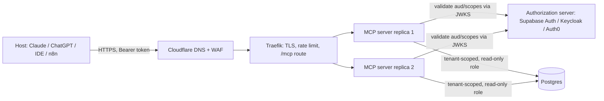

# Model Context Protocol - Building MCP Servers

> [!info] Deep dive of [[Model Context Protocol]]

> [!abstract] TL;DR
> A production MCP server is a **small, stateless HTTP API whose consumer is an LLM**.
> - **Tools**: design a few task-shaped tools with precise descriptions, strict input schemas and compact structured output.
> - **Auth**: run as an **OAuth 2.1 resource server**, with RFC 9728 metadata and audience-bound tokens. Derive tenant and user from the token, never from arguments.
> - **Deploy**: put it behind [[Traefik]] like any API. Under spec 2026-07-28 there are no sessions, so scale horizontally.
> - **Treat output as untrusted**: everything the server returns lands in a model's context. Return only what's needed, and never echo instructions from third-party data verbatim without framing.

## Concept

### Primitives, from the builder's view
| Primitive | Controlled by | Build it when | Example (SME order system) |
|---|---|---|---|
| **Tool** | Model (with host consent) | The model should *act* or *query* on demand | `find_orders(customer_phone, status?)`, `create_refund(order_id, amount)` |
| **Resource** | Application/user | Readable context selected by the user or host | `orders://A1234`, `kb://refund-policy` |
| **Prompt** | User | Reusable, parameterised workflows | `/monthly-sales-summary month=2026-09` |
| Elicitation | Server → user | Confirmation or missing input mid-call | "Refund RM 450 to order A1234?" |

### Tool design rules
| Rule | Why | Bad → Good |
|---|---|---|
| Task-shaped, not table-shaped | Fewer calls, less reasoning, smaller attack surface | `query_table(sql)` → `find_orders(phone, status, since)` |
| 5–15 tools per server | Every definition costs context and dilutes selection | 60 CRUD endpoints → 8 workflows |
| Descriptions say **when** to use it and what it returns | The model picks tools from descriptions alone | "Gets orders" → "Find a customer's orders by phone (E.164). Use before answering delivery/refund questions. Returns ≤20 most recent." |
| Strict schemas with enums/patterns | Rejects hallucinated arguments early | `status: string` → `status: "pending" \| "paid" \| "shipped"` |
| Structured output + short text | Machine-usable, low token cost | 5 MB JSON dump → `outputSchema` + top-N + `next_cursor` |
| Errors as results (`isError: true`) with a fix hint | The model can self-correct | Throwing → "No customer with phone +6012…; ask the user to confirm the number." |
| Annotations | Hosts decide confirmation UX | `readOnlyHint`, `destructiveHint`, `idempotentHint`, `openWorldHint` |

## How It Works

1. An unauthenticated request gets `401` + `WWW-Authenticate: Bearer resource_metadata="https://mcp.example.my/.well-known/oauth-protected-resource"`.
2. The client reads the Protected Resource Metadata (RFC 9728). It discovers the authorization server, registers (Client ID Metadata Document or DCR), and runs auth code + PKCE.
3. Each request carries a token whose **audience is this server**. The server validates the signature, `iss`, `aud`, `exp` and scopes, then maps the token to tenant/user.
4. **Stateless core** (2026-07-28): each request carries its protocol version and capabilities in `_meta`. There's no `initialize` or `Mcp-Session-Id`, so any replica can serve any request. List results can be cached.

## Practical Usage

### Server skeleton (TypeScript SDK, Streamable HTTP)
```ts
import express from "express";
import { McpServer } from "@modelcontextprotocol/sdk/server/mcp.js";
import { StreamableHTTPServerTransport } from "@modelcontextprotocol/sdk/server/streamableHttp.js";
import { z } from "zod";

function buildServer(auth: AuthContext) {
  const server = new McpServer({ name: "rarticle-orders", version: "1.4.0" });

  server.registerTool(
    "find_orders",
    {
      title: "Find customer orders",
      description: "Find a customer's orders by phone (E.164, e.g. +60123456789). Use before answering delivery or refund questions. Returns up to 20 most recent orders.",
      inputSchema: {
        phone: z.string().regex(/^\+\d{8,15}$/),
        status: z.enum(["pending", "paid", "shipped", "refunded"]).optional(),
        cursor: z.string().optional(),
      },
      outputSchema: {
        orders: z.array(z.object({ id: z.string(), status: z.string(), total_myr: z.number(), created_at: z.string() })),
        next_cursor: z.string().nullable(),
      },
      annotations: { readOnlyHint: true, openWorldHint: false },
    },
    async ({ phone, status, cursor }) => {
      const page = await ordersRepo.find(auth.tenantId, { phone, status, cursor, limit: 20 });
      if (page.orders.length === 0) {
        return { isError: true, content: [{ type: "text", text: `No orders for ${phone}. Ask the user to confirm the number.` }] };
      }
      return {
        structuredContent: page,
        content: [{ type: "text", text: `${page.orders.length} orders found${page.next_cursor ? " (more available)" : ""}.` }],
      };
    },
  );
  return server;
}

const app = express();
app.use(express.json({ limit: "1mb" }));
app.post("/mcp", requireBearer, async (req, res) => {
  const server = buildServer(res.locals.auth);                                     // per-request: no shared mutable state
  const transport = new StreamableHTTPServerTransport({ sessionIdGenerator: undefined }); // stateless mode
  res.on("close", () => { transport.close(); server.close(); });
  await server.connect(transport);
  await transport.handleRequest(req, res, req.body);
});
app.listen(3000);
```

> [!warning] Unverified — check before relying on this
> The TS SDK's transport and registration API (`registerTool`, `StreamableHTTPServerTransport`, stateless options) is evolving with the 2026-07-28 stateless spec. Check the SDK README and the release that matches your target spec revision.

### Resource-server auth (RFC 9728 + JWT validation)
```ts
import { createRemoteJWKSet, jwtVerify } from "jose";

const ISSUER = "https://auth.example.my";
const JWKS = createRemoteJWKSet(new URL(`${ISSUER}/.well-known/jwks.json`));
const RESOURCE = "https://mcp.example.my";

app.get("/.well-known/oauth-protected-resource", (_req, res) =>
  res.json({ resource: RESOURCE, authorization_servers: [ISSUER], scopes_supported: ["orders:read", "orders:refund"] }));

async function requireBearer(req, res, next) {
  const token = req.headers.authorization?.replace(/^Bearer /, "");
  try {
    if (!token) throw new Error("missing");
    const { payload } = await jwtVerify(token, JWKS, { issuer: ISSUER, audience: RESOURCE });
    res.locals.auth = { tenantId: payload.tenant_id as string, userId: payload.sub!, scopes: String(payload.scope ?? "").split(" ") };
    next();
  } catch {
    res.status(401)
      .set("WWW-Authenticate", `Bearer resource_metadata="${RESOURCE}/.well-known/oauth-protected-resource"`)
      .end();
  }
}
```
- **Per-tool scopes**: check them inside the handler, e.g. `create_refund` requires `orders:refund`. Return a clear error instead of hiding the tool, so the host can prompt re-consent.
- **No token passthrough**: to call downstream APIs (Shopify, Xero), use the server's own credentials or RFC 8693 token exchange. Never forward the client's token ([[OAuth 2.0 & OIDC]], [[JWT]]).

### Write tools with confirmation
```ts
server.registerTool("create_refund", {          // inside buildServer(auth), like find_orders
  description: "Refund part or all of a PAID order. Always confirm the amount with the user first.",
  inputSchema: { order_id: z.string().regex(/^A\d+$/), amount_myr: z.number().positive().max(5000), reason: z.string().max(200) },
  annotations: { destructiveHint: true, idempotentHint: false },
}, async (args, ctx) => {
  requireScope(auth, "orders:refund");
  const ok = await ctx.elicit?.({ message: `Refund RM ${args.amount_myr} for ${args.order_id}?`, requestedSchema: { type: "object", properties: { confirm: { type: "boolean" } } } });
  if (!ok || ok.action !== "accept" || !ok.content?.confirm) return { content: [{ type: "text", text: "Refund cancelled by user." }] };
  const r = await refunds.create(auth.tenantId, args, { idempotencyKey: `${args.order_id}:${args.amount_myr}` });
  return { structuredContent: r, content: [{ type: "text", text: `Refund ${r.id} created.` }] };
});
```
- Elicitation support varies by host. Fall back to a two-step "prepare → confirm" tool pair when it's unavailable, and always enforce the limit server-side (`max(5000)`).

### Test loop
```bash
npx @modelcontextprotocol/inspector            # UI: list tools, call them, inspect raw JSON-RPC
curl -i -X POST https://mcp.example.my/mcp     # expect 401 + WWW-Authenticate resource_metadata
```
- From the Claude API, use the MCP connector (beta `mcp-client-2025-11-20`). It needs **both** `mcp_servers: [{ type: "url", url, name }]` and `tools: [{ type: "mcp_toolset", mcp_server_name: name }]`.
- Run an eval set of 20–50 realistic user requests. Score tool selection, argument correctness and final answers ([[AI Evals & Observability]]).

## Patterns & Anti-patterns
| Pattern | When | Anti-pattern to avoid |
|---|---|---|
| Few task-shaped tools with "use when…" descriptions | Always | Auto-generating 200 tools from an OpenAPI spec |
| Tenant/user from the token, read-only DB role | Multi-tenant SaaS | `tenant_id` as a tool argument (the model or an attacker picks any tenant) |
| Paginate with cursors + summary text | Lists, search | Returning whole tables; context blow-up and cost |
| Stateless handlers, scale replicas | Remote servers | In-memory sessions or caches that break behind a load balancer |
| Version the server; changelog tool changes | Published servers | Silently changing descriptions/schemas (looks like a rug pull, breaks evals) |
| Frame third-party text as data | Tools returning emails/tickets/web pages | Raw untrusted text that reads like instructions to the model |
| Confirm + idempotency key on side effects | Payments, sends, deletes | One-shot destructive tools without limits |

## Performance & Trade-offs
- **Latency**: models call tools serially within reasoning, so a 2 s tool × 5 calls = 10 s of user-visible wait. Target p95 < 500 ms. Precompute or cache hot lookups ([[Redis]]).
- **Token cost**: tool definitions are resent on every model request (cache them on the client side). Long descriptions × many tools can cost 5–20K tokens per call. Results also count, so trim fields.
- **stdio vs remote**:
  - **stdio**: zero infra, but only works on one machine, carries user-level privileges, and is hard to update.
  - **Remote HTTP**: needs auth and ops, but is centrally patched, multi-user and auditable. Choose remote for anything client-facing.
- **Long operations** (> 30 s): use the tasks extension (`tasks/get` polling) or return a job ID plus a `get_job_status` tool, instead of holding HTTP open.

## Tips & Reminders
> [!tip]
> - **Name for the model**: `verb_noun` tool names, units in field names (`total_myr`, `weight_kg`), and ISO dates.
> - **Log every call** with `tool`, `tenant`, `user`, latency, result size and `isError`. That gives you an audit trail plus eval data.
> - **Rate-limit per token/tenant** at [[Traefik]] (per-IP rate limits fail behind host IP ranges). Put a body size limit on `/mcp`.
> - **Cloudflare Access**: don't put an Access login in front of `/mcp`, because MCP clients do OAuth, not browser SSO. Use WAF rules and rate limits instead ([[Cloudflare - Zero Trust Tunnel & Access]]).
> - **In ZP's stack**:
>   - **Product**: package each client integration (POS, inventory, WhatsApp order history) as a remote MCP server on [[Coolify]]. Use Supabase Auth or Keycloak as the authorization server and a Postgres read-only role per tenant.
>   - **Pricing**: sell it as "use your business data from Claude/ChatGPT" on a monthly retainer.
>   - **[[n8n]]**: the MCP Server Trigger is fine for prototypes. Move to a coded server once you need auth scopes and evals.

## Version Notes
| Spec | Impact on server builders |
|---|---|
| 2025-03-26 | Streamable HTTP replaces HTTP+SSE. OAuth 2.1 authorization. Tool annotations |
| 2025-06-18 | `outputSchema` + `structuredContent`, elicitation, servers as RFC 9728 resource servers, `MCP-Protocol-Version` header, JSON-RPC batching removed |
| 2025-11-25 | Client ID Metadata Documents, URL-mode elicitation, experimental tasks |
| **2026-07-28** | **Stateless**: no `initialize`/sessions/`Mcp-Session-Id`, `_meta` per request, cacheable lists, extensions framework (tasks moved to an extension). Sampling/Roots/Logging deprecated (≥ 12 months). Legacy HTTP+SSE on a 1-year offramp |

## Critical Issues & Gotchas
> [!danger] Confused deputy and cross-tenant leaks
> A server with broad credentials that trusts tool arguments for scoping (`tenant_id`, `project_id`, file paths) lets one user's prompt, or injected text, read another tenant's data. Asana's MCP server had a cross-tenant exposure in Jun 2025. Bind every query to the token's tenant, enforce RLS in Postgres ([[Supabase - Row Level Security]]), and test with two tenants in CI.

> [!danger] Your server is an injection carrier
> Tools that return user-generated content (emails, tickets, GitHub issues, web pages) can smuggle instructions into the model, as in the 2025 GitHub MCP exploit. Mitigations:
> - Return minimal fields and strip invisible Unicode.
> - Label untrusted content (`"untrusted_customer_message": …`).
> - Never combine *private data + untrusted content + an exfiltration-capable tool* in one server without confirmation gates ([[AI Agents - Tool Calling & Agent Loops]]).

> [!warning] Gotchas
> - Missing the `WWW-Authenticate` `resource_metadata` parameter → clients can't discover auth and show a generic connection error.
> - Tokens issued for another audience (e.g. your web app's Supabase JWT) must be **rejected**. Check `aud`.
> - Large `inputSchema` features (`oneOf`, recursive refs) are handled inconsistently by hosts. Keep schemas flat.
> - Changing tool names breaks saved host configs and evals. Add new tools and deprecate old ones over a release.
> - A stdio server that logs to stdout corrupts the JSON-RPC stream. Log to stderr.
> - Upgrading to 2026-07-28 removes `initialize`-time state. Move anything initialized per session into per-request context.

## Related
- [[Model Context Protocol]]
- [[AI Agents - Tool Calling & Agent Loops]] — how models choose and chain tools
- [[OAuth 2.0 & OIDC]] — authorization server, PKCE, token exchange
- [[JWT]] — access-token validation (`aud`, `iss`, JWKS rotation)
- [[Docker]] / [[Coolify]] / [[Traefik]] — packaging and deployment
- [[LLM APIs & SDKs]] — MCP connector in the Claude API, tool-definition token cost

## References
- MCP specification 2026-07-28: https://modelcontextprotocol.io/specification/2026-07-28
- 2026-07-28 changelog: https://modelcontextprotocol.io/specification/2026-07-28/changelog
- MCP authorization: https://modelcontextprotocol.io/specification/2026-07-28/basic/authorization
- TypeScript SDK: https://github.com/modelcontextprotocol/typescript-sdk
- MCP Inspector: https://github.com/modelcontextprotocol/inspector
- RFC 9728 OAuth Protected Resource Metadata: https://www.rfc-editor.org/rfc/rfc9728
