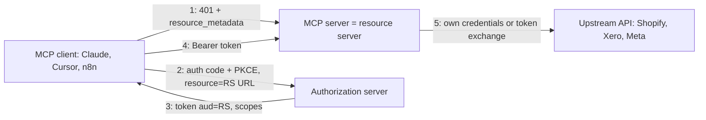

# Model Context Protocol - Remote Servers, OAuth & Security

> [!info] Deep dive of [[Model Context Protocol]]

> [!abstract] TL;DR
> A remote MCP server is an **OAuth resource server whose caller is a prompt-injectable LLM**. Most incidents come from two sources:
> - **classic web bugs**: confused-deputy OAuth proxies, token passthrough, SSRF, command injection;
> - the **lethal trifecta**: one agent with private data + untrusted content + a way to send data out.
>
> Defend in layers: audience-bound tokens and per-client consent, least-privilege scopes, human approval for writes, egress limits, and pinned, vetted servers. Server implementation basics are in [[Model Context Protocol - Building MCP Servers]].

## Concept
**Threat model**: who attacks whom.

| Attacker | Vector | Example impact |
|---|---|---|
| Malicious or compromised **server** | Tool poisoning (hidden instructions in descriptions), rug pull (definitions change after approval), tool shadowing across servers | Agent exfiltrates other servers' data; postmark-mcp npm package (2025) silently BCC'd every email |
| **Content** the agent reads | Indirect prompt injection in tickets, emails, web pages, DB rows | Agent calls a write tool with attacker-chosen arguments |
| Network attacker / **other users** | Confused-deputy OAuth proxy, stolen session IDs, DNS rebinding on local servers | Account takeover, RCE on a dev machine |
| Malicious **auth metadata** | Client trusts `authorization_endpoint` / CIMD URLs | CVE-2025-6514 (`mcp-remote`): OS command injection via a crafted endpoint |

- **Lethal trifecta** (Simon Willison): private data access + exposure to untrusted content + an exfiltration channel (HTTP, email, image URLs, PR comments). Any agent holding all three can be steered into leaking data. Remove at least one leg per session.
- **The 2025 Supabase MCP case**: a coding agent connected with a `service_role` key read a support ticket containing instructions, then queried private tables and wrote the results back into the ticket. Nothing was "hacked"; the agent had all three legs.

## How It Works
**Authorization roles** for a remote server:

- **Option A: real AS** (Supabase Auth, Keycloak, Auth0, WorkOS). The MCP server only validates tokens. This is the cleanest option.
- **Option B: OAuth proxy**. The MCP server acts as its own AS towards MCP clients and delegates login to a third-party IdP (GitHub, Google) that doesn't support DCR/CIMD. This is common and **easy to get wrong**:
  - the upstream IdP sees one static client ID for all MCP clients;
  - the upstream IdP may skip consent for that client ID on later logins;
  - so the proxy **must run its own per-client consent** and bind the callback to the browser session that started the flow. Otherwise you get a confused deputy.

## Practical Usage
**OAuth proxy: per-client consent + state bound to the browser session** (the CVE-2026-27124 class):
```ts
// GET /authorize — from an MCP client (dynamic or CIMD client_id)
app.get('/authorize', async (req, res) => {
  const client = await clients.resolve(req.query.client_id as string);          // CIMD fetch: allowlist + SSRF guard
  assertRedirectUri(client, req.query.redirect_uri as string);                  // exact match, no wildcards
  const consented = await consents.has(req.session.userId, client.id);
  if (!consented) return res.render('consent', { client, scopes: req.query.scope });   // OUR consent, per MCP client

  const state = randomToken();
  req.session.pending = { state, clientId: client.id, mcpParams: req.query };   // bound to THIS browser's session
  res.redirect(github.authorizeUrl({ state }));
});

// GET /callback — from GitHub
app.get('/callback', async (req, res) => {
  const p = req.session.pending;
  if (!p || p.state !== req.query.state) return res.status(400).send('flow not started in this browser');
  delete req.session.pending;                                                    // one-shot
  const gh = await github.exchange(req.query.code as string);                    // upstream token stays server-side
  const code = await issueMcpCode({ user: gh.userId, clientId: p.clientId, scopes: p.mcpParams.scope,
                                    codeChallenge: p.mcpParams.code_challenge, resource: RESOURCE });
  res.redirect(`${p.mcpParams.redirect_uri}?code=${code}&state=${p.mcpParams.state}`);
});
```
**Token validation on every request** (audience + scope + tenant from token):
```ts
const { payload } = await jwtVerify(token, JWKS, { issuer: ISSUER, audience: RESOURCE });   // aud MUST be this server
if (!scopes(payload).includes(requiredScope(tool))) throw forbidden('insufficient_scope');
const ctx = { tenantId: payload.tenant_id, userId: payload.sub };                           // never from tool args
```
**Local stdio and localhost servers**: block DNS rebinding.
```ts
const ALLOWED = new Set(['http://localhost:6274', 'http://127.0.0.1:6274']);
app.use((req, res, next) => (req.headers.origin && !ALLOWED.has(req.headers.origin)) ? res.sendStatus(403) : next());
app.listen(6274, '127.0.0.1');                                                    // never 0.0.0.0
```
**Wrong way**:
```ts
// ❌ token passthrough: forwards the MCP client's token to an upstream API (audience confusion, no scope control)
await fetch('https://api.xero.com/…', { headers: { Authorization: req.headers.authorization! } });
// ❌ tenant from arguments: the LLM (or the injected text) picks the tenant
server.registerTool('list_invoices', { inputSchema: { tenant_id: z.string() } }, ({ tenant_id }) => repo.list(tenant_id));
```

## Patterns & Anti-patterns
| Pattern | When | Anti-pattern to avoid |
|---|---|---|
| Separate read and write servers or scopes (`orders:read` vs `orders:refund`) | Any business server | One `admin` scope for everything |
| Human approval for side-effecting tools (`destructiveHint`, client confirmation) | Refunds, sends, deletes | Auto-approve "because it's our own server" |
| Per-tenant DB role or RLS-scoped connection behind tools | Multi-tenant SaaS | Server connects with `service_role` and filters in code |
| Pin server versions plus a hash of tool definitions; alert on change | Third-party servers | `npx some-mcp@latest` in every client config |
| MCP gateway: allowlist tools, log calls, apply policy | Teams, many servers | Each developer wiring servers ad hoc |
| Egress allowlist for server containers | Servers handling private data | Unrestricted outbound HTTP (exfiltration channel) |
| Break the trifecta per session (no untrusted input in sessions with private-data + send tools) | Agents reading tickets, emails, web | One "do-everything" agent with all servers enabled |

## Performance & Trade-offs
- **Approval friction vs safety**: every confirmation slows the user. Gate only side effects and cross-tenant reads. Read-only, tenant-scoped tools can be auto-approved.
- **Gateways** add a hop (~5–20 ms) and another component to run, but give central audit logs, tool allowlists and secret isolation. They pay off from about 3+ servers or 2+ users.
- **Token lifetime**: short access tokens (5–15 min) with refresh limit the damage from leaks, but every refresh round-trips to the AS. Cache JWKS (`createRemoteJWKSet` caches and rotates).
- **Description scanning** (detecting hidden Unicode tag characters, "ignore previous instructions" patterns) catches lazy poisoning only. Treat it as a tripwire, not a control.

## Tips & Reminders
> [!tip] In ZP's stack
> - For client-facing MCP servers on [[Coolify]], use Supabase Auth or Keycloak as a real AS (Option A). Avoid hand-rolled OAuth proxies unless you need GitHub/Google login specifically.
> - Each tool runs as the user via an RLS-scoped Postgres connection (see [[Supabase - Row Level Security]]), never `service_role`.
> - Put Cloudflare WAF rate limits on `/mcp` and the OAuth endpoints.

- For internal agents (Claude Code, Cursor) against client databases, use **read-only roles** and a staging copy where possible. Never paste production `service_role` keys into MCP configs.
- Log `client_id`, `user`, `tool`, a hash of the args and the result size for every call. This is the only way to reconstruct an injection incident.
- Review third-party servers like dependencies: maintainer, source, what network calls it makes, and which credentials it needs. Prefer official vendor servers.
- Return data, not instructions. Tool output that contains imperative text gets read as instructions by the model. Strip or quote untrusted fields.

## Version Notes
| Version | Security-relevant change |
|---|---|
| 2025-03-26 | OAuth 2.1 authorization for HTTP transports introduced |
| 2025-06-18 | Servers are OAuth resource servers (RFC 9728). Resource indicators (RFC 8707) required. Explicit **token passthrough ban** and security best-practices page |
| 2025-11-25 | Client ID Metadata Documents (CIMD) preferred over DCR. URL-mode elicitation for out-of-band auth |
| 2026-07-28 | Stateless core (no session handshake), which removes session-hijack classes tied to `Mcp-Session-Id` |
| 2026 CVEs | CVE-2026-27124: FastMCP OAuth proxy confused deputy, fixed in 3.2.0. CVE-2026-13341: Kong Konnect MCP indirect injection |

> [!warning] Unverified — check before relying on this
> The CVE-2026-13341 details came only from an arXiv paper, and severity scores for CVE-2026-27124 differ between databases. Check NVD and the vendor advisories.

## Critical Issues & Gotchas
> [!danger] Confused-deputy OAuth proxies
> If the proxy uses a single upstream client ID and doesn't enforce its own consent plus browser-bound state, an attacker can complete their own consent, capture the authorization URL, and get a victim's browser (already logged in, consent skipped upstream) to finish the flow for the attacker's client. The fix is per-MCP-client consent, exact redirect URIs, state tied to the session, and PKCE.

> [!danger] Clients executing attacker-controlled auth metadata
> `mcp-remote` (CVE-2025-6514, CVSS 9.6) passed a server-supplied `authorization_endpoint` to a shell `open` call, which gave RCE when connecting to a malicious server. Keep MCP clients and bridges updated, and connect only to servers you trust.

> [!danger] Local servers are full-privilege code
> stdio servers run as your user, with access to SSH keys, `.env` files and browser cookies. MCP Inspector before 0.14.1 (CVE-2025-49596) allowed RCE via a browser-to-localhost CSRF. Run untrusted local servers in containers with no home-directory mounts.

- **Rug pulls**: a server can change tool descriptions after you approved it. Clients that don't re-prompt on change are vulnerable. Pin versions and diff `tools/list`.
- **SSRF via discovery**: clients and AS fetch URLs from metadata (CIMD `client_id` URLs, `jwks_uri`). Block private IP ranges and enforce HTTPS on those fetches.
- **Exposed servers**: scans in 2025–26 found many thousands of MCP servers on the public internet without auth. Never deploy a "temporary" unauthenticated `/mcp` endpoint.
- **OWASP mapping**: most findings are A01 Broken Access Control and A10 SSRF ([[OWASP Top 10]]). Run the usual web pentest checklist on MCP servers.

## Related
- [[Model Context Protocol]]
- [[Model Context Protocol - Building MCP Servers]] — resource-server implementation, tool design
- [[OAuth 2.0 & OIDC]] — PKCE, resource indicators, token exchange
- [[OAuth 2.0 & OIDC - Attacks & Hardening]] — redirect, mix-up and CSRF attacks underlying MCP auth bugs
- [[AI Agents]] — agent loops, approval patterns
- [[Supabase - Row Level Security]] — per-user data access behind tools

## References
- https://modelcontextprotocol.io/specification/2025-06-18/basic/security_best_practices
- https://modelcontextprotocol.io/specification/2025-06-18/basic/authorization
- https://cvefeed.io/vuln/detail/CVE-2026-27124
- https://arxiv.org/pdf/2607.05744
- https://simonwillison.net/2025/Jun/16/the-lethal-trifecta/
- https://mcp.directory/blog/mcp-security-200000-exposed-servers-owasp-mcp-top-10-cves
