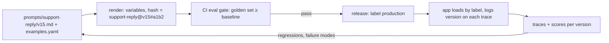

# Prompt Engineering - System Prompts, Few-shot & Prompt Versioning

> [!info] Deep dive of [[Prompt Engineering]]

> [!abstract] TL;DR
> Treat prompts as **code**: versioned files, reviewed diffs, an eval gate in CI, and the version logged on every trace.
> - **System prompt**: a stable, cacheable "job description": role, goal, audience, rules with reasons, output contract. Volatile data goes **after** it.
> - **Few-shot**: 3–5 *diverse* examples, including edge cases, wrapped in tags. They're the strongest lever for format and tone.
>
> Current models follow instructions closely, so prompts written for older models (ALL-CAPS "MUST", over-prescriptive step lists, prefill tricks) now often **hurt**. Re-audit prompts on every model migration.

## Concept
**System prompt anatomy** (in order; stable → cache-friendly):

| Section | Purpose | Example |
|---|---|---|
| Role + context | Who the assistant is, for whom | "You are the order assistant for Kedai Ali, a Kuching bakery, replying on WhatsApp." |
| Goal | What success looks like | "Resolve order questions in one or two messages; hand off to staff when unsure." |
| Rules **with reasons** | Constraints the model can generalize from | "Never promise delivery times; the rider schedule changes daily, so check `get_delivery_slots`." |
| Tools guidance | When to use which tool | "Use `get_order` before answering anything about a specific order." |
| Style | Tone, length, language | "Reply in the customer's language (BM, English or Chinese). Max 3 short sentences." |
| Output contract | Format consumers rely on | Structured output schema, or tags for parseable sections |
| Examples | Few-shot | `<examples>` with 3–5 varied cases |

**Few-shot design**:
- **Diverse**: different intents, languages, lengths and edge cases ("customer angry", "order not found", "asks for a discount").
- **Balanced labels** for classification, so the model doesn't learn a prior from example frequency.
- **Representative of the hard cases**, not just the happy path. Include a "hand off to human" example.
- **Wrapped and labelled** (`<example>`, `<input>`, `<ideal_response>`) so the model can't confuse them with live data.

## How It Works


## Practical Usage
**Prompt file** (`prompts/support-reply/v15.md`):
```markdown
You are the WhatsApp order assistant for {{store_name}}, a {{store_type}} in {{city}}.

Goal: resolve order questions in at most two short messages. When you are not confident, hand off to staff:
customers prefer a human over a wrong answer, and staff see handoffs within 15 minutes during opening hours.

Rules:
- Check the order with get_order before answering about a specific order. Order details change often.
- Never promise delivery times; offer the slots from get_delivery_slots instead, because the rider schedule changes daily.
- Reply in the customer's language (Bahasa Melayu, English or Chinese), matching their tone. Keep it under 3 sentences.

<examples>
{{examples}}
</examples>
```
**Loader** with versioning and hashing:
```ts
import { createHash } from 'node:crypto';
import { readFileSync } from 'node:fs';

export function loadPrompt(name: string, version: string, vars: Record<string, string>) {
  const tpl = readFileSync(`prompts/${name}/${version}.md`, 'utf8');
  const text = tpl.replace(/\{\{(\w+)\}\}/g, (_, k) => {
    if (!(k in vars)) throw new Error(`missing prompt var ${k}`);
    return vars[k];
  });
  const hash = createHash('sha256').update(text).digest('hex').slice(0, 8);
  return { text, id: `${name}@${version}#${hash}` };      // log id on every trace
}
```
**Request layout**: stable system first, untrusted data clearly delimited, per-turn reminders as mid-conversation system messages:
```ts
const sys = loadPrompt('support-reply', 'v15', { store_name: t.name, store_type: t.type, city: t.city, examples: renderExamples(t) });
const res = await client.messages.create({
  model: 'claude-sonnet-5-5', max_tokens: 1500,
  output_config: { effort: 'low' },
  system: [{ type: 'text', text: sys.text, cache_control: { type: 'ephemeral' } }],
  messages: [
    ...history,
    { role: 'user', content: `<customer_message>\n${escapeTags(msg.text)}\n</customer_message>` },
    { role: 'system', content: `Store status now: ${t.isOpen ? 'open' : 'closed'} (${nowMYT()}).` },   // volatile, after the cached prefix
  ],
});
```
**Eval gate in CI** (promptfoo-style config or a custom script):
```yaml
# evals/support-reply.yaml
prompts: [prompts/support-reply/v15.md]
providers: [{ id: anthropic:messages:claude-sonnet-5-5 }]
tests: file://evals/support-reply.golden.jsonl      # 100–300 real, labelled cases
defaultTest:
  assert:
    - type: llm-rubric
      value: "Uses get_order before order-specific claims; no promised delivery times; replies in the customer's language"
    - type: javascript
      value: "output.length < 400"
```
**Wrong way**:
```text
❌ "You MUST ALWAYS respond in JSON!!! NEVER EVER mention competitors!!!"   (shouting → overcorrection, brittle)
❌ System prompt with {{current_time}} at the top                          (breaks the prompt cache on every request)
❌ "Ignore previous instructions" defence by more instructions only          (put untrusted text in tags + least-privilege tools)
❌ Assistant prefill "{" to force JSON                                       (rejected on current Claude models; use structured outputs)
```

## Patterns & Anti-patterns
| Pattern | When | Anti-pattern to avoid |
|---|---|---|
| Rules with the reason attached | Any constraint | Bare imperative lists the model can't generalize from |
| One prompt per route, versioned files + changelog | Production | Prompts as inline string literals scattered in code |
| Version id (name@version#hash) on every trace | Always | "Which prompt was live on Tuesday?" |
| Examples from real (redacted) traffic, refreshed quarterly | Customer-facing bots | Invented examples that don't match how users write |
| Eval gate: new version ≥ baseline on golden set | Every prompt PR | Shipping on "looks better in 3 manual tries" |
| Prompt audit on model migration | Model upgrades | Carrying old-model workarounds forward |

## Performance & Trade-offs
- **Prompt length vs cost**: long system prompts are fine when cached (≈10× cheaper reads). The real cost is **uncached** volatile content placed early ([[LLM APIs & SDKs - Prompt Caching & Cost Optimization]]).
- **Examples vs instructions**: examples fix format and tone fast, but over-anchor content (the model copies phrasing). Vary surface details and keep 3–5. More rarely helps.
- **Registry vs git**: a prompt registry (Langfuse prompts with `production`/`staging` labels) enables hot-swaps without deploys and links prompts to traces automatically. Git files give code review and atomic changes with code. A common hybrid: author in git, sync to the registry in CI ([[AI Evals & Observability - Tracing & Production Monitoring with Langfuse]]).
- **Effort vs "think step by step"**: on current Claude models, raise `effort` instead of adding reasoning instructions. Lower effort for chat routes cuts latency and tokens.

## Tips & Reminders
> [!tip] In ZP's stack
> - **One base prompt per product route, with tenant variables** (store name, hours, policies). Never fork prompts per client.
> - **Tenant FAQ and policies** are injected as delimited context below the cached system prompt.
> - **BM/Manglish examples**: include them in few-shot and golden sets for every Malaysian deployment.
> - **n8n AI nodes**: keep the prompt text in git and paste the rendered version with its version id into the node, so changes are traceable.

- Write prompts for a smart new colleague: context, goal, constraints and why. Skip motivational filler.
- Remove contradictions between system prompt, tool descriptions and examples. The model resolves them unpredictably.
- Keep an "anti-examples" section only if you've seen the failure. Speculative "don't do X" lists plant ideas.
- Diff prompts semantically in PRs ("removed rule 4 because the tool now enforces it"), not just textually.

## Version Notes
| Date / model generation | Prompting change |
|---|---|
| 2022–24 | Chain-of-thought instructions, heavy formatting rules, prefill for JSON |
| 2025 | Extended/adaptive thinking reduces the need for explicit CoT prompts. Structured outputs replace JSON prefill |
| 2026 (Opus 5.5 / Sonnet 5.5 / Fable 5.1) | Prefill rejected. Sampling params removed. `effort` is the depth control. Mid-conversation `system` messages for operator reminders without cache resets. Prompts written for older models are often too prescriptive and should be audited |

## Critical Issues & Gotchas
> [!danger] Prompt injection through templated data
> Interpolating customer messages, documents or tool results into the **instruction** part of a prompt lets attackers rewrite your rules. Put untrusted content in clearly delimited user-turn tags, escape tag-like sequences, and enforce critical rules in code and tool permissions, not in prose ([[OWASP Top 10 - LLM & Agent Security]]).

> [!danger] Untracked prompt edits in production
> Editing a prompt in a dashboard or n8n node without versioning makes regressions impossible to attribute or roll back. Every live prompt needs an id that appears in traces, and a way to revert in one step.

- **Model migrations change prompt behaviour**: the same text can become over-literal on a newer model. Re-run evals and remove obsolete workarounds when changing model or effort ([[LLM Fundamentals - Model Selection & Routing]]).
- **Examples leaking into answers**: the model reuses example names, prices or order IDs. Use obviously fake placeholders, and vary them.
- **Missing variables**: a template rendered with an empty `{{store_hours}}` produces confident nonsense. Fail on missing vars, as in the loader above.
- **Length creep**: prompts grow with every incident. Re-audit quarterly, and delete rules the tools, validators or schema now enforce.

## Related
- [[Prompt Engineering]]
- [[AI Evals & Observability - Eval Datasets & LLM-as-Judge]] — golden sets for the eval gate
- [[AI Evals & Observability - Tracing & Production Monitoring with Langfuse]] — prompt registry and per-version metrics
- [[LLM Fundamentals - Model Selection & Routing]] — effort and model choice per route
- [[LLM APIs & SDKs - Prompt Caching & Cost Optimization]] — prompt layout for caching
- [[AI Agents - Memory & Context Engineering]] — what goes into context beyond the system prompt

## References
- https://docs.claude.com/en/docs/build-with-claude/prompt-engineering/overview
- https://docs.claude.com/en/docs/build-with-claude/prompt-caching
- https://langfuse.com/docs/prompt-management/overview
- https://www.promptfoo.dev/docs/intro/
