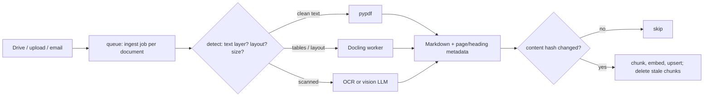

# RAG - Document Ingestion & PDF Parsing Pipelines

> [!info] Deep dive of [[RAG]]

> [!abstract] TL;DR
> Bad parsing caps RAG quality before retrieval even starts: tables flattened into word soup, two-column pages interleaved, scanned pages empty.
> - **Route by document type**: fast text extraction for clean born-digital PDFs, layout-aware parsers (Docling, Marker, MinerU) for tables and complex layouts, OCR or a vision LLM for scans.
> - Emit **structured Markdown with page and heading metadata**.
> - Make ingestion **idempotent** (content hashes, parser version) with deletes and ACLs propagated, so re-syncs and PDPA deletion requests are routine.

## Concept
**Pipeline stages**:

| Stage | Output | Key decisions |
|---|---|---|
| Acquire | Raw file + source metadata (URL/Drive ID, owner, modified time) | Sync mode: webhook, poll, upload |
| Detect | MIME (sniffed, not by extension), page count, text-layer presence, encryption | Route to a parser |
| Parse | Markdown / JSON with headings, tables, page numbers, bounding boxes | Parser choice per route |
| Clean | Header/footer removal, de-hyphenation, whitespace and Unicode normalization | Per-source rules |
| Enrich | Title, date, language, tenant, ACL, doc type, summary | Metadata used for filters and citations |
| Chunk + contextualize | Structure-aware chunks with heading path + doc context | See [[RAG - Chunking & Retrieval Strategies]] |
| Embed + index | Vectors + FTS, idempotent upsert | Model version stored per chunk |

**Parser routing**:

| Document | Route | Why |
|---|---|---|
| Born-digital text PDF, simple layout | `pypdf` / `pdfplumber` / PyMuPDF | Milliseconds per page, no models |
| Tables, multi-column, forms, reports | **Docling** (MIT, IBM, TableFormer) or **Marker** | Layout analysis, table structure, reading order |
| Scientific / formula-heavy | **MinerU** | Stronger LaTeX formula recognition (vendor-adjacent claim) |
| Scanned / photos / IC & receipts | OCR (Docling + Tesseract/EasyOCR) or a **vision LLM** | No text layer |
| DOCX/PPTX/XLSX | Docling or `markitdown` | Native structure |
| HTML | `trafilatura` / readability | Boilerplate removal |

- **Benchmarks are vendor-run**: Datalab (Marker's maker) reports Marker 2 at 76.0% overall on olmOCR-bench versus MinerU 72.7% and Docling 50.3% (default pipeline). Docling is often stronger on complex nested tables. Evaluate on **your** documents.

## How It Works


## Practical Usage
**Schema** (Postgres / Supabase):
```sql
create table public.documents (
  id uuid primary key default gen_random_uuid(),
  tenant_id uuid not null,
  source text not null, source_id text not null,          -- e.g. 'gdrive', file id
  title text, mime text, page_count int,
  content_hash text not null,                              -- sha256 of parsed markdown
  parser text not null, parser_version text not null,     -- re-ingest on parser upgrades
  acl text[] not null default '{}',                        -- groups/roles allowed to read
  status text not null default 'pending',                  -- pending | parsed | indexed | failed
  error text, updated_at timestamptz not null default now(),
  unique (tenant_id, source, source_id)
);
create table public.chunks (
  id bigserial primary key,
  document_id uuid not null references public.documents on delete cascade,   -- deletes propagate
  tenant_id uuid not null,
  ord int not null, heading_path text[], page_from int, page_to int,
  content text not null, content_hash text not null,
  embedding vector(1024), embedding_model text not null,
  tsv tsvector generated always as (to_tsvector('simple', content)) stored
);
```
**Parse worker** (Python, Docling, run as a container worker, not in an Edge Function):
```python
import hashlib
from docling.document_converter import DocumentConverter

converter = DocumentConverter()          # load models once per worker process

def parse(path: str) -> tuple[str, str]:
    result = converter.convert(path)
    md = result.document.export_to_markdown()          # headings, tables as Markdown tables
    return md, hashlib.sha256(md.encode()).hexdigest()

def ingest(job):
    doc = db.get_document(job.document_id)
    md, h = parse(download(doc))
    if h == doc.content_hash and doc.parser_version == PARSER_VERSION:
        return db.mark(doc.id, "indexed")                # unchanged → skip embedding cost
    chunks = chunk_markdown(md, max_tokens=500, keep_tables_whole=True)
    with db.transaction():
        db.delete_chunks(doc.id)                          # replace atomically: no stale chunks
        db.insert_chunks(doc, chunks, embed([contextualize(doc, c) for c in chunks]))
        db.update(doc.id, content_hash=h, parser="docling", parser_version=PARSER_VERSION, status="indexed")
```
**Vision-LLM fallback** for scans and messy forms (Claude PDF input, up to 32 MB / 600 pages per request):
```ts
const res = await client.messages.create({
  model: 'claude-haiku-5-5', max_tokens: 16000,
  messages: [{ role: 'user', content: [
    { type: 'document', source: { type: 'base64', media_type: 'application/pdf', data: b64 } },
    { type: 'text', text: 'Transcribe to Markdown. Keep tables as Markdown tables. Mark each page with "<!-- page N -->". Do not summarize.' },
  ] }],
});
```
**Wrong way**:
```python
text = PdfReader(path).pages[0].extract_text()   # ❌ one parser for everything: scans → "", tables → soup
chunks = [text[i:i+1000] for i in range(0, len(text), 1000)]   # ❌ fixed slices cut tables and sentences
db.insert_chunks(chunks)                          # ❌ re-sync duplicates every chunk; deleted files linger forever
```

## Patterns & Anti-patterns
| Pattern | When | Anti-pattern to avoid |
|---|---|---|
| Route by detected type, with a fallback chain | Mixed corpora | One parser for all documents |
| Store `parser` + `parser_version` + `content_hash` | Always | No way to know which docs need re-parsing after an upgrade |
| Delete-and-replace chunks per document in one transaction | Updates | Appending new chunks, so old and new versions both retrieved |
| ACL/tenant metadata on every chunk, filtered in SQL/RLS | Multi-user knowledge bases | Filtering after retrieval in app code (leaks into LLM context) |
| Keep tables whole; also emit a row-wise text version for large tables | Price lists, specs | Splitting a table mid-row |
| Page numbers + heading path on chunks | Citations, review | Answers nobody can verify |
| Golden set of 20–50 representative docs, re-parsed in CI on parser upgrades | Parser changes | Upgrading Docling/Marker blind |

## Performance & Trade-offs
- **Throughput** (vendor numbers, GPU): Marker ~2.9 pages/s versus MinerU ~0.5 pages/s. Docling on CPU handles roughly a few pages/s for born-digital and much slower with OCR. A 500-page manual on a CPU-only 4-vCPU VPS can take minutes, so queue it and never parse in the request path.
- **Memory**: layout models need ~2–4 GB RAM per worker. Run one or two parse workers in a dedicated container with `MemoryMax`/limits, separate from the app ([[Docker - Compose Patterns for Production]]).
- **Vision LLM cost**: excellent on scans and forms, but you pay per page (image tokens). Use it as the fallback route, not the default, and cache results by content hash.
- **Re-embedding** is the expensive part. Hashing parsed output avoids it when a source file's bytes change but its content doesn't (metadata edits, re-saves).

## Tips & Reminders
> [!tip] In ZP's stack
> - **Uploads**: Supabase Storage or R2 uploads → enqueue a `pgmq` job ([[Supabase - Edge Functions, Cron & Queues]]) → Python Docling worker on Coolify → chunks into pgvector with RLS by `tenant_id`.
> - **Drive sources**: [[n8n]] Google Drive triggers can feed the same queue.
> - **Language**: for Malaysian SME documents (BM/EN/Chinese mixes), enable the right OCR language packs (`msa`, `eng`, `chi_sim`), and use an embedding model that handles multilingual text.

- Sniff MIME with magic bytes (`python-magic`). Users upload `.pdf` files that are actually images, ZIPs or HTML.
- Use `pdfplumber`/PyMuPDF to check for a text layer (`len(page.get_text()) > 50`) to decide OCR versus text extraction per page, not per document.
- Strip repeated headers and footers by detecting lines that recur on >50% of pages.
- Keep the parsed Markdown (in storage) alongside chunks. Debugging "why didn't it find X?" starts there ([[RAG - Chunking & Retrieval Strategies]]).

## Version Notes
| Date / version | Change |
|---|---|
| 2024–25 | Docling released by IBM Research (MIT), with TableFormer table structure. Marker and MinerU mature as open-source layout parsers |
| 2025–26 | Vision LLMs viable as parsers for scans and forms. Marker 2 claims a lead on olmOCR-bench (vendor-run) |
| Claude API | PDF `document` blocks: 32 MB per request, 600 pages (100 for 200k-context models) |

> [!warning] Unverified — check before relying on this
> Licences differ and matter for commercial client work: Docling is MIT; Marker's code and model-weights terms and MinerU's licence have commercial-use conditions. Check each project's current LICENSE before deploying for clients. Benchmark figures come from a vendor.

## Critical Issues & Gotchas
> [!danger] Malicious and pathological files
> PDFs can carry exploits, decompression bombs or 10,000-page payloads. Run parsers in an isolated container (no secrets, no network beyond storage), cap file size and page count, set timeouts, and keep parser libraries patched.

> [!danger] Deletion and ACL drift (PDPA)
> If a source file is deleted or its sharing is revoked but its chunks stay indexed, the assistant keeps answering from it, possibly to the wrong people. Propagate deletes (`on delete cascade`), re-sync ACLs on change, and support a per-person erasure query across chunks.

- **Reading order**: multi-column layouts parsed naively interleave columns, and answers then cite nonsense. Check samples visually against the PDF.
- **Tables across pages** get split into two tables, and the second loses its header. Docling/Marker help, but verify. Repeat headers in chunk text.
- **Encrypted / password PDFs** fail silently in some libraries. Detect and mark them `failed` with a reason the user can see.
- **Parser upgrades change output**, which changes hashes and triggers a full re-embed. Budget for it, and roll out per tenant.

## Related
- [[RAG]]
- [[RAG - Chunking & Retrieval Strategies]] — what happens after parsing
- [[Vector Databases - pgvector Tuning & Hybrid Search]] — index and hybrid search
- [[LLM APIs & SDKs - Structured Outputs & Tool Schemas]] — field extraction from parsed documents
- [[Supabase - Edge Functions, Cron & Queues]] — ingestion job queue
- [[n8n]] — source triggers and orchestration

## References
- https://arxiv.org/pdf/2501.17887 (Docling technical report)
- https://github.com/docling-project/docling
- https://github.com/datalab-to/marker
- https://www.spheron.network/blog/self-host-document-intelligence-docling-marker-mineru-rag-guide/
- https://github.com/applied-artificial-intelligence/pdf-parser-benchmark
