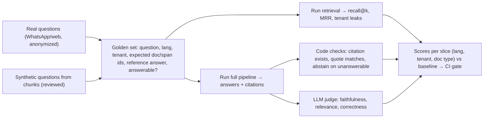

# RAG - Evaluation & Answer Grounding

> [!info] Deep dive of [[RAG]]

> [!abstract] TL;DR
> Evaluate the **two halves separately**:
> - **Retrieval**: did the right sources come back? Measure recall@k and MRR against a golden set of question → expected source IDs. It's cheap, deterministic and catches most problems.
> - **Generation**: is the answer supported by the retrieved text (**faithfulness**), does it answer the question (**relevance**), are the citations real (**citation accuracy**), and does it **abstain** when the answer isn't there?
>
> Build the golden set from real (anonymized) questions, including **unanswerable**, **multilingual** and **cross-tenant** cases. Gate every change to chunking, embeddings, k, reranking or prompts on it.

## Concept
| Layer | Metric | Question it answers | How measured |
|---|---|---|---|
| Retrieval | **Recall@k** | Is at least one expected source in the top k? | Code, golden IDs |
| Retrieval | **MRR** | How high is the first relevant hit? | Code |
| Retrieval | Precision@k / nDCG | How much noise / graded relevance | Code (graded labels) |
| Retrieval | Tenant isolation | Any result from another tenant? | Code (must be 0) |
| Generation | **Faithfulness / groundedness** | Is every claim supported by the context? | LLM judge with claim decomposition |
| Generation | Answer relevance | Does it address the question? | LLM judge |
| Generation | **Citation accuracy** | Do cited chunks exist and contain the quoted text? | Code |
| Generation | Correctness vs reference | Matches the expected answer's facts | LLM judge or exact fields |
| Generation | **Abstention** | Says "I don't know" when sources lack the answer | Labelled unanswerable cases |
| Online | No-answer rate, thumbs, handoff rate, latency, cost | Real-world quality | Traces + feedback |

**Failure attribution**:

| Retrieval hit? | Answer correct? | Diagnosis | Fix |
|---|---|---|---|
| ❌ | ❌ | Retrieval failure | Chunking, hybrid search, query rewriting, metadata filters |
| ✅ | ❌ | Generation failure | Prompt, model, context ordering, too many chunks |
| ❌ | ✅ | Lucky or model prior knowledge | Dangerous: ungrounded, so tighten grounding |
| ✅ | ✅ | Working | Keep as a regression case |

## How It Works


## Practical Usage
**Golden set record** (JSONL; key by document + span, not volatile chunk IDs):
```json
{"id":"q-042","tenant":"kedai-ahseng","lang":"ms","question":"Boleh pulangkan barang lepas 14 hari?","expected":[{"doc":"return-policy-v3","span":"§2"}],"answerable":true,"reference":"Pemulangan dalam 7 hari sahaja, kecuali barang rosak (30 hari)."}
{"id":"q-043","tenant":"kedai-ahseng","lang":"en","question":"Do you ship to Brunei?","expected":[],"answerable":false}
{"id":"q-044","tenant":"kedai-ahseng","lang":"en","question":"What is Klinik Sejahtera's opening time?","expected":[],"answerable":false,"note":"other tenant's data — must not leak"}
```
**Retrieval metrics** (TypeScript):
```ts
type Hit = { doc: string; span?: string; tenant: string };
export function scoreRetrieval(cases: Case[], results: Map<string, Hit[]>, k = 5) {
  let recall = 0, mrr = 0, leaks = 0, n = 0;
  for (const c of cases) {
    const hits = (results.get(c.id) ?? []).slice(0, k);
    leaks += hits.filter((h) => h.tenant !== c.tenant).length;
    if (!c.answerable) continue;
    n++;
    const rank = hits.findIndex((h) => c.expected.some((e) => e.doc === h.doc && (!e.span || e.span === h.span)));
    if (rank >= 0) { recall++; mrr += 1 / (rank + 1); }
  }
  return { recallAtK: recall / n, mrr: mrr / n, tenantLeaks: leaks };   // tenantLeaks must be 0
}
```
**Grounded generation contract** (structured output the checks can verify):
```json
{
  "answer": "string",
  "answerable": true,
  "citations": [{ "chunk_id": "string", "quote": "exact text copied from the chunk" }]
}
```
**Faithfulness judge prompt** (claim-level, binary per claim; judge ≠ generator prompt):
```text
You are checking whether an answer is supported by the provided sources.
1. Split the answer into atomic factual claims.
2. For each claim, decide SUPPORTED (a source states it), CONTRADICTED, or NOT_FOUND.
Return JSON: {"claims":[{"text":…,"verdict":…,"source_id":…}]}.
Judge only against the sources, not your own knowledge.
<sources>…</sources>
<answer>…</answer>
```
Faithfulness = supported claims / total claims. Track the share of answers with any CONTRADICTED claim separately, since one wrong price is worse than a vague sentence.

**Wrong way**:
```text
❌ Only end-to-end "does the answer look good" judging → can't tell retrieval from generation failures
❌ Golden set keyed by chunk_id → every re-chunking invalidates the whole eval
❌ 100% synthetic questions generated from the chunks → inflated recall (questions copy chunk wording)
❌ No unanswerable cases → you never measure hallucinated answers to out-of-scope questions
```

## Patterns & Anti-patterns
| Pattern | When | Anti-pattern to avoid |
|---|---|---|
| Retrieval eval first (cheap, fast, deterministic) | Any RAG change | Tuning prompts while retrieval misses |
| Slices: language, tenant, doc type, question type | Malaysian multilingual bots | One average hiding BM failures |
| 15–25% unanswerable + cross-tenant probes | Every golden set | Only "happy path" questions |
| Code checks before LLM judges (citations, quotes, JSON) | Generation evals | Paying a judge to check string containment |
| Judge validated against ~50 human labels | Before trusting judge scores | Unvalidated judge as ground truth |
| Baseline comparison + CI gate (no regression > 2 pts) | Releases | Absolute scores without history |
| Production traces sampled into the golden set | Ongoing | A golden set frozen at launch |

## Performance & Trade-offs
- **Cost**: retrieval evals over 200 questions cost only embedding calls (cents). Full generation + judge runs cost model calls, so use the Batch API and smaller judge models for routine runs, and stronger judges for release gates ([[LLM APIs & SDKs - Batch Processing & Async Workloads]]).
- **k vs precision**: higher k raises recall but adds noise and tokens, and can lower faithfulness. Evaluate recall@k and answer quality together when changing k or adding reranking.
- **Judge variance**: LLM judges disagree with themselves on borderline cases. Use binary/claim-level verdicts, fixed judge prompts and model versions, and multiple samples for release gates.
- **Freshness**: when documents change, reference answers go stale. Version golden cases with the document version they assume.

## Tips & Reminders
> [!tip] In ZP's stack
> - **Per-client FAQ bots**: start with 50 real questions per client (from WhatsApp history, anonymized) + 10 unanswerable + 5 cross-tenant probes. Run them on every knowledge-base update before publishing.
> - **Store** the golden set and run results in Postgres/Langfuse datasets, and trace `retrieved_ids` + scores per production answer ([[AI Evals & Observability - Tracing & Production Monitoring with Langfuse]]).
> - **Show clients a monthly quality line**: recall@5, faithful-answer rate, handoff rate. That's concrete value reporting for retainers.

- Test Malay, English, Chinese and code-mixed (Manglish) questions separately ([[Vector Databases - Embedding Models & Multilingual Retrieval]]).
- Require citations in every answer and render them in the UI. Users and reviewers can then spot-check grounding.
- When recall is fine but faithfulness drops, reduce the number of chunks, move the question after the documents, and add an explicit abstain instruction ([[Prompt Engineering - Long-Context & Structured Reasoning Prompts]]).
- Re-run the retrieval eval after any embedding model or chunking change. It's the most common silent regression.

## Version Notes
N/A — methodology is stable. Tooling (Ragas, DeepEval, Promptfoo, Langfuse datasets/experiments) evolves quickly, so pin versions in the eval repo and check metric definitions when upgrading, because names like "faithfulness" are computed differently between tools.

## Critical Issues & Gotchas
> [!danger] Confident answers from the model's prior knowledge
> If retrieval misses, the model often answers anyway from general knowledge: plausible but not the client's policy (prices, return windows, clinic hours). Without unanswerable test cases and a faithfulness check, this looks like success. Require citations, abstain when there are none, and count uncited factual answers as failures.

> [!danger] Cross-tenant leakage in retrieval
> A missing `tenant_id` filter (or a bug in a metadata filter) lets one business's bot quote another's documents, which is a PDPA and contractual breach. Make tenant-leak probes part of every eval run with a hard gate of zero, and enforce the filter in the database (RLS on chunks), not only in application code ([[Vector Databases - pgvector Tuning & Hybrid Search]]).

- **Eval set PII**: real questions contain names, phones and order numbers. Anonymize them before storing them in eval tools or sharing them with vendors.
- **Overfitting to the golden set**: tuning until 100% on 50 questions often degrades unseen queries. Keep a held-out set.
- **Judge self-preference**: the same model judging its own outputs inflates scores. Use a different model or validate against human labels.
- **Changing chunk boundaries** shifts which "span" contains the answer. Expected sources at document + section level are more robust.

## Related
- [[RAG]]
- [[RAG - Chunking & Retrieval Strategies]] — what the retrieval metrics tune
- [[AI Evals & Observability - Eval Datasets & LLM-as-Judge]] — judge design and dataset hygiene
- [[AI Evals & Observability - Tracing & Production Monitoring with Langfuse]] — online signals and datasets
- [[Vector Databases - pgvector Tuning & Hybrid Search]] — hybrid search, filters, tenant isolation
- [[Prompt Engineering - Long-Context & Structured Reasoning Prompts]] — quote-grounded answering

## References
- https://docs.ragas.io/
- https://www.anthropic.com/news/contextual-retrieval
- https://docs.claude.com/en/docs/build-with-claude/citations
- https://langfuse.com/docs/evaluation/overview
- https://arxiv.org/abs/2309.15217
